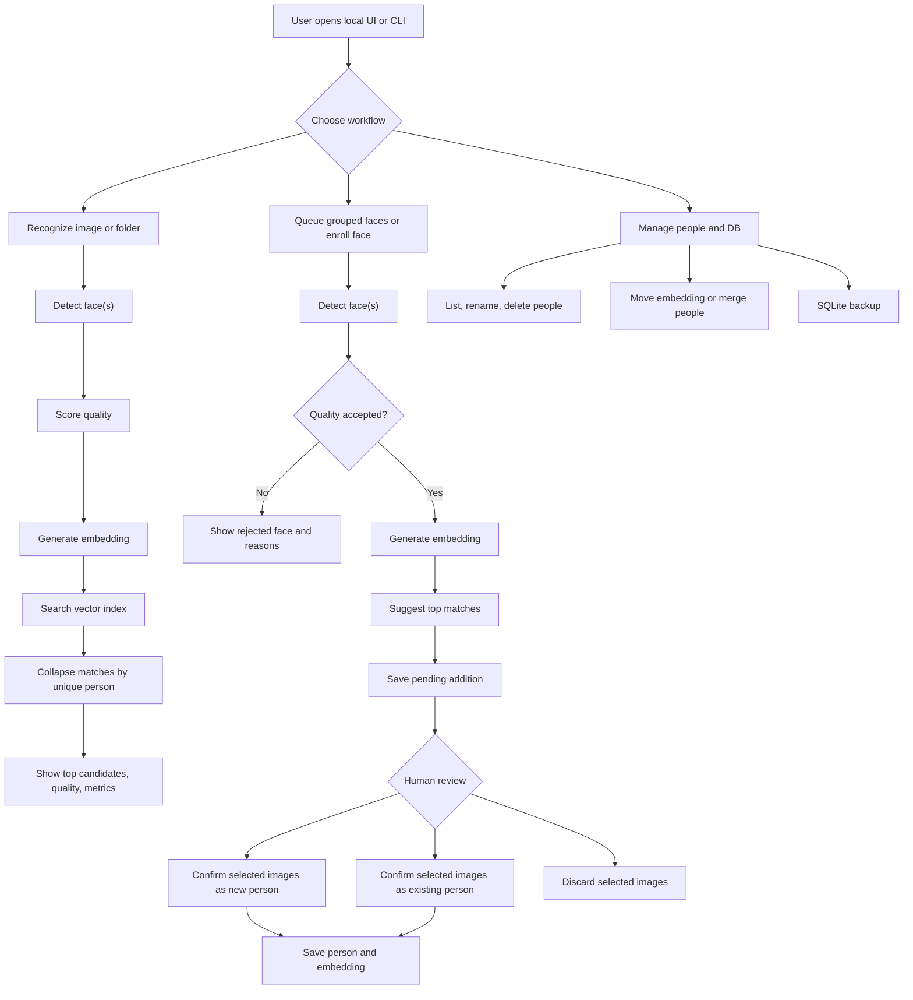
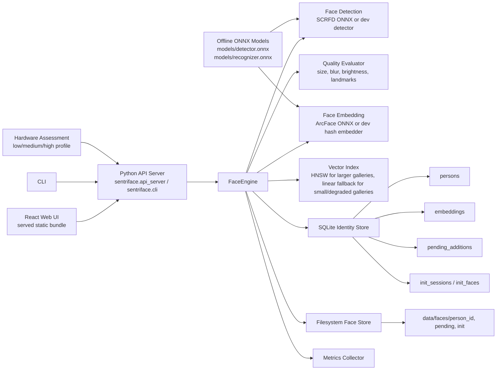

# SentriFace Edge

SentriFace Edge is a CPU-first, fully offline face identification engine. It is designed for low-end Windows, macOS, and Linux machines, including i3-class CPUs without a GPU.

The project goal is simple: keep the face system modular and controllable without turning it into a pile of local web services.

Release and trust documentation: [Privacy](PRIVACY.md), [Security](SECURITY.md),
[Third-party notices](THIRD_PARTY_NOTICES.md), and [Changelog](CHANGELOG.md).

## Core Shape

```text
UI
-> App Controller
-> Face Engine
   -> Detector
   -> Aligner
   -> Embedder
   -> Matcher / Index
   -> SQLite Identity Store
   -> Filesystem Image Store
```

The normal runtime uses offline ONNX models. Deterministic placeholder components remain available only through explicit `--runtime dev` for tests and development; their results are synthetic.

## System Diagrams

End-to-end flow:



System design:



## CPU-First Defaults

Target runtime stack:

```text
Inference: ONNX Runtime CPU
Detector:  detector.onnx
Embedder:  recognizer.onnx
Search:    HNSW (qhnswlib wheels) for larger galleries, linear cosine fallback
DB:        SQLite
Images:    filesystem paths, not DB blobs
```

For an i3 system:

- Load models once and reuse them.
- Keep processing in a single background worker by default.
- Resize images before detection.
- Cache embeddings and never re-encode unchanged images.
- Store multiple good embeddings per person.
- Use strict thresholds before adding embeddings to an identity.

SentriFace assesses the machine at startup and maps it to a runtime tier:

```text
low    -> 1 worker, batch size 1, smaller image edge, small-model preference
medium -> 2 workers, batch size 2, hnswlib-ready vector index
high   -> 3 workers, batch size 4, larger preprocessing batches
```

For i3-class systems, the goal is not to max out the CPU. The goal is to keep
the UI responsive while recognition happens in the background.

Install from a source checkout (same commands on Windows, macOS, and Linux):

```bash
python -m pip install -e .
sentriface-models \
  --detector-source path/to/operator-detector.onnx --detector-sha256 <sha256> \
  --recognizer-source path/to/operator-recognizer.onnx --recognizer-sha256 <sha256> \
  --usage-basis commercial-license \
  --authorized-by "Customer Administrator" \
  --organization "Customer Organization" \
  --licensor "Model Supplier" \
  --license-reference "Agreement or invoice reference" \
  --accept-model-responsibility
sentriface-ui
```

HNSW acceleration is optional: `pip install -e ".[index]"` when a native
wheel is available. SentriFace otherwise uses the synchronized linear index with
the same recognition behavior; the Profile view reports the active backend.

For an explicit project-local development database, run
`python -m sentriface.api_server --data-dir data`. A normal installed launch
uses a stable per-user application directory instead of whichever directory the
terminal happens to be in. Override it with `--data-dir` or
`SENTRIFACE_DATA_DIR`; override model storage with `SENTRIFACE_MODEL_DIR`.

Then open `http://127.0.0.1:8765`. The server rejects non-loopback binds and
foreign Host headers. ONNX is the default; use `--runtime dev` only for explicit
testing. `sentriface-models` never downloads weights. It copies only local,
operator-supplied files after SHA-256 verification and writes a hash-bound usage
declaration. ONNX startup fails closed if that declaration is missing or stale;
research-only declarations produce a persistent UI warning. The UI
prints debug events to the terminal and keeps the latest events visible in the
Debug tab.

Starting the app automatically creates its SQLite DB, face crop folder, index,
backups, and logs if they are missing. You do not need to run `init-db` before
launching the UI.

On first launch, create the machine's first account in the browser. That account
becomes the administrator. Later, administrators manage local accounts in
**Advanced > Accounts**. Passwords are hashed with Argon2id and never stored or
logged in plaintext. Sessions are held in an HttpOnly, SameSite cookie, expire
after 30 minutes of inactivity or eight hours total, and are revoked after
password or role changes. Five failed logins lock an account for 15 minutes.

Roles are enforced by the backend, including CLI commands:

| Role | Access |
| --- | --- |
| Viewer | View people and run recognition. |
| Operator | Viewer access plus enrollment and queue/review changes. |
| Custodian | Operator access plus archive/delete/restore operations and backup deletion. |
| Technician | Viewer access plus logs, machine diagnostics, and backup creation/export. |
| Administrator | All capabilities, including accounts, recovery configuration, and database restore/import. |

Roles can be combined. Database restore is deliberately administrator-only
because a restored database also replaces account and role records. CLI commands
require `--username USERNAME` after first-run setup and prompt for the password
without accepting it in command arguments. If every administrator password is
lost, the signed-in operating-system custodian can run
`sentriface-admin-reset --username USERNAME`; it prompts twice for a new password,
clears lockout/disable state, revokes sessions, and writes an authentication audit
record.

The selected low/medium/high performance profile is recalculated for each machine
at startup. Technicians and administrators can inspect the hardware inputs,
selected limits, active index, and offline/storage status in **Advanced > Machine
Profile**.

Browser flow:

```text
choose image -> enroll person -> recognize same image -> inspect match and metrics
```

The main UI actions accept image and folder picker input. Queue also accepts
dragged images or folders. Files are checked in the browser and decoded again
by the backend before they are stored. Unsupported, empty, mismatched, corrupt,
oversized, or unsafe images are skipped; a mixed selection continues with its
valid images and produces one aggregate warning and a structured Debug event.
Queue uploads accepted files into a local batch directory, creates embeddings,
groups similar photos, and lets the reviewer accept or discard selected images
from each group.
Uploaded files under 1 MB are saved unchanged. Uploaded files over 1 MB are
only size-reduced before they are passed to the engine; face quality decisions
still happen inside the engine.
Frontend source lives in `frontend/` and is handled by React + Vite. Backend/API
code lives in `src/sentriface` and is handled by Python. The frontend has its
own `frontend/package.json` and `frontend/vite.config.js`. Vite builds into
`src/sentriface/ui_static`, which is the compiled static bundle served by the
Python UI server. After editing the frontend, rebuild the static bundle:

```bash
cd frontend
npm ci
npm run build
```

Check the selected profile:

```bash
python -m sentriface.cli --username USERNAME profile
```

Use JSON output for future UI integration:

```bash
python -m sentriface.cli --username USERNAME --json profile
```

Use metrics output before optimizing:

```bash
python -m sentriface.cli --username USERNAME --metrics --runtime onnx recognize path/to/image.jpg
```

Metrics include stage timings such as image load, detection, quality scoring,
embedding, search, DB work, and useful counters such as detected faces and
accepted/rejected faces.

Run a repeatable recognition benchmark over one image or a folder:

```bash
python -m sentriface.cli --username USERNAME --metrics --runtime onnx benchmark path/to/images --repeat 3
```

Compare ONNX Runtime thread counts on the target machine:

```bash
python -m sentriface.cli --username USERNAME --runtime onnx benchmark path/to/images --repeat 3 --compare-threads 1,2,4
```

Override ONNX threads for a normal command:

```bash
python -m sentriface.cli --username USERNAME --runtime onnx --onnx-threads 2 recognize path/to/image.jpg
```

Tune strictness and CPU load without editing code:

```bash
python -m sentriface.cli --username USERNAME --runtime onnx --max-image-edge 720 --min-quality-score 0.60 recognize path/to/image.jpg
```

The backend treats cosine similarity as a score, never as an identity probability. ONNX startup requires a hash-bound `calibration.json` beside the recognizer, with thresholds derived from a representative validation dataset and declared target false-match rate. Labels use those model-specific thresholds. `min-quality-score` controls whether a face may be added, and `max-image-edge` controls how aggressively images are downscaled before detection.

Run with development placeholders:

```bash
python -m sentriface.cli --username USERNAME --runtime dev recognize path/to/image.jpg
```

Run recognition over a folder:

```bash
python -m sentriface.cli --username USERNAME --runtime onnx recognize-batch path/to/images
```

Run with real CPU ONNX components after placing models on disk:

```bash
python -m pip install -r requirements-runtime.txt
# Install local models using one of the declarations documented in models/MODELS.md

python -m sentriface.cli --username USERNAME \
  --runtime onnx \
  --detector-model models/detector.onnx \
  --recognizer-model models/recognizer.onnx \
  recognize path/to/image.jpg
```

The ONNX path is CPU-only by default and uses the selected hardware profile to
limit ONNX Runtime threads.

Enroll a person from the first detected face:

```bash
python -m sentriface.cli --username USERNAME \
  --runtime onnx \
  enroll "Person Name" path/to/image.jpg
```

Queue a face for review instead of immediately updating the DB:

```bash
python -m sentriface.cli --username USERNAME --runtime onnx queue-add path/to/image.jpg
python -m sentriface.cli --username USERNAME --runtime onnx pending
python -m sentriface.cli --username USERNAME --runtime onnx confirm-existing PENDING_ID PERSON_ID
python -m sentriface.cli --username USERNAME --runtime onnx confirm-new PENDING_ID "Person Name"
python -m sentriface.cli --username USERNAME --runtime onnx reject-pending PENDING_ID
```

Face additions are quality-gated before they enter the pending queue. The engine
checks detector confidence, face size, blur, brightness, crop validity, and
landmark availability.

Possible quality states:

```text
good -> safe to queue/enroll
warn -> accepted, but reasons are shown
bad  -> rejected by default
```

Force a bad-quality face only when you intentionally want it:

```bash
python -m sentriface.cli --username USERNAME --runtime onnx queue-add path/to/image.jpg --force-bad-quality
```

## Workflows

### Queue

```text
images/folders -> detect -> encode -> cluster -> select images -> accept or discard -> update identities
```

Queue groups similar photos and keeps unselected images in their group after an
accept/discard action. The remaining group is re-scored against the updated DB.

### Add

```text
image -> detect -> encode -> top 3 candidates -> pending suggestion -> user confirms -> save embedding
```

### Recognize

```text
image -> detect -> encode -> search -> top 3 -> show identity or unknown
```

Recognition results are ranked by unique person, not by duplicate embeddings.
When multiple embeddings from the same person match, they are collapsed into one
candidate with `embeddings_matched`.

Person management:

```bash
python -m sentriface.cli --username USERNAME --runtime onnx persons
python -m sentriface.cli --username USERNAME --runtime onnx person PERSON_ID
python -m sentriface.cli --username USERNAME --runtime onnx rename-person PERSON_ID "New Name"
python -m sentriface.cli --username USERNAME --runtime onnx delete-person PERSON_ID
python -m sentriface.cli --username USERNAME --runtime onnx restore-person PERSON_ID
python -m sentriface.cli --username USERNAME --runtime onnx delete-embedding EMBEDDING_ID
python -m sentriface.cli --username USERNAME --runtime onnx deleted-faces
python -m sentriface.cli --username USERNAME --runtime onnx restore-embedding EMBEDDING_ID
python -m sentriface.cli --username USERNAME --runtime onnx purge-embedding EMBEDDING_ID
python -m sentriface.cli --username USERNAME --runtime onnx move-embedding EMBEDDING_ID TARGET_PERSON_ID
python -m sentriface.cli --username USERNAME --runtime onnx merge-persons SOURCE_PERSON_ID TARGET_PERSON_ID
```

`delete-person` archives a person; their active faces stay in the database but
are excluded from active listings and recognition until `restore-person`.
`delete-embedding` moves one face to Deleted Faces. The face is excluded from
recognition immediately, its linked sightings remain intact, and it may be
restored for 30 days. `purge-embedding` permanently removes a face that is
already in Deleted Faces. Expired faces are automatically purged after the
30-day recovery period.
Use `move-embedding` when one sample was attached to the wrong person. Use
`merge-persons` when two person records are actually the same identity; source
faces and linked sightings are moved to the target and the source person is
retained as a non-restorable merge record.

Every People deletion, archive, merge, and permanent purge initiated through
the UI or CLI first creates and verifies a named portable backup in
`data/backups/`. It contains a consistent SQLite snapshot plus deduplicated,
checksummed copies of every database-referenced original image and face crop.
Operation IDs make retries idempotent, so the same request cannot apply twice
or create duplicate pre-deletion backups.

## Storage

Default application data locations:

- Windows: `%LOCALAPPDATA%\SentriFace`
- macOS: `~/Library/Application Support/SentriFace`
- Linux: `$XDG_DATA_HOME/sentriface` or `~/.local/share/sentriface`

```text
SentriFace/
  sentriface.db
  faces/
    person_id/
      crop files
  index/
    face_index.bin
  backups/
  logs/
  models/
    detector.onnx
    recognizer.onnx
```

Before applying an existing database schema upgrade, SentriFace automatically
creates and verifies a named portable backup under `data/backups/`. If snapshot
creation or verification fails, startup stops before changing the schema.
Restarting a failed upgrade reuses and re-verifies the same pre-migration
backup instead of creating duplicates.

SentriFace encrypts its live database, managed biometric files, managed backups,
and persistent logs at rest. The per-installation master key is held by the
operating-system credential vault. Configure the Disaster recovery card under
Advanced and Machine Profile with a destination on another drive; SentriFace
writes an initial encrypted backup, refreshes it automatically every 24 hours,
and displays a one-time recovery code. After machine loss, install the recovered
key before startup with:

```bash
sentriface-ui --recover-kit /path/to/sentriface-recovery-kit.json
```

The command prompts for the recovery code without placing it on the command line.
Use **Advanced > Database > Portable Backups** to:

- create and verify a complete managed backup;
- export a password-encrypted `.sfbackup.enc` archive;
- import only password-encrypted `.sfbackup.enc` exports;
- import and verify an archive without changing current data;
- restore a complete backup after an automatic pre-restore safety backup;
- delete backups that are no longer required.

Restore stages every file, validates checksums, rewrites image paths for the
current data directory, checks SQLite integrity and foreign keys, then performs
an atomic database replacement and rebuilds the recognition index. If any step
or index reload fails, SentriFace restores the safety database and removes the
newly staged media. Repeating a restore operation ID is idempotent.

Backups explicitly report missing historical files. Such backups still protect
the database and all files that were available, but the UI labels them
**Incomplete** and will not restore them as portable backups.

The older `backup-db` CLI command remains available for scripts that need a
machine-key-encrypted SQLCipher-only copy:

```bash
python -m sentriface.cli --username USERNAME --runtime onnx backup-db backups/sentriface.db
```

The SQLite database uses `PRAGMA user_version` for schema versioning. Newer
database versions are rejected clearly instead of being opened unsafely by older
app builds. Brand-new version-0 databases do not create an empty migration
backup.

## Run Checks

```bash
python -m unittest discover -s tests
```

## License

SentriFace Edge is proprietary software. See [LICENSE](LICENSE). Third-party
components remain governed by their own license terms.
