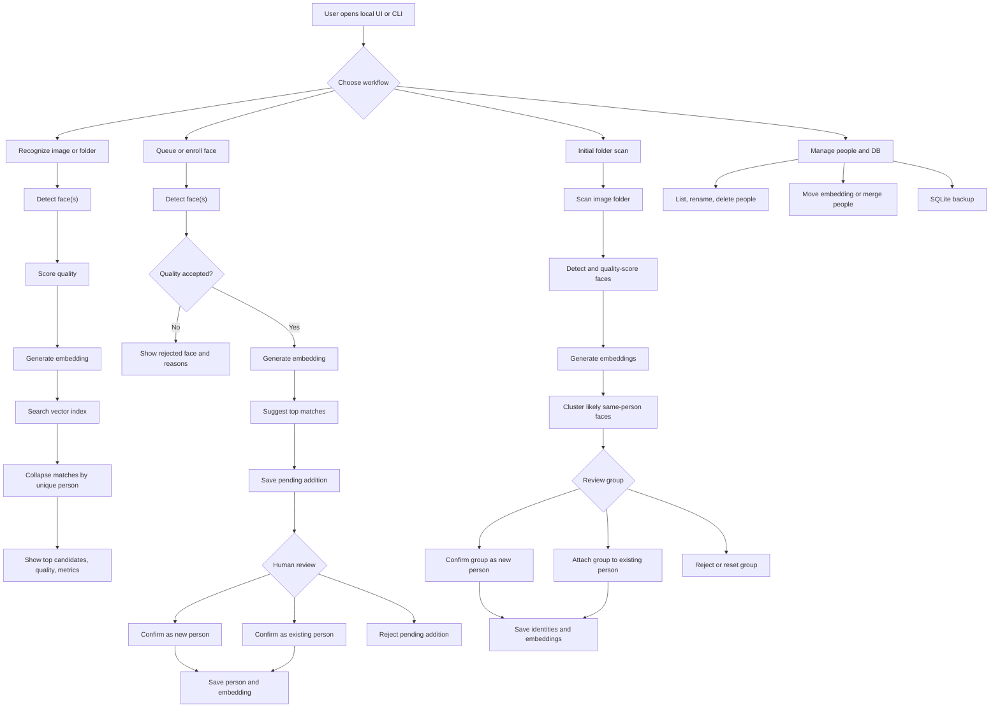
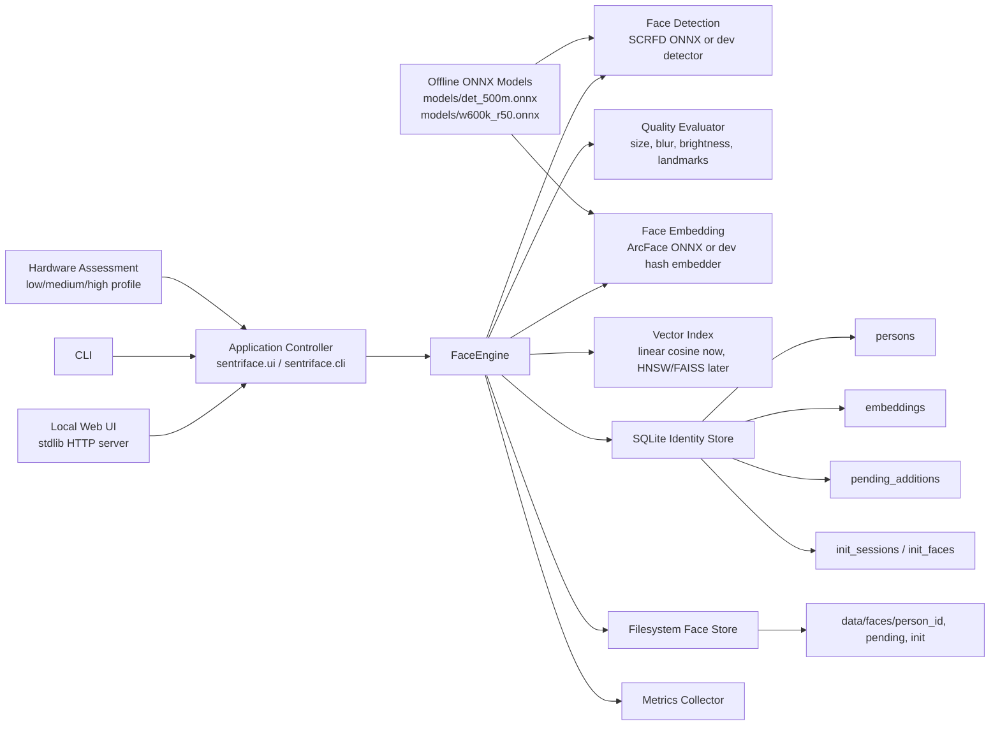

# SentriFace Edge

SentriFace Edge is a CPU-first, fully offline face identification engine. It is designed for low-end Windows x86 machines first, including i3-class CPUs without a GPU.

The project goal is simple: keep the face system modular and controllable without turning it into a pile of local web services.

## Core Shape

```text
UI
-> App Controller
-> Face Engine
   -> Detector
   -> Aligner
   -> Embedder
   -> Matcher / Index
   -> SQLite Identity Store
   -> Filesystem Image Store
```

The first scaffold uses deterministic placeholder components so the storage, workflows, and contracts can run immediately. Real ONNX models will plug into the same interfaces.

## System Diagrams

End-to-end flow:



System design:



## CPU-First Defaults

Target runtime stack:

```text
Inference: ONNX Runtime CPU
Detector:  det_500m.onnx
Embedder:  w600k_r50.onnx
Search:    hnswlib for larger galleries, linear cosine for tiny galleries
DB:        SQLite
Images:    filesystem paths, not DB blobs
```

For an i3 system:

- Load models once and reuse them.
- Keep processing in a single background worker by default.
- Resize images before detection.
- Cache embeddings and never re-encode unchanged images.
- Store multiple good embeddings per person.
- Use strict thresholds before adding embeddings to an identity.

SentriFace assesses the machine at startup and maps it to a runtime tier:

```text
low    -> 1 worker, batch size 1, smaller image edge, small-model preference
medium -> 2 workers, batch size 2, hnswlib-ready vector index
high   -> 3 workers, batch size 4, larger preprocessing batches
```

For i3-class systems, the goal is not to max out the CPU. The goal is to keep
the UI responsive while recognition happens in the background.

Run the local UI:

```bash
PYTHONPATH=src python3 -m sentriface.ui --runtime dev --data-dir data
```

Then open `http://127.0.0.1:8765`. Use `--runtime onnx` after the offline ONNX
models are present. The UI prints debug events to the terminal and keeps the
latest events visible in the Debug tab.
Starting the app automatically creates the `data/` folder, SQLite DB, face crop
folder, and index folder if they are missing. You do not need to run `init-db`
before launching the UI.

Browser flow:

```text
choose image -> enroll person -> recognize same image -> inspect match and metrics
```

The main UI actions accept file picker input. Path fields remain available as an
advanced fallback for local folders and scripted testing.
Init Scan accepts a folder picker and uploads selected images into a local batch
directory before grouping faces.
Uploaded files under 1 MB are saved unchanged. Uploaded files over 1 MB are
only size-reduced before they are passed to the engine; face quality decisions
still happen inside the engine.
The browser UI source lives in `src/sentriface/ui_frontend` and is built with
React + Vite into `src/sentriface/ui_static`, which is what the Python UI server
serves. After editing the frontend, rebuild the static bundle:

```bash
npm run build
```

Check the selected profile:

```bash
PYTHONPATH=src python3 -m sentriface.cli profile
```

Use JSON output for future UI integration:

```bash
PYTHONPATH=src python3 -m sentriface.cli --json profile
```

Use metrics output before optimizing:

```bash
PYTHONPATH=src python3 -m sentriface.cli --metrics --runtime onnx recognize path/to/image.jpg
```

Metrics include stage timings such as image load, detection, quality scoring,
embedding, search, DB work, and useful counters such as detected faces and
accepted/rejected faces.

Run a repeatable recognition benchmark over one image or a folder:

```bash
PYTHONPATH=src python3 -m sentriface.cli --metrics --runtime onnx benchmark path/to/images --repeat 3
```

Compare ONNX Runtime thread counts on the target machine:

```bash
PYTHONPATH=src python3 -m sentriface.cli --runtime onnx benchmark path/to/images --repeat 3 --compare-threads 1,2,4
```

Override ONNX threads for a normal command:

```bash
PYTHONPATH=src python3 -m sentriface.cli --runtime onnx --onnx-threads 2 recognize path/to/image.jpg
```

Tune strictness and CPU load without editing code:

```bash
PYTHONPATH=src python3 -m sentriface.cli --runtime onnx --max-image-edge 720 --high-confidence 0.70 --medium-confidence 0.52 --min-quality-score 0.60 recognize path/to/image.jpg
```

`high-confidence` controls strong matches, `medium-confidence` controls
ambiguous candidates, `min-quality-score` controls whether a face may be added,
and `max-image-edge` controls how aggressively images are downscaled before
detection.

Run with development placeholders:

```bash
PYTHONPATH=src python3 -m sentriface.cli --runtime dev recognize path/to/image.jpg
```

Run recognition over a folder:

```bash
PYTHONPATH=src python3 -m sentriface.cli --runtime onnx recognize-batch path/to/images
```

Run with real CPU ONNX components after placing models on disk:

```bash
python -m pip install -r requirements-runtime.txt
python scripts/fetch_models.py

PYTHONPATH=src python3 -m sentriface.cli \
  --runtime onnx \
  --detector-model models/det_500m.onnx \
  --recognizer-model models/w600k_r50.onnx \
  recognize path/to/image.jpg
```

The ONNX path is CPU-only by default and uses the selected hardware profile to
limit ONNX Runtime threads.

Enroll a person from the first detected face:

```bash
PYTHONPATH=src python3 -m sentriface.cli \
  --runtime onnx \
  enroll "Person Name" path/to/image.jpg
```

Queue a face for review instead of immediately updating the DB:

```bash
PYTHONPATH=src python3 -m sentriface.cli --runtime onnx queue-add path/to/image.jpg
PYTHONPATH=src python3 -m sentriface.cli --runtime onnx pending
PYTHONPATH=src python3 -m sentriface.cli --runtime onnx confirm-existing PENDING_ID PERSON_ID
PYTHONPATH=src python3 -m sentriface.cli --runtime onnx confirm-new PENDING_ID "Person Name"
PYTHONPATH=src python3 -m sentriface.cli --runtime onnx reject-pending PENDING_ID
```

Face additions are quality-gated before they enter the pending queue. The engine
checks detector confidence, face size, blur, brightness, crop validity, and
landmark availability.

Possible quality states:

```text
good -> safe to queue/enroll
warn -> accepted, but reasons are shown
bad  -> rejected by default
```

Force a bad-quality face only when you intentionally want it:

```bash
PYTHONPATH=src python3 -m sentriface.cli --runtime onnx queue-add path/to/image.jpg --force-bad-quality
```

## Workflows

### Init_Add

```text
images -> detect -> encode -> cluster -> user confirms groups -> save identities
```

CLI review flow:

```bash
PYTHONPATH=src python3 -m sentriface.cli --runtime onnx init-scan path/to/images
PYTHONPATH=src python3 -m sentriface.cli --runtime onnx init-groups SESSION_ID
PYTHONPATH=src python3 -m sentriface.cli --runtime onnx init-confirm SESSION_ID GROUP_ID "Person Name"
PYTHONPATH=src python3 -m sentriface.cli --runtime onnx init-confirm-existing SESSION_ID GROUP_ID PERSON_ID
PYTHONPATH=src python3 -m sentriface.cli --runtime onnx init-reject SESSION_ID GROUP_ID
PYTHONPATH=src python3 -m sentriface.cli --runtime onnx init-reset SESSION_ID GROUP_ID
```

`init-scan` does not create people immediately. It creates a durable review
session, clusters likely-same-person faces, and waits for confirmation.
`init-confirm-existing` adds the group as new embeddings for an active person.
`init-reset` moves a reviewed group back to pending; it does not remove
embeddings that were already confirmed.

### Add

```text
image -> detect -> encode -> top 3 candidates -> pending suggestion -> user confirms -> save embedding
```

### Recognize

```text
image -> detect -> encode -> search -> top 3 -> show identity or unknown
```

Recognition results are ranked by unique person, not by duplicate embeddings.
When multiple embeddings from the same person match, they are collapsed into one
candidate with `embeddings_matched`.

Person management:

```bash
PYTHONPATH=src python3 -m sentriface.cli --runtime onnx persons
PYTHONPATH=src python3 -m sentriface.cli --runtime onnx person PERSON_ID
PYTHONPATH=src python3 -m sentriface.cli --runtime onnx rename-person PERSON_ID "New Name"
PYTHONPATH=src python3 -m sentriface.cli --runtime onnx delete-person PERSON_ID
PYTHONPATH=src python3 -m sentriface.cli --runtime onnx delete-embedding EMBEDDING_ID
PYTHONPATH=src python3 -m sentriface.cli --runtime onnx move-embedding EMBEDDING_ID TARGET_PERSON_ID
PYTHONPATH=src python3 -m sentriface.cli --runtime onnx merge-persons SOURCE_PERSON_ID TARGET_PERSON_ID
```

`delete-person` is a soft delete. Embeddings stay in the database for now, but
deleted people are excluded from active listings and recognition.
Use `move-embedding` when one sample was attached to the wrong person. Use
`merge-persons` when two person records are actually the same identity; source
embeddings are moved to the target and the source person is soft-deleted.

## Storage

```text
data/
  sentriface.db
  faces/
    person_id/
      crop files
  index/
    face_index.bin
models/
  detector.onnx
  recognizer.onnx
```

Create a safe SQLite backup before upgrades or bulk cleanup:

```bash
PYTHONPATH=src python3 -m sentriface.cli --runtime onnx backup-db backups/sentriface.db
```

SQLite stores metadata, embedding records, thresholds, and paths. Original images and face crops live on disk when needed.

The SQLite database uses `PRAGMA user_version` for schema versioning. Newer
database versions are rejected clearly instead of being opened unsafely by older
app builds.

## Run Checks

```bash
PYTHONPATH=src python3 -m unittest discover -s tests
```
