# SentriFace current-experience visual baseline — Issue #6

**AUDIT EVIDENCE — DO NOT MERGE. Overall status: PARTIAL. Completeness/design Gate 1 remains open.** This library preserves observed current behavior; it does not certify exhaustive qualification, authorize Figcraft redesign or implement a product change.

Source/base: [`b457f0a723e845dd1a92a07a577072c85146c89a`](https://github.com/suraj-singh12/sentri-face-edge/commit/b457f0a723e845dd1a92a07a577072c85146c89a), `release-v2.0.0-hardening`. Evidence branch: `audit/issue-6-current-experience`. It extends PR #33's UX-00–UX-15 register and [canonical design authority](../../docs/UI_UX_DESIGN.md). Current Explore | Connections naming is preserved. Future #4 Encounter Split/Merge is not an implemented workflow.

**macOS completion pass 2:** [execution plan](pass2-execution-plan.csv); continuations in [J02](journeys/J02.md), [J07](journeys/J07.md), [J15](journeys/J15.md), [J20](journeys/J20.md), [J22](journeys/J22.md), [J24](journeys/J24.md), and [J33](journeys/J33.md). This is a milestone; remaining contracts require execution.

## Start here

Choose an area in the gallery below or a journey in the complete ordered register. Each journey contains its goal, role/start state, actual triggers and ordered screenshots, authority consequences, return and gaps. Open a thumbnail for the original full-size public capture. Related problems and recommendations live in [findings](findings.md), component/controller opportunities in [reuse map](reuse-map.md), and independent challenges in [review](review.md).

| Evidence question | Authoritative record |
| --- | --- |
| What was actually counted, and how complete is it? | [Coverage report and gate decision](coverage.md) · [Execution summary: totals, definitions and status numerators/denominators](execution-summary.json) |
| Which source feature/control has evidence or a gap? | [Source oracle](source-map.md) · [832 source definition sites](source-inventory.csv) · [control/state coverage](coverage.csv) |
| Which implemented goal or branch was executed? | [60 semantic task contracts and execution results](source-journeys.csv) · [509 semantic branch/state contracts and execution results](source-branches.csv) |
| Which distinct screen or overlay was actually captured? | [Surface register](surface-register.csv) · [Captured overlay register](captured-overlays.csv) |
| How can a future audit replay the meaningful scenarios? | [Reproduction guide](reproduce.md) · ordered journeys below |
| What role, theme, size, fixture and SHA produced an image? | [Capture register](capture-register.json) · [hashed manifest](manifest.json) · [manifest checksum](manifest.sha256) |
| What was independently checked? | [Review](review.md) · [validation](checks/validation.json) · [role denials](checks/role-checks.json) |

A source definition, screenshot or matching accessible name alone does not earn workflow PASS. **PASS** means the specifically mapped branch executed with its stated result; **FAIL** means its stated expectation failed; **PARTIAL** means only part qualified; **BLOCKED** needs a recorded prerequisite; **NOT RUN** has no execution claim. Repeated attempts, a loader and a saved outcome are not interchangeable. Control candidate-presence and manually reconciled branch coverage use different denominators. Read the linked execution summary before quoting a percentage.

## Visual gallery by existing UX area

### UX-00 — Startup, authentication, models and safety gates

[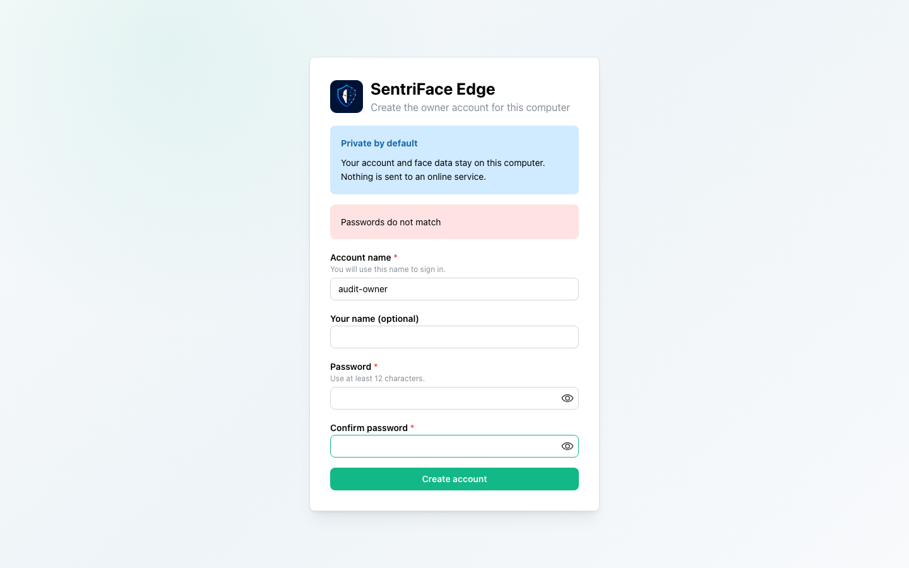](screenshots/UX-00/UX-00_J01_Step-02_Password-mismatch.png)

Journeys: [J01](journeys/J01.md), [J32](journeys/J32.md), [J40](journeys/J40.md). The thumbnail is an entry point; follow the ordered journey for intermediate states, private omissions and outcomes.

### UX-01 — Global shell, account and navigation

[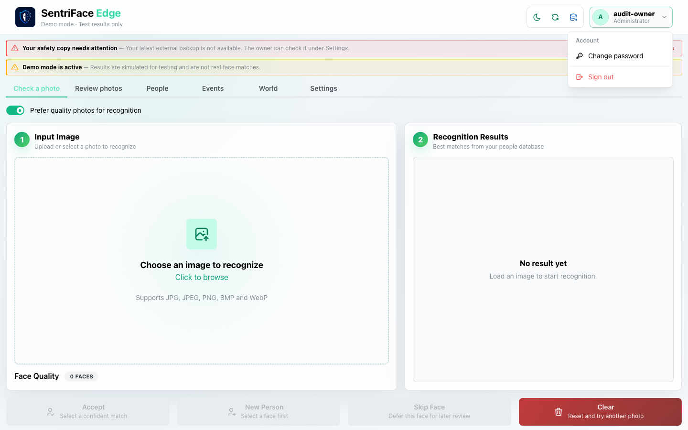](screenshots/UX-01/UX-01_J02_Step-01_Account-menu.png)

Journeys: [J01](journeys/J01.md), [J02](journeys/J02.md), [J24](journeys/J24.md). The thumbnail is an entry point; follow the ordered journey for intermediate states, private omissions and outcomes.

### UX-02 — Check a Photo

[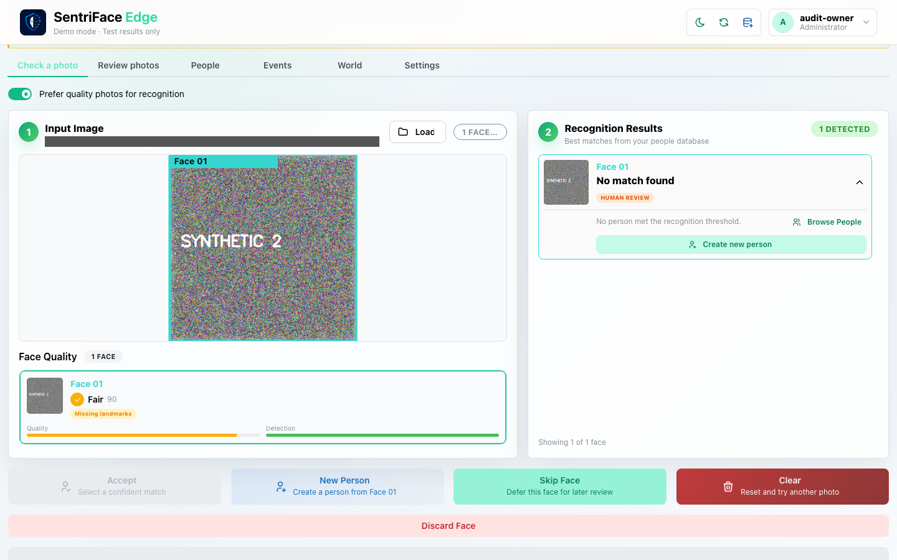](screenshots/UX-02/UX-02_J06_Step-04_Unknown-face-result_SANITIZED.png)

Journeys: [J06](journeys/J06.md), [J26](journeys/J26.md), [J34](journeys/J34.md), [J40](journeys/J40.md). The thumbnail is an entry point; follow the ordered journey for intermediate states, private omissions and outcomes.

### UX-03 — Review Photos: input, sessions and grouping

[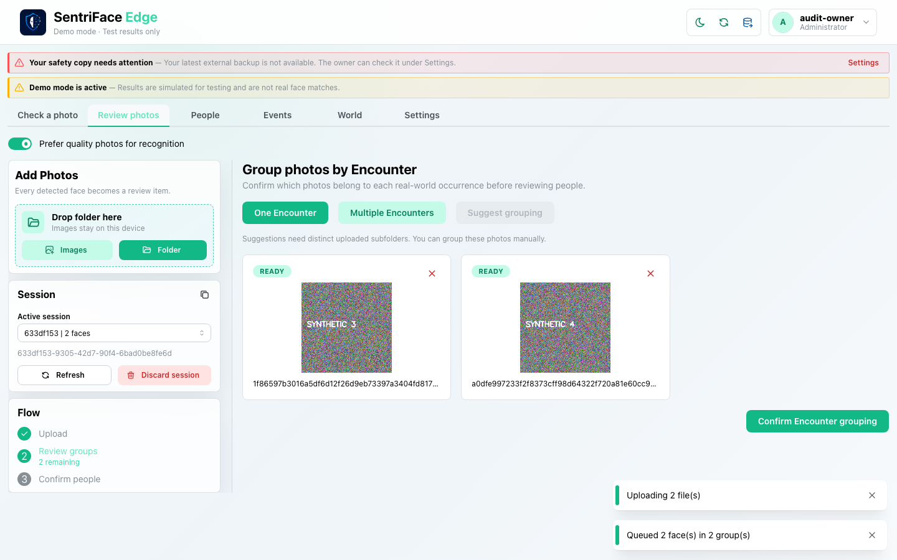](screenshots/UX-03/UX-03_J08_Step-02_One-Encounter-grouping.png)

Journeys: [J08](journeys/J08.md), [J26](journeys/J26.md), [J33](journeys/J33.md), [J40](journeys/J40.md). The thumbnail is an entry point; follow the ordered journey for intermediate states, private omissions and outcomes.

### UX-04 — Review Photos: Event, face decisions, Relations and completion

[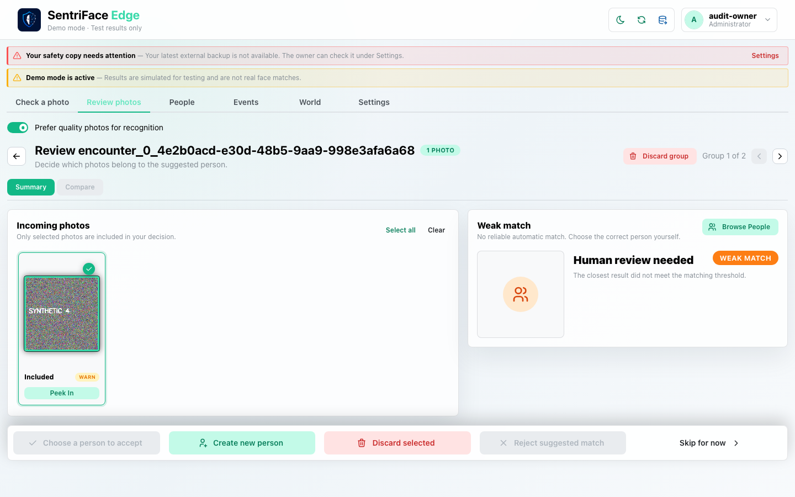](screenshots/UX-04/UX-04_J08_Step-08_Group-review.png)

Journeys: [J08](journeys/J08.md), [J17](journeys/J17.md). The thumbnail is an entry point; follow the ordered journey for intermediate states, private omissions and outcomes.

### UX-05 — People library

[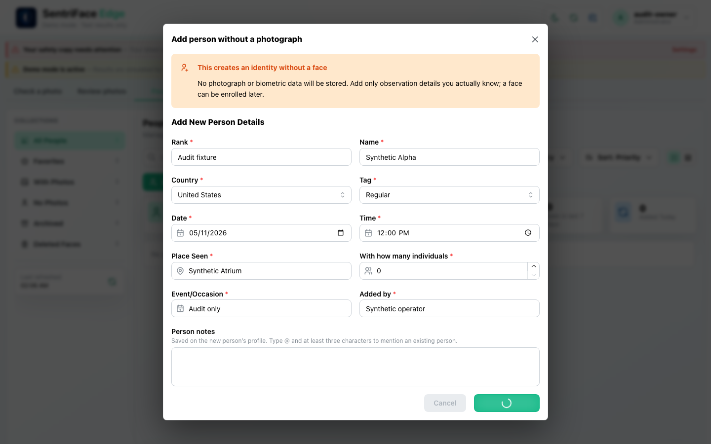](screenshots/UX-05/UX-05_J03_Step-04_Person-create-submitting.png)

Journeys: [J03](journeys/J03.md), [J09](journeys/J09.md), [J11](journeys/J11.md), [J13](journeys/J13.md), [J26](journeys/J26.md), [J31](journeys/J31.md), [J40](journeys/J40.md). The thumbnail is an entry point; follow the ordered journey for intermediate states, private omissions and outcomes.

### UX-06 — People profile and Graph

[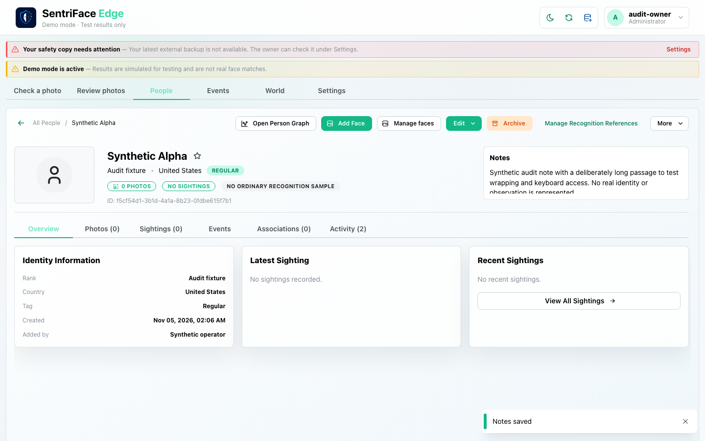](screenshots/UX-06/UX-06_J04_Step-05_Notes-saved.png)

Journeys: [J04](journeys/J04.md), [J05](journeys/J05.md), [J10](journeys/J10.md), [J12](journeys/J12.md), [J24](journeys/J24.md), [J25](journeys/J25.md), [J29](journeys/J29.md). The thumbnail is an entry point; follow the ordered journey for intermediate states, private omissions and outcomes.

### UX-07 — People edits, Notes, References and faces

Journeys: [J03](journeys/J03.md), [J04](journeys/J04.md), [J05](journeys/J05.md), [J11](journeys/J11.md), [J24](journeys/J24.md), [J27](journeys/J27.md), [J28](journeys/J28.md), [J29](journeys/J29.md), [J30](journeys/J30.md). The thumbnail is an entry point; follow the ordered journey for intermediate states, private omissions and outcomes.

### UX-08 — People lifecycle, merge and associations

[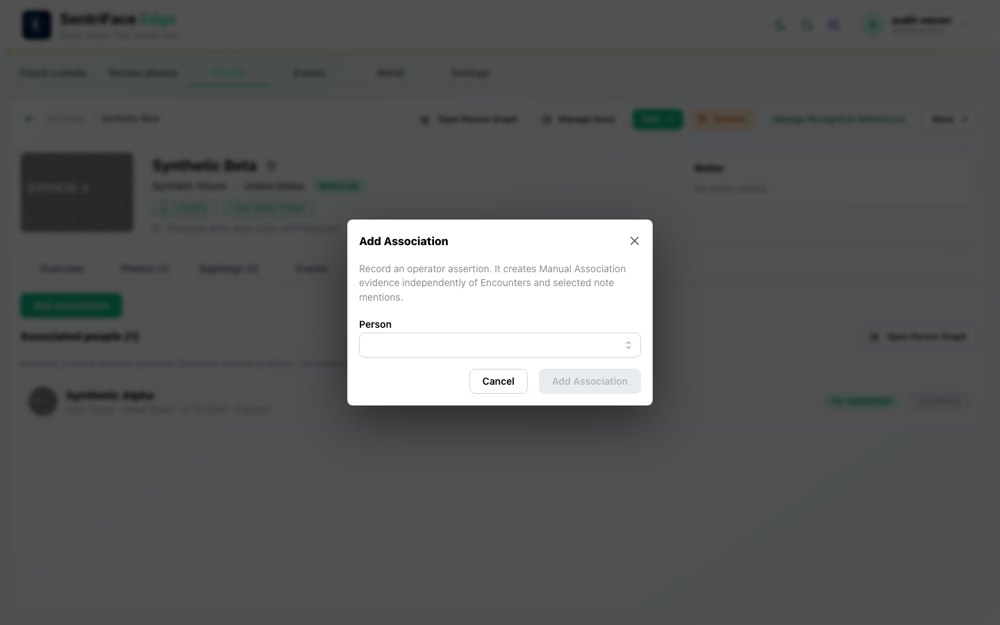](screenshots/UX-08/UX-08_J12_Step-02_Add-association-dialog.png)

Journeys: [J04](journeys/J04.md), [J12](journeys/J12.md), [J13](journeys/J13.md), [J14](journeys/J14.md), [J27](journeys/J27.md), [J28](journeys/J28.md). The thumbnail is an entry point; follow the ordered journey for intermediate states, private omissions and outcomes.

### UX-09 — Events and evidence

[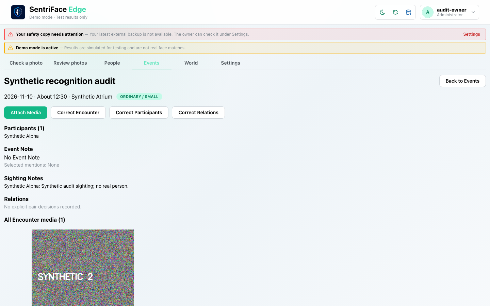](screenshots/UX-09/UX-09_J07_Step-02_Event-detail.png)

Journeys: [J07](journeys/J07.md), [J24](journeys/J24.md), [J26](journeys/J26.md), [J31](journeys/J31.md), [J40](journeys/J40.md). The thumbnail is an entry point; follow the ordered journey for intermediate states, private omissions and outcomes.

### UX-10 — Event corrections

[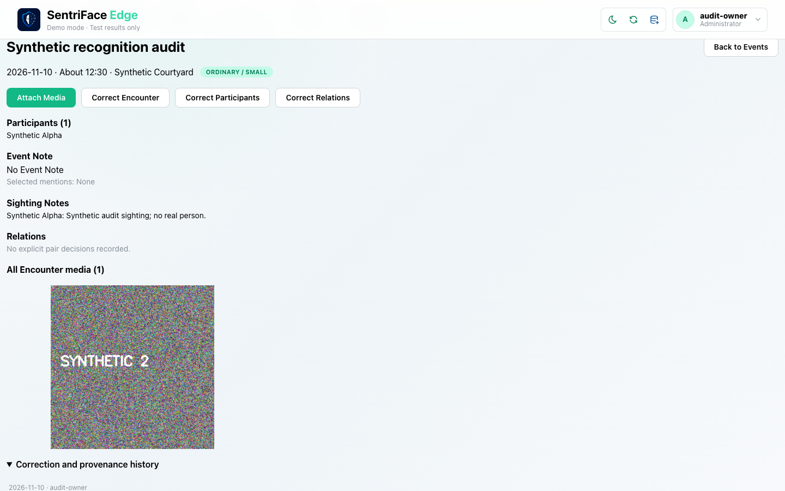](screenshots/UX-10/UX-10_J07_Step-04_Correction-history-expanded.png)

Journeys: [J07](journeys/J07.md), [J15](journeys/J15.md), [J16](journeys/J16.md). The thumbnail is an entry point; follow the ordered journey for intermediate states, private omissions and outcomes.

### UX-11 — World — Explore

[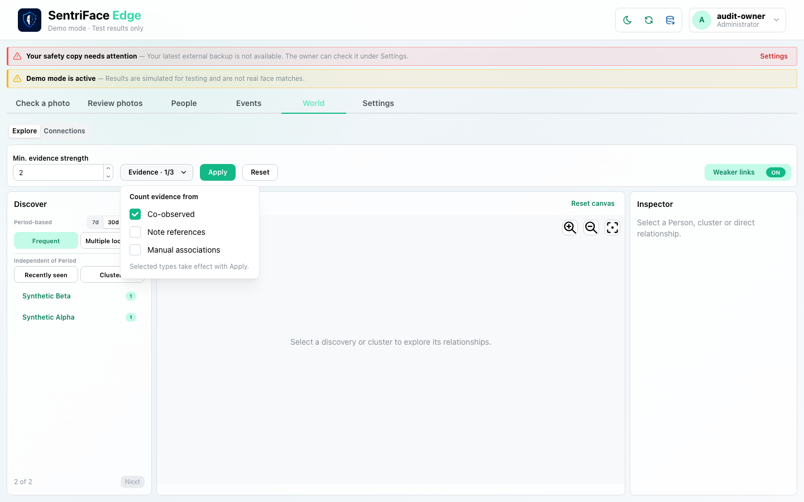](screenshots/UX-11/UX-11_J18_Step-02_Evidence-popover.png)

Journeys: [J18](journeys/J18.md), [J26](journeys/J26.md), [J31](journeys/J31.md), [J40](journeys/J40.md). The thumbnail is an entry point; follow the ordered journey for intermediate states, private omissions and outcomes.

### UX-12 — World — Connections

[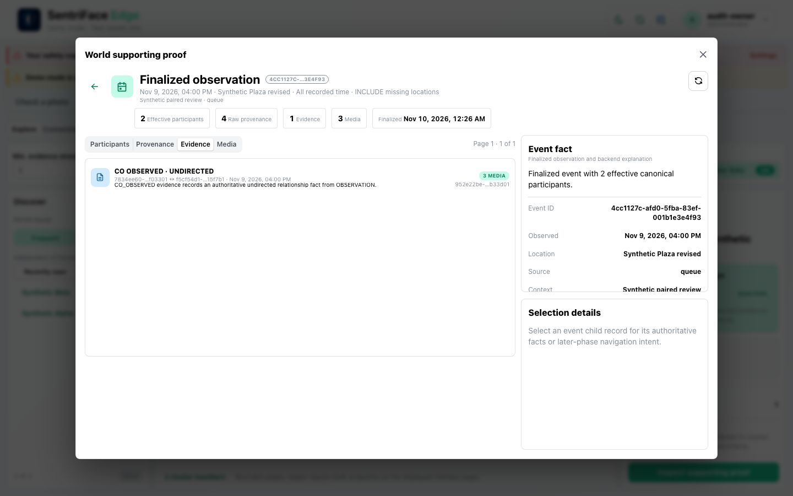](screenshots/UX-12/UX-12_J18_Step-13_World-event-evidence.png)

Journeys: [J18](journeys/J18.md), [J19](journeys/J19.md). The thumbnail is an entry point; follow the ordered journey for intermediate states, private omissions and outcomes.

### UX-13 — Settings

[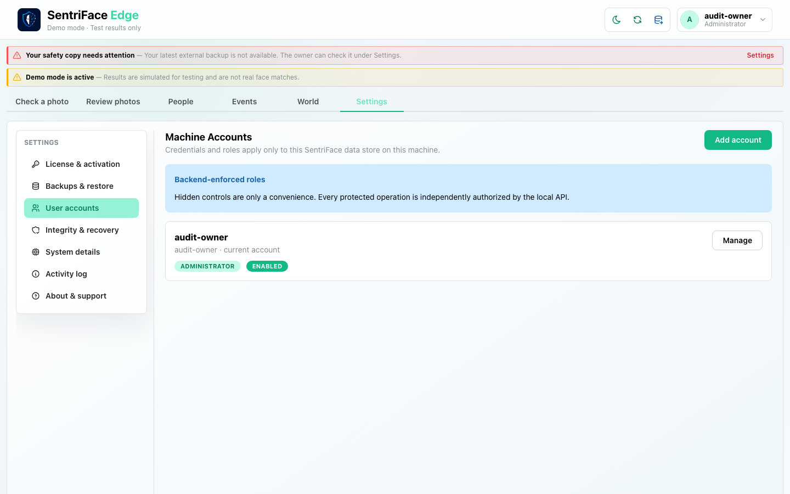](screenshots/UX-13/UX-13_J20_Step-02_Machine-accounts.png)

Journeys: [J20](journeys/J20.md), [J21](journeys/J21.md), [J22](journeys/J22.md), [J23](journeys/J23.md), [J24](journeys/J24.md), [J26](journeys/J26.md), [J27](journeys/J27.md), [J40](journeys/J40.md). The thumbnail is an entry point; follow the ordered journey for intermediate states, private omissions and outcomes.

### UX-14 — Shared dialogs, overlays and feedback

[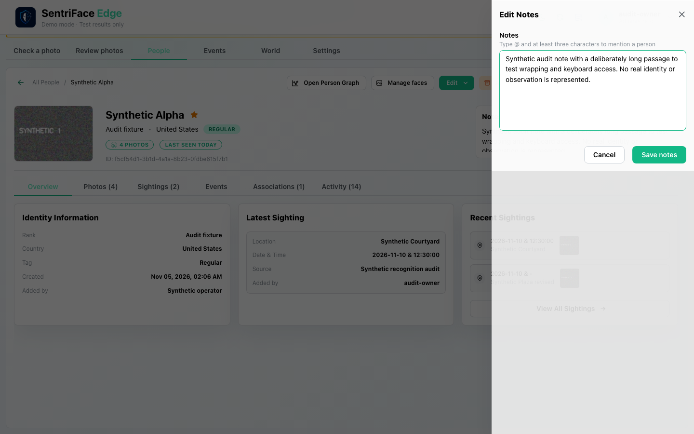](screenshots/UX-14/UX-14_J25_Step-04_Drawer-keyboard-focus.png)

Journeys: [J18](journeys/J18.md), [J25](journeys/J25.md). The thumbnail is an entry point; follow the ordered journey for intermediate states, private omissions and outcomes.

### UX-15 — Cross-feature transitions

[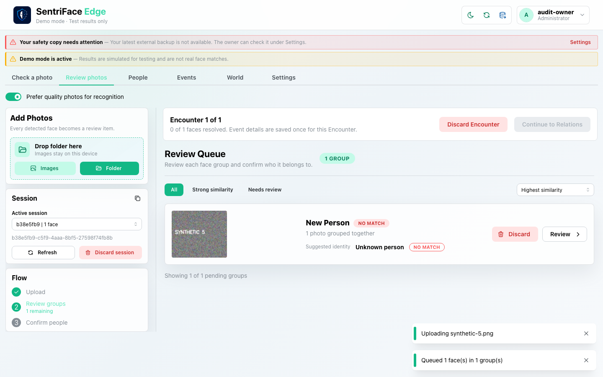](screenshots/UX-15/UX-15_J17_Step-01_Attach-to-review-target.png)

Journeys: [J15](journeys/J15.md), [J17](journeys/J17.md), [J18](journeys/J18.md), [J19](journeys/J19.md). The thumbnail is an entry point; follow the ordered journey for intermediate states, private omissions and outcomes.

## Ordered journey register

| Journey | Operator task |
| --- | --- |
| [J01](journeys/J01.md) | First owner account and safety-copy gate |
| [J02](journeys/J02.md) | Account menu and password-dialog cancellation |
| [J03](journeys/J03.md) | Create a Person without a photograph |
| [J04](journeys/J04.md) | Profile, cancelled metadata edit and saved Person Note |
| [J05](journeys/J05.md) | Reference Only acknowledgment, enrollment and lifecycle |
| [J06](journeys/J06.md) | Check a photo: choose an existing Person and complete review |
| [J07](journeys/J07.md) | Events detail, metadata correction and correction-form branches |
| [J08](journeys/J08.md) | Review Photos: grouping, identity decisions, comparison and Relations |
| [J09](journeys/J09.md) | People collections, menus, list mode, favorite and search |
| [J10](journeys/J10.md) | Person Sightings, Photos, Events and Activity |
| [J11](journeys/J11.md) | Face management confirmations, soft deletion and recovery |
| [J12](journeys/J12.md) | Independent association evidence and Person Graph |
| [J13](journeys/J13.md) | Archive, historical access and restore a Person |
| [J14](journeys/J14.md) | Merge and tombstone confirmation safety |
| [J15](journeys/J15.md) | Cross-feature Event correction, pair consent and retained history |
| [J16](journeys/J16.md) | Competing Event correction and stale-state recovery |
| [J17](journeys/J17.md) | Attach Media, source restart and completion on the same Encounter |
| [J18](journeys/J18.md) | Explore criteria, inspector, proof, media and source hierarchy |
| [J19](journeys/J19.md) | Connections filters and nested cluster–Person–Event navigation |
| [J20](journeys/J20.md) | License status and five local role accounts |
| [J21](journeys/J21.md) | Deliberate integrity check and empty merge history |
| [J22](journeys/J22.md) | Portable backup, encrypted export and import validation |
| [J23](journeys/J23.md) | System facts, Activity log and support export |
| [J24](journeys/J24.md) | Role and capability boundaries |
| [J25](journeys/J25.md) | Keyboard, pointer evidence, drawer and tooltip |
| [J26](journeys/J26.md) | Viewport and theme equivalence sample |
| [J27](journeys/J27.md) | Canonical merge and guarded revert refusal |
| [J28](journeys/J28.md) | Tombstone a disposable Person |
| [J29](journeys/J29.md) | Selected Person Note and independent evidence |
| [J30](journeys/J30.md) | Poor-quality Reference and four-source cap |
| [J31](journeys/J31.md) | Long lists, pagination and dense graph fixture |
| [J32](journeys/J32.md) | Model-needed gate, local source and activation |
| [J33](journeys/J33.md) | Group-discard refusal and whole-session discard |
| [J34](journeys/J34.md) | Invalid photo, quality warning and proof-only completion |
| [J40](journeys/J40.md) | Native macOS window and scaling baseline |
| [J41](journeys/J41.md) | Genuine ONNX supplement, private visual originals |

## Evidence classes, privacy and geometry

Broad workflow captures use the documented source synthetic mode and generated non-biometric patterns. A distinct media-free domain fixture supplies 30 People/30 Events for pagination and graph density ([J31](journeys/J31.md)); it is not UI-creation or recognition evidence. Existing authorized ONNX models and permitted photographs underpin a bounded genuine supplement ([J41](journeys/J41.md)), whose original photographs/screenshots remain private. Model setup is separately [J32](journeys/J32.md). No downloads, invented frontend states or product patches establish outcomes.

Most images are full browser-content viewports, not OS windows. CSS equivalence samples cover 1440×900 Day, 1366×768 Day, 1280×800 Night, 900×700 Night and 1440×900 Night; five real roles were sampled, without multiplying identical combinations ([J24](journeys/J24.md), [J26](journeys/J26.md)). [J40](journeys/J40.md) provides six actual native macOS full-window captures at the VM's measured DPR 2, plus content geometry. Native window requests were clamped by the VM; CSS dimensions are not represented as available native desktop sizes.

Public originals contain only approved synthetic/non-sensitive material. Where path-bearing originals are withheld, a separately identified **SANITIZED** browser screenshot may mask text; it is never described as untouched. Explicitly private or rejected originals are not linked as public images. Public capture records distinguish originals, sanitized derivatives, private captures and rejected audit attempts. Private local archives must never be committed or published.

## Reproduce and assess completeness

Start with [the reproduction guide](reproduce.md). Read [source-development instructions](../../docs/DEVELOPMENT_MODE.md), the actual launcher and [the source oracle](source-map.md). Use a dedicated disposable data authority and the repository's existing QA helpers. Follow each journey's named real controls in order; do not reuse private paths/identities from the operator environment. Audit-only [capture tooling](tooling/capture_host.py), [role sweep](tooling/role_sweep.py), [viewport sweep](tooling/viewport_sweep.py), [dense fixture](tooling/dense_fixture.py) and [genuine supplement](tooling/genuine_supplement.py) document the bounded harness. Genuine inputs require already authorized local files, never a download implied by this library.

The source ledger is the independent missed-scope checklist. Unrun loading/failure/cancellation, role/license/recovery, photographic-volume and platform combinations remain visible there. No general VoiceOver, WCAG contrast, Windows lifecycle, production license activation, successful guarded merge-revert or full real-photo corpus qualification is inferred from this macOS baseline. Keep all exact limitations and review objections alongside visual evidence when planning the subsequent design phase. **Gate 1 remains open until remaining important contracts are resolved or explicitly accepted as constrained scope. Stop before redesign or implementation.**

## macOS completion pass 2 — safety continuation B

Follow [recovery gate](journeys/J01.md), [model preparation](journeys/J32.md), [Check a Photo](journeys/J06.md), [queue grouping](journeys/J08.md), [Encounter discard](journeys/J33.md), [face correction and erase](journeys/J11.md), [backup import](journeys/J22.md), [administrator guard](journeys/J20.md), and [session interruption](journeys/J24.md). See [new findings](findings.md) and the [additional discovered path](discovered-branches.csv). The audit remains in progress.

## Pass 2 continuation C

See [duplicate attachment refusal and cancellation](journeys/J17.md), [mentioned versus present Event evidence](journeys/J10.md), [Person Note correction and retained link](journeys/J29.md), and [safety warning navigation](journeys/J24.md). [Activity filtering/export](journeys/J23.md) is documented with private originals. This is an in-progress continuation.

## Pass 2 continuation D

See [manual association guards](journeys/J12.md), [library deletion confirmation](journeys/J14.md), [contrasting Event filters](journeys/J07.md), [recovery permissions](journeys/J23.md), [fresh merge revert refusal](journeys/J27.md), and [preferred photo persistence](journeys/J10.md). Current findings and gaps remain in the ledger; this is not audit completion.
