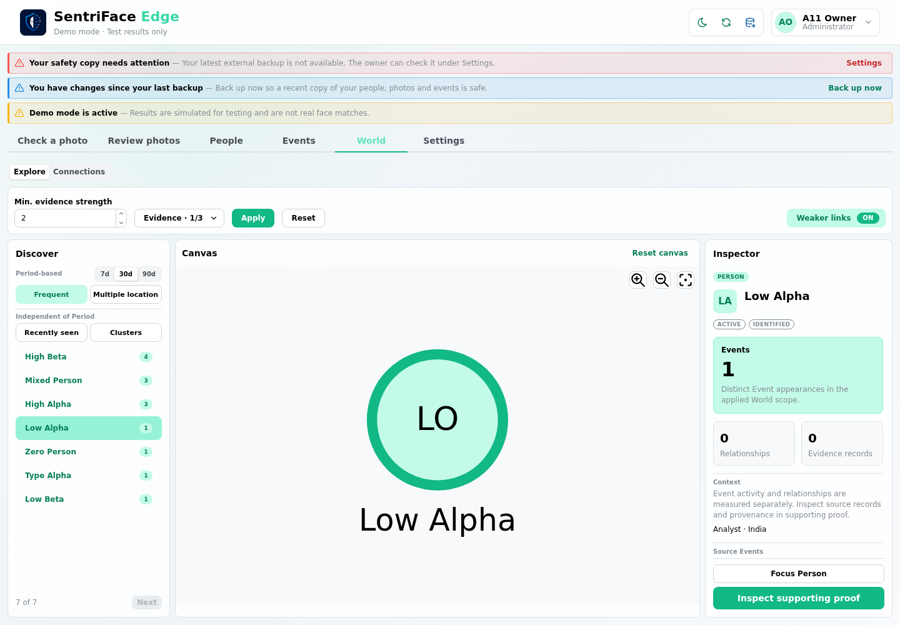
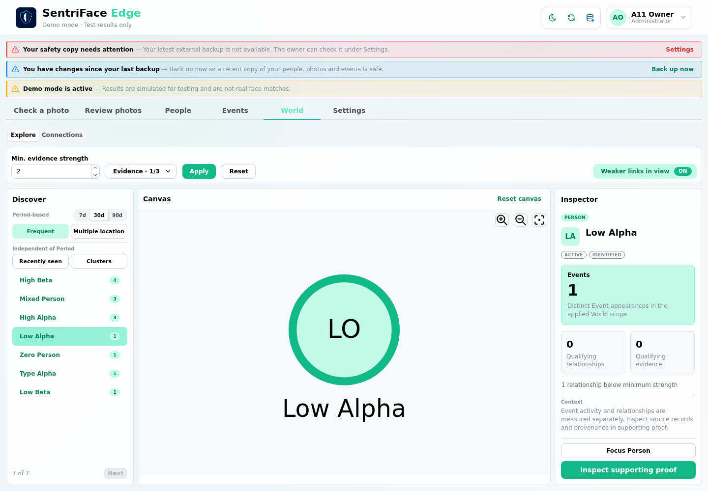
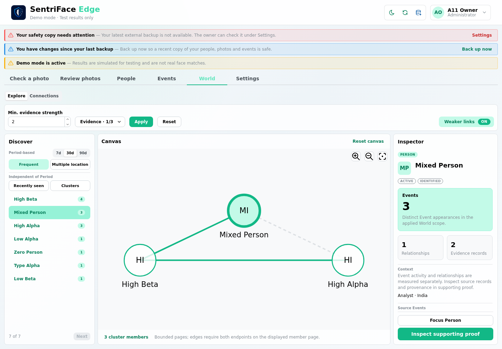
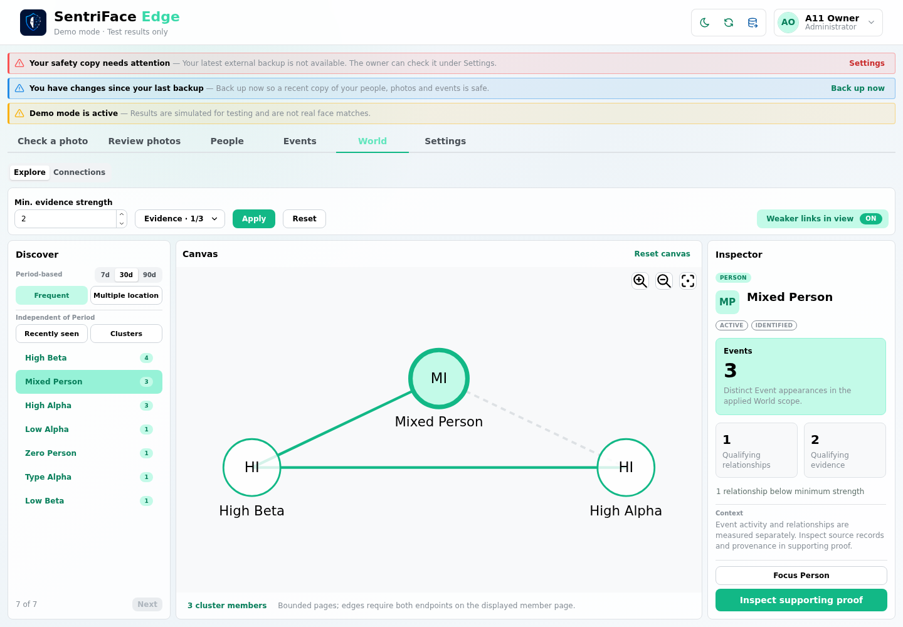
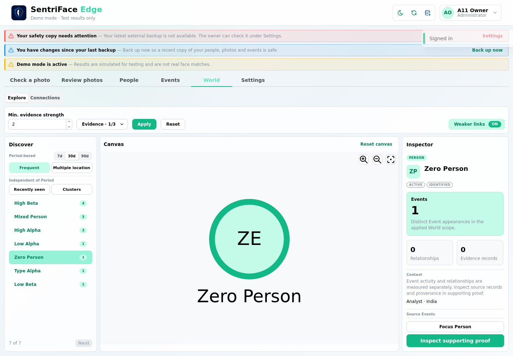
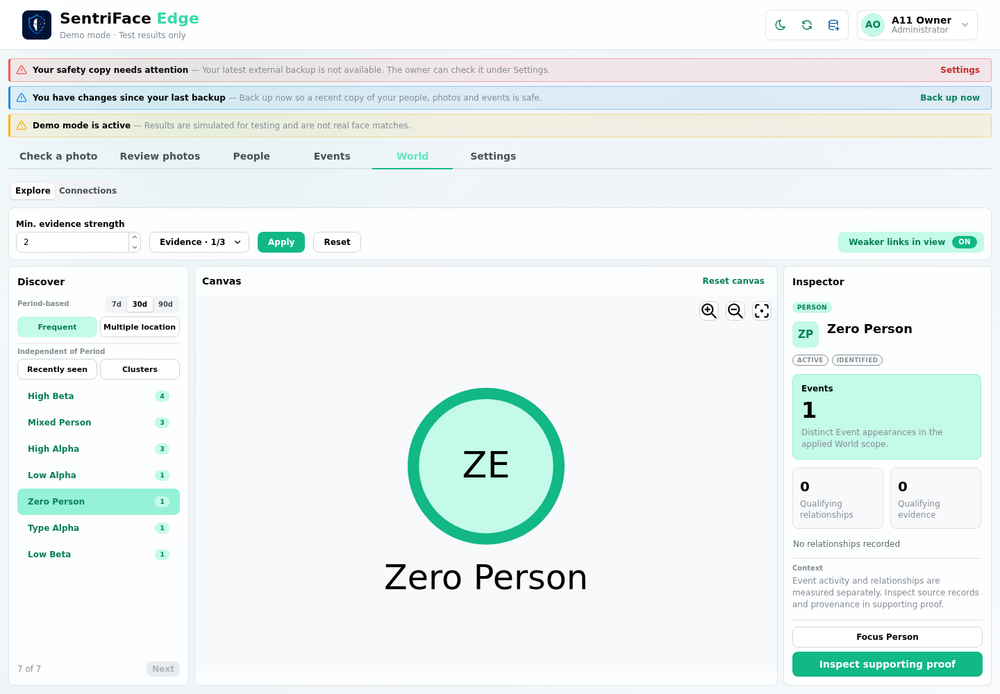
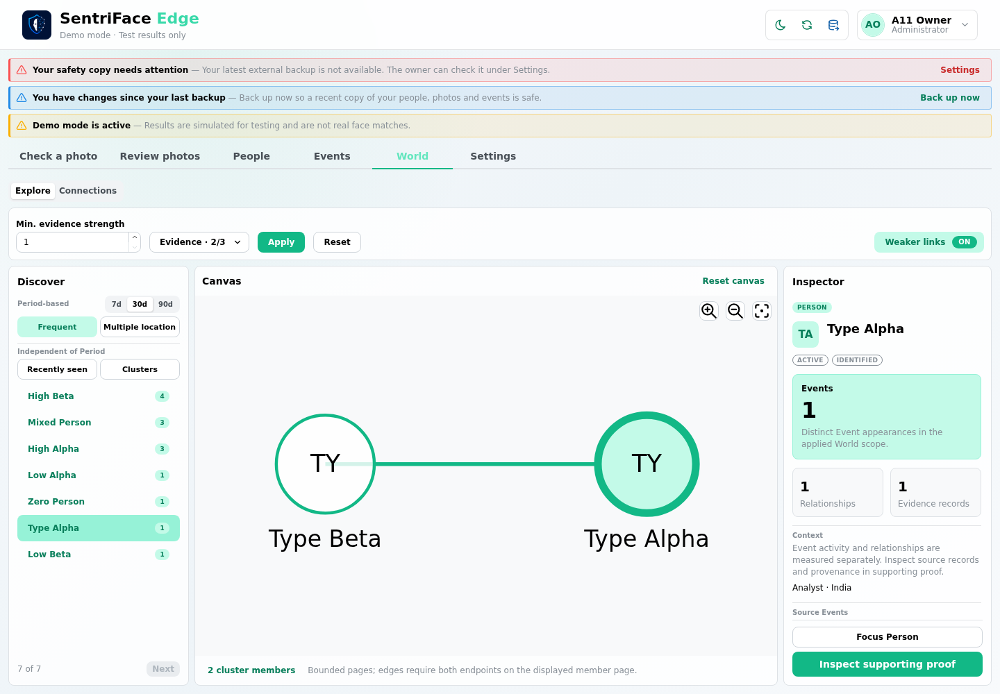
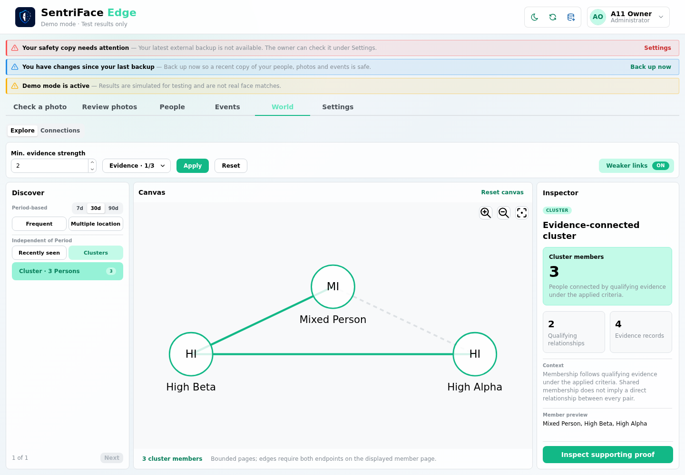
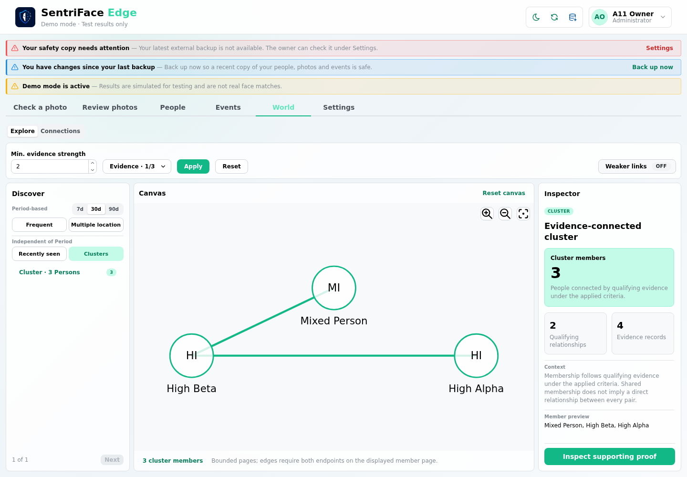
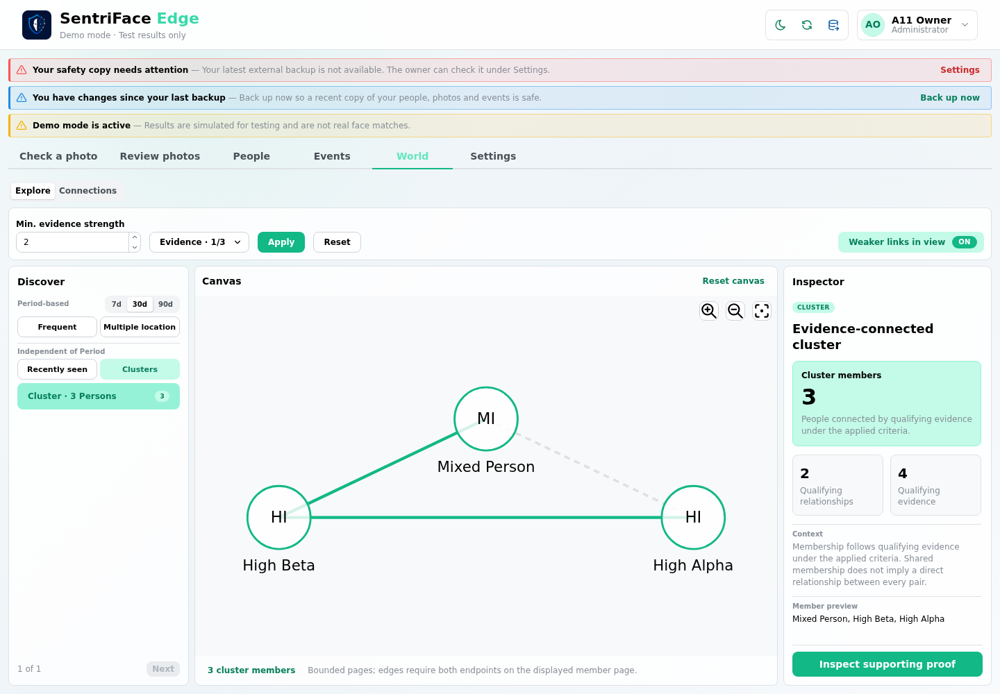

# A-11 World Explore UX clarity — visual proposal

Design-only proposal. No product code was changed.

## Proposed smallest coherent refinement

### 1. Inspector counts

Replace the absolute-sounding labels:

- `Relationships` → `Qualifying relationships`
- `Evidence records` → `Qualifying evidence`

Add one compact dimmed state line beneath the metric cards only when it carries information:

- `No relationships recorded`
- `1 relationship below minimum strength`
- `1 relationship uses unselected evidence types`

Use pluralization naturally. If both hidden causes exist, show two short lines rather than a paragraph. Do not add badges, alerts or permanent explanatory copy when there is nothing hidden.

### 2. Weaker links control

Change the visible label:

- `Weaker links` → `Weaker links in view`

Add a tooltip/focus description during implementation:

> Shows relationships below the minimum strength only when both people are already visible.

The toggle behavior, default ON state, edge styling and connected-component clustering do not change.

### 3. Isolated-person explanation

Use existing person-focus data, plus one conditional all-evidence-types comparison read only when needed, to choose the accurate line:

| Condition | Message |
| --- | --- |
| No active relationships in the all-evidence comparison | `No relationships recorded` |
| Selected-evidence relationships exist only below the strength minimum | `N relationship(s) below minimum strength` |
| Relationships exist only in unselected evidence types | `N relationship(s) use unselected evidence types` |
| Both below-threshold and type-excluded relationships exist | Two compact lines, same wording |

The message appears inside the existing Inspector hierarchy beneath the metric cards. Canvas shape, clustering, filtering and proof drilldown are unchanged.

## Before / after evidence

### Below-threshold isolated person

Before: Low Alpha has one strength-1 relationship, but the Inspector shows zero without explanation.

After: counts are explicitly qualifying and the hidden reason is visible without leaving World.

### Mixed-strength Person

Before: Mixed Person has one qualifying and one below-threshold relationship; only the qualifying count is shown.

After: the below-threshold remainder is acknowledged compactly.

### Genuine zero relationships

Before: genuine absence looks identical to hidden relationships.

After: genuine absence is stated plainly.

### Evidence-type exclusion

Before: Type Alpha has a manual association, but the default Co-observed-only evidence selection makes it indistinguishable from zero.

After: the operator can tell that evidence selection, not absence, causes the isolated display.

Control verification: selecting Manual associations at strength 1 makes the same relationship appear.

### Qualifying cluster and weaker links

Before, Weaker links ON: dashed strength-1 edge appears only because both endpoints are already displayed cluster members.

Before, Weaker links OFF: the dashed edge disappears while qualifying edges remain.

After: the control label accurately scopes the behavior without changing the graph.

## Implementation notes if approved

- Reuse existing Mantine `Text`, tooltip and metric-card styling; no new visual system.
- Preserve `EXPLORE_DEFAULT_FILTERS`, connected components, ranking, evidence independence and proof semantics.
- Do not use the weaker-links toggle to reveal non-displayed people.
- Add focused frontend tests for label rendering and message selection, plus API contract tests for the total/qualifying count composition.
- No backend schema or migration is needed for the recommended design.
