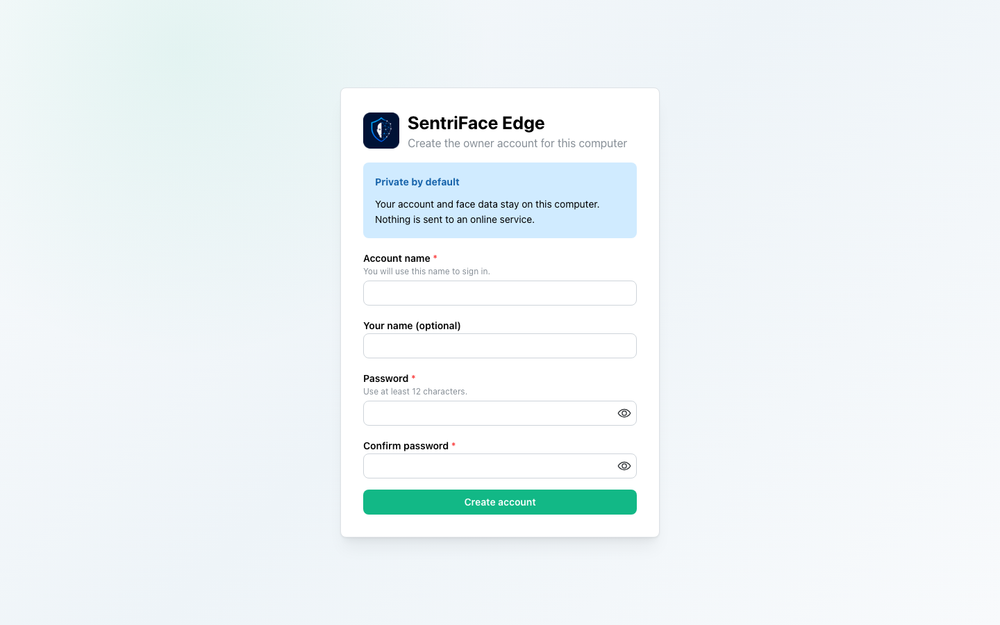
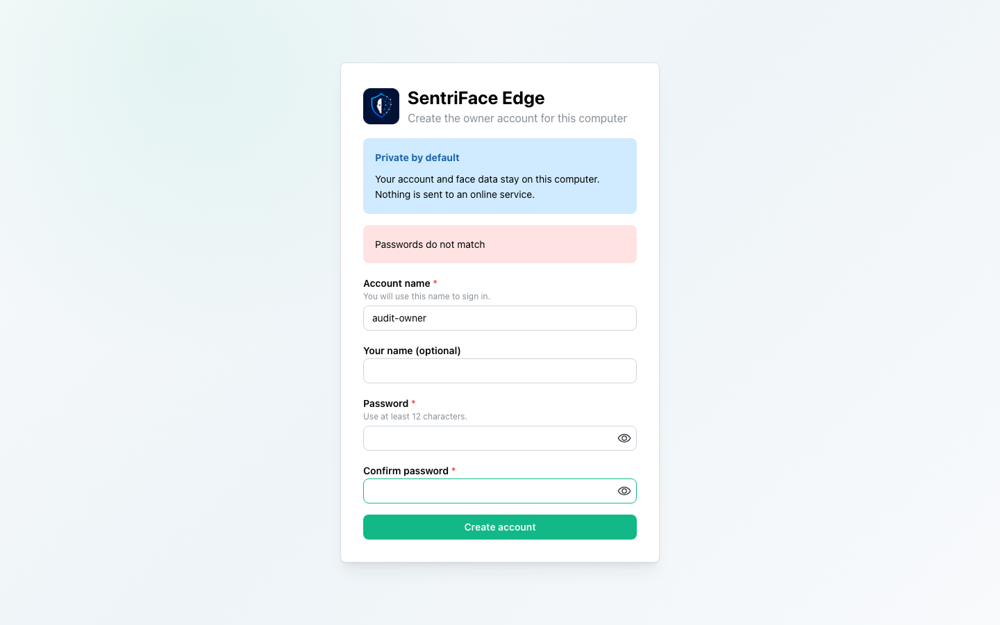
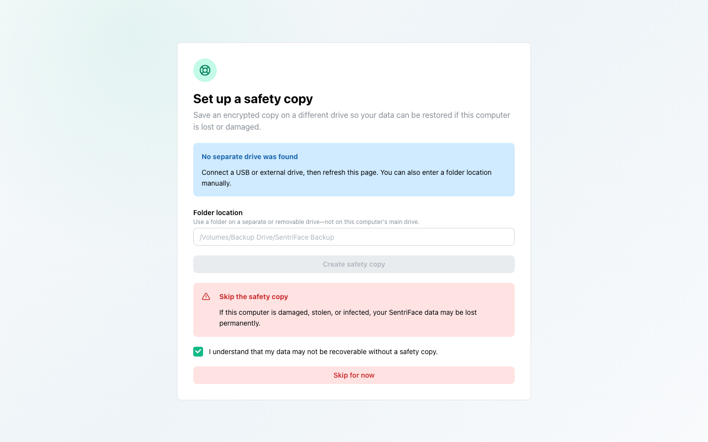
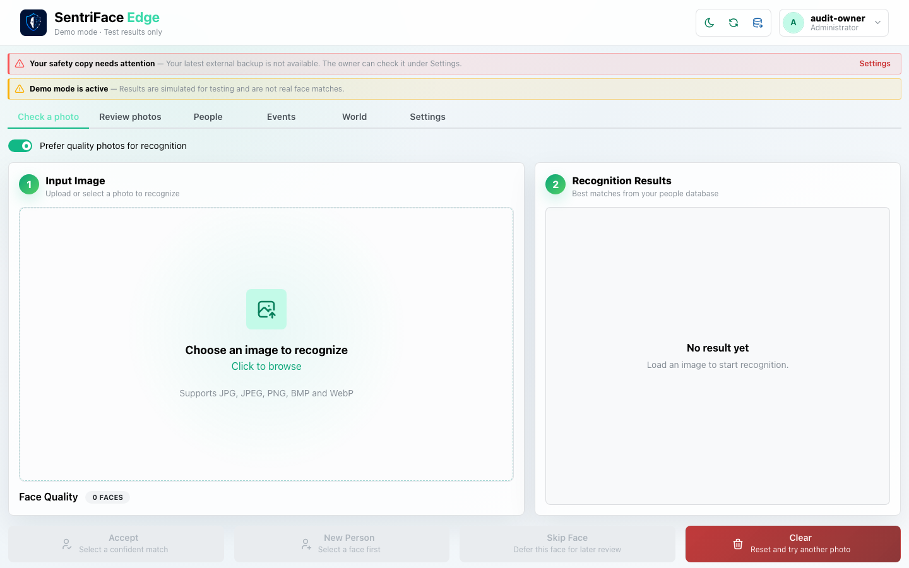
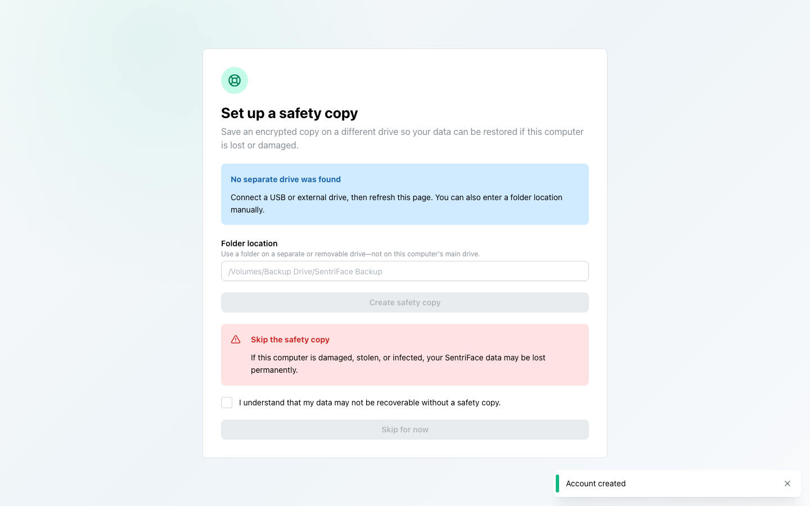
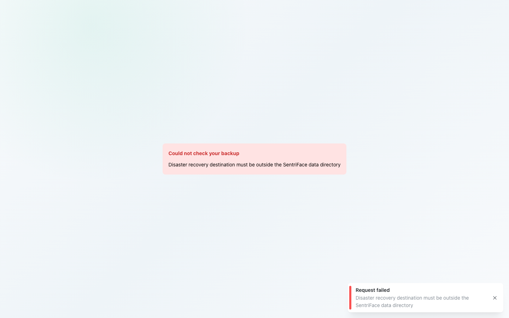
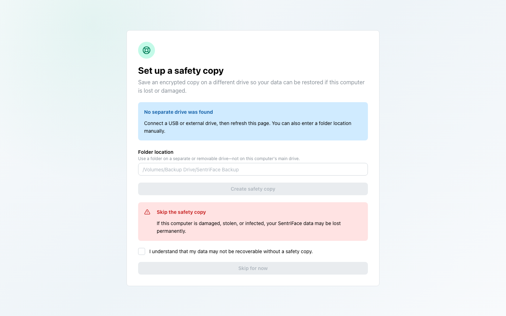
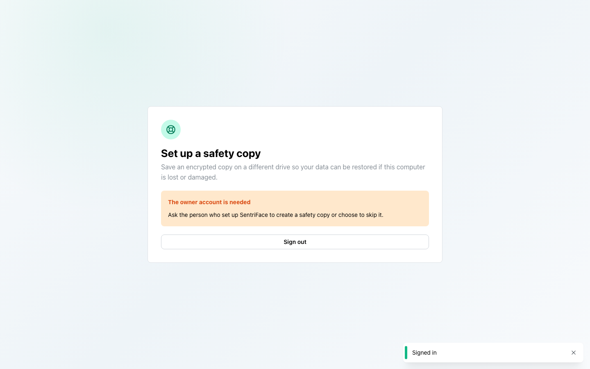
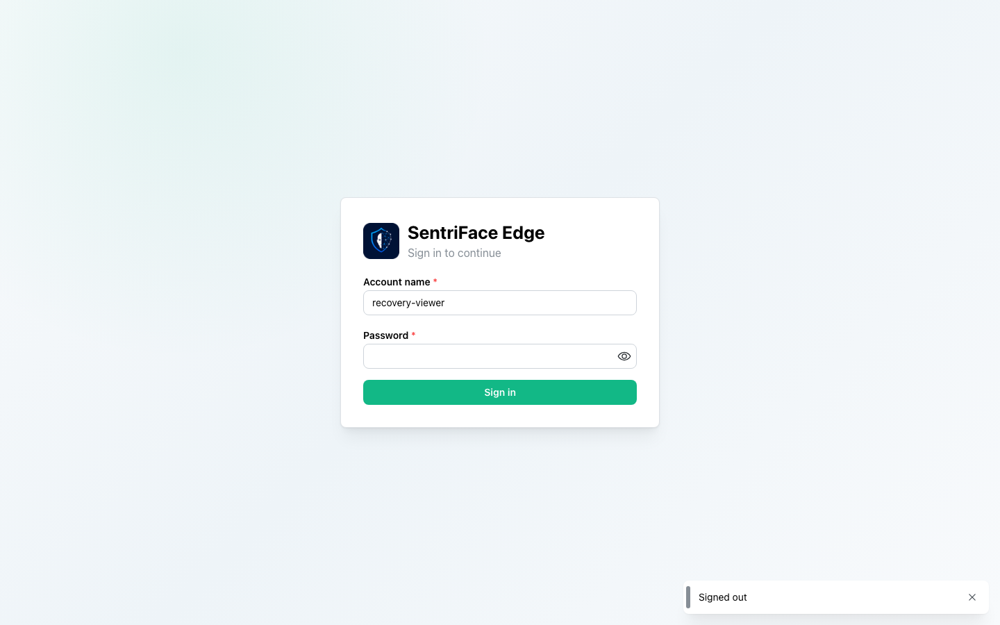

# J01 — First owner account and safety-copy gate

[Audit index](../INDEX.md) · [Source oracle](../source-map.md) · [Independent review](../review.md)

**Scope result: PARTIAL.** This record proves only the ordered observations below; source-contract branches outside them are not silently passed. Source tasks: [SJ-001](../source-journeys.csv), [SJ-004](../source-journeys.csv), [SJ-005](../source-journeys.csv).

**Operator goal:** Create the first local owner and reach the working application with an explicit backup-readiness choice.

**Starting state and required role:** Fresh disposable synthetic authority; initial setup is required. No existing operator authority is used. All captures in this record use the disposable Administrator unless a step explicitly says unauthenticated.

**Implemented owners:** [`components/AuthGate.jsx`](../../../frontend/src/components/AuthGate.jsx); [`components/RecoveryGate.jsx`](../../../frontend/src/components/RecoveryGate.jsx); [`SentriFaceApp.jsx`](../../../frontend/src/SentriFaceApp.jsx).

**Evidence basis:** saved current-run screenshots, capture metadata and accessibility snapshots. Visual acceptance is documented in the independent review; this assembly does not claim a second independent visual inspection. Synthetic images are generated patterns, not biometric photographs. No source/UI manipulation produces these states.

**Source:** `b457f0a723e845dd1a92a07a577072c85146c89a`. Capture sequence numbers order the captured states; uncaptured return actions are named in the text. The audit was interrupted and resumed across November 5 and 10 at the same source SHA.

## Ordered interaction and visual evidence

### Step 01 — First launch

Open the fresh source runtime. The first-owner form explains Private by default and requires account name, password and confirmation.

Capture: `UX-00` · Administrator · light theme · 1440×900 CSS viewport · DPR 1 · `2026-11-05T10:04:51.830330+00:00` · fixture: synthetic.

Exact scroll offset was not recorded for this earlier capture; use the full original framing when reproducing.

### Step 02 — Password mismatch

Submit different password and confirmation values. The form reports “Passwords do not match”; the captured fields have been cleared. No account-success claim belongs to this frame.

Capture: `UX-00` · Administrator · light theme · 1440×900 CSS viewport · DPR 1 · `2026-11-05T10:04:59.083332+00:00` · fixture: synthetic.

Exact scroll offset was not recorded for this earlier capture; use the full original framing when reproducing.

### Step 03 — Safety copy gate

Submit matching valid credentials. The next gate says “Set up a safety copy” and “No separate drive was found”; Create safety copy and Skip for now are disabled.

Capture: `UX-00` · Administrator · light theme · 1440×900 CSS viewport · DPR 1 · `2026-11-05T10:05:12.776935+00:00` · fixture: synthetic.

Exact scroll offset was not recorded for this earlier capture; use the full original framing when reproducing.

### Step 04 — Skip acknowledged

Check the explicit data-loss acknowledgment. Skip for now becomes available; this is consent to the disposable-data risk, not a configured safety copy.

Capture: `UX-00` · Administrator · light theme · 1440×900 CSS viewport · DPR 1 · `2026-11-05T10:05:13.376352+00:00` · fixture: synthetic.

Exact scroll offset was not recorded for this earlier capture; use the full original framing when reproducing.

### Step 05 — Shell ready

Choose Skip for now. The Check a photo shell opens with Demo mode and safety-copy notices. This is the observed ready outcome.

Capture: `UX-01` · Administrator · light theme · 1440×900 CSS viewport · DPR 1 · `2026-11-05T10:05:14.125356+00:00` · fixture: synthetic.

Exact scroll offset was not recorded for this earlier capture; use the full original framing when reproducing.

## Outcome, authority and return path

The owner account is created. The safety-copy gate is left through its explicit risk acknowledgment and Skip for now action. The shell still warns that the safety copy needs attention; no external backup or second independent copy is claimed.

## Limits and unexecuted branches

Connected-drive configuration, recovery-code custody, non-owner wait, setup server errors, model admission and license restrictions are not exercised here. See the source task contracts and later separate records.

No redesign or implementation is specified by this record. Findings and recommended directions belong to the shared audit review and canonical design authority.

## macOS completion pass 2 — continuation B

Source product `b457f0a723e845dd1a92a07a577072c85146c89a`; full browser-content screenshots, 1440×900 CSS pixels, DPR 1, Day; dedicated disposable authority. See capture register for exact role, capture time and inference qualification.

On a fresh disposable authority, the administrator entered its own data directory as recovery destination. The server refused: “Disaster recovery destination must be outside the SentriFace data directory.” The error screen offered no visible retry or sign-out; browser reload returned to the gate. A Viewer created through the authenticated API saw “The owner account is needed” and signed out. No separate drive was available.

### Step 06 — Pass2 Recovery gate start

Captured `2026-11-11T10:55:54.893604+00:00` · Administrator · UX-00 · scroll {'x': 0, 'y': 0}. Exact fixture and inference mode are described above and in the capture register.

### Step 07 — Pass2 Recovery destination invalid

Original retained privately: path, credential, or rejected attribution; not published.

Captured `2026-11-11T10:56:18.573368+00:00` · Administrator · UX-00 · scroll {'x': 0, 'y': 0}. Exact fixture and inference mode are described above and in the capture register.

### Step 08 — Pass2 Recovery setup error

Captured `2026-11-11T10:56:20.572444+00:00` · Administrator · UX-00 · scroll {'x': 0, 'y': 0}. Exact fixture and inference mode are described above and in the capture register.

### Step 09 — Pass2 Recovery after page reload

Captured `2026-11-11T10:56:39.023186+00:00` · Administrator · UX-00 · scroll {'x': 0, 'y': 0}. Exact fixture and inference mode are described above and in the capture register.

### Step 10 — Pass2 Recovery non admin gate

Captured `2026-11-11T10:57:32.059743+00:00` · Viewer · UX-00 · scroll {'x': 0, 'y': 0}. Exact fixture and inference mode are described above and in the capture register.

### Step 11 — Pass2 Recovery non admin sign out

Captured `2026-11-11T10:57:44.061906+00:00` · Unauthenticated · UX-00 · scroll {'x': 0, 'y': 0}. Exact fixture and inference mode are described above and in the capture register.
