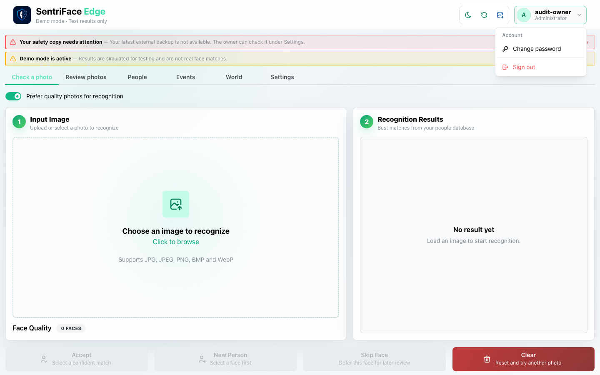
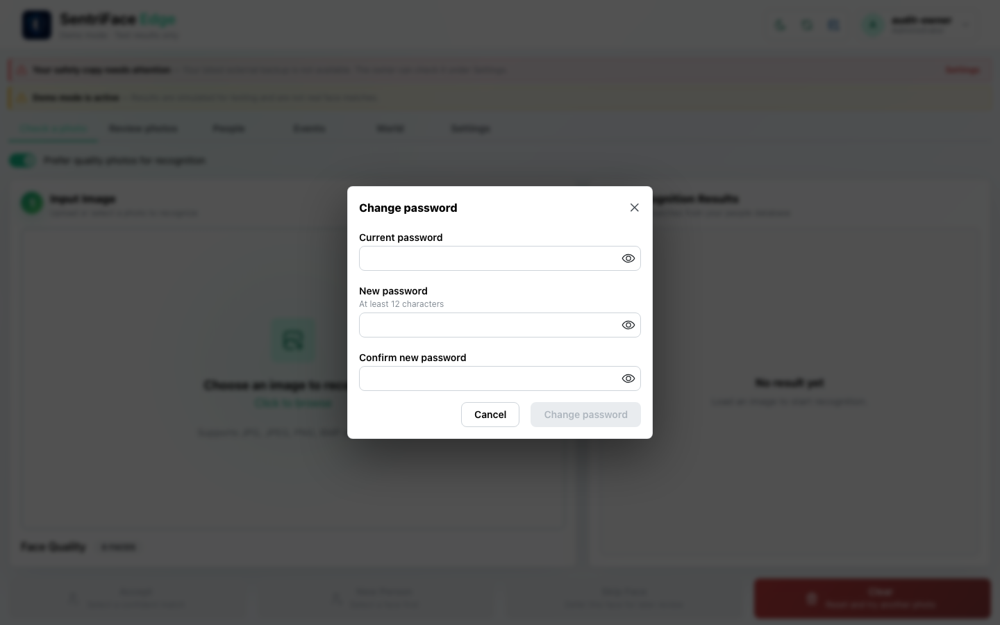
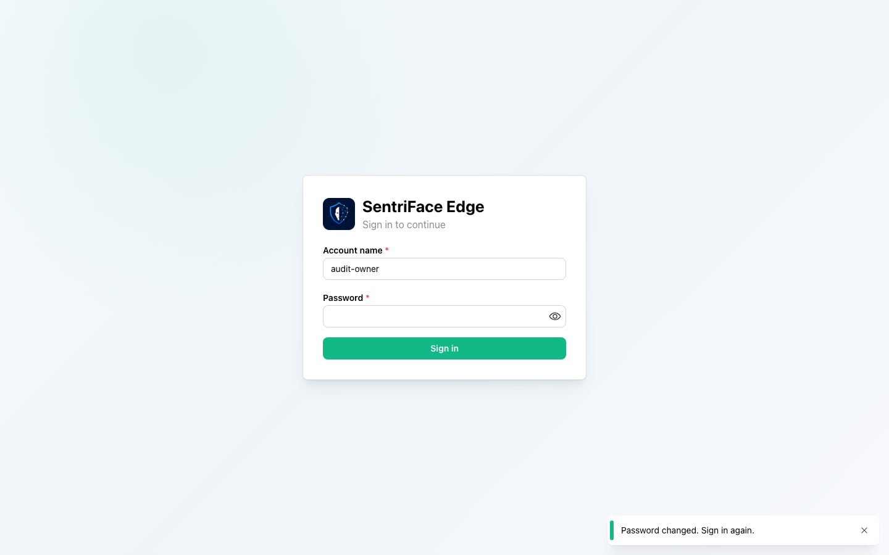
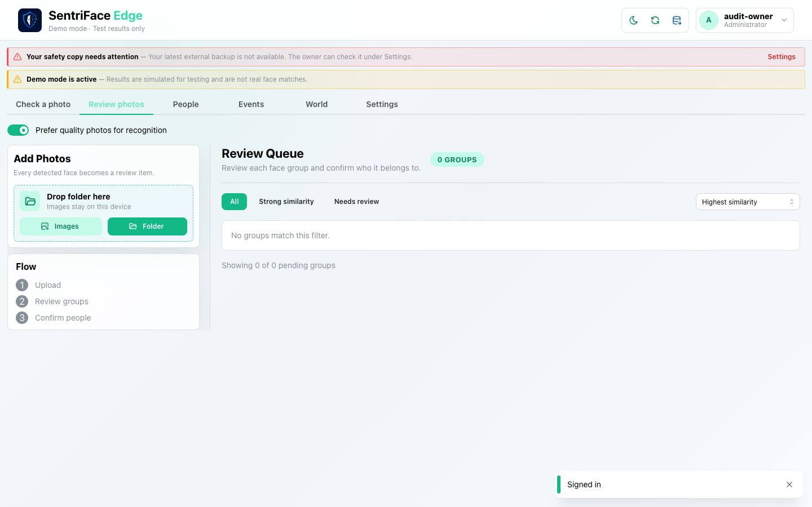

# J02 — Account menu and password-dialog cancellation

[Audit index](../INDEX.md) · [Source oracle](../source-map.md) · [Independent review](../review.md)

**Scope result: PARTIAL.** This record proves only the ordered observations below; source-contract branches outside them are not silently passed. Source tasks: [SJ-007](../source-journeys.csv), [SJ-059](../source-journeys.csv).

**Operator goal:** Find own-account controls and inspect the password-change form without altering credentials.

**Starting state and required role:** Signed-in disposable Administrator in the main shell. All captures in this record use the disposable Administrator unless a step explicitly says unauthenticated.

**Implemented owners:** [`SentriFaceApp.jsx`](../../../frontend/src/SentriFaceApp.jsx); [`components/AuthGate.jsx`](../../../frontend/src/components/AuthGate.jsx).

**Evidence basis:** saved current-run screenshots, capture metadata and accessibility snapshots. Visual acceptance is documented in the independent review; this assembly does not claim a second independent visual inspection. Synthetic images are generated patterns, not biometric photographs. No source/UI manipulation produces these states.

**Source:** `b457f0a723e845dd1a92a07a577072c85146c89a`. Capture sequence numbers order the captured states; uncaptured return actions are named in the text. The audit was interrupted and resumed across November 5 and 10 at the same source SHA.

## Ordered interaction and visual evidence

### Step 01 — Account menu

Open account menu. Change password and Sign out are exposed as separate menu items.

Capture: `UX-01` · Administrator · light theme · 1440×900 CSS viewport · DPR 1 · `2026-11-05T10:05:42.119435+00:00` · fixture: synthetic.

Exact scroll offset was not recorded for this earlier capture; use the full original framing when reproducing.

### Step 02 — Change password dialog

Choose Change password. The modal shows current/new/confirmation fields and a Cancel action. It is cancelled after this capture.

Capture: `UX-01` · Administrator · light theme · 1440×900 CSS viewport · DPR 1 · `2026-11-05T10:05:48.547471+00:00` · fixture: synthetic.

Exact scroll offset was not recorded for this earlier capture; use the full original framing when reproducing.

## Outcome, authority and return path

Account menu and Change password dialog are opened; Cancel closes the dialog. No password change, sign-out or successful reauthentication is established by these two frames.

## Limits and unexecuted branches

Incorrect-current-password, mismatch/short validation, successful credential replacement and session revocation are not run in this record.

No redesign or implementation is specified by this record. Findings and recommended directions belong to the shared audit review and canonical design authority.

## macOS completion pass 2 — ordered continuation

**Status: PARTIAL overall.** Source remains `b457f0a723e845dd1a92a07a577072c85146c89a`; pass-one checkpoint `27a0532123389421b5cfdc5d0331eb1793e74c78` remains unchanged in history. Synthetic source mode and a dedicated disposable authority; 1440×900 CSS viewport, DPR 1, Day, Administrator unless the capture register says unauthenticated.

For the disposable audit owner only, mismatch and short-password inputs each disabled submission. Wrong current password produced “Current password is incorrect” while retaining the dialog. With the correct current password, change to a newly generated credential: the session returned to sign-in with “Password changed. Sign in again.” The old credential was refused and the new credential authenticated. Password-field captures, including the wrong-current error, are private; the screenshots and raw accessibility text are not published. No operator account was changed.

### Step 03 — Pass2 Password mismatch disabled

Private original retained in the local archive; credential-field capture is not published.

Capture `2026-11-11T06:26:20.121955+00:00` · Administrator · UX-01 · synthetic · scroll {'x': 0, 'y': 0}. Full browser viewport, not native window chrome.

### Step 04 — Pass2 Wrong current password

Private original retained in the local archive; credential-field capture is not published.

Capture `2026-11-11T06:26:21.622847+00:00` · Administrator · UX-01 · synthetic · scroll {'x': 0, 'y': 0}. Full browser viewport, not native window chrome.

### Step 05 — Pass2 Password changed signed out

Capture `2026-11-11T06:26:58.082327+00:00` · Unauthenticated · UX-00 · synthetic · scroll {'x': 0, 'y': 0}. Full browser viewport, not native window chrome.

### Step 06 — Pass2 Old password rejected

Private original retained in the local archive; credential-field capture is not published.

Capture `2026-11-11T06:27:16.171458+00:00` · Unauthenticated · UX-00 · synthetic · scroll {'x': 0, 'y': 0}. Full browser viewport, not native window chrome.

### Step 07 — Pass2 Reauthenticated with new password

Capture `2026-11-11T06:27:17.142126+00:00` · Administrator · UX-01 · synthetic · scroll {'x': 0, 'y': 0}. Full browser viewport, not native window chrome.

### Step 08 — Pass2 Short password disabled

Private original retained in the local archive; credential-field capture is not published.

Capture `2026-11-11T06:27:47.008648+00:00` · Administrator · UX-01 · synthetic · scroll {'x': 0, 'y': 0}. Full browser viewport, not native window chrome.
