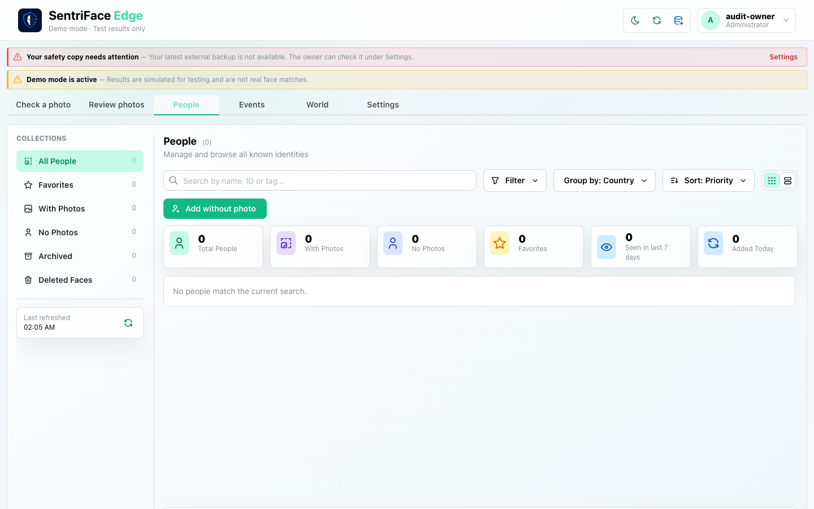
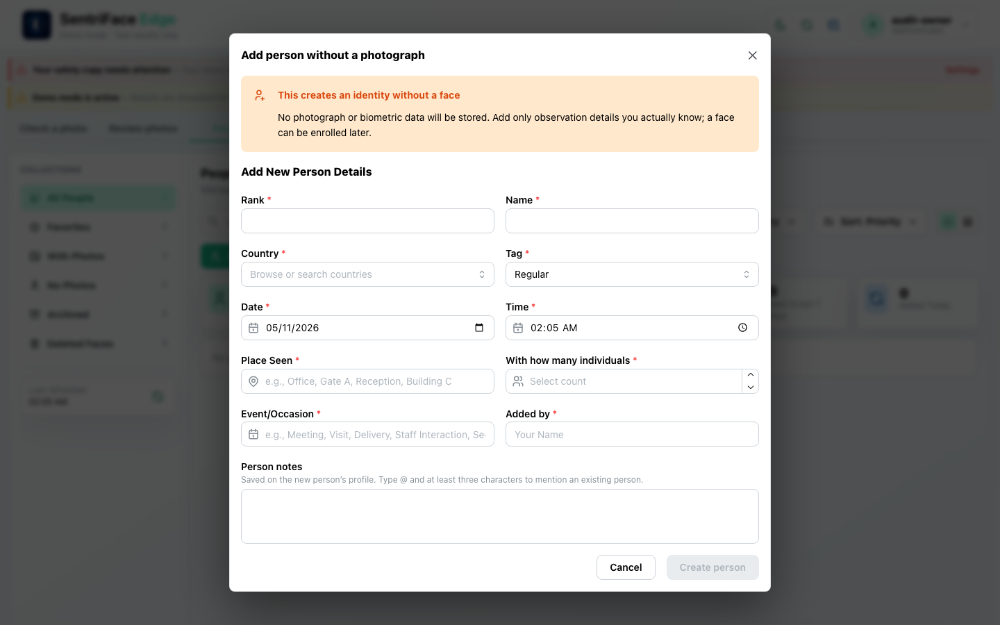
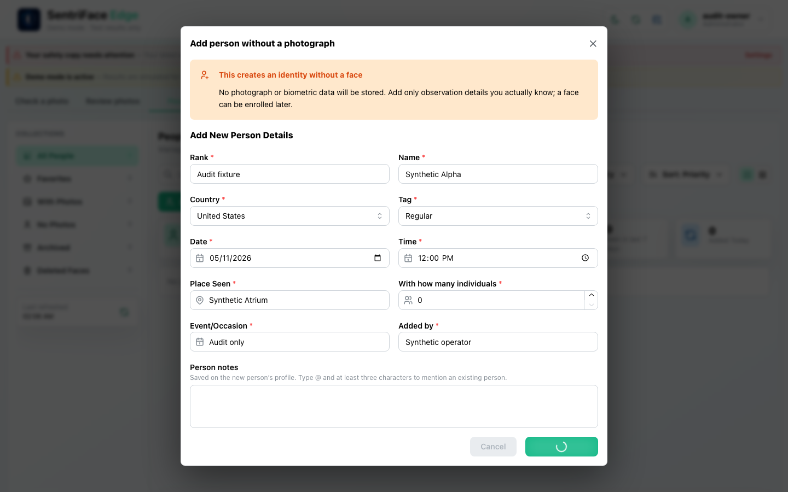
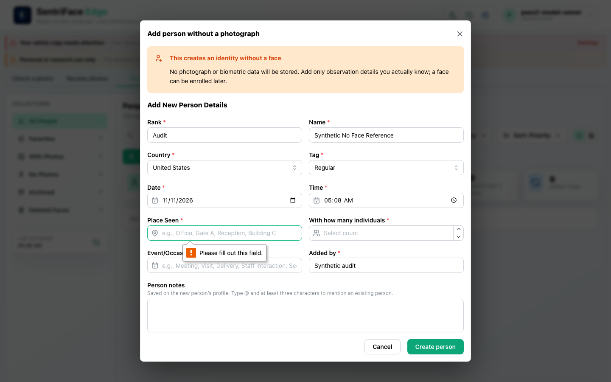

# J03 — Create a Person without a photograph

[Audit index](../INDEX.md) · [Source oracle](../source-map.md) · [Independent review](../review.md)

**Scope result: PARTIAL.** This record proves only the ordered observations below; source-contract branches outside them are not silently passed. Source tasks: [SJ-021](../source-journeys.csv), [SJ-023](../source-journeys.csv).

**Operator goal:** Create a named identity without inventing biometric evidence or an Encounter.

**Starting state and required role:** Empty People library; Administrator has add capability. Synthetic Alpha is an expressly fictional fixture. All captures in this record use the disposable Administrator unless a step explicitly says unauthenticated.

**Implemented owners:** [`views/PeopleView.jsx`](../../../frontend/src/views/PeopleView.jsx); [`hooks/usePeopleController.js`](../../../frontend/src/hooks/usePeopleController.js).

**Evidence basis:** saved current-run screenshots, capture metadata and accessibility snapshots. Visual acceptance is documented in the independent review; this assembly does not claim a second independent visual inspection. Synthetic images are generated patterns, not biometric photographs. No source/UI manipulation produces these states.

**Source:** `b457f0a723e845dd1a92a07a577072c85146c89a`. Capture sequence numbers order the captured states; uncaptured return actions are named in the text. The audit was interrupted and resumed across November 5 and 10 at the same source SHA.

## Ordered interaction and visual evidence

### Step 01 — Empty library

Select People. The empty collection and disabled pagination establish the starting state.

Capture: `UX-05` · Administrator · light theme · 1440×900 CSS viewport · DPR 1 · `2026-11-05T10:05:49.689526+00:00` · fixture: synthetic.

Exact scroll offset was not recorded for this earlier capture; use the full original framing when reproducing.

### Step 02 — Create person dialog

Choose Add without photo. The dialog explains that no photograph or biometric data will be stored; Create person is initially disabled.

Capture: `UX-07` · Administrator · light theme · 1440×900 CSS viewport · DPR 1 · `2026-11-05T10:06:03.218458+00:00` · fixture: synthetic.

Exact scroll offset was not recorded for this earlier capture; use the full original framing when reproducing.

### Step 03 — Create person valid

Enter the explicitly synthetic identity and fixture context and select Country. The form is ready to submit.

Capture: `UX-07` · Administrator · light theme · 1440×900 CSS viewport · DPR 1 · `2026-11-05T10:06:19.010663+00:00` · fixture: synthetic.

Exact scroll offset was not recorded for this earlier capture; use the full original framing when reproducing.

### Step 04 — Person create submitting

Choose Create person. The spinner and disabled controls show submission in progress. This frame was relabeled from Person-created after independent review; use J04 step 1 for completion.

Capture: `UX-05` · Administrator · light theme · 1440×900 CSS viewport · DPR 1 · `2026-11-05T10:06:20.748843+00:00` · fixture: synthetic.

Exact scroll offset was not recorded for this earlier capture; use the full original framing when reproducing.

## Outcome, authority and return path

The captured sequence reaches submission. Step 4 is a real loading/intermediate frame with the form still open, not a completed library. The later completed Synthetic Alpha profile is independently captured in J04 step 1.

## Limits and unexecuted branches

Server refusal, cancel and selected-ID mention branches are not captured here. The form’s required fields and “known context” wording must not be taken as permission to invent real observation facts.

No redesign or implementation is specified by this record. Findings and recommended directions belong to the shared audit review and canonical design authority.

## macOS completion pass 2 — continuation B

Source product `b457f0a723e845dd1a92a07a577072c85146c89a`; full browser-content screenshots, 1440×900 CSS pixels, DPR 1, Day; dedicated disposable authority. See capture register for exact role, capture time and inference qualification.

On a fresh authorized ONNX authority, submit a synthetic no-photo Person with required Place Seen empty. Native validation points to the required field; no Person is created by that attempted submission.

### Step 05 — Pass2 ONNX person invalid form

Captured `2026-11-11T13:09:12.929087+00:00` · Administrator · UX-07 · scroll {'x': 0, 'y': 0}. Exact fixture and inference mode are described above and in the capture register.
