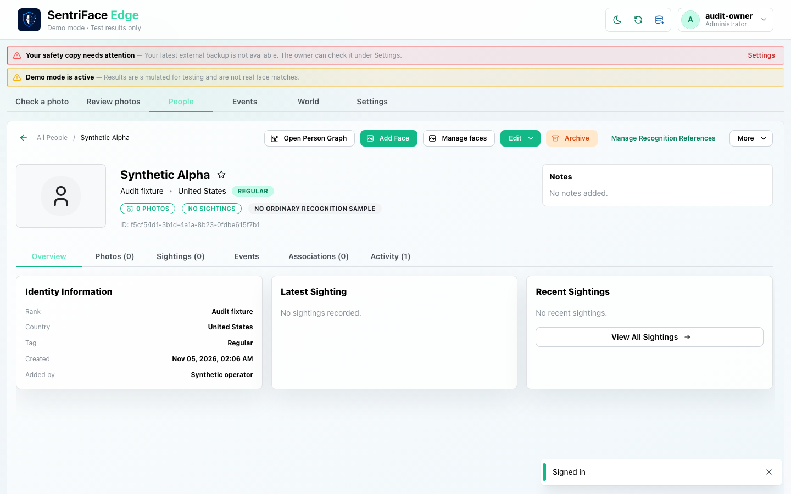
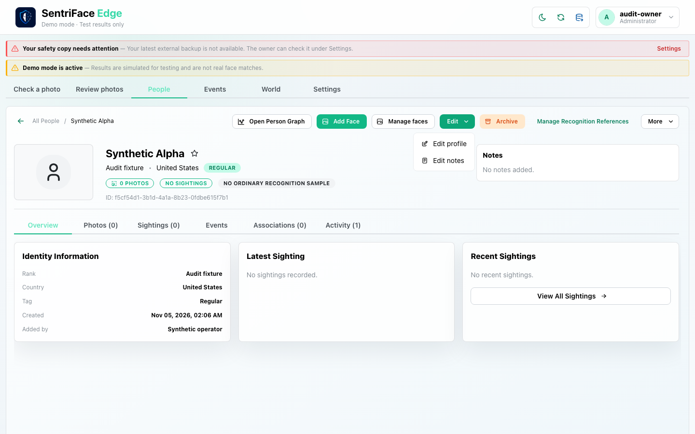
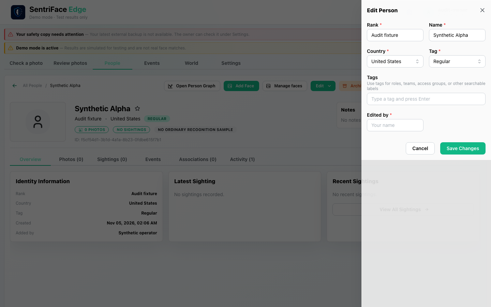
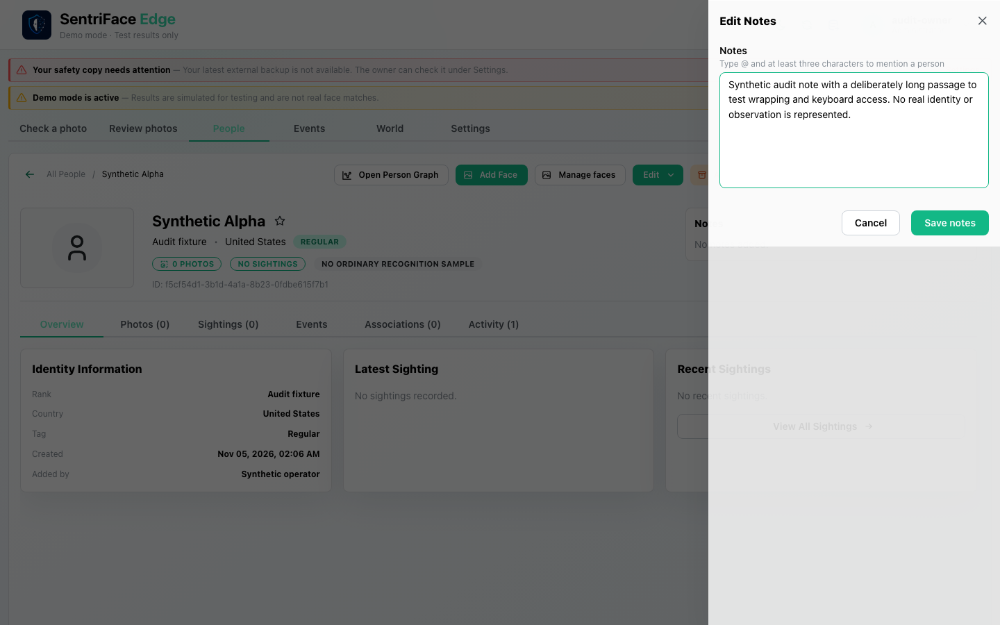
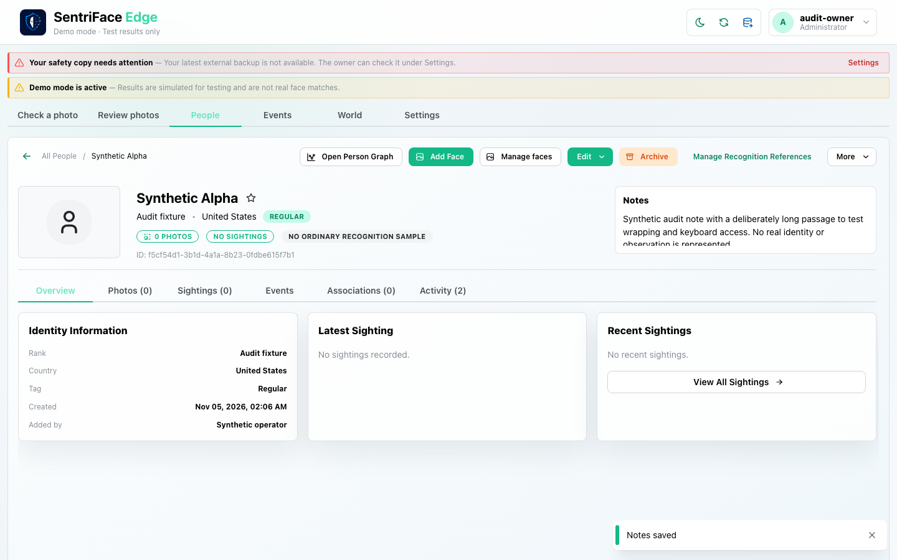
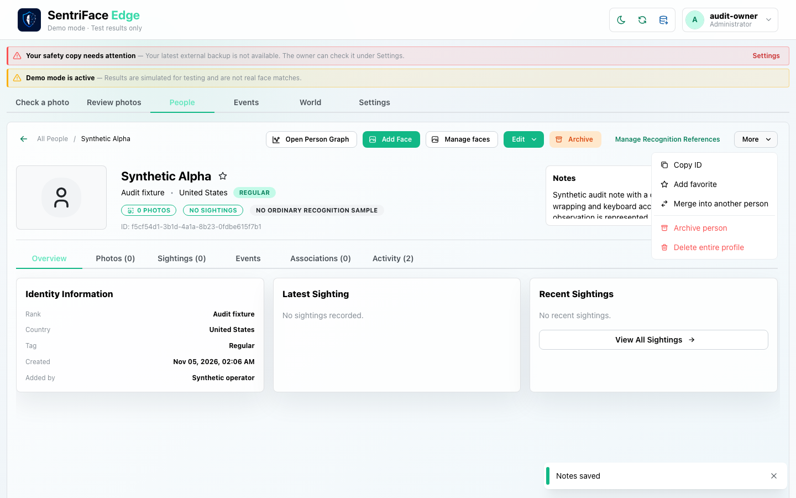

# J04 — Profile, cancelled metadata edit and saved Person Note

[Audit index](../INDEX.md) · [Source oracle](../source-map.md) · [Independent review](../review.md)

**Scope result: PARTIAL.** This record proves only the ordered observations below; source-contract branches outside them are not silently passed. Source tasks: [SJ-024](../source-journeys.csv), [SJ-028](../source-journeys.csv), [SJ-029](../source-journeys.csv), [SJ-059](../source-journeys.csv).

**Operator goal:** Inspect Synthetic Alpha, cancel a profile edit, and save a general Person Note.

**Starting state and required role:** Synthetic Alpha exists as a no-face identity after J03. The audit resumed against the same source SHA; this is not an uninterrupted session from J03. All captures in this record use the disposable Administrator unless a step explicitly says unauthenticated.

**Implemented owners:** [`views/PeopleView.jsx`](../../../frontend/src/views/PeopleView.jsx); [`hooks/usePeopleController.js`](../../../frontend/src/hooks/usePeopleController.js).

**Evidence basis:** saved current-run screenshots, capture metadata and accessibility snapshots. Visual acceptance is documented in the independent review; this assembly does not claim a second independent visual inspection. Synthetic images are generated patterns, not biometric photographs. No source/UI manipulation produces these states.

**Source:** `b457f0a723e845dd1a92a07a577072c85146c89a`. Capture sequence numbers order the captured states; uncaptured return actions are named in the text. The audit was interrupted and resumed across November 5 and 10 at the same source SHA.

## Ordered interaction and visual evidence

### Step 01 — Profile overview

Open the created Synthetic Alpha card. Its no-face Overview, zero sightings and ordinary-recognition warning establish the successful J03 outcome.

Capture: `UX-06` · Administrator · light theme · 1440×900 CSS viewport · DPR 1 · `2026-11-10T08:19:08.399021+00:00` · fixture: synthetic.

Exact scroll offset was not recorded for this earlier capture; use the full original framing when reproducing.

### Step 02 — Edit menu open (legacy filename says drawer)

Open Edit. Despite the legacy filename Edit-drawer, this frame is the Edit menu containing Edit profile and Edit notes.

Capture: `UX-07` · Administrator · light theme · 1440×900 CSS viewport · DPR 1 · `2026-11-10T08:19:32.256431+00:00` · fixture: synthetic.

Exact scroll offset was not recorded for this earlier capture; use the full original framing when reproducing.

### Step 03 — Edit profile drawer

Choose Edit profile. Inspect the right-side drawer, enter a trial name, then cancel; no metadata write is claimed.

Capture: `UX-07` · Administrator · light theme · 1440×900 CSS viewport · DPR 1 · `2026-11-10T08:19:41.667326+00:00` · fixture: synthetic.

Exact scroll offset was not recorded for this earlier capture; use the full original framing when reproducing.

### Step 04 — Notes drawer

Open Edit notes and enter a clearly synthetic long note. The drawer exposes Save notes and Cancel.

Capture: `UX-07` · Administrator · light theme · 1440×900 CSS viewport · DPR 1 · `2026-11-10T08:19:43.143278+00:00` · fixture: synthetic.

Exact scroll offset was not recorded for this earlier capture; use the full original framing when reproducing.

### Step 05 — Notes saved

Choose Save notes and wait for the drawer to close. “Notes saved” appears and the profile summary displays the saved note; visual review records clipping of the long summary.

Capture: `UX-06` · Administrator · light theme · 1440×900 CSS viewport · DPR 1 · `2026-11-10T08:19:44.777768+00:00` · fixture: synthetic.

Exact scroll offset was not recorded for this earlier capture; use the full original framing when reproducing.

### Step 06 — Lifecycle menu

Open More. Copy ID, favorite, merge, archive and delete entry points are visible; merely opening this menu changes no lifecycle authority.

Capture: `UX-08` · Administrator · light theme · 1440×900 CSS viewport · DPR 1 · `2026-11-10T08:19:45.586687+00:00` · fixture: synthetic.

Exact scroll offset was not recorded for this earlier capture; use the full original framing when reproducing.

## Outcome, authority and return path

The completed no-face profile is visible. A trial name edit is cancelled; the profile remains Synthetic Alpha. A synthetic Person Note is saved and the “Notes saved” toast is observed. The More menu exposes later lifecycle entry points without executing them.

## Limits and unexecuted branches

No metadata-save outcome, selected mention, note revision conflict or complete Viewer read path is proved here. Earlier captures lack exact scroll offsets; preserve their full-window context when reproducing.

No redesign or implementation is specified by this record. Findings and recommended directions belong to the shared audit review and canonical design authority.
