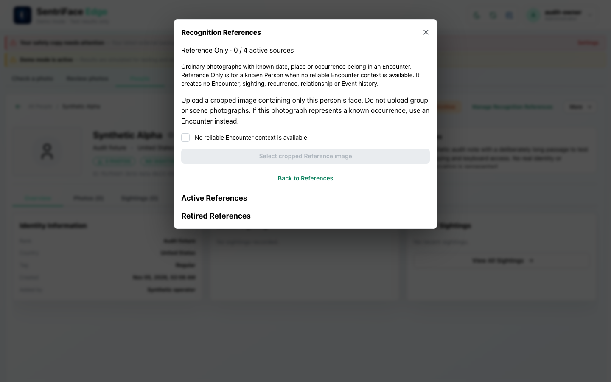
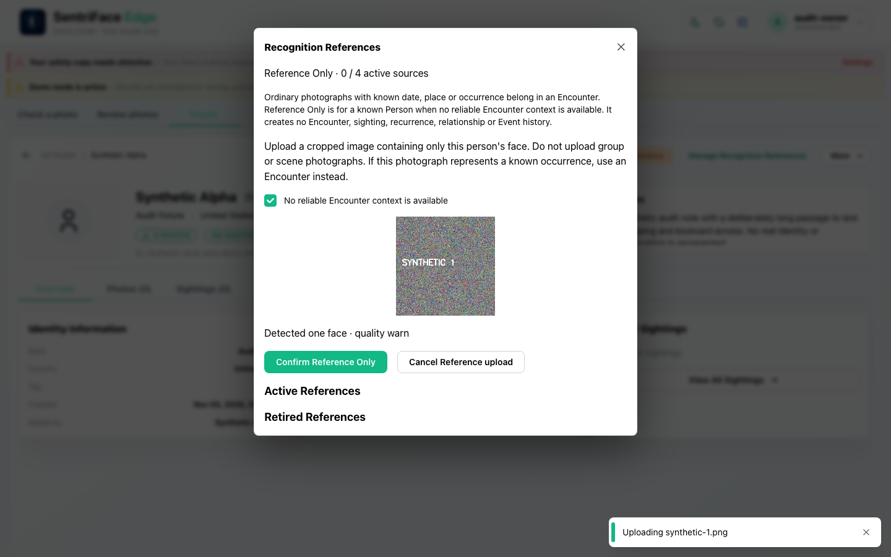
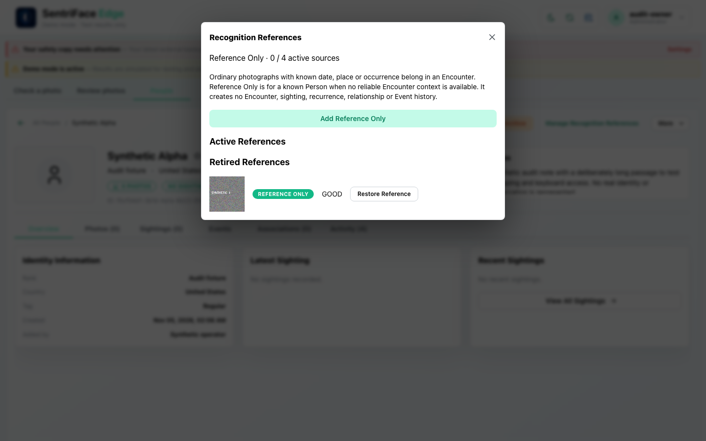
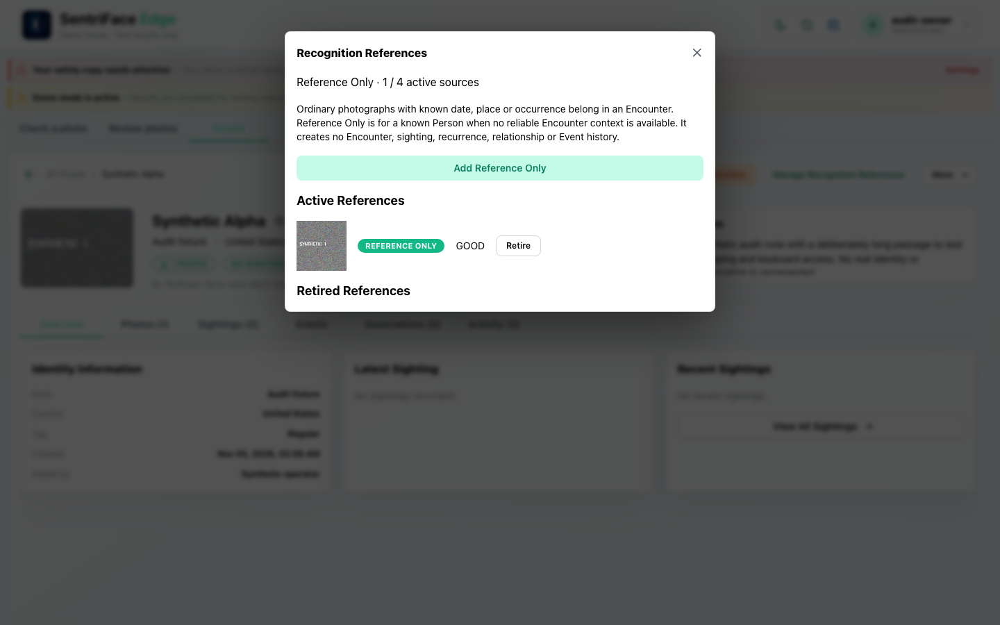
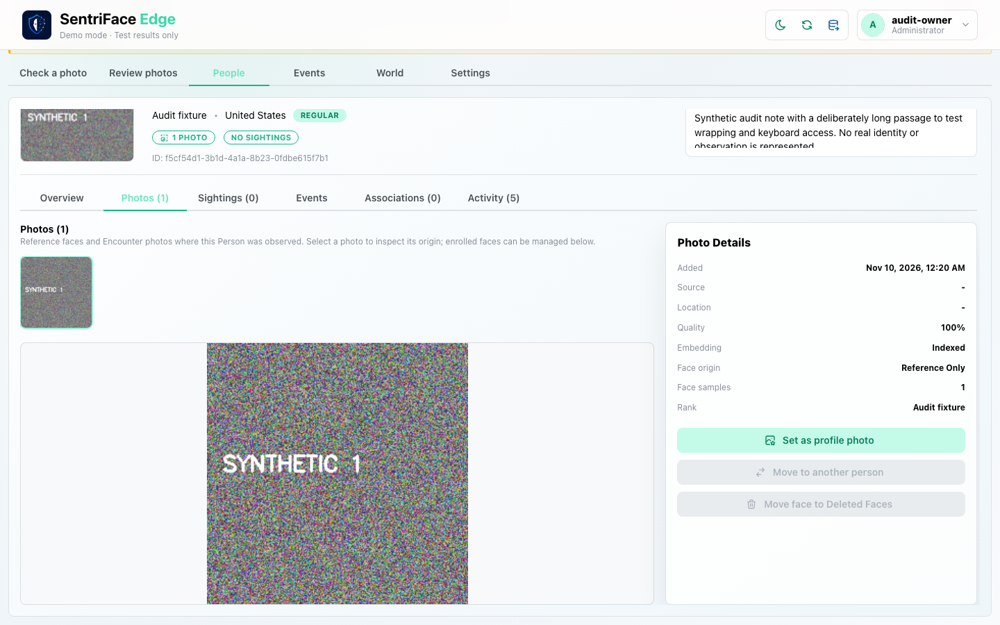

# J05 — Reference Only acknowledgment, enrollment and lifecycle

[Audit index](../INDEX.md) · [Source oracle](../source-map.md) · [Independent review](../review.md)

**Scope result: PARTIAL.** This record proves only the ordered observations below; source-contract branches outside them are not silently passed. Source tasks: [SJ-025](../source-journeys.csv), [SJ-030](../source-journeys.csv), [SJ-031](../source-journeys.csv).

**Operator goal:** Add an exceptional contextless recognition source, then retire and restore it without creating an occurrence.

**Starting state and required role:** Synthetic Alpha is ACTIVE and has no usable ordinary-recognition sample. Administrator has add capability. Input synthetic-1.png is a generated non-biometric pattern; dev mode treats the whole image as a face. All captures in this record use the disposable Administrator unless a step explicitly says unauthenticated.

**Implemented owners:** [`views/RecognitionReferences.jsx`](../../../frontend/src/views/RecognitionReferences.jsx); [`views/PeopleView.jsx`](../../../frontend/src/views/PeopleView.jsx); [`hooks/usePeopleController.js`](../../../frontend/src/hooks/usePeopleController.js).

**Evidence basis:** saved current-run screenshots, capture metadata and accessibility snapshots. Visual acceptance is documented in the independent review; this assembly does not claim a second independent visual inspection. Synthetic images are generated patterns, not biometric photographs. No source/UI manipulation produces these states.

**Source:** `b457f0a723e845dd1a92a07a577072c85146c89a`. Capture sequence numbers order the captured states; uncaptured return actions are named in the text. The audit was interrupted and resumed across November 5 and 10 at the same source SHA.

## Ordered interaction and visual evidence

### Step 01 — Reference ack required

Choose Add Face. Recognition References opens with the no-reliable-Encounter-context acknowledgment unchecked and upload unavailable.

Capture: `UX-07` · Administrator · light theme · 1440×900 CSS viewport · DPR 1 · `2026-11-10T08:20:06.209965+00:00` · fixture: synthetic.

Exact scroll offset was not recorded for this earlier capture; use the full original framing when reproducing.

### Step 02 — Reference prepared

Check the acknowledgment and select synthetic-1.png. The staged image and “Detected one face · quality warn” appear with Confirm Reference Only and Cancel Reference upload. The lingering Uploading toast is not a success receipt.

Capture: `UX-07` · Administrator · light theme · 1440×900 CSS viewport · DPR 1 · `2026-11-10T08:20:09.049456+00:00` · fixture: synthetic.

Exact scroll offset was not recorded for this earlier capture; use the full original framing when reproducing.

### Step 03 — Reference active

Choose Confirm Reference Only and wait for Retire. The active list contains one source and active count is 1 / 4.

Capture: `UX-07` · Administrator · light theme · 1440×900 CSS viewport · DPR 1 · `2026-11-10T08:20:38.270608+00:00` · fixture: synthetic.

Exact scroll offset was not recorded for this earlier capture; use the full original framing when reproducing.

### Step 04 — Reference retired

Choose Retire. The source moves to Retired References with Restore Reference available.

Capture: `UX-07` · Administrator · light theme · 1440×900 CSS viewport · DPR 1 · `2026-11-10T08:20:40.152464+00:00` · fixture: synthetic.

Exact scroll offset was not recorded for this earlier capture; use the full original framing when reproducing.

### Step 05 — Reference restored

Choose Restore Reference. The source returns to the active list. No purge or new occurrence is implied.

Capture: `UX-07` · Administrator · light theme · 1440×900 CSS viewport · DPR 1 · `2026-11-10T08:20:41.205860+00:00` · fixture: synthetic.

Exact scroll offset was not recorded for this earlier capture; use the full original framing when reproducing.

### Step 06 — Photos reference origin

Close References and inspect Photos. Origin is Reference Only; move/deleted-face controls are disabled and no sightings are shown.

Capture: `UX-06` · Administrator · light theme · 1440×900 CSS viewport · DPR 1 · `2026-11-10T08:20:42.553252+00:00` · fixture: synthetic.

Exact scroll offset was not recorded for this earlier capture; use the full original framing when reproducing.

## Outcome, authority and return path

One synthetic Reference Only source is prepared and confirmed, retired, then restored through actual controls. The Photos surface labels it Reference Only and disables transfer/deleted-face actions for that source. The profile still reports no sightings. This is workflow evidence, not detector or identity-accuracy evidence.

## Limits and unexecuted branches

Zero/multiple-face rejection cannot be represented by the whole-image dev detector. Four-source cap, poor/proof-only choices, shared-sample conflict, duplicate/no-new-slot, upload cancel and restricted-role variants are not covered by this sequence.

No redesign or implementation is specified by this record. Findings and recommended directions belong to the shared audit review and canonical design authority.
