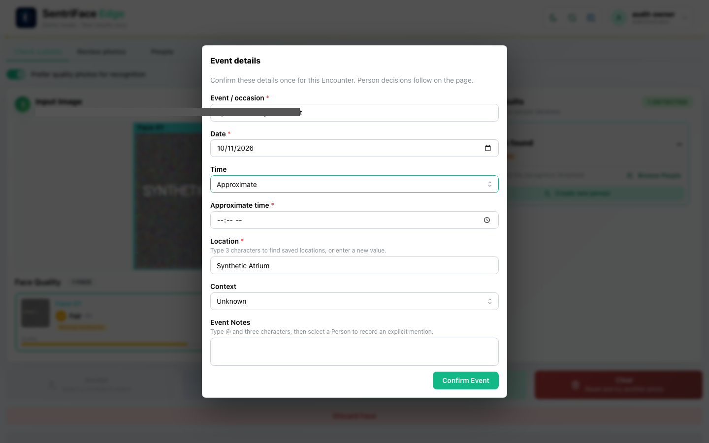
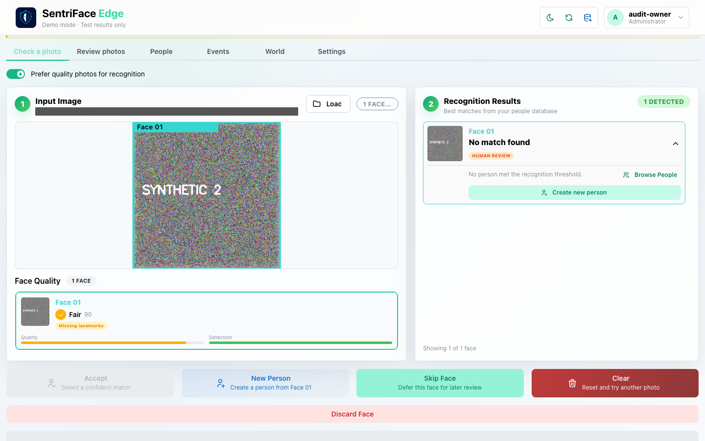
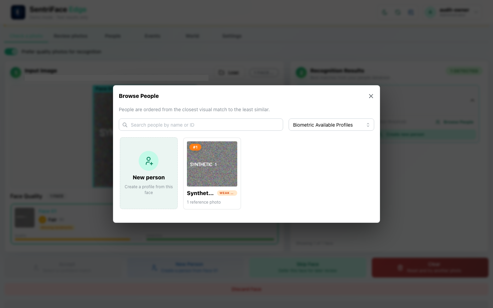
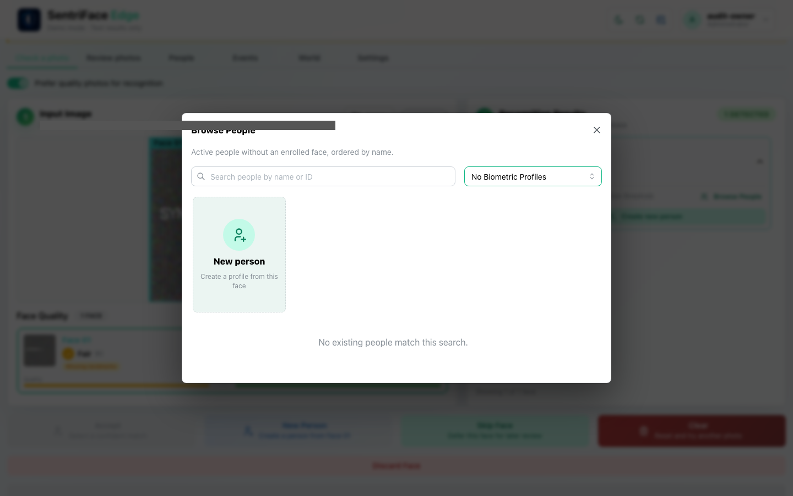
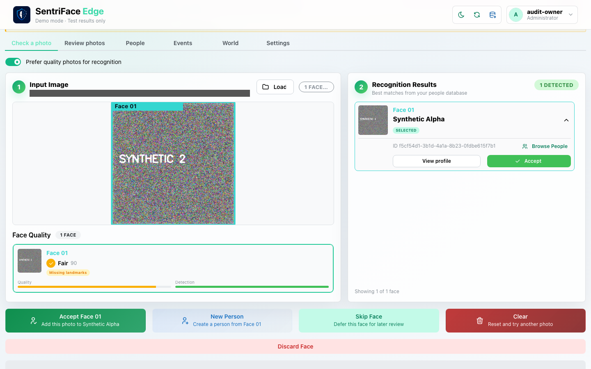
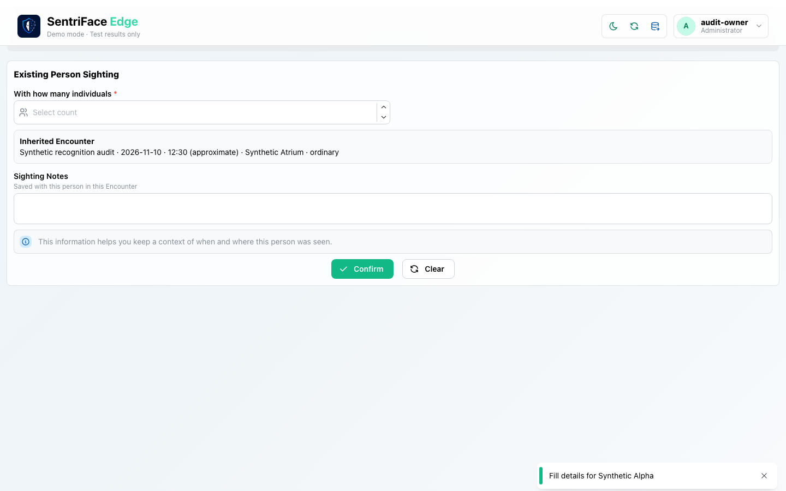
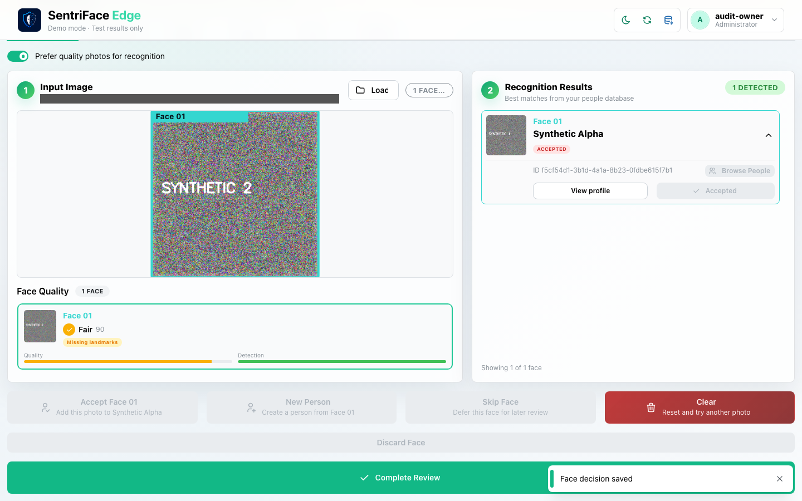
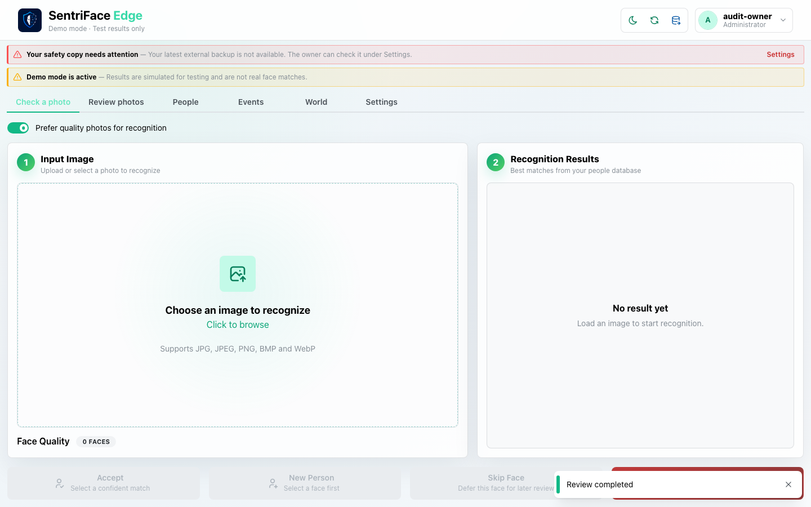
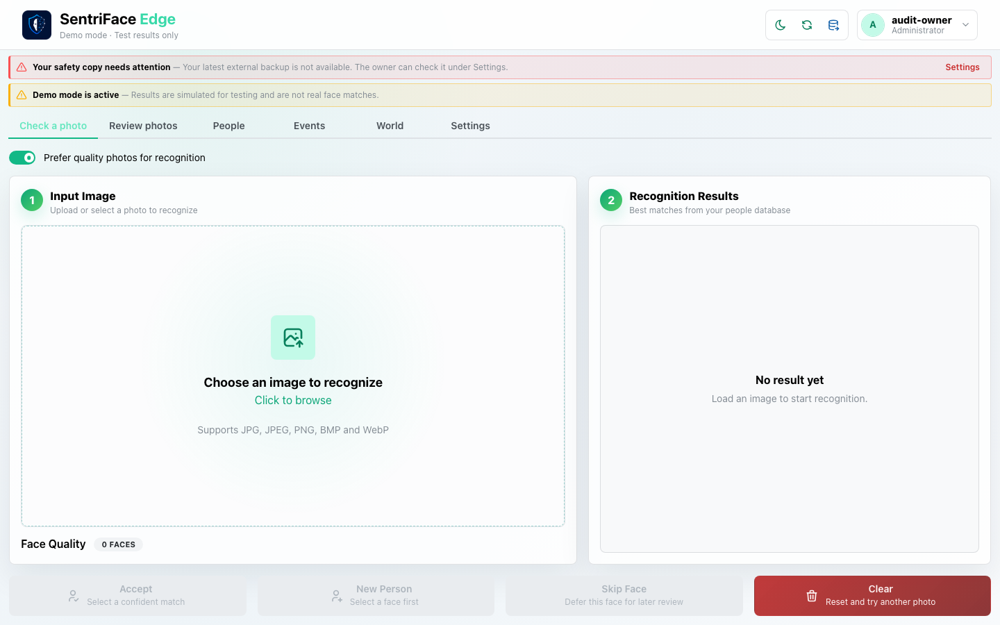

# J06 — Check a photo: choose an existing Person and complete review

[Audit index](../INDEX.md) · [Source oracle](../source-map.md) · [Independent review](../review.md)

**Scope result: PARTIAL.** This record proves only the ordered observations below; source-contract branches outside them are not silently passed. Source tasks: [SJ-008](../source-journeys.csv), [SJ-009](../source-journeys.csv), [SJ-011](../source-journeys.csv).

**Operator goal:** Review a synthetic image, set occurrence metadata, explicitly choose an existing Person and finalize one Encounter.

**Starting state and required role:** Administrator can recognize and add. Synthetic Alpha already has Reference Only coverage. synthetic-2.png is a distinct non-biometric generated pattern; all recognition results are synthetic. All captures in this record use the disposable Administrator unless a step explicitly says unauthenticated.

**Implemented owners:** [`views/RecognizeView.jsx`](../../../frontend/src/views/RecognizeView.jsx); [`components/EncounterDetailsModal.jsx`](../../../frontend/src/components/EncounterDetailsModal.jsx); [`components/RecognitionFollowupForm.jsx`](../../../frontend/src/components/RecognitionFollowupForm.jsx); [`hooks/useRecognizeController.js`](../../../frontend/src/hooks/useRecognizeController.js).

**Evidence basis:** saved current-run screenshots, capture metadata and accessibility snapshots. Visual acceptance is documented in the independent review; this assembly does not claim a second independent visual inspection. Synthetic images are generated patterns, not biometric photographs. No source/UI manipulation produces these states.

**Source:** `b457f0a723e845dd1a92a07a577072c85146c89a`. Capture sequence numbers order the captured states; uncaptured return actions are named in the text. The audit was interrupted and resumed across November 5 and 10 at the same source SHA.

## Ordered interaction and visual evidence

### Step 01 — Event details initial

Upload synthetic-2.png. The one-time Event details modal opens over the synthetic recognition result. The original is private because local path text is visible behind the overlay.

**Private evidence retained; no public image.** This state is withheld for path/credential privacy or is a rejected capture label. Its existence does not imply a successful workflow outcome.

Capture: `UX-02` · Administrator · light theme · 1440×900 CSS viewport · DPR 1 · `2026-11-10T08:21:11.210828+00:00` · fixture: synthetic.

Exact scroll offset was not recorded for this earlier capture; use the full original framing when reproducing.

### Step 02 — Exact time fields

Fill the synthetic occurrence and choose Start and end. Required start/end fields are exposed. This private frame samples the exact-time branch; it is not the final time choice.

**Private evidence retained; no public image.** This state is withheld for path/credential privacy or is a rejected capture label. Its existence does not imply a successful workflow outcome.

Capture: `UX-02` · Administrator · light theme · 1440×900 CSS viewport · DPR 1 · `2026-11-10T08:21:11.925011+00:00` · fixture: synthetic.

Exact scroll offset was not recorded for this earlier capture; use the full original framing when reproducing.

### Step 03 — Approximate time fields

Change Time to Approximate. The form now exposes Approximate time. Public evidence uses an opaque path mask and is not an untouched original.

**Sanitized derivative:** local path text is covered by opaque browser-capture masks. The untouched original is retained privately. A mask may overlap foreground overlay content; this derivative is not an untouched runtime original.

Capture: `UX-02` · Administrator · light theme · 1440×900 CSS viewport · DPR 1 · `2026-11-10T08:22:12.282942+00:00` · fixture: synthetic.

Scroll recorded: x=0, y=80.

### Step 04 — Unknown face result

Enter 12:30, ordinary context, and confirm Event. The result says no person met the recognition threshold; Complete Review remains disabled.

**Sanitized derivative:** local path text is covered by opaque browser-capture masks. The untouched original is retained privately. A mask may overlap foreground overlay content; this derivative is not an untouched runtime original.

Capture: `UX-02` · Administrator · light theme · 1440×900 CSS viewport · DPR 1 · `2026-11-10T08:22:13.447025+00:00` · fixture: synthetic.

Scroll recorded: x=0, y=80.

### Step 05 — Browse biometric profiles

Choose Browse People. The Biometric Available Profiles mode lists Synthetic Alpha with a weak-match label; this is a proposal, not acceptance.

**Sanitized derivative:** local path text is covered by opaque browser-capture masks. The untouched original is retained privately. A mask may overlap foreground overlay content; this derivative is not an untouched runtime original.

Capture: `UX-02` · Administrator · light theme · 1440×900 CSS viewport · DPR 1 · `2026-11-10T08:22:14.793225+00:00` · fixture: synthetic.

Scroll recorded: x=0, y=80.

### Step 06 — Browse no biometric empty

Change Profile type to No Biometric Profiles. The empty no-biometric collection is captured; switch back to continue.

**Sanitized derivative:** local path text is covered by opaque browser-capture masks. The untouched original is retained privately. A mask may overlap foreground overlay content; this derivative is not an untouched runtime original.

Capture: `UX-02` · Administrator · light theme · 1440×900 CSS viewport · DPR 1 · `2026-11-10T08:22:30.867008+00:00` · fixture: synthetic.

Scroll recorded: x=0, y=80.

### Step 07 — Existing person selected

Choose Synthetic Alpha in the biometric collection. The main result now shows Selected and explicit accept controls.

**Sanitized derivative:** local path text is covered by opaque browser-capture masks. The untouched original is retained privately. A mask may overlap foreground overlay content; this derivative is not an untouched runtime original.

Capture: `UX-02` · Administrator · light theme · 1440×900 CSS viewport · DPR 1 · `2026-11-10T08:22:31.737559+00:00` · fixture: synthetic.

Scroll recorded: x=0, y=80.

### Step 08 — Existing person followup

Choose Accept Face 01. The Existing Person Sighting form inherits the Encounter metadata and requests individual count and Sighting Notes.

**Sanitized derivative:** local path text is covered by opaque browser-capture masks. The untouched original is retained privately. A mask may overlap foreground overlay content; this derivative is not an untouched runtime original.

Capture: `UX-02` · Administrator · light theme · 1440×900 CSS viewport · DPR 1 · `2026-11-10T08:22:32.404215+00:00` · fixture: synthetic.

Scroll recorded: x=0, y=923.

### Step 09 — Accepted awaiting completion

Enter synthetic count/note and Confirm. The face says Accepted and “Face decision saved”; Complete Review becomes available. This is still awaiting final completion.

**Sanitized derivative:** local path text is covered by opaque browser-capture masks. The untouched original is retained privately. A mask may overlap foreground overlay content; this derivative is not an untouched runtime original.

Capture: `UX-02` · Administrator · light theme · 1440×900 CSS viewport · DPR 1 · `2026-11-10T08:23:00.058113+00:00` · fixture: synthetic.

Scroll recorded: x=0, y=130.

### Step 10 — Completed review

Choose Complete Review. “Review completed” is observed and the input/result is cleared. The finalized Event is followed in J07.

Capture: `UX-02` · Administrator · light theme · 1440×900 CSS viewport · DPR 1 · `2026-11-10T08:23:24.982944+00:00` · fixture: synthetic.

Scroll recorded: x=0, y=4.

## Outcome, authority and return path

The operator explicitly selects Synthetic Alpha from Browse People, confirms Sighting details, and completes review. “Face decision saved” precedes “Review completed”; the first finalized Event appears in J07. A candidate or saved draft is not itself completion.

## Limits and unexecuted branches

No-face/multi-face, genuine inference, New Person, quality overrides, discard, defer, interrupted recognition, gallery and completion retry are not established here. The first two originals expose a local managed path behind the modal and are withheld; subsequent public frames are explicitly masked derivatives, with some mask overlap on unrelated foreground UI.

No redesign or implementation is specified by this record. Findings and recommended directions belong to the shared audit review and canonical design authority.

## macOS completion pass 2 — continuation B

Source product `b457f0a723e845dd1a92a07a577072c85146c89a`; full browser-content screenshots, 1440×900 CSS pixels, DPR 1, Day; dedicated disposable authority. See capture register for exact role, capture time and inference qualification.

In a synthetic Check a Photo review, discard the only face: completion stays disabled without an accepted participant. Clear, repeat and defer the face; completion stays disabled and deferred state survives browser refresh. Path-bearing originals remain private. An accepted identity decision after refresh was not established.

### Step 11 — Pass2 Discard flow event details

Original retained privately: path, credential, or rejected attribution; not published.

Captured `2026-11-11T11:01:47.916788+00:00` · Administrator · UX-02 · scroll {'x': 0, 'y': 0}. Exact fixture and inference mode are described above and in the capture register.

### Step 12 — Pass2 Single face before discard

Original retained privately: path, credential, or rejected attribution; not published.

Captured `2026-11-11T11:02:00.792831+00:00` · Administrator · UX-02 · scroll {'x': 0, 'y': 0}. Exact fixture and inference mode are described above and in the capture register.

### Step 13 — Pass2 Single face discarded

Original retained privately: path, credential, or rejected attribution; not published.

Captured `2026-11-11T11:02:02.410977+00:00` · Administrator · UX-02 · scroll {'x': 0, 'y': 130}. Exact fixture and inference mode are described above and in the capture register.

### Step 14 — Pass2 Discarded face cleared

Captured `2026-11-11T11:02:17.894980+00:00` · Administrator · UX-02 · scroll {'x': 0, 'y': 4}. Exact fixture and inference mode are described above and in the capture register.

### Step 15 — Pass2 Single face before defer

Original retained privately: path, credential, or rejected attribution; not published.

Captured `2026-11-11T11:02:37.365310+00:00` · Administrator · UX-02 · scroll {'x': 0, 'y': 4}. Exact fixture and inference mode are described above and in the capture register.

### Step 16 — Pass2 Single face deferred

Original retained privately: path, credential, or rejected attribution; not published.

Captured `2026-11-11T11:02:38.968510+00:00` · Administrator · UX-02 · scroll {'x': 0, 'y': 4}. Exact fixture and inference mode are described above and in the capture register.

### Step 17 — Pass2 Deferred face after browser reload

Original retained privately: path, credential, or rejected attribution; not published.

Captured `2026-11-11T11:02:53.734473+00:00` · Administrator · UX-02 · scroll {'x': 0, 'y': 0}. Exact fixture and inference mode are described above and in the capture register.

### Step 18 — Pass2 Deferred face cleared after reload

Captured `2026-11-11T11:03:09.548603+00:00` · Administrator · UX-02 · scroll {'x': 0, 'y': 0}. Exact fixture and inference mode are described above and in the capture register.
