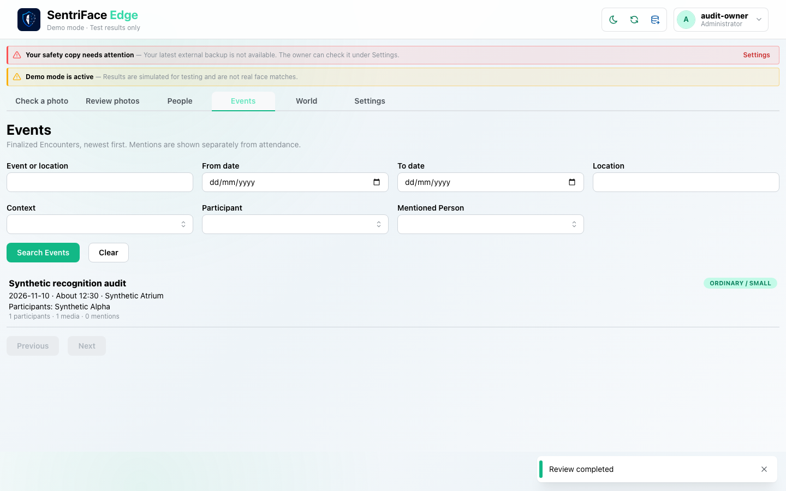
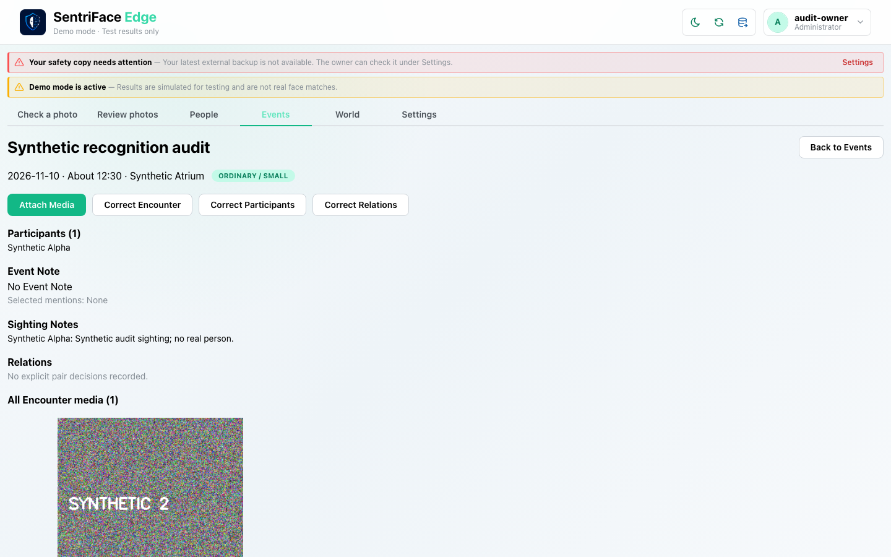
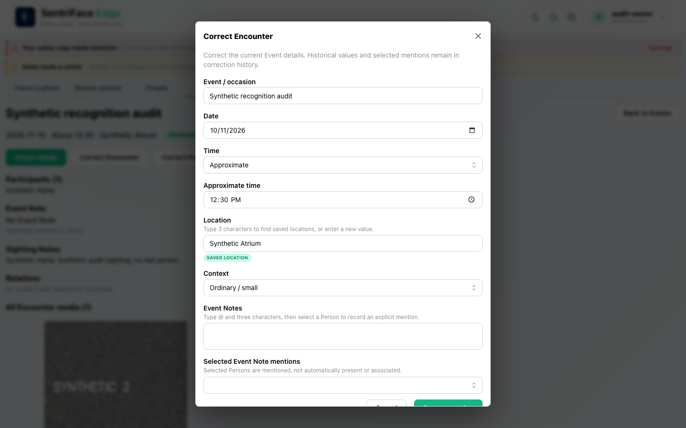
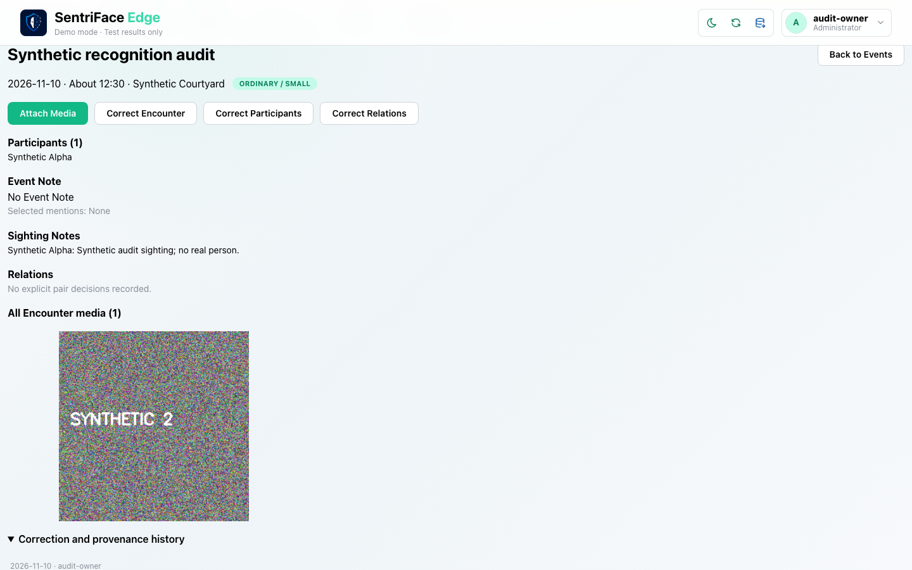
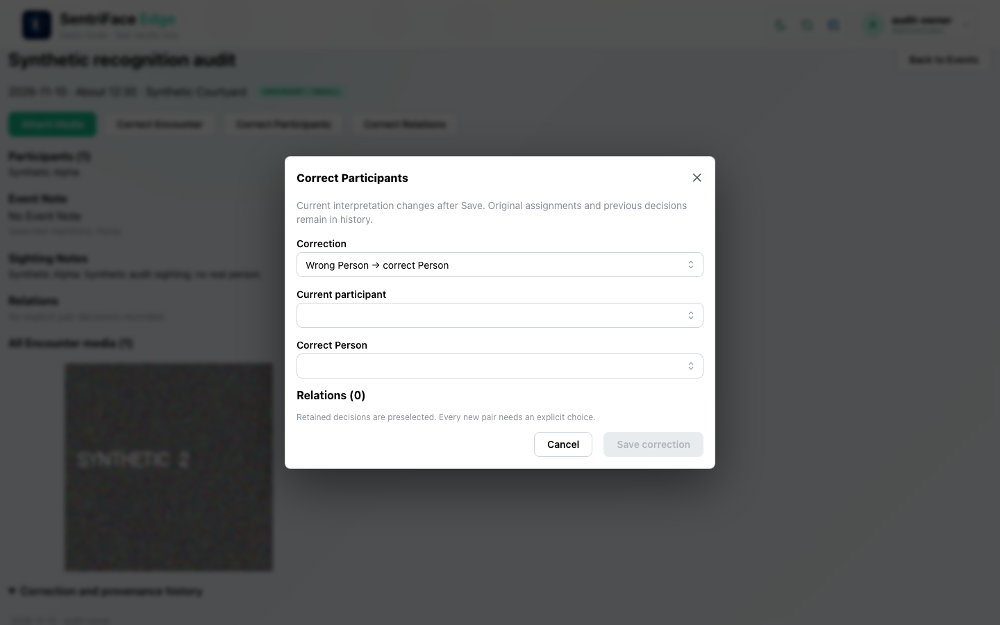
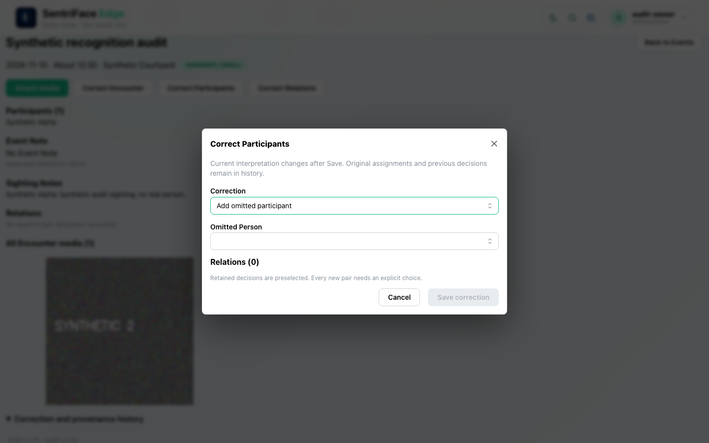
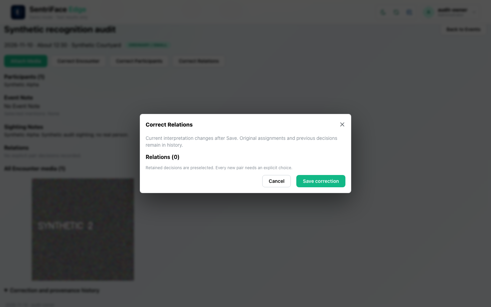

# J07 — Events detail, metadata correction and correction-form branches

[Audit index](../INDEX.md) · [Source oracle](../source-map.md) · [Independent review](../review.md)

**Scope result: PARTIAL.** This record proves only the ordered observations below; source-contract branches outside them are not silently passed. Source tasks: [SJ-037](../source-journeys.csv), [SJ-038](../source-journeys.csv), [SJ-040](../source-journeys.csv), [SJ-041](../source-journeys.csv).

**Operator goal:** Inspect the first finalized occurrence, correct its location and discover participant/Relations correction forms.

**Starting state and required role:** J06 completed one synthetic Encounter with Synthetic Alpha. Administrator has view and destroy capabilities. All captures in this record use the disposable Administrator unless a step explicitly says unauthenticated.

**Implemented owners:** [`views/EventsView.jsx`](../../../frontend/src/views/EventsView.jsx); [`components/EncounterDetailsModal.jsx`](../../../frontend/src/components/EncounterDetailsModal.jsx); [`components/EncounterManagementModal.jsx`](../../../frontend/src/components/EncounterManagementModal.jsx).

**Evidence basis:** saved current-run screenshots, capture metadata and accessibility snapshots. Visual acceptance is documented in the independent review; this assembly does not claim a second independent visual inspection. Synthetic images are generated patterns, not biometric photographs. No source/UI manipulation produces these states.

**Source:** `b457f0a723e845dd1a92a07a577072c85146c89a`. Capture sequence numbers order the captured states; uncaptured return actions are named in the text. The audit was interrupted and resumed across November 5 and 10 at the same source SHA.

## Ordered interaction and visual evidence

### Step 01 — Events list

Select Events after J06. The list contains the finalized synthetic recognition audit and a “Review completed” toast.

Capture: `UX-09` · Administrator · light theme · 1440×900 CSS viewport · DPR 1 · `2026-11-10T08:23:25.797208+00:00` · fixture: synthetic.

Scroll recorded: x=0, y=0.

### Step 02 — Event detail

Open the Event row. Participants, Event Note, Sighting Notes, Relations, media, Attach and correction entry points are visible.

Capture: `UX-09` · Administrator · light theme · 1440×900 CSS viewport · DPR 1 · `2026-11-10T08:23:31.681277+00:00` · fixture: synthetic.

Scroll recorded: x=0, y=0.

### Step 03 — Metadata correction

Choose Correct Encounter. Inspect the metadata form; change Location to Synthetic Courtyard and save after this capture.

Capture: `UX-10` · Administrator · light theme · 1440×900 CSS viewport · DPR 1 · `2026-11-10T08:23:32.492214+00:00` · fixture: synthetic.

Scroll recorded: x=0, y=0.

### Step 04 — Correction history expanded

Expand Correction and provenance history after save. The effective location is Synthetic Courtyard. This frame alone does not show the complete below-fold history text.

Capture: `UX-10` · Administrator · light theme · 1440×900 CSS viewport · DPR 1 · `2026-11-10T08:23:33.371856+00:00` · fixture: synthetic.

Scroll recorded: x=0, y=152.

### Step 05 — Reassign participant form

Choose Correct Participants. The default Wrong Person → correct Person form is shown with current/correct Person selectors.

Capture: `UX-10` · Administrator · light theme · 1440×900 CSS viewport · DPR 1 · `2026-11-10T08:23:43.028066+00:00` · fixture: synthetic.

Scroll recorded: x=0, y=152.

### Step 06 — Remove participant form

Switch Correction to Remove incorrect participant. Inspect that branch without executing removal.

Capture: `UX-10` · Administrator · light theme · 1440×900 CSS viewport · DPR 1 · `2026-11-10T08:23:43.657192+00:00` · fixture: synthetic.

Scroll recorded: x=0, y=152.

### Step 07 — Add participant form empty

Switch Correction to Add omitted participant. With no other active identity in this small fixture, inspect the empty target branch, then Cancel.

Capture: `UX-10` · Administrator · light theme · 1440×900 CSS viewport · DPR 1 · `2026-11-10T08:23:44.234844+00:00` · fixture: synthetic.

Scroll recorded: x=0, y=152.

### Step 08 — No pair relations

Choose Correct Relations. With one participant, zero pairs are shown; Cancel leaves the Event unchanged.

Capture: `UX-10` · Administrator · light theme · 1440×900 CSS viewport · DPR 1 · `2026-11-10T08:23:45.204713+00:00` · fixture: synthetic.

Scroll recorded: x=0, y=152.

## Outcome, authority and return path

The finalized Event is readable with its participant, Sighting Note and media. A location correction changes Synthetic Atrium to Synthetic Courtyard while history remains available. Participant form modes and zero-pair Relations are inspected and cancelled; no participant change is claimed in this record.

## Limits and unexecuted branches

J07 step 4 expands history but most history text lies below the captured viewport; J15 step 8 supplies the scrolled history evidence. Metadata modal footer is clipped in the initial viewport; successful save demonstrates execution, not complete responsive/accessibility acceptance. Reassign is inspected only.

No redesign or implementation is specified by this record. Findings and recommended directions belong to the shared audit review and canonical design authority.
