# J08 — Review Photos: grouping, identity decisions, comparison and Relations

[Audit index](../INDEX.md) · [Source oracle](../source-map.md) · [Independent review](../review.md)

**Scope result: PARTIAL.** This record proves only the ordered observations below; source-contract branches outside them are not silently passed. Source tasks: [SJ-012](../source-journeys.csv), [SJ-013](../source-journeys.csv), [SJ-014](../source-journeys.csv), [SJ-016](../source-journeys.csv), [SJ-017](../source-journeys.csv), [SJ-018](../source-journeys.csv), [SJ-019](../source-journeys.csv).

**Operator goal:** Group two synthetic photos as one real-world-occurrence fixture, resolve both identities and explicitly choose their Relation before completion.

**Starting state and required role:** Two generated patterns synthetic-3.png and synthetic-4.png are imported by an Administrator. Synthetic Alpha exists; Synthetic Beta will be staged as a new identity. The dev whole-image detector returns one synthetic face per image. All captures in this record use the disposable Administrator unless a step explicitly says unauthenticated.

**Implemented owners:** [`views/QueueView.jsx`](../../../frontend/src/views/QueueView.jsx); [`components/EncounterDetailsModal.jsx`](../../../frontend/src/components/EncounterDetailsModal.jsx); [`components/RecognitionFollowupForm.jsx`](../../../frontend/src/components/RecognitionFollowupForm.jsx); [`hooks/useQueueController.js`](../../../frontend/src/hooks/useQueueController.js).

**Evidence basis:** saved current-run screenshots, capture metadata and accessibility snapshots. Visual acceptance is documented in the independent review; this assembly does not claim a second independent visual inspection. Synthetic images are generated patterns, not biometric photographs. No source/UI manipulation produces these states.

**Source:** `b457f0a723e845dd1a92a07a577072c85146c89a`. Capture sequence numbers order the captured states; uncaptured return actions are named in the text. The audit was interrupted and resumed across November 5 and 10 at the same source SHA.

## Ordered interaction and visual evidence

### Step 01 — Queue empty

Open Review photos before upload. The empty queue and import controls establish the start.

Capture: `UX-03` · Administrator · light theme · 1440×900 CSS viewport · DPR 1 · `2026-11-10T08:23:46.336099+00:00` · fixture: synthetic.

Scroll recorded: x=0, y=0.

### Step 02 — One Encounter grouping

Import the two generated image files. One Encounter grouping is the default; each photo is Ready.

Capture: `UX-03` · Administrator · light theme · 1440×900 CSS viewport · DPR 1 · `2026-11-10T08:24:03.831784+00:00` · fixture: synthetic.

Scroll recorded: x=0, y=0.

### Step 03 — Multiple Encounter grouping

Choose Multiple Encounters. The bounded count and per-photo Encounter selectors appear. This branch is inspected; the final plan later uses one Encounter.

Capture: `UX-03` · Administrator · light theme · 1440×900 CSS viewport · DPR 1 · `2026-11-10T08:24:04.600219+00:00` · fixture: synthetic.

Scroll recorded: x=0, y=0.

### Step 04 — Grouping suggestion unavailable

Hover Suggest grouping. It is unavailable because distinct uploaded subfolders are absent. No folder-derived grouping is invented.

[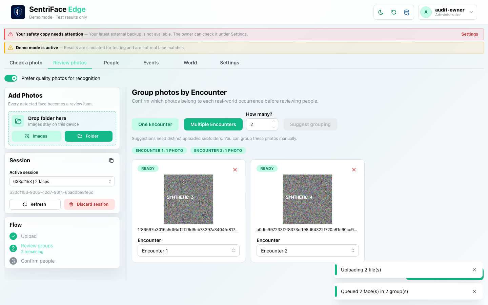](../screenshots/UX-03/UX-03_J08_Step-04_Grouping-suggestion-unavailable.png)

Capture: `UX-03` · Administrator · light theme · 1440×900 CSS viewport · DPR 1 · `2026-11-10T08:24:05.134067+00:00` · fixture: synthetic.

Scroll recorded: x=0, y=0.

### Step 05 — Photo excluded

Remove a photo using its actual remove control. The removed state and Restore photo action are captured; restore it before continuing.

[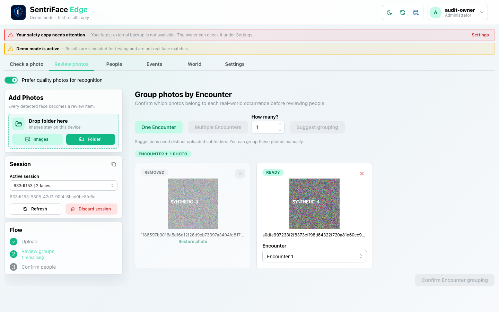](../screenshots/UX-03/UX-03_J08_Step-05_Photo-excluded.png)

Capture: `UX-03` · Administrator · light theme · 1440×900 CSS viewport · DPR 1 · `2026-11-10T08:24:31.208432+00:00` · fixture: synthetic.

Scroll recorded: x=0, y=0.

### Step 06 — Grouping confirmed

Choose One Encounter and Confirm Encounter grouping. The durable draft shows two unresolved faces and Continue to Relations disabled.

[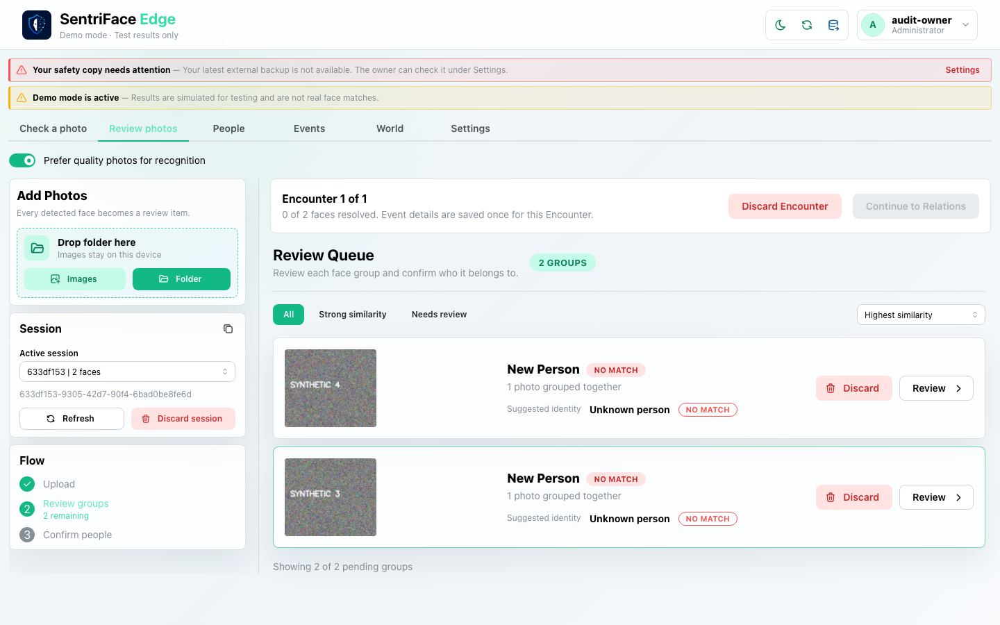](../screenshots/UX-03/UX-03_J08_Step-06_Grouping-confirmed.png)

Capture: `UX-03` · Administrator · light theme · 1440×900 CSS viewport · DPR 1 · `2026-11-10T08:24:33.204010+00:00` · fixture: synthetic.

Scroll recorded: x=0, y=0.

### Step 07 — Queue event details

Open the first Review group. The one-time Event details form is entered with explicitly synthetic occasion/date/location/public context.

[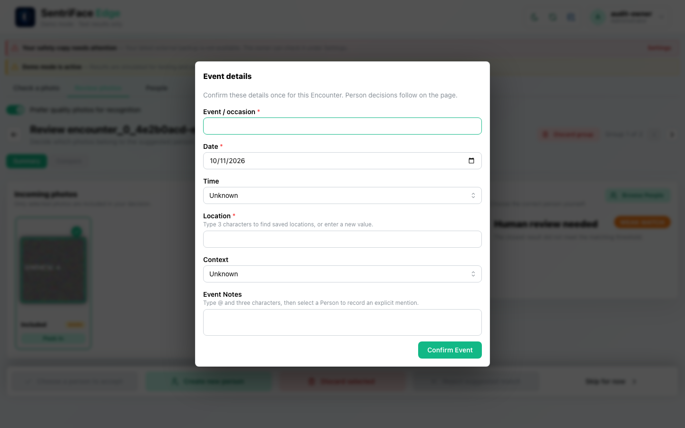](../screenshots/UX-04/UX-04_J08_Step-07_Queue-event-details.png)

Capture: `UX-04` · Administrator · light theme · 1440×900 CSS viewport · DPR 1 · `2026-11-10T08:24:55.583806+00:00` · fixture: synthetic.

Scroll recorded: x=0, y=0.

### Step 08 — Group review

Confirm Event. The group review offers incoming-photo selection, Browse People, Create new person, Discard and Skip; the automatic result is not reliable.

Capture: `UX-04` · Administrator · light theme · 1440×900 CSS viewport · DPR 1 · `2026-11-10T08:24:56.827344+00:00` · fixture: synthetic.

Scroll recorded: x=0, y=0.

### Step 09 — Peek in open

Choose Peek In. Face preview opens as a separate modal; Escape closes it.

[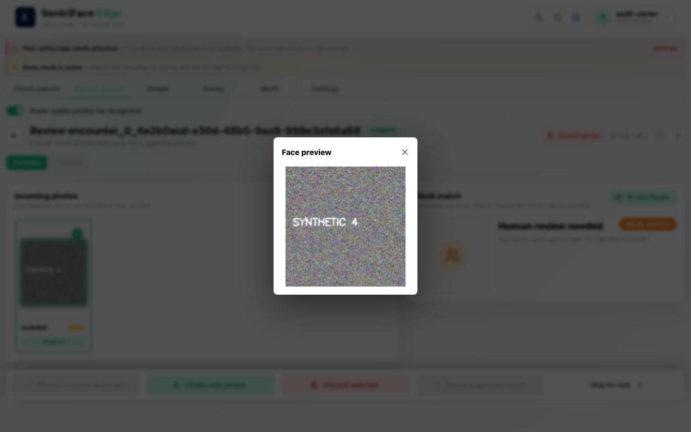](../screenshots/UX-04/UX-04_J08_Step-09_Peek-in-open.png)

Capture: `UX-04` · Administrator · light theme · 1440×900 CSS viewport · DPR 1 · `2026-11-10T08:25:12.413083+00:00` · fixture: synthetic.

Scroll recorded: x=0, y=0.

### Step 10 — New person followup

Choose Create new person. The follow-up form requests new identity metadata while inheriting the Encounter.

[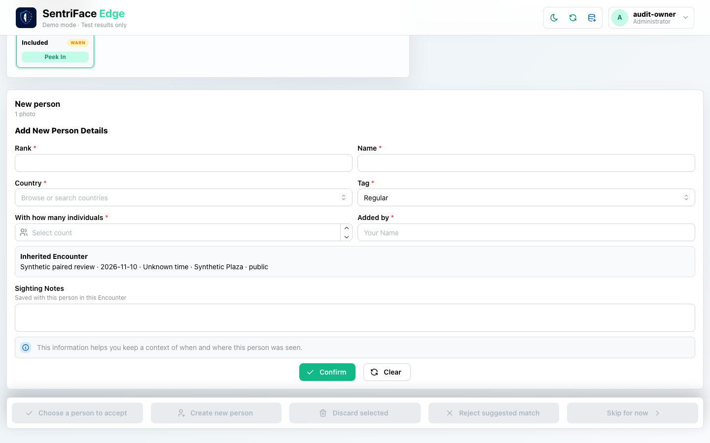](../screenshots/UX-04/UX-04_J08_Step-10_New-person-followup.png)

Capture: `UX-04` · Administrator · light theme · 1440×900 CSS viewport · DPR 1 · `2026-11-10T08:25:28.393922+00:00` · fixture: synthetic.

Scroll recorded: x=0, y=596.

### Step 11 — New person valid

Fill synthetic Beta identity values and individual count. This is ready to confirm, not yet a committed Person.

[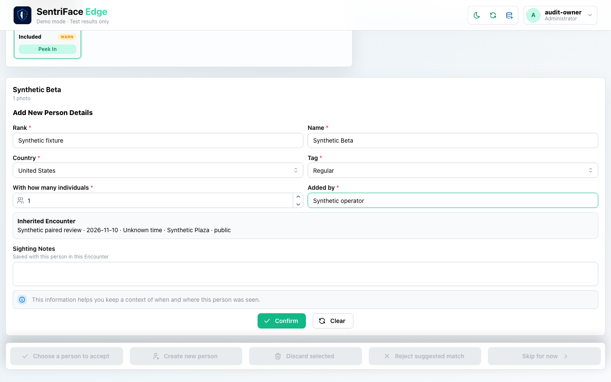](../screenshots/UX-04/UX-04_J08_Step-11_New-person-valid.png)

Capture: `UX-04` · Administrator · light theme · 1440×900 CSS viewport · DPR 1 · `2026-11-10T08:25:29.030183+00:00` · fixture: synthetic.

Scroll recorded: x=0, y=596.

### Step 12 — Draft person decision

Confirm. “Identity decision saved to Encounter draft” appears; one face remains and Relations is still blocked.

Capture: `UX-04` · Administrator · light theme · 1440×900 CSS viewport · DPR 1 · `2026-11-10T08:25:30.272546+00:00` · fixture: synthetic.

Scroll recorded: x=0, y=80.

### Step 13 — Deferred group

Review the remaining group and choose Skip for now. “Deferred groups returned for review” shows its immediate return because no other pending work remains.

[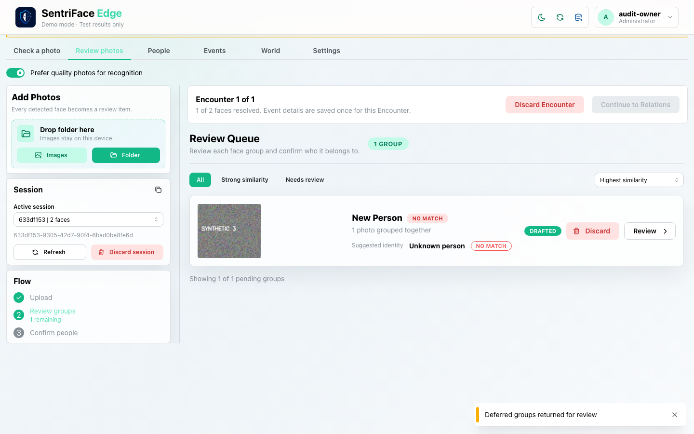](../screenshots/UX-04/UX-04_J08_Step-13_Deferred-group.png)

Capture: `UX-04` · Administrator · light theme · 1440×900 CSS viewport · DPR 1 · `2026-11-10T08:25:57.184803+00:00` · fixture: synthetic.

Scroll recorded: x=0, y=80.

### Step 14 — Queue browse committed and draft

Open Browse People on the returned group. Both committed Alpha and draft-created Beta appear; only Beta has Drafted provenance.

[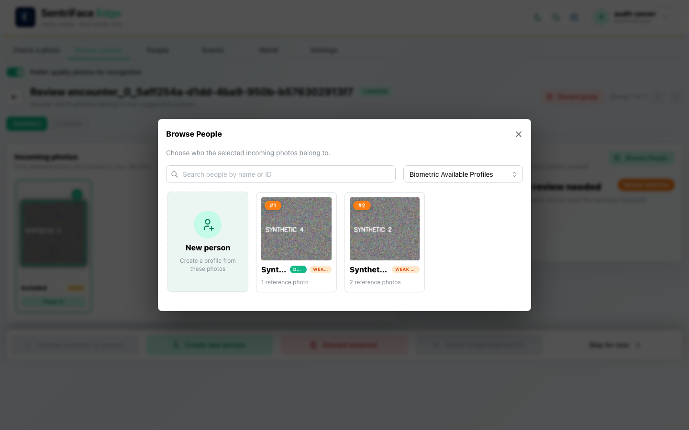](../screenshots/UX-04/UX-04_J08_Step-14_Queue-browse-committed-and-draft.png)

Capture: `UX-04` · Administrator · light theme · 1440×900 CSS viewport · DPR 1 · `2026-11-10T08:26:19.708876+00:00` · fixture: synthetic.

Scroll recorded: x=0, y=80.

### Step 15 — Compare mode

Choose Alpha and Compare. Incoming and saved-reference thumbnails are shown together.

[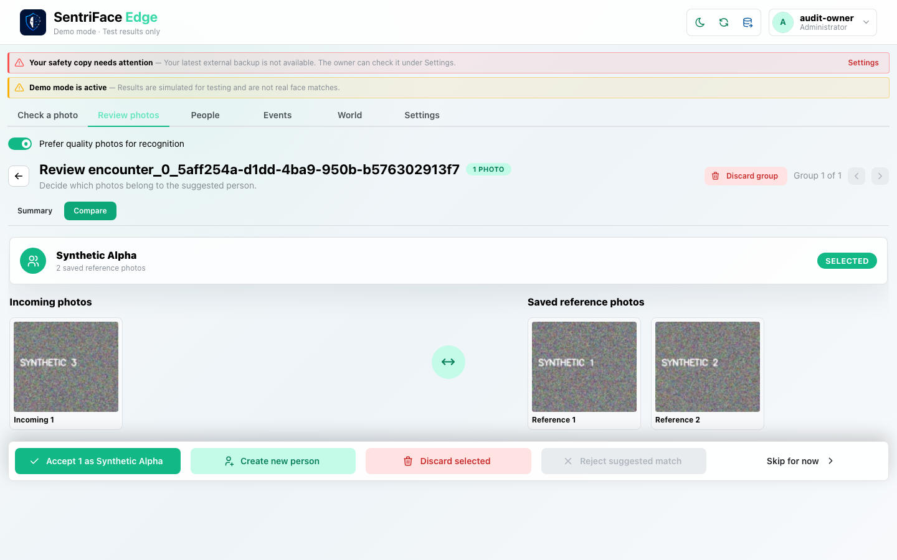](../screenshots/UX-04/UX-04_J08_Step-15_Compare-mode.png)

Capture: `UX-04` · Administrator · light theme · 1440×900 CSS viewport · DPR 1 · `2026-11-10T08:26:33.602498+00:00` · fixture: synthetic.

Scroll recorded: x=0, y=0.

### Step 16 — Focused compare zoom unsynced

Open the incoming comparison, zoom in, and turn Sync off. The focused comparison, independent zoom and Fit control are sampled.

[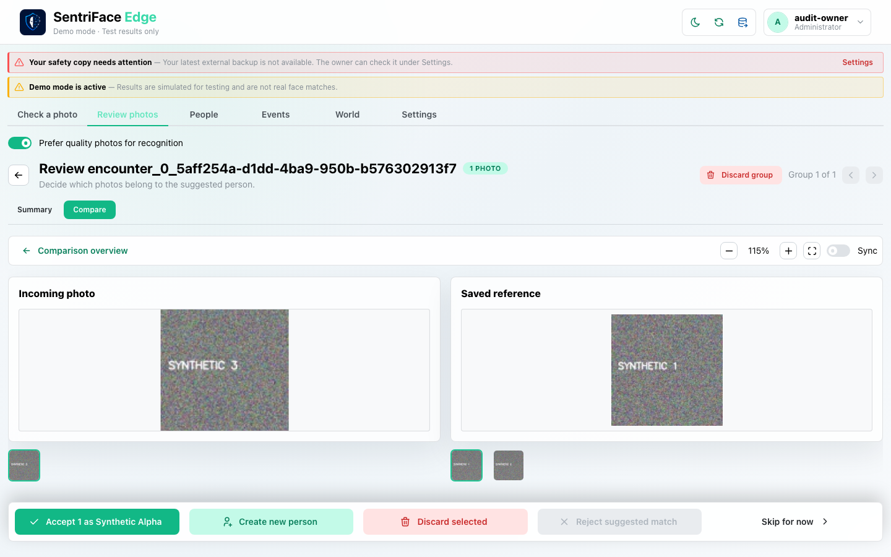](../screenshots/UX-04/UX-04_J08_Step-16_Focused-compare-zoom-unsynced.png)

Capture: `UX-04` · Administrator · light theme · 1440×900 CSS viewport · DPR 1 · `2026-11-10T08:26:54.852603+00:00` · fixture: synthetic.

Scroll recorded: x=0, y=0.

### Step 17 — Identities ready

Fit, return to comparison, accept as Alpha, complete its Sighting form and Confirm. Both identities are resolved; Continue to Relations is available.

[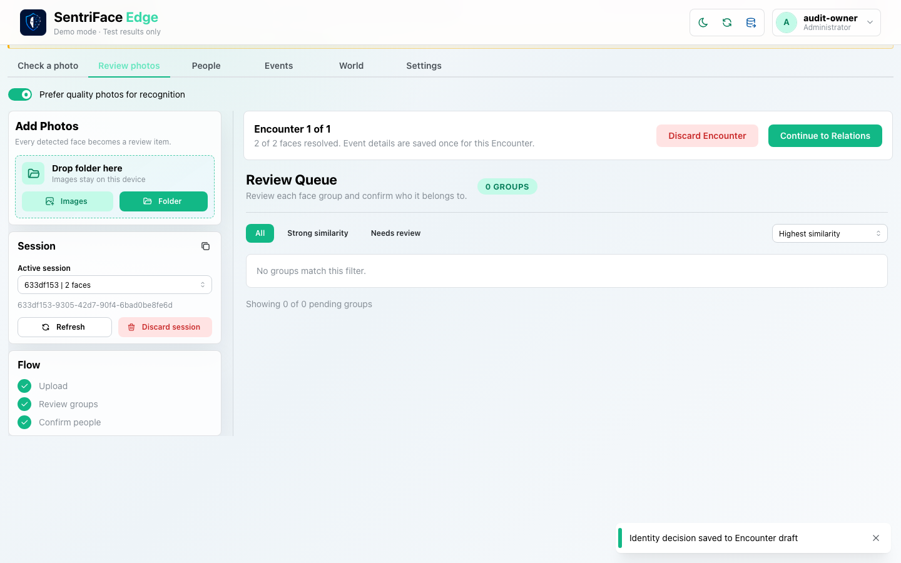](../screenshots/UX-04/UX-04_J08_Step-17_Identities-ready.png)

Capture: `UX-04` · Administrator · light theme · 1440×900 CSS viewport · DPR 1 · `2026-11-10T08:26:56.718397+00:00` · fixture: synthetic.

Scroll recorded: x=0, y=80.

### Step 18 — Relations undecided

Continue to Relations. The pair is undecided and Complete Review is disabled.

[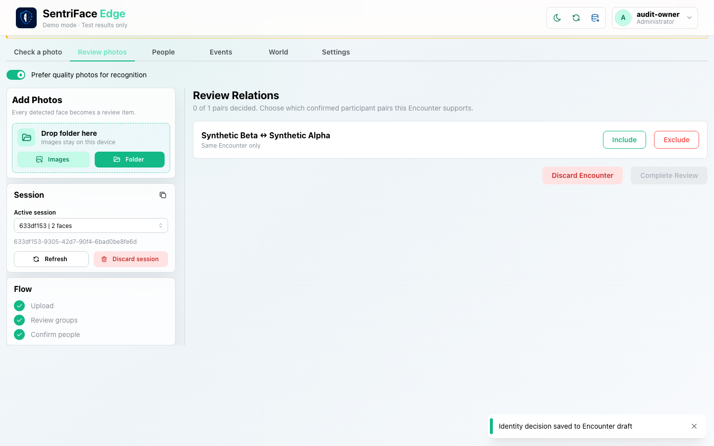](../screenshots/UX-04/UX-04_J08_Step-18_Relations-undecided.png)

Capture: `UX-04` · Administrator · light theme · 1440×900 CSS viewport · DPR 1 · `2026-11-10T08:26:57.501758+00:00` · fixture: synthetic.

Scroll recorded: x=0, y=80.

### Step 19 — Relations excluded

Choose Exclude. Its selected state is captured. This is a saved draft decision, not final graph authority.

[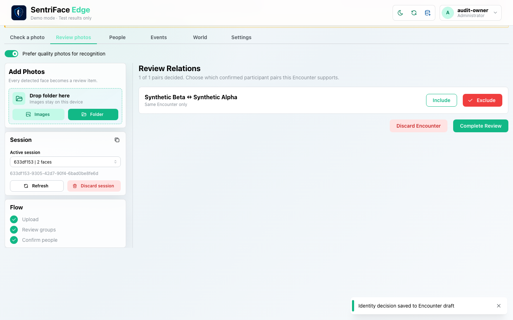](../screenshots/UX-04/UX-04_J08_Step-19_Relations-excluded.png)

Capture: `UX-04` · Administrator · light theme · 1440×900 CSS viewport · DPR 1 · `2026-11-10T08:26:58.227681+00:00` · fixture: synthetic.

Scroll recorded: x=0, y=80.

### Step 20 — Relations included

Change the pair to Include. Its selected state/checkmark is captured and final completion is allowed.

[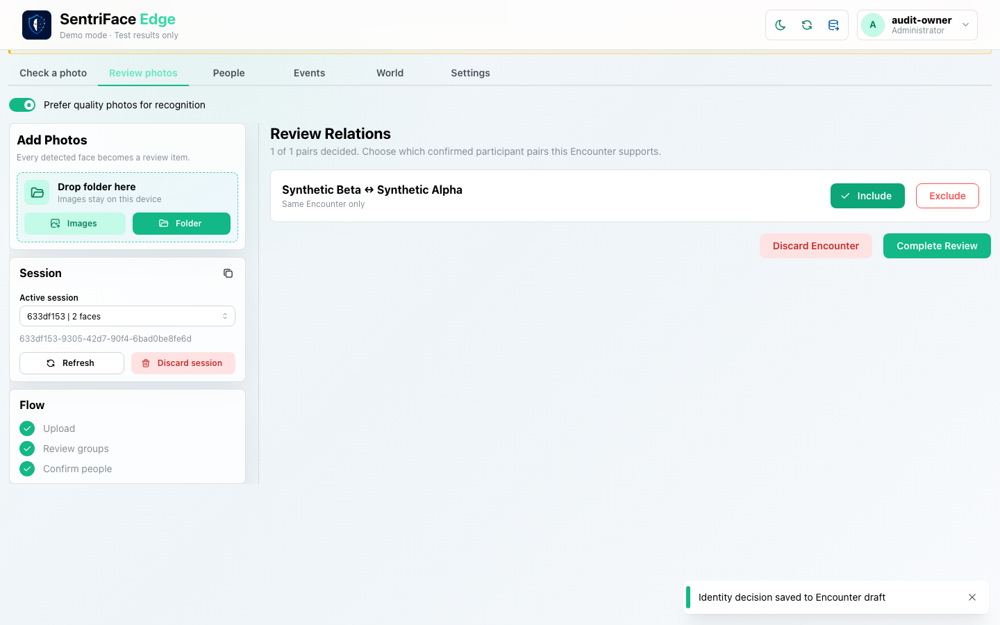](../screenshots/UX-04/UX-04_J08_Step-20_Relations-included.png)

Capture: `UX-04` · Administrator · light theme · 1440×900 CSS viewport · DPR 1 · `2026-11-10T08:26:58.958152+00:00` · fixture: synthetic.

Scroll recorded: x=0, y=80.

### Step 21 — Queue completed

Choose Complete Review. The queue clears and “Encounter finalized” appears. This is the observed final outcome; no genuine recognition accuracy is claimed.

[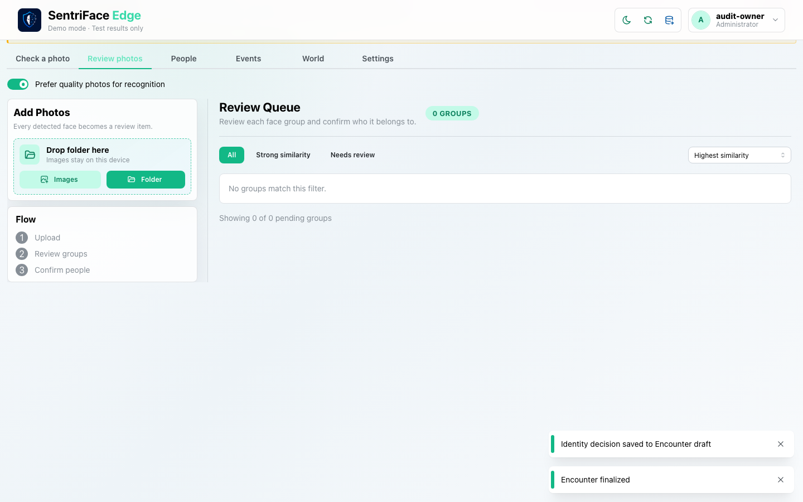](../screenshots/UX-04/UX-04_J08_Step-21_Queue-completed.png)

Capture: `UX-04` · Administrator · light theme · 1440×900 CSS viewport · DPR 1 · `2026-11-10T08:27:00.394642+00:00` · fixture: synthetic.

Scroll recorded: x=0, y=80.

## Outcome, authority and return path

The operator samples multiple-grouping controls, removes/restores a photo, confirms One Encounter, stages Beta, manually accepts Alpha, and completes with INCLUDE. Unselected Relations block completion. Runtime checks elsewhere in the audit report one committed Person before finalization and two after; the UI shows Encounter finalized. Final data is one additional Encounter, not one per photo.

## Limits and unexecuted branches

Multiple Encounters is opened but not finalized; folder suggestions are unavailable for this flat batch. Folder/drop import, cancel processing, group/session discard, poor/proof-only duplicate, unselected-face handling, alternate next-Encounter outcome and completion failure/retry remain separate gaps. Step 13 is immediate deferred-group return, not a persistent deferred state.

No redesign or implementation is specified by this record. Findings and recommended directions belong to the shared audit review and canonical design authority.
