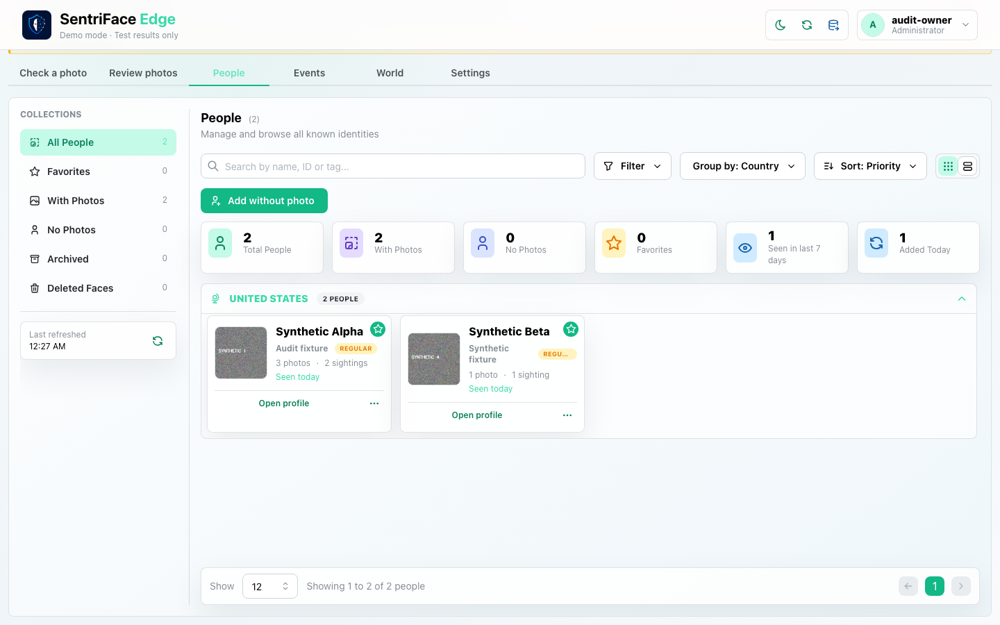
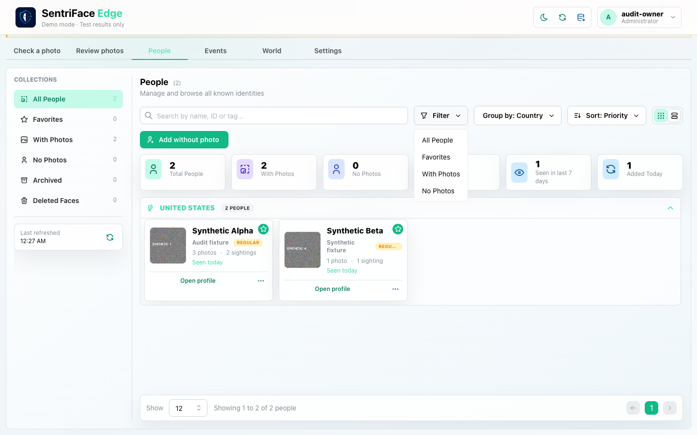
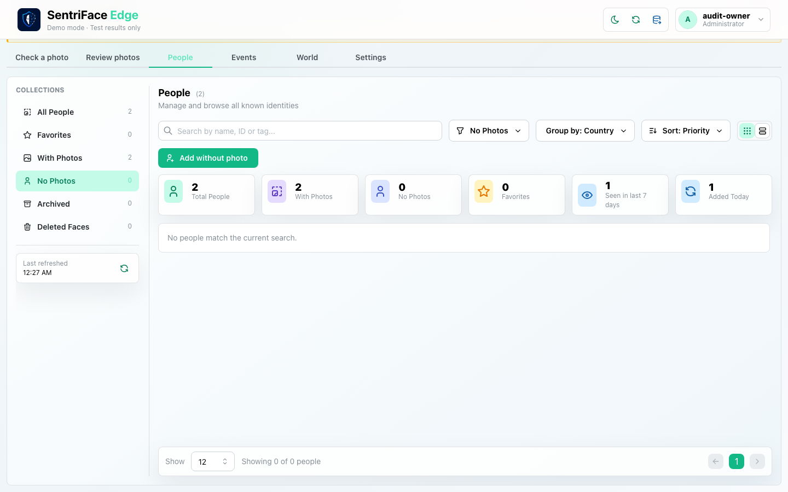
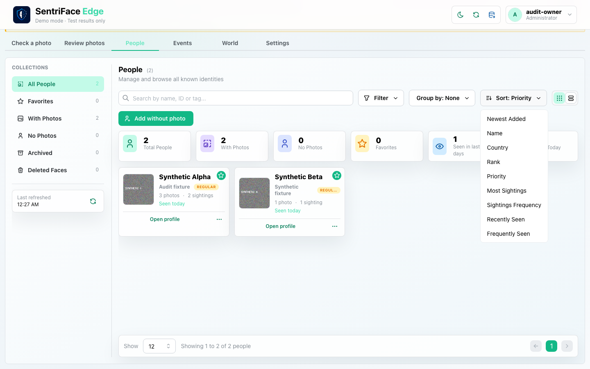
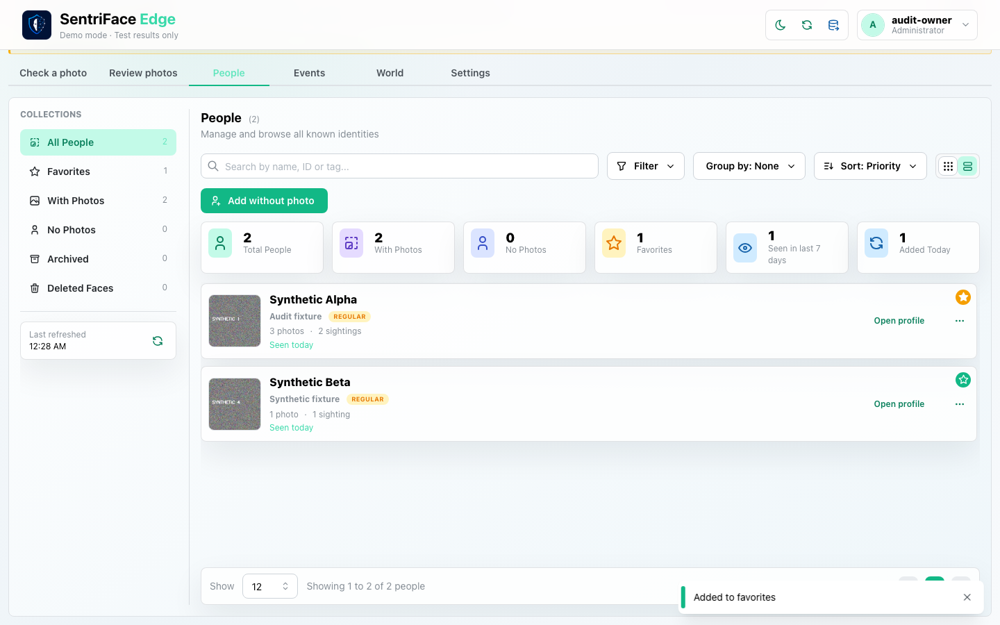
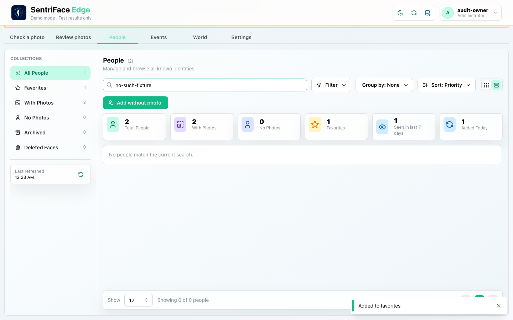
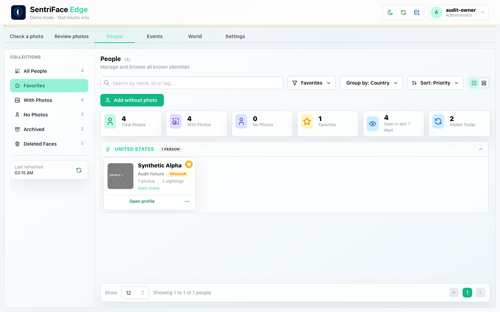
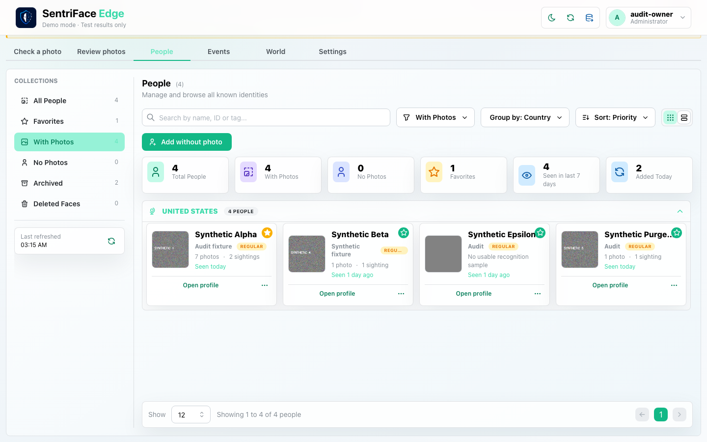
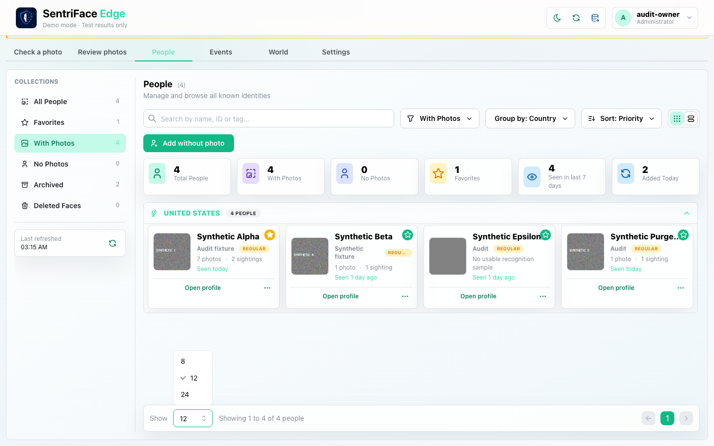

# J09 — People collections, menus, list mode, favorite and search

[Audit index](../INDEX.md) · [Source oracle](../source-map.md) · [Independent review](../review.md)

**Scope result: PARTIAL.** This record proves only the ordered observations below; source-contract branches outside them are not silently passed. Source tasks: [SJ-021](../source-journeys.csv), [SJ-022](../source-journeys.csv), [SJ-028](../source-journeys.csv).

**Operator goal:** Find and organize the two synthetic identities using existing People controls.

**Starting state and required role:** Alpha and Beta are finalized active People with synthetic media after J08. Administrator is signed in. All captures in this record use the disposable Administrator unless a step explicitly says unauthenticated.

**Implemented owners:** [`views/PeopleView.jsx::PeopleToolbar`](../../../frontend/src/views/PeopleView.jsx); [`views/PeopleView.jsx::PeoplePagination`](../../../frontend/src/views/PeopleView.jsx).

**Evidence basis:** saved current-run screenshots, capture metadata and accessibility snapshots. Visual acceptance is documented in the independent review; this assembly does not claim a second independent visual inspection. Synthetic images are generated patterns, not biometric photographs. No source/UI manipulation produces these states.

**Source:** `b457f0a723e845dd1a92a07a577072c85146c89a`. Capture sequence numbers order the captured states; uncaptured return actions are named in the text. The audit was interrupted and resumed across November 5 and 10 at the same source SHA.

## Ordered interaction and visual evidence

### Step 01 — Populated library

Return to the People library after review. Two active synthetic identities and their photo/sighting counts are visible.

Capture: `UX-05` · Administrator · light theme · 1440×900 CSS viewport · DPR 1 · `2026-11-10T08:27:05.279363+00:00` · fixture: synthetic.

Scroll recorded: x=0, y=80.

### Step 02 — People filter popover

Open Filter. All People, Favorites, With Photos and No Photos options are exposed.

Capture: `UX-05` · Administrator · light theme · 1440×900 CSS viewport · DPR 1 · `2026-11-10T08:27:06.017488+00:00` · fixture: synthetic.

Scroll recorded: x=0, y=80.

### Step 03 — No photos empty

Choose No Photos. The empty collection is shown because both identities currently have ordinary synthetic samples.

Capture: `UX-05` · Administrator · light theme · 1440×900 CSS viewport · DPR 1 · `2026-11-10T08:27:21.286696+00:00` · fixture: synthetic.

Scroll recorded: x=0, y=80.

### Step 04 — Group menu

Return to All People and open Group by. The available grouping choices are captured; this is not evidence that every choice was applied.

Capture: `UX-05` · Administrator · light theme · 1440×900 CSS viewport · DPR 1 · `2026-11-10T08:27:22.096325+00:00` · fixture: synthetic.

Scroll recorded: x=0, y=80.

### Step 05 — Sort menu

Choose None, then open Sort. The current ordering and all sort choices are exposed.

Capture: `UX-05` · Administrator · light theme · 1440×900 CSS viewport · DPR 1 · `2026-11-10T08:27:52.947359+00:00` · fixture: synthetic.

Scroll recorded: x=0, y=80.

### Step 06 — List and favorite

Close the menu, switch to List view and favorite the first identity. The filled favorite state and list arrangement are captured.

Capture: `UX-05` · Administrator · light theme · 1440×900 CSS viewport · DPR 1 · `2026-11-10T08:28:02.660028+00:00` · fixture: synthetic.

Scroll recorded: x=0, y=80.

### Step 07 — Search no results

Enter a query that matches no fixture. The no-results state is shown; clear it before opening Synthetic Beta.

Capture: `UX-05` · Administrator · light theme · 1440×900 CSS viewport · DPR 1 · `2026-11-10T08:28:03.261465+00:00` · fixture: synthetic.

Scroll recorded: x=0, y=80.

## Outcome, authority and return path

The populated library, filter/group/sort menus, no-photo empty class, list mode, favorite and no-results search are captured. Search is cleared before opening Beta for J10. Group and sort alternatives are exposed, but not every value is executed.

## Limits and unexecuted branches

This two-Person dataset cannot qualify populated pagination or a genuinely dense list. Favorites/With Photos collection outcomes, every sort/group value, page size and long data need their own equivalence sampling; source menus alone do not prove them.

No redesign or implementation is specified by this record. Findings and recommended directions belong to the shared audit review and canonical design authority.

## macOS completion pass 2 — continuation B

Source product `b457f0a723e845dd1a92a07a577072c85146c89a`; full browser-content screenshots, 1440×900 CSS pixels, DPR 1, Day; dedicated disposable authority. See capture register for exact role, capture time and inference qualification.

Favorites and With Photos filters return the expected synthetic records. The page-size selector was changed to eight, but only four records existed, so a pagination effect remains unverified.

### Step 08 — Pass2 Favorites collection

Captured `2026-11-11T11:15:47.865166+00:00` · Administrator · UX-05 · scroll {'x': 0, 'y': 80}. Exact fixture and inference mode are described above and in the capture register.

### Step 09 — Pass2 With photos collection

Captured `2026-11-11T11:15:49.091705+00:00` · Administrator · UX-05 · scroll {'x': 0, 'y': 80}. Exact fixture and inference mode are described above and in the capture register.

### Step 10 — Pass2 People page size menu

Captured `2026-11-11T11:16:07.407855+00:00` · Administrator · UX-05 · scroll {'x': 0, 'y': 80}. Exact fixture and inference mode are described above and in the capture register.

### Step 11 — Pass2 People page size eight

Captured `2026-11-11T11:16:12.878019+00:00` · Administrator · UX-05 · scroll {'x': 0, 'y': 80}. Exact fixture and inference mode are described above and in the capture register.
