# J10 — Person Sightings, Photos, Events and Activity

[Audit index](../INDEX.md) · [Source oracle](../source-map.md) · [Independent review](../review.md)

**Scope result: PARTIAL.** This record proves only the ordered observations below; source-contract branches outside them are not silently passed. Source tasks: [SJ-024](../source-journeys.csv), [SJ-025](../source-journeys.csv), [SJ-026](../source-journeys.csv), [SJ-027](../source-journeys.csv).

**Operator goal:** Understand how one Person’s occurrence history, media origin and operational activity relate.

**Starting state and required role:** Synthetic Beta has one accepted face in the two-photo Encounter from J08. Administrator reads its profile. All captures in this record use the disposable Administrator unless a step explicitly says unauthenticated.

**Implemented owners:** [`views/PeopleView.jsx::PeopleGalleryView`](../../../frontend/src/views/PeopleView.jsx); [`views/PeopleView.jsx::PeopleProfilePhotos`](../../../frontend/src/views/PeopleView.jsx).

**Evidence basis:** saved current-run screenshots, capture metadata and accessibility snapshots. Visual acceptance is documented in the independent review; this assembly does not claim a second independent visual inspection. Synthetic images are generated patterns, not biometric photographs. No source/UI manipulation produces these states.

**Source:** `b457f0a723e845dd1a92a07a577072c85146c89a`. Capture sequence numbers order the captured states; uncaptured return actions are named in the text. The audit was interrupted and resumed across November 5 and 10 at the same source SHA.

## Ordered interaction and visual evidence

### Step 01 — Sightings tab

Open Beta and select Sightings (1). Its occurrence card shows synthetic location/date/source and a generic Encounter thumbnail.

[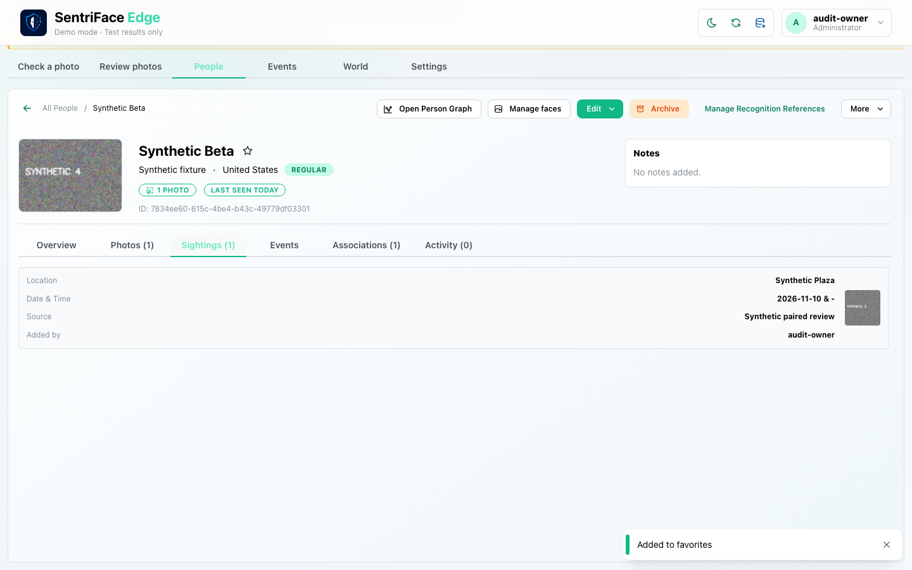](../screenshots/UX-06/UX-06_J10_Step-01_Sightings-tab.png)

Capture: `UX-06` · Administrator · light theme · 1440×900 CSS viewport · DPR 1 · `2026-11-10T08:28:04.360430+00:00` · fixture: synthetic.

Scroll recorded: x=0, y=80.

### Step 02 — Sighting photo detail

Select the Sighting card. Photos opens with Beta’s own retained source and Added from Encounter origin. The differing thumbnail context is documented in review.

[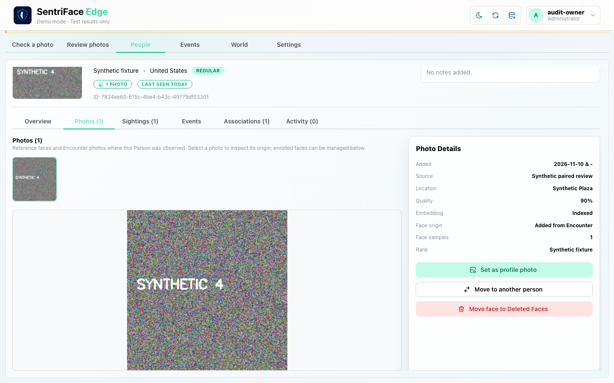](../screenshots/UX-06/UX-06_J10_Step-02_Sighting-photo-detail.png)

Capture: `UX-06` · Administrator · light theme · 1440×900 CSS viewport · DPR 1 · `2026-11-10T08:28:17.893471+00:00` · fixture: synthetic.

Scroll recorded: x=0, y=80.

### Step 03 — Person events tab

Select the profile Events tab. The same occurrence is marked Present and can open global Event detail, a transition exercised in J15.

[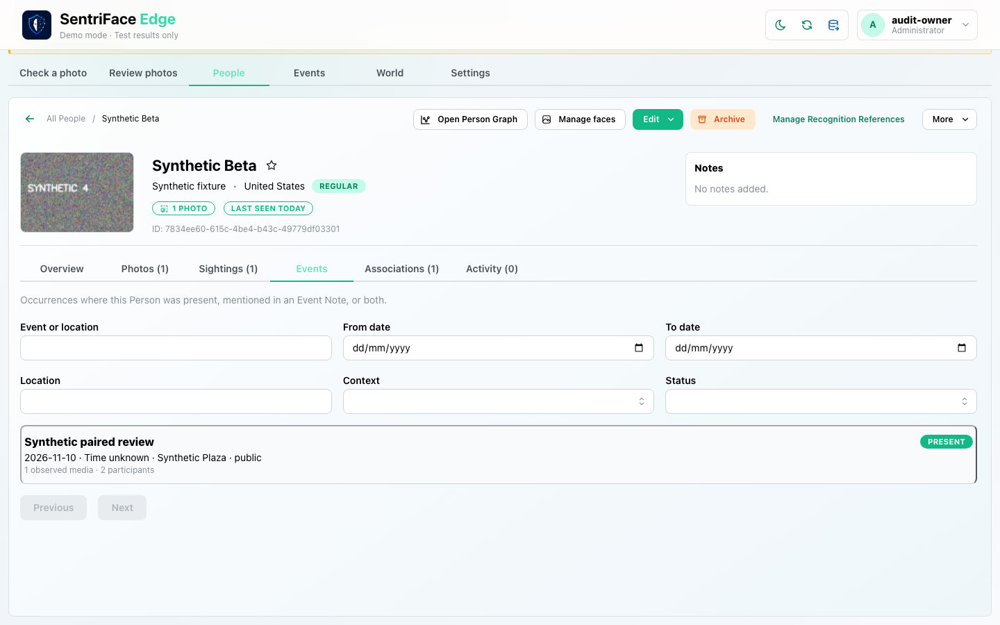](../screenshots/UX-06/UX-06_J10_Step-03_Person-events-tab.png)

Capture: `UX-06` · Administrator · light theme · 1440×900 CSS viewport · DPR 1 · `2026-11-10T08:28:28.585601+00:00` · fixture: synthetic.

Scroll recorded: x=0, y=80.

### Step 04 — Person activity

Later, select Activity (4) after the archive/restore operations in J13. This is journaled Person history; intervening actions are recorded in their own journeys, not hidden steps.

[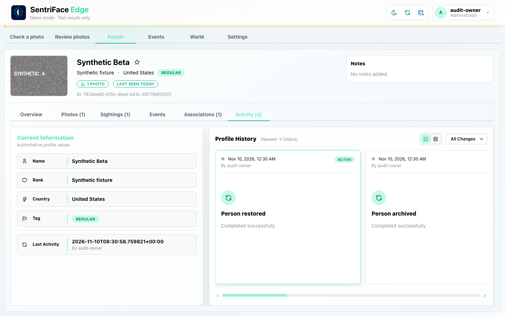](../screenshots/UX-06/UX-06_J10_Step-04_Person-activity.png)

Capture: `UX-06` · Administrator · light theme · 1440×900 CSS viewport · DPR 1 · `2026-11-10T08:31:25.983969+00:00` · fixture: synthetic.

Scroll recorded: x=0, y=80.

## Outcome, authority and return path

Sightings, photo-origin detail, Person Events and Activity are captured. Clicking a Sighting moves to Photos. The generic Encounter thumbnail and Person-specific photo differ in this fixture; source review classifies this as presentation/navigation ambiguity, not wrong identity assignment.

## Limits and unexecuted branches

MENTIONED/BOTH, selected/literal notes, filters, multiple pages, empty histories and read-only-role access are not established in these four frames. Activity here is Person change history, not the global Events chronology.

No redesign or implementation is specified by this record. Findings and recommended directions belong to the shared audit review and canonical design authority.

## macOS completion pass 2 — continuation C

Source product `b457f0a723e845dd1a92a07a577072c85146c89a`; disposable authority; 1440×900 browser-content viewport, DPR 1, Day, Administrator.

The mentioned Person profile shows one separate Event marked Present and the corrected paired Event marked Mentioned with zero observed media. Filter to Mentioned, open the linked Event, and switch back to People: the same Person opens on Overview rather than retaining the Events tab/filter.

### Step 05 — Pass2 Person events present versus mentioned

[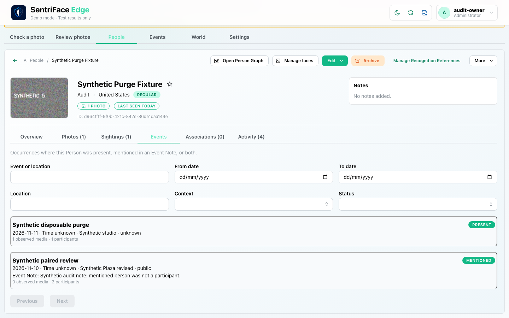](../screenshots/UX-06/UX-06_J10_Step-05_Pass2-Person-events-present-versus-mentioned.png)

Captured `2026-11-11T13:30:37.528426+00:00` · Administrator · UX-06 · synthetic fixture · scroll {'x': 0, 'y': 80}.

### Step 06 — Pass2 Person events mentioned only

[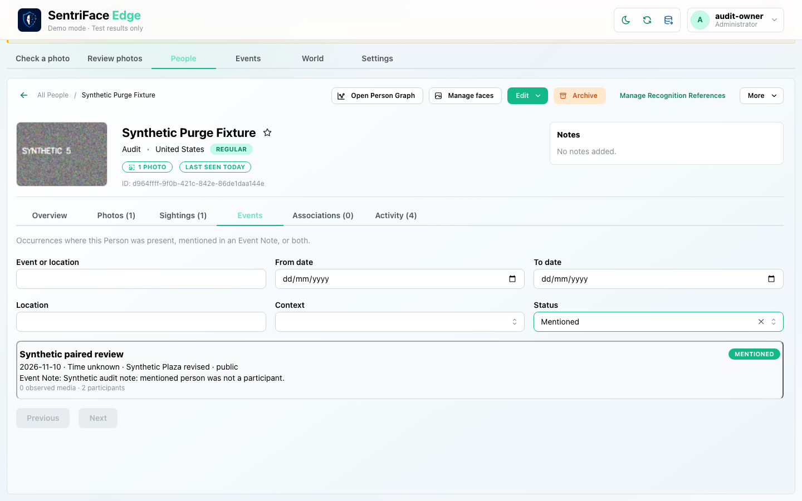](../screenshots/UX-06/UX-06_J10_Step-06_Pass2-Person-events-mentioned-only.png)

Captured `2026-11-11T13:30:44.951741+00:00` · Administrator · UX-06 · synthetic fixture · scroll {'x': 0, 'y': 80}.

### Step 07 — Pass2 Mention to event detail

[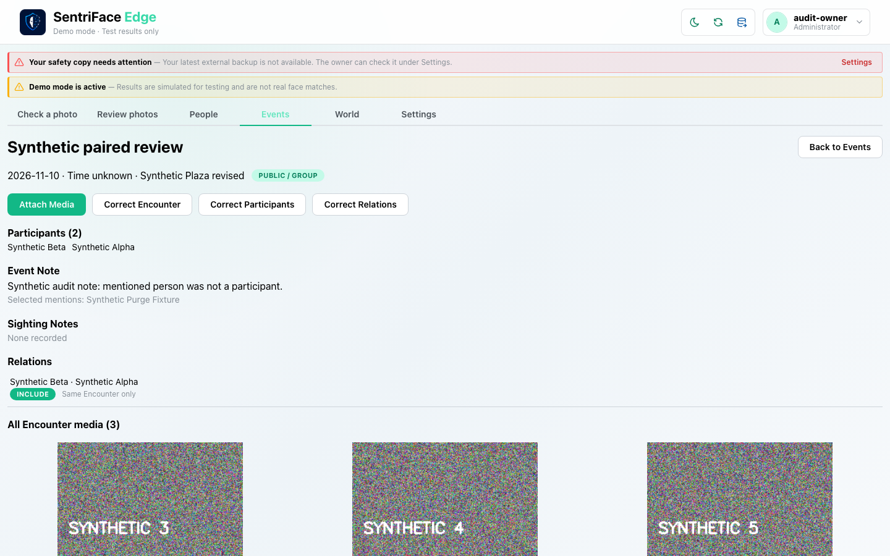](../screenshots/UX-10/UX-10_J10_Step-07_Pass2-Mention-to-event-detail.png)

Captured `2026-11-11T13:31:00.467852+00:00` · Administrator · UX-10 · synthetic fixture · scroll {'x': 0, 'y': 0}.

### Step 08 — Pass2 Return to person overview context reset

[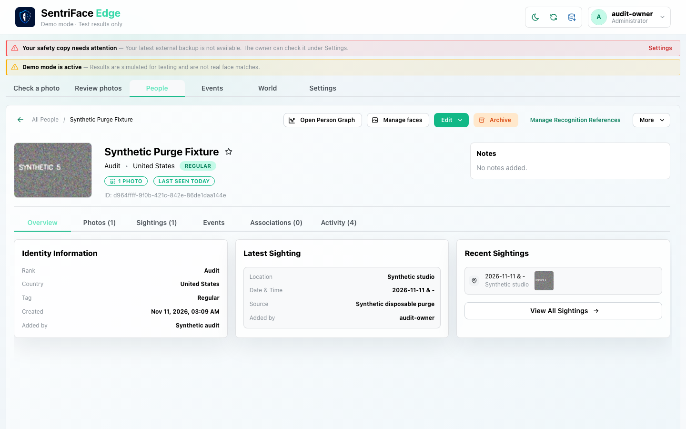](../screenshots/UX-06/UX-06_J10_Step-08_Pass2-Return-to-person-overview-context-reset.png)

Captured `2026-11-11T13:31:04.714553+00:00` · Administrator · UX-06 · synthetic fixture · scroll {'x': 0, 'y': 0}.

## macOS completion pass 2 — continuation D

Source product `b457f0a723e845dd1a92a07a577072c85146c89a`; disposable authority; full browser-content viewport 1440×900 CSS pixels, DPR 1, Day. Role and capture time are recorded per step.

A no-photo Person shows an empty gallery and “No biometric data is stored”. On synthetic Alpha, select the second image and Set as profile photo. The UI reports success, but immediately returns to the first image. In a fresh browser session the profile initially shows image 1; selecting image 2 in Photos displays the persisted “Profile photo” badge and disabled “Current profile photo” button, and the header switches to image 2. Thus the choice is persisted but the initial presentation does not reflect it in this scenario.

### Step 09 — Pass2 No photo profile gallery empty

[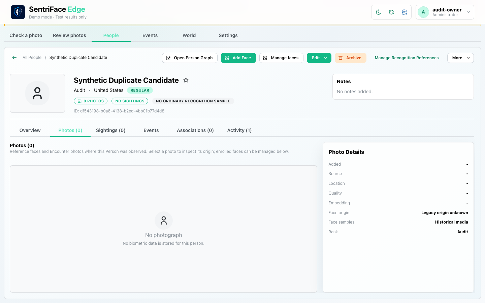](../screenshots/UX-06/UX-06_J10_Step-09_Pass2-No-photo-profile-gallery-empty.png)

Captured `2026-11-14T04:33:45.063170+00:00` · Administrator · UX-06 · synthetic fixture · scroll {'x': 0, 'y': 80}.

### Step 10 — Pass2 Gallery before profile photo change

[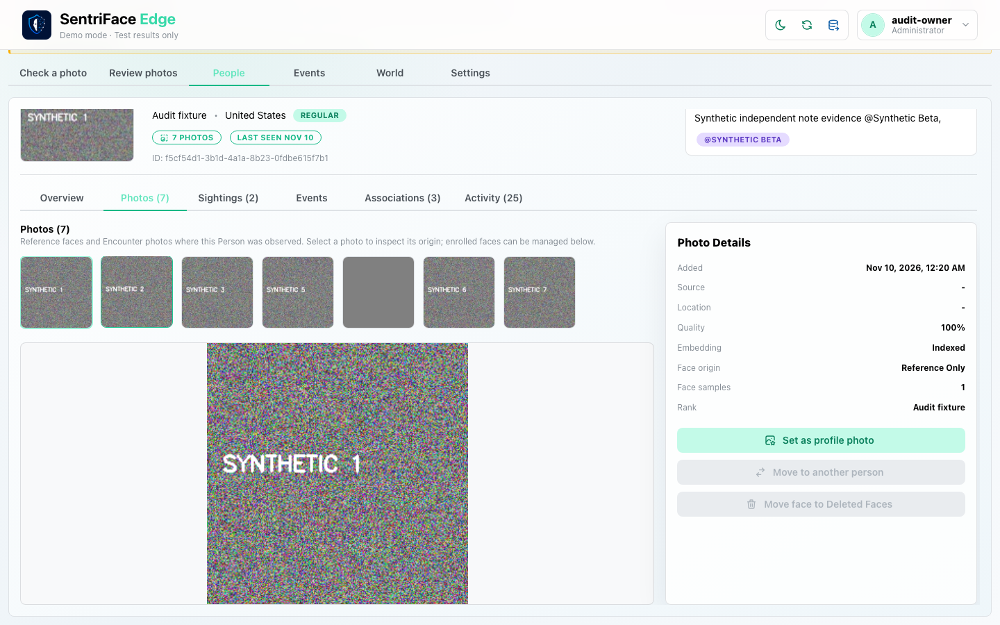](../screenshots/UX-06/UX-06_J10_Step-10_Pass2-Gallery-before-profile-photo-change.png)

Captured `2026-11-14T04:34:07.410214+00:00` · Administrator · UX-06 · synthetic fixture · scroll {'x': 0, 'y': 80}.

### Step 11 — Pass2 Gallery second photo selected

[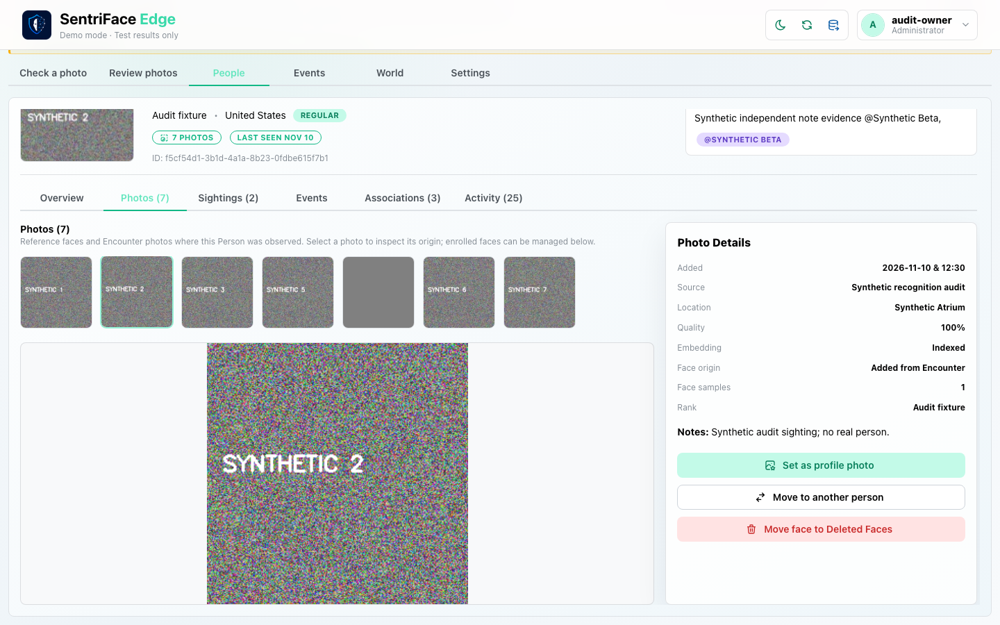](../screenshots/UX-06/UX-06_J10_Step-11_Pass2-Gallery-second-photo-selected.png)

Captured `2026-11-14T04:34:08.179462+00:00` · Administrator · UX-06 · synthetic fixture · scroll {'x': 0, 'y': 80}.

### Step 12 — Pass2 Gallery set profile photo

[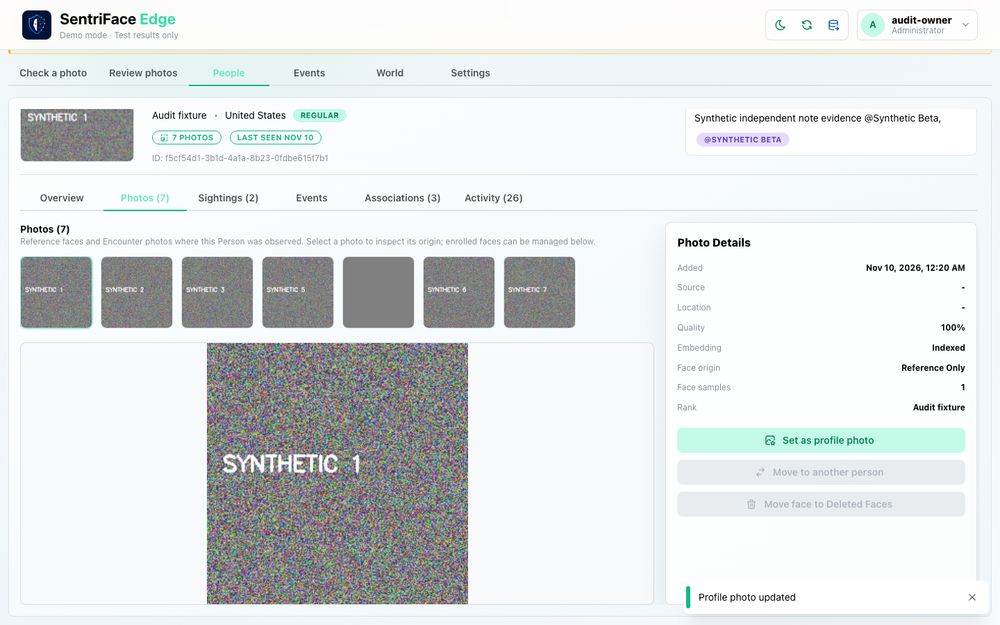](../screenshots/UX-06/UX-06_J10_Step-12_Pass2-Gallery-set-profile-photo.png)

Captured `2026-11-14T04:34:21.698656+00:00` · Administrator · UX-06 · synthetic fixture · scroll {'x': 0, 'y': 80}.

### Step 13 — Pass2 Profile photo after new session

[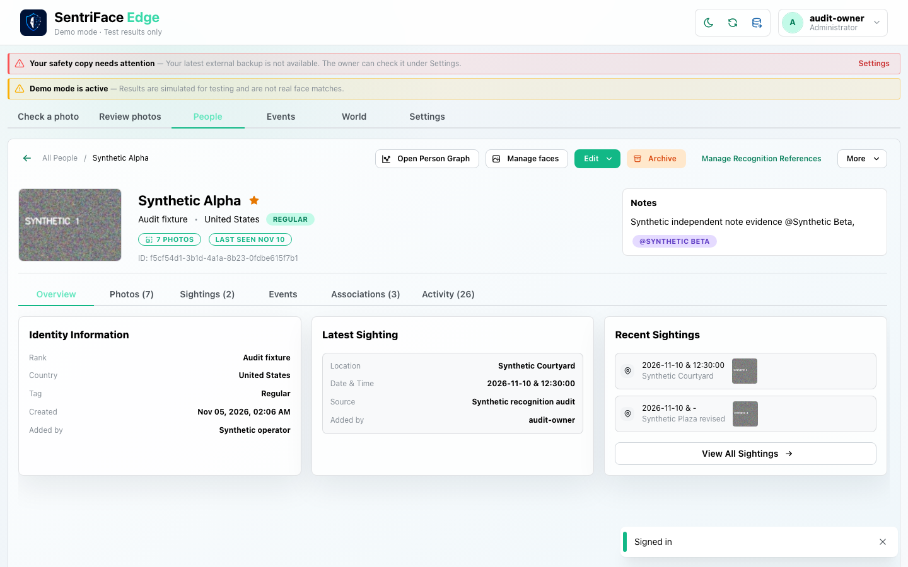](../screenshots/UX-06/UX-06_J10_Step-13_Pass2-Profile-photo-after-new-session.png)

Captured `2026-11-14T04:35:06.404260+00:00` · Administrator · UX-06 · synthetic fixture · scroll {'x': 0, 'y': 0}.

### Step 14 — Pass2 Preferred photo persisted badge

[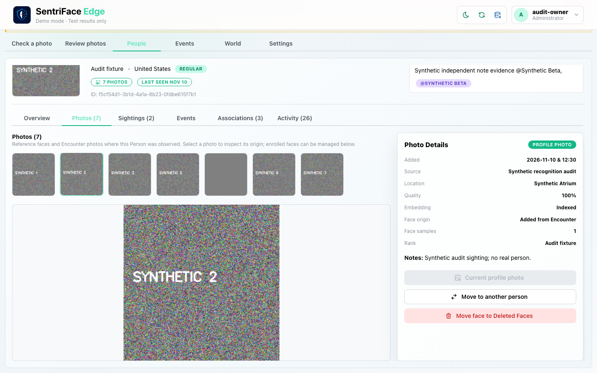](../screenshots/UX-06/UX-06_J10_Step-14_Pass2-Preferred-photo-persisted-badge.png)

Captured `2026-11-14T04:35:44.343938+00:00` · Administrator · UX-06 · synthetic fixture · scroll {'x': 0, 'y': 80}.

### Step 15 — Pass2 Overview after preferred selection

[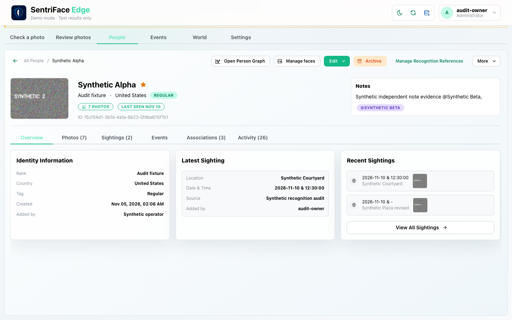](../screenshots/UX-06/UX-06_J10_Step-15_Pass2-Overview-after-preferred-selection.png)

Captured `2026-11-14T04:35:45.045561+00:00` · Administrator · UX-06 · synthetic fixture · scroll {'x': 0, 'y': 80}.
