# J11 — Face management confirmations, soft deletion and recovery

[Audit index](../INDEX.md) · [Source oracle](../source-map.md) · [Independent review](../review.md)

**Scope result: PARTIAL.** This record proves only the ordered observations below; source-contract branches outside them are not silently passed. Source tasks: [SJ-025](../source-journeys.csv), [SJ-035](../source-journeys.csv).

**Operator goal:** Inspect face ownership/destruction controls and demonstrate the recoverable Deleted Faces path using only synthetic media.

**Starting state and required role:** Beta’s accepted Encounter face is selected in Photos; Administrator has destroy capability. Its Reference-independent origin permits ordinary face management. All captures in this record use the disposable Administrator unless a step explicitly says unauthenticated.

**Implemented owners:** [`views/PeopleView.jsx`](../../../frontend/src/views/PeopleView.jsx); [`hooks/usePeopleController.js`](../../../frontend/src/hooks/usePeopleController.js).

**Evidence basis:** saved current-run screenshots, capture metadata and accessibility snapshots. Visual acceptance is documented in the independent review; this assembly does not claim a second independent visual inspection. Synthetic images are generated patterns, not biometric photographs. No source/UI manipulation produces these states.

**Source:** `b457f0a723e845dd1a92a07a577072c85146c89a`. Capture sequence numbers order the captured states; uncaptured return actions are named in the text. The audit was interrupted and resumed across November 5 and 10 at the same source SHA.

## Ordered interaction and visual evidence

### Step 01 — Move face dialog

Choose Move to another person from Beta Photos. The target-selection dialog is captured; Cancel performs no ownership change.

Capture: `UX-07` · Administrator · light theme · 1440×900 CSS viewport · DPR 1 · `2026-11-10T08:28:26.582356+00:00` · fixture: synthetic.

Scroll recorded: x=0, y=80.

### Step 02 — Delete face confirm

Choose Move face to Deleted Faces. The warning describes immediate recognition exclusion, retained linked Sighting and a verified backup prerequisite; this first opening is cancelled.

Capture: `UX-07` · Administrator · light theme · 1440×900 CSS viewport · DPR 1 · `2026-11-10T08:28:27.789883+00:00` · fixture: synthetic.

Scroll recorded: x=0, y=80.

### Step 03 — Face soft deleted

Later reopen the confirmation and choose Move to Deleted Faces. “Face safely deleted” reports a 30-day recovery path and one linked sighting retained.

Capture: `UX-07` · Administrator · light theme · 1440×900 CSS viewport · DPR 1 · `2026-11-10T08:31:28.207150+00:00` · fixture: synthetic.

Scroll recorded: x=0, y=80.

### Step 04 — Deleted faces collection

Return to People and select Deleted Faces. The synthetic face, retained sighting count, scheduled live erasure and Restore/Erase controls are visible.

Capture: `UX-05` · Administrator · light theme · 1440×900 CSS viewport · DPR 1 · `2026-11-10T08:31:47.749943+00:00` · fixture: synthetic.

Scroll recorded: x=0, y=80.

### Step 05 — Erase face confirm

Choose Erase from live library. The confirmation explains that safety/exported backups can still retain copies. Cancel prevents this irreversible branch from executing.

Capture: `UX-07` · Administrator · light theme · 1440×900 CSS viewport · DPR 1 · `2026-11-10T08:32:12.518776+00:00` · fixture: synthetic.

Scroll recorded: x=0, y=80.

### Step 06 — Deleted face restored

Choose Restore in Deleted Faces. “Face restored to the person’s photo library” is observed; subsequent profile use continues with the restored sample.

Capture: `UX-07` · Administrator · light theme · 1440×900 CSS viewport · DPR 1 · `2026-11-10T08:32:14.105278+00:00` · fixture: synthetic.

Scroll recorded: x=0, y=80.

## Outcome, authority and return path

Move ownership is inspected and cancelled. The face is moved to Deleted Faces through the actual confirmation; the UI reports a retained linked sighting. The recovery collection shows the 30-day window. Live erasure is inspected and cancelled; Restore returns the face to the Person library.

## Limits and unexecuted branches

Ownership move is not executed. Live erasure/purge, automatic expiry, backup failure and restricted-role alternatives are not run here. A retained historical photo after sample deletion is not a new usable recognition source.

No redesign or implementation is specified by this record. Findings and recommended directions belong to the shared audit review and canonical design authority.

## macOS completion pass 2 — continuation B

Source product `b457f0a723e845dd1a92a07a577072c85146c89a`; full browser-content screenshots, 1440×900 CSS pixels, DPR 1, Day; dedicated disposable authority. See capture register for exact role, capture time and inference qualification.

A synthetic face was moved from its newly created Person to Beta and back, with profile counts observed. The request spinner at step 10 is intermediate; step 13 shows Beta after moving back, and step 14 confirms the original profile. Move the face to Deleted Faces, inspect the retention message and ERASE confirmation: wrong phrase disables, exact phrase enables. Permanent erase was attempted twice; both times the server returned “FOREIGN KEY constraint failed” after a safety backup, leaving the face recoverable. Cancel and restore it; the original profile again shows one photo and one sighting. This specific correction sequence is a functional FAIL; no inference about all erasure cases or corruption.

### Step 07 — Pass2 Disposable photo before delete

Captured `2026-11-11T11:09:57.030179+00:00` · Administrator · UX-06 · scroll {'x': 0, 'y': 80}. Exact fixture and inference mode are described above and in the capture register.

### Step 08 — Pass2 Move disposable face open

[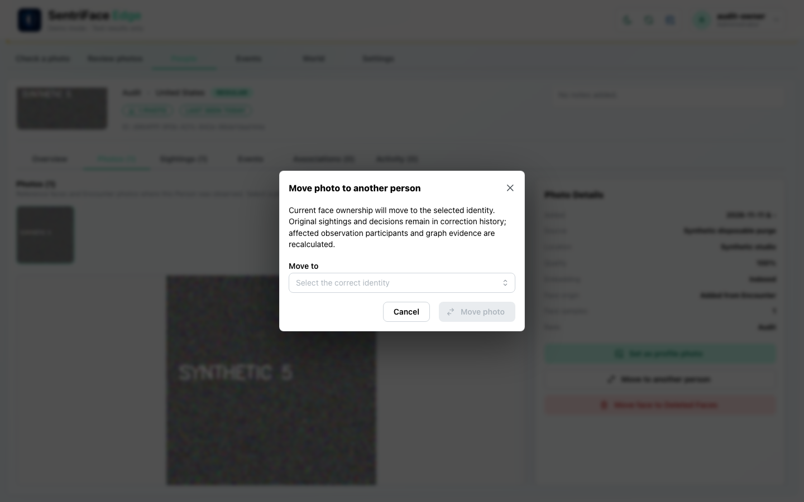](../screenshots/UX-07/UX-07_J11_Step-08_Pass2-Move-disposable-face-open.png)

Captured `2026-11-11T11:10:11.961939+00:00` · Administrator · UX-07 · scroll {'x': 0, 'y': 80}. Exact fixture and inference mode are described above and in the capture register.

### Step 09 — Pass2 Move disposable face ready

[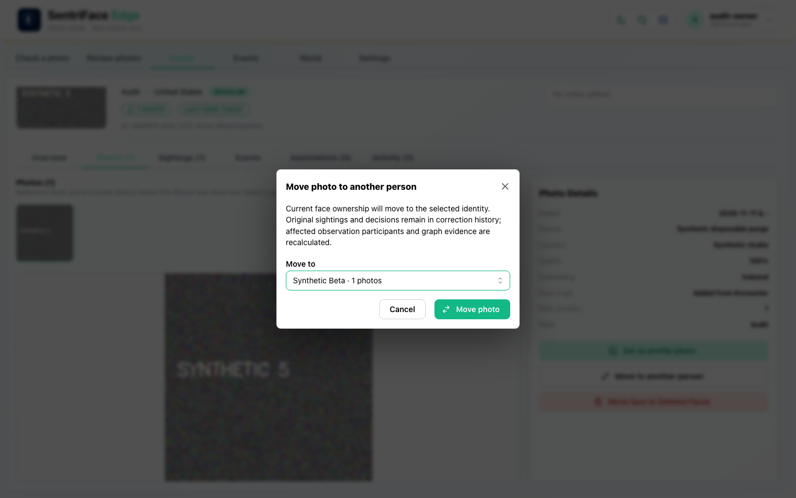](../screenshots/UX-07/UX-07_J11_Step-09_Pass2-Move-disposable-face-ready.png)

Captured `2026-11-11T11:10:31.762239+00:00` · Administrator · UX-07 · scroll {'x': 0, 'y': 80}. Exact fixture and inference mode are described above and in the capture register.

### Step 10 — Pass2 Move request in progress

[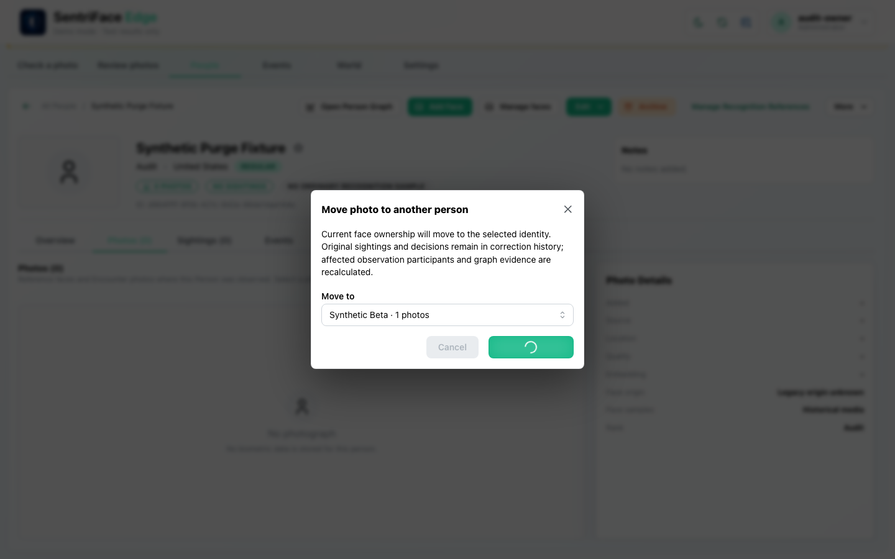](../screenshots/UX-07/UX-07_J11_Step-10_Pass2-Move-disposable-face-response.png)

Captured `2026-11-11T11:10:34.369030+00:00` · Administrator · UX-07 · scroll {'x': 0, 'y': 80}. Exact fixture and inference mode are described above and in the capture register.

### Step 11 — Pass2 Move target beta photos

[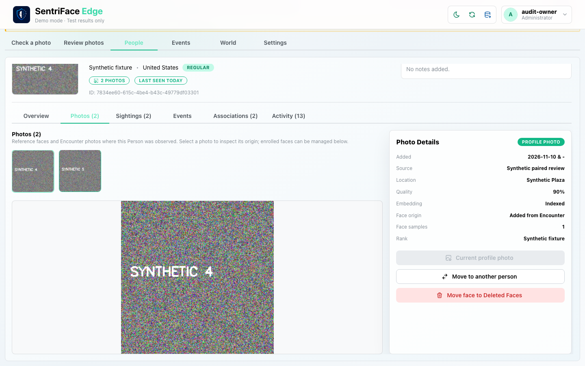](../screenshots/UX-06/UX-06_J11_Step-11_Pass2-Move-target-beta-photos.png)

Captured `2026-11-11T11:11:07.801129+00:00` · Administrator · UX-06 · scroll {'x': 0, 'y': 80}. Exact fixture and inference mode are described above and in the capture register.

### Step 12 — Pass2 Moved photo selected on target

[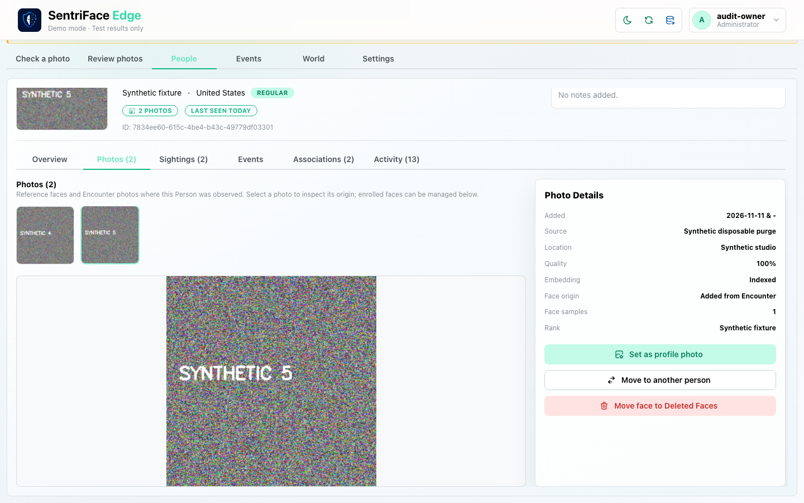](../screenshots/UX-06/UX-06_J11_Step-12_Pass2-Moved-photo-selected-on-target.png)

Captured `2026-11-11T11:11:21.582090+00:00` · Administrator · UX-06 · scroll {'x': 0, 'y': 80}. Exact fixture and inference mode are described above and in the capture register.

### Step 13 — Pass2 Beta profile after move back

[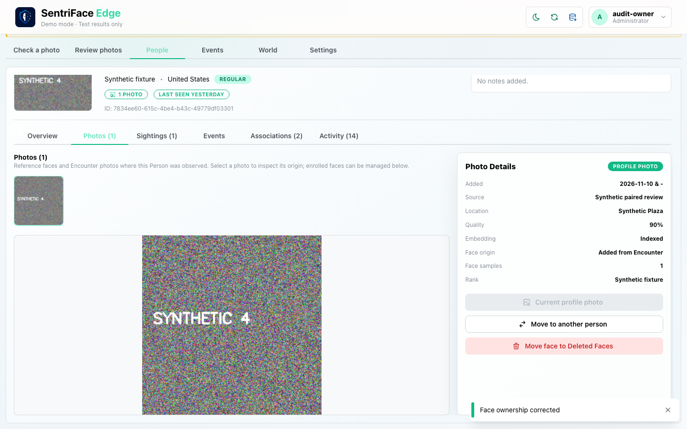](../screenshots/UX-06/UX-06_J11_Step-13_Pass2-Moved-photo-restored-to-fixture.png)

Captured `2026-11-11T11:11:45.474918+00:00` · Administrator · UX-06 · scroll {'x': 0, 'y': 80}. Exact fixture and inference mode are described above and in the capture register.

### Step 14 — Pass2 Restored disposable face profile

[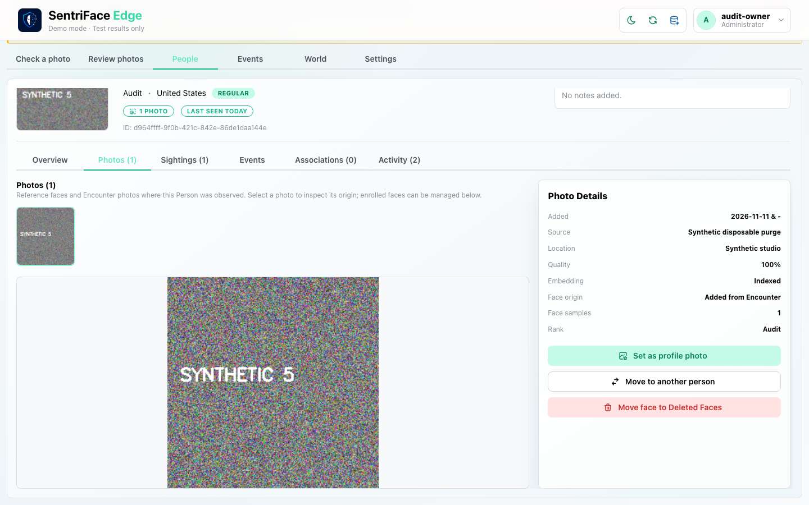](../screenshots/UX-06/UX-06_J11_Step-14_Pass2-Restored-disposable-face-profile.png)

Captured `2026-11-11T11:12:02.026138+00:00` · Administrator · UX-06 · scroll {'x': 0, 'y': 80}. Exact fixture and inference mode are described above and in the capture register.

### Step 15 — Pass2 Disposable face delete confirmation

Captured `2026-11-11T11:12:03.037511+00:00` · Administrator · UX-07 · scroll {'x': 0, 'y': 80}. Exact fixture and inference mode are described above and in the capture register.

### Step 16 — Pass2 Disposable face soft deleted

[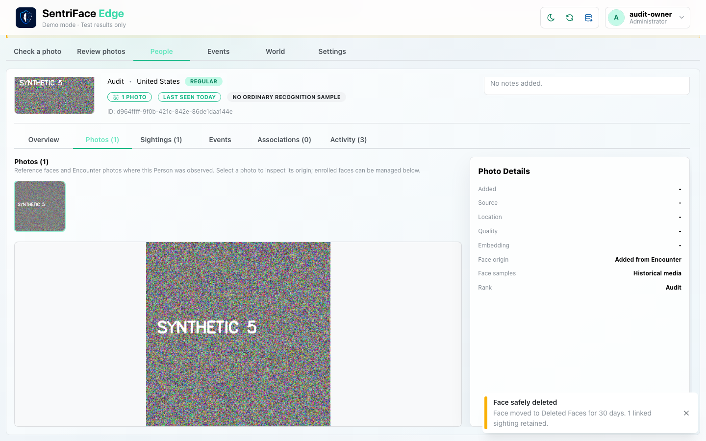](../screenshots/UX-07/UX-07_J11_Step-16_Pass2-Disposable-face-soft-deleted.png)

Captured `2026-11-11T11:12:19.921568+00:00` · Administrator · UX-07 · scroll {'x': 0, 'y': 80}. Exact fixture and inference mode are described above and in the capture register.

### Step 17 — Pass2 Disposable deleted face collection

[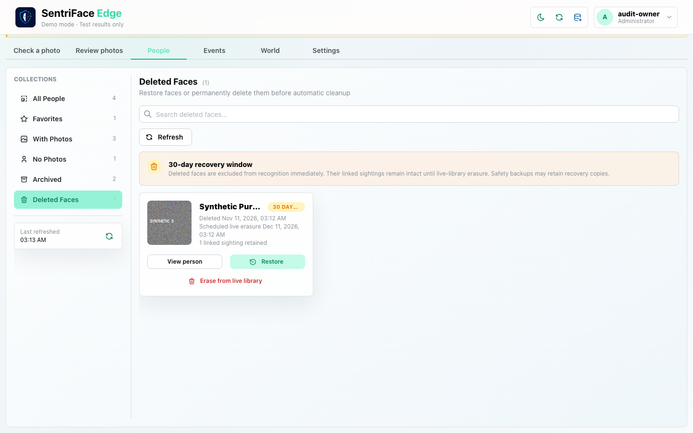](../screenshots/UX-05/UX-05_J11_Step-17_Pass2-Disposable-deleted-face-collection.png)

Captured `2026-11-11T11:13:06.216957+00:00` · Administrator · UX-05 · scroll {'x': 0, 'y': 80}. Exact fixture and inference mode are described above and in the capture register.

### Step 18 — Pass2 Disposable face erase confirmation

Captured `2026-11-11T11:13:23.542780+00:00` · Administrator · UX-07 · scroll {'x': 0, 'y': 80}. Exact fixture and inference mode are described above and in the capture register.

### Step 19 — Pass2 Erase wrong phrase disabled

[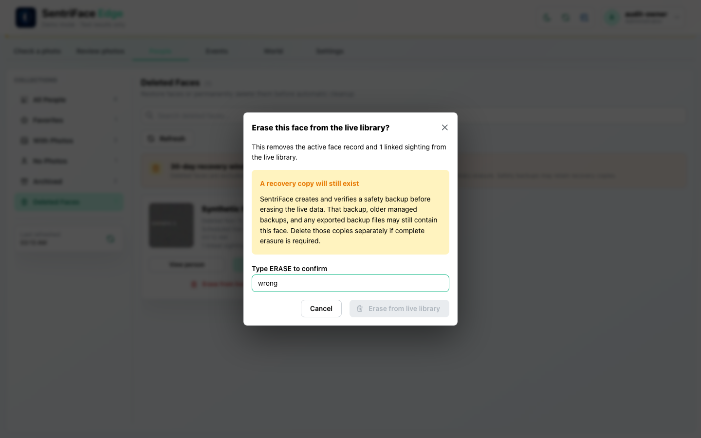](../screenshots/UX-07/UX-07_J11_Step-19_Pass2-Erase-wrong-phrase-disabled.png)

Captured `2026-11-11T11:13:40.701843+00:00` · Administrator · UX-07 · scroll {'x': 0, 'y': 80}. Exact fixture and inference mode are described above and in the capture register.

### Step 20 — Pass2 Erase phrase ready

[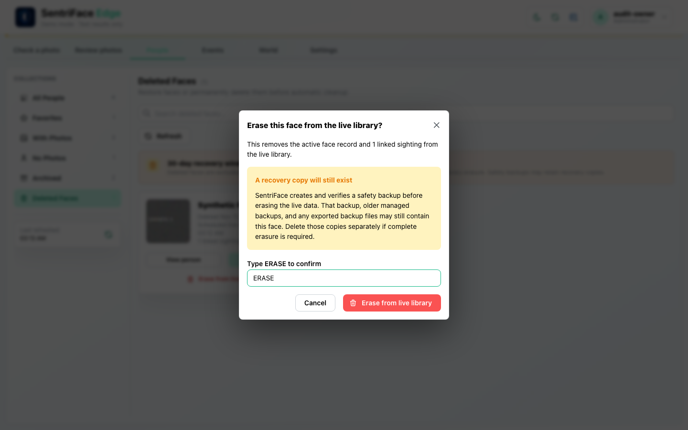](../screenshots/UX-07/UX-07_J11_Step-20_Pass2-Erase-phrase-ready.png)

Captured `2026-11-11T11:13:41.541605+00:00` · Administrator · UX-07 · scroll {'x': 0, 'y': 80}. Exact fixture and inference mode are described above and in the capture register.

### Step 21 — Pass2 Erase attempt response

Captured `2026-11-11T11:14:24.831507+00:00` · Administrator · UX-07 · scroll {'x': 0, 'y': 80}. Exact fixture and inference mode are described above and in the capture register.

### Step 22 — Pass2 Erase refused foreign key

[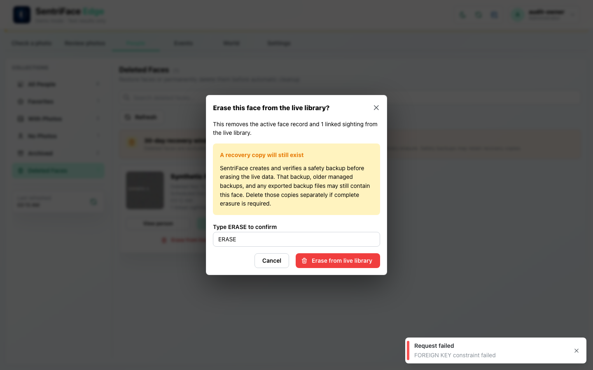](../screenshots/UX-07/UX-07_J11_Step-22_Pass2-Erase-refused-foreign-key.png)

Captured `2026-11-11T11:14:52.534514+00:00` · Administrator · UX-07 · scroll {'x': 0, 'y': 80}. Exact fixture and inference mode are described above and in the capture register.

### Step 23 — Pass2 Erase failure retained deleted face

[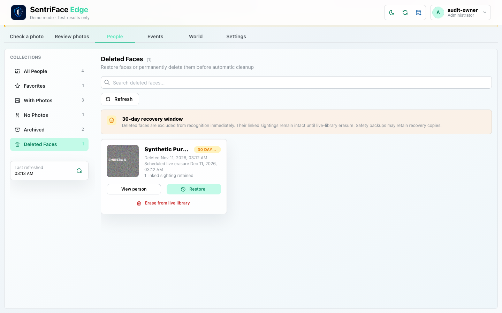](../screenshots/UX-05/UX-05_J11_Step-23_Pass2-Erase-failure-retained-deleted-face.png)

Captured `2026-11-11T11:15:10.258315+00:00` · Administrator · UX-05 · scroll {'x': 0, 'y': 80}. Exact fixture and inference mode are described above and in the capture register.

### Step 24 — Pass2 Face restored after erase failure

Captured `2026-11-11T11:15:13.204514+00:00` · Administrator · UX-05 · scroll {'x': 0, 'y': 80}. Exact fixture and inference mode are described above and in the capture register.

### Step 25 — Pass2 Restored profile after erase failure

[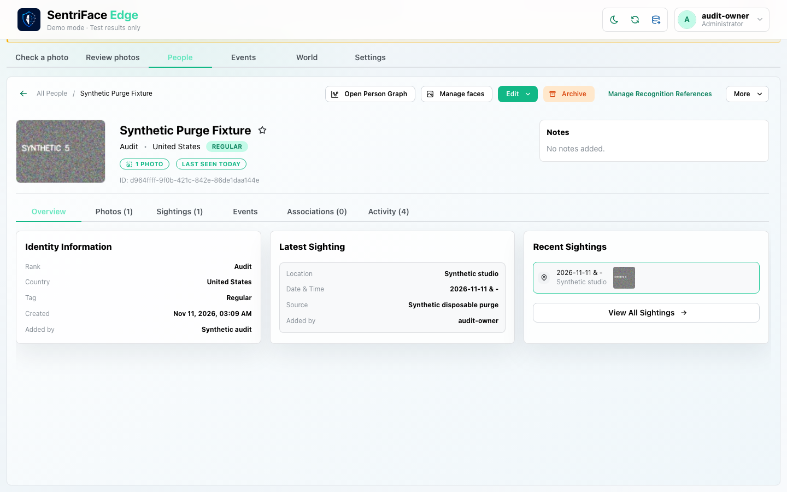](../screenshots/UX-06/UX-06_J11_Step-25_Pass2-Restored-profile-after-erase-failure.png)

Captured `2026-11-11T11:15:28.494866+00:00` · Administrator · UX-06 · scroll {'x': 0, 'y': 80}. Exact fixture and inference mode are described above and in the capture register.
