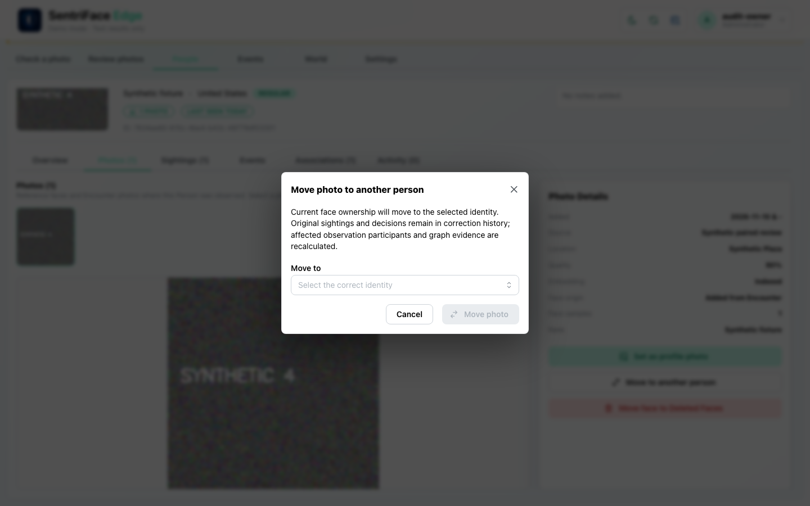
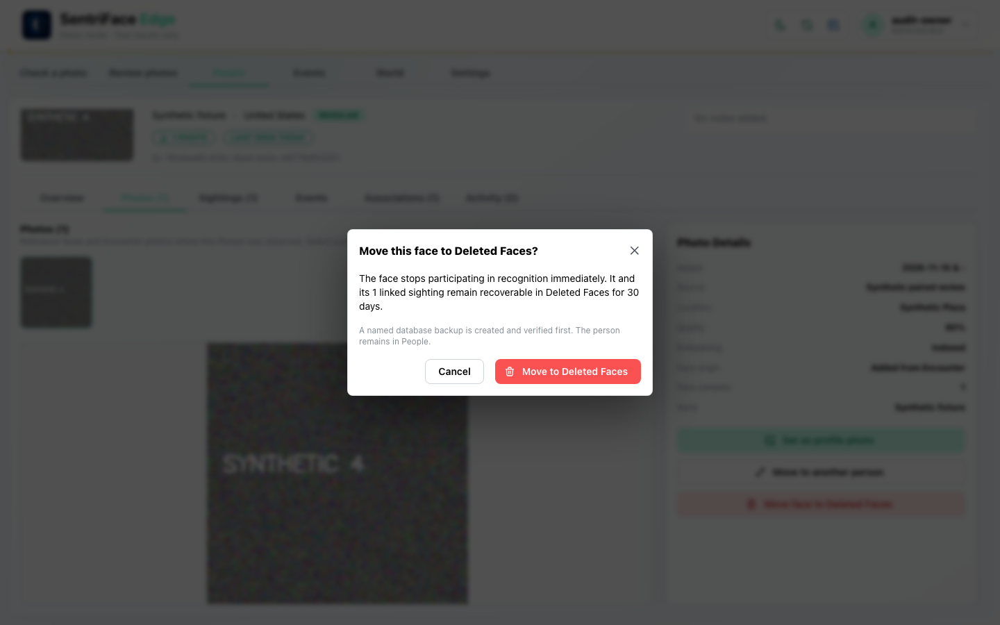
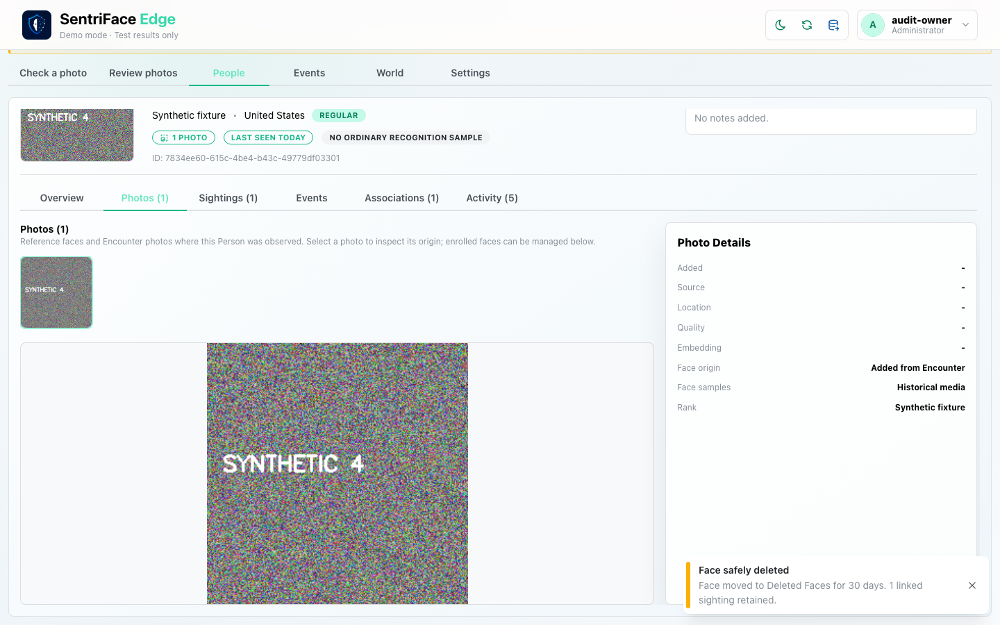
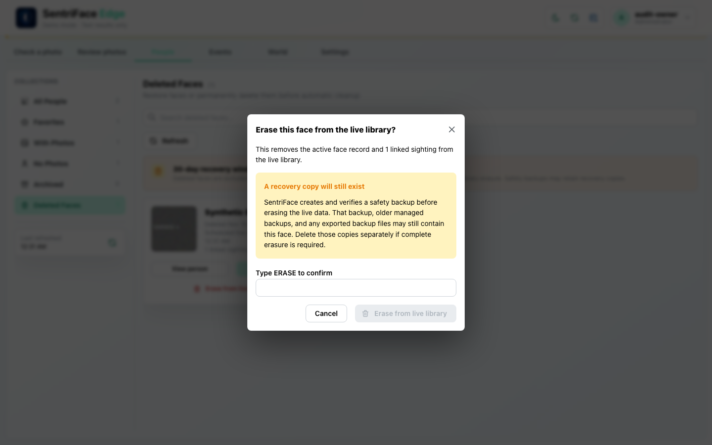
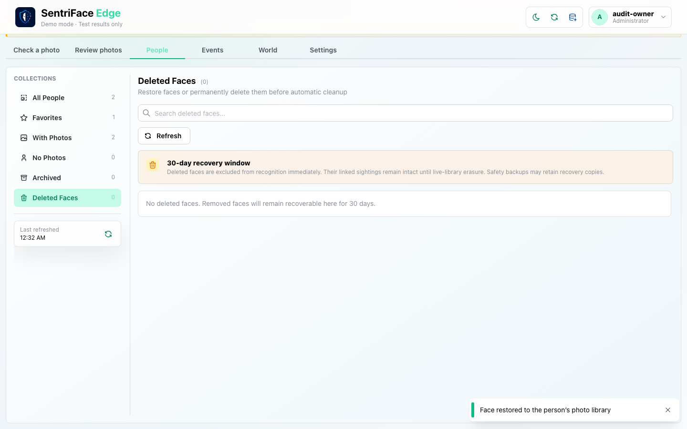

# J11 — Face management confirmations, soft deletion and recovery

[Audit index](../INDEX.md) · [Source oracle](../source-map.md) · [Independent review](../review.md)

**Scope result: PARTIAL.** This record proves only the ordered observations below; source-contract branches outside them are not silently passed. Source tasks: [SJ-025](../source-journeys.csv), [SJ-035](../source-journeys.csv).

**Operator goal:** Inspect face ownership/destruction controls and demonstrate the recoverable Deleted Faces path using only synthetic media.

**Starting state and required role:** Beta’s accepted Encounter face is selected in Photos; Administrator has destroy capability. Its Reference-independent origin permits ordinary face management. All captures in this record use the disposable Administrator unless a step explicitly says unauthenticated.

**Implemented owners:** [`views/PeopleView.jsx`](../../../frontend/src/views/PeopleView.jsx); [`hooks/usePeopleController.js`](../../../frontend/src/hooks/usePeopleController.js).

**Evidence basis:** saved current-run screenshots, capture metadata and accessibility snapshots. Visual acceptance is documented in the independent review; this assembly does not claim a second independent visual inspection. Synthetic images are generated patterns, not biometric photographs. No source/UI manipulation produces these states.

**Source:** `b457f0a723e845dd1a92a07a577072c85146c89a`. Capture sequence numbers order the captured states; uncaptured return actions are named in the text. The audit was interrupted and resumed across November 5 and 10 at the same source SHA.

## Ordered interaction and visual evidence

### Step 01 — Move face dialog

Choose Move to another person from Beta Photos. The target-selection dialog is captured; Cancel performs no ownership change.

Capture: `UX-07` · Administrator · light theme · 1440×900 CSS viewport · DPR 1 · `2026-11-10T08:28:26.582356+00:00` · fixture: synthetic.

Scroll recorded: x=0, y=80.

### Step 02 — Delete face confirm

Choose Move face to Deleted Faces. The warning describes immediate recognition exclusion, retained linked Sighting and a verified backup prerequisite; this first opening is cancelled.

Capture: `UX-07` · Administrator · light theme · 1440×900 CSS viewport · DPR 1 · `2026-11-10T08:28:27.789883+00:00` · fixture: synthetic.

Scroll recorded: x=0, y=80.

### Step 03 — Face soft deleted

Later reopen the confirmation and choose Move to Deleted Faces. “Face safely deleted” reports a 30-day recovery path and one linked sighting retained.

Capture: `UX-07` · Administrator · light theme · 1440×900 CSS viewport · DPR 1 · `2026-11-10T08:31:28.207150+00:00` · fixture: synthetic.

Scroll recorded: x=0, y=80.

### Step 04 — Deleted faces collection

Return to People and select Deleted Faces. The synthetic face, retained sighting count, scheduled live erasure and Restore/Erase controls are visible.

Capture: `UX-05` · Administrator · light theme · 1440×900 CSS viewport · DPR 1 · `2026-11-10T08:31:47.749943+00:00` · fixture: synthetic.

Scroll recorded: x=0, y=80.

### Step 05 — Erase face confirm

Choose Erase from live library. The confirmation explains that safety/exported backups can still retain copies. Cancel prevents this irreversible branch from executing.

Capture: `UX-07` · Administrator · light theme · 1440×900 CSS viewport · DPR 1 · `2026-11-10T08:32:12.518776+00:00` · fixture: synthetic.

Scroll recorded: x=0, y=80.

### Step 06 — Deleted face restored

Choose Restore in Deleted Faces. “Face restored to the person’s photo library” is observed; subsequent profile use continues with the restored sample.

Capture: `UX-07` · Administrator · light theme · 1440×900 CSS viewport · DPR 1 · `2026-11-10T08:32:14.105278+00:00` · fixture: synthetic.

Scroll recorded: x=0, y=80.

## Outcome, authority and return path

Move ownership is inspected and cancelled. The face is moved to Deleted Faces through the actual confirmation; the UI reports a retained linked sighting. The recovery collection shows the 30-day window. Live erasure is inspected and cancelled; Restore returns the face to the Person library.

## Limits and unexecuted branches

Ownership move is not executed. Live erasure/purge, automatic expiry, backup failure and restricted-role alternatives are not run here. A retained historical photo after sample deletion is not a new usable recognition source.

No redesign or implementation is specified by this record. Findings and recommended directions belong to the shared audit review and canonical design authority.
