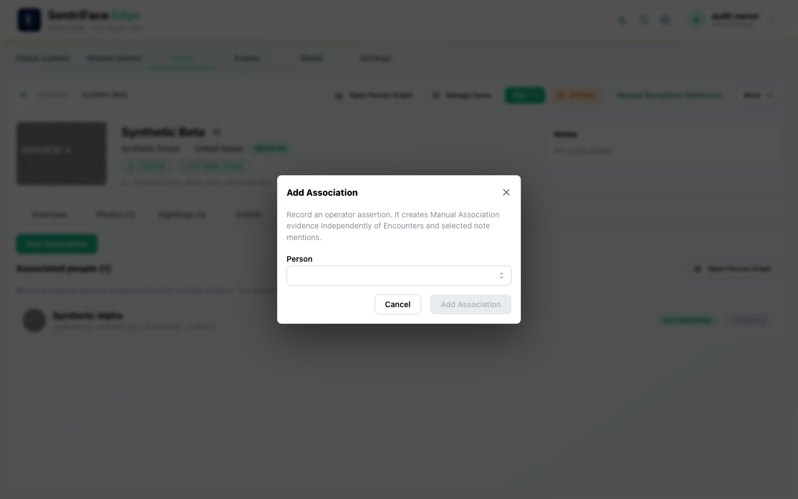
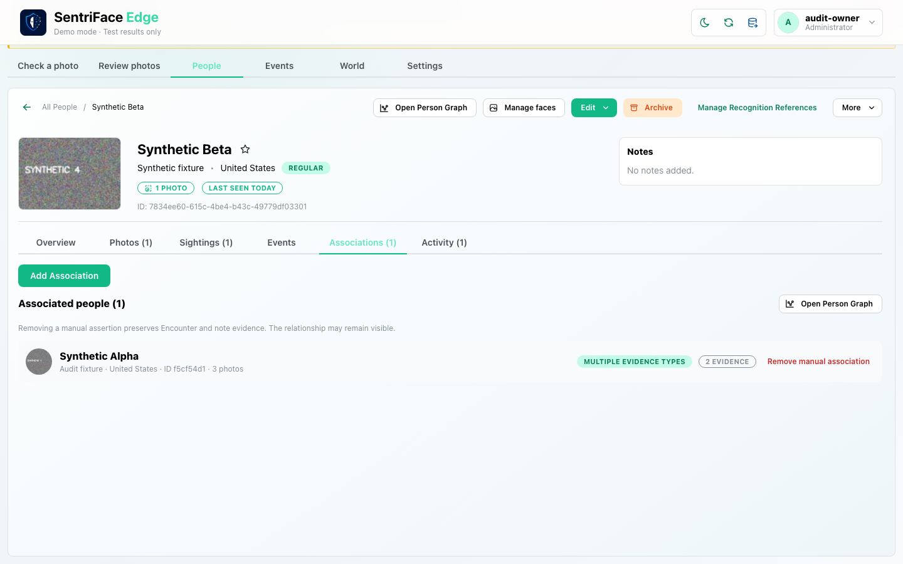
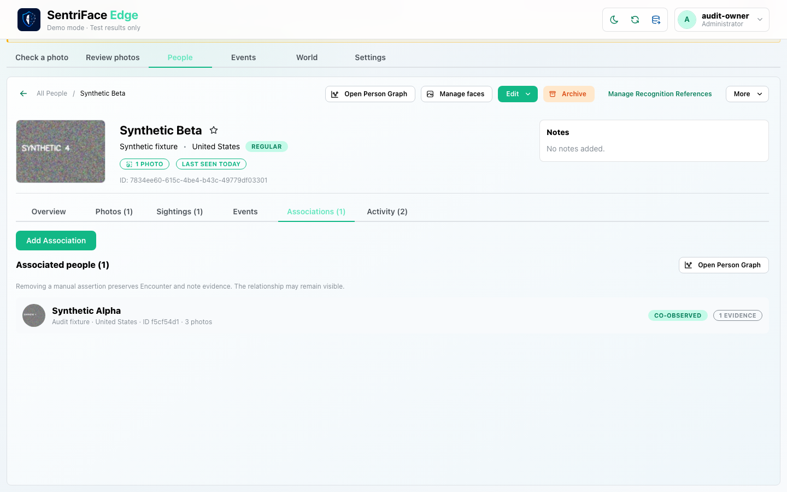
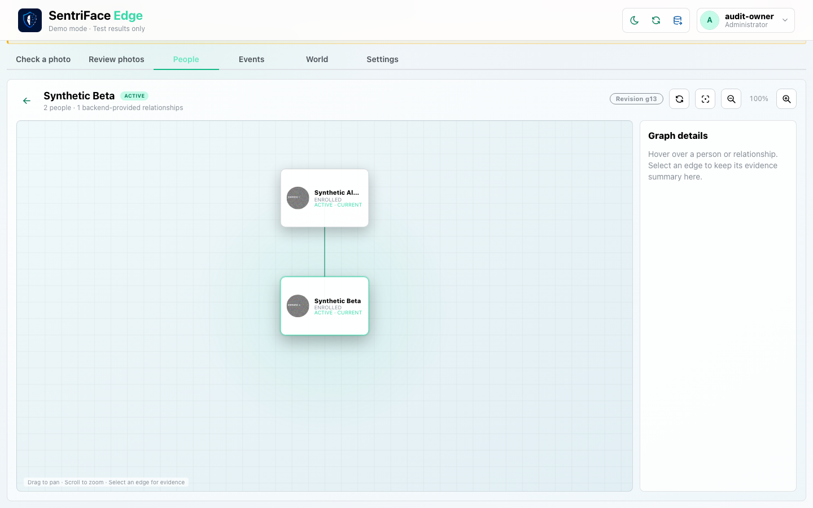
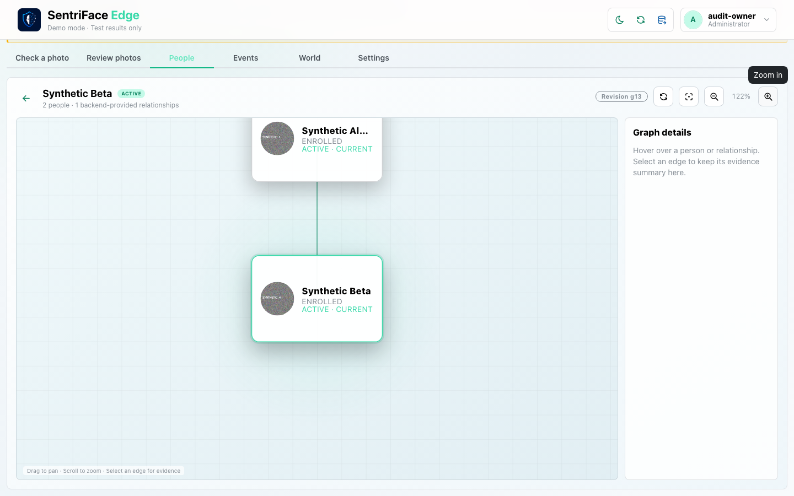
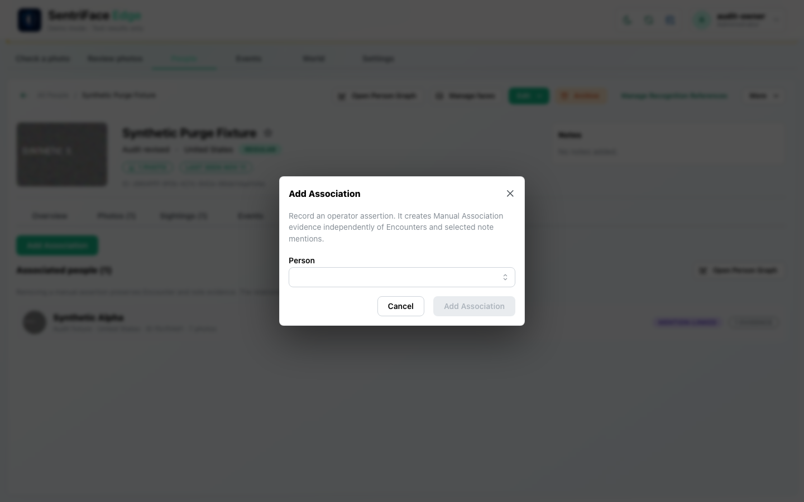
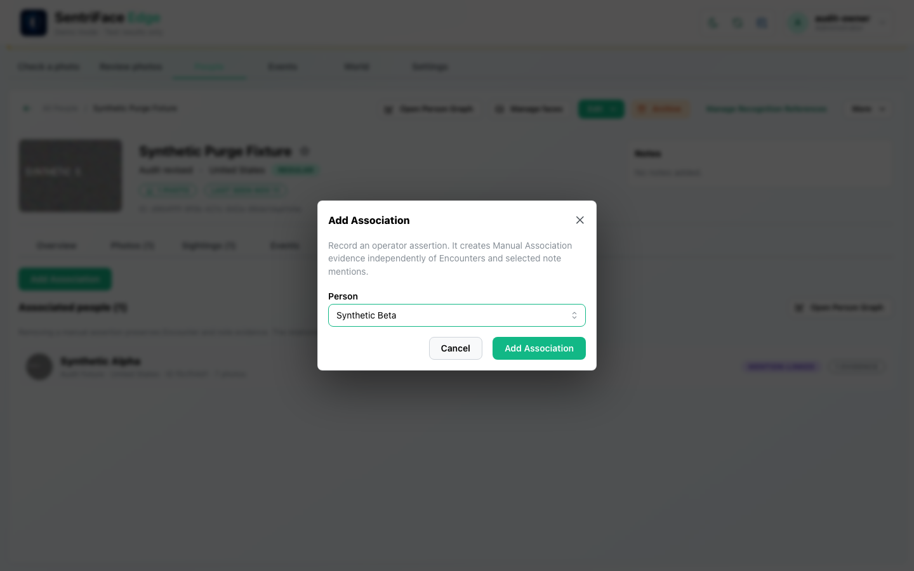
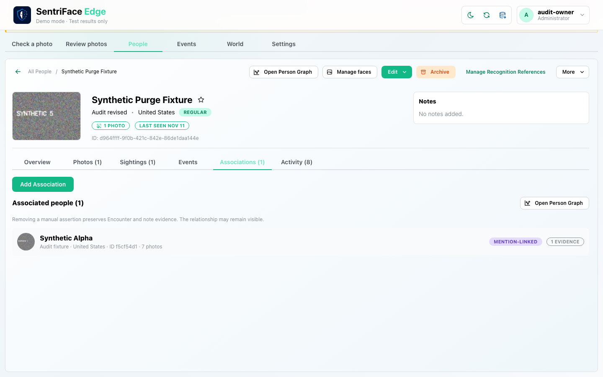
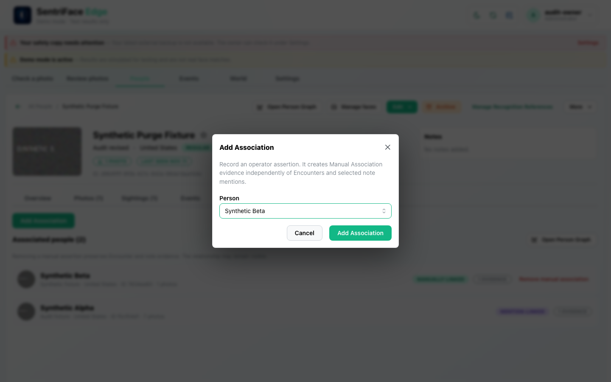
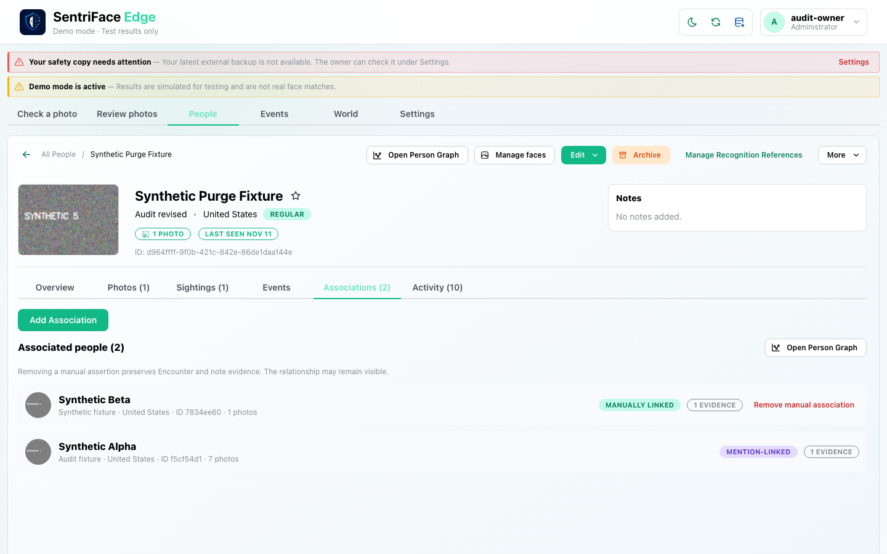

# J12 — Independent association evidence and Person Graph

[Audit index](../INDEX.md) · [Source oracle](../source-map.md) · [Independent review](../review.md)

**Scope result: PARTIAL.** This record proves only the ordered observations below; source-contract branches outside them are not silently passed. Source tasks: [SJ-027](../source-journeys.csv), [SJ-036](../source-journeys.csv).

**Operator goal:** Add and remove a standing Manual Association while retaining independent Encounter support, then inspect the same relationship in Person Graph.

**Starting state and required role:** Beta and Alpha have an INCLUDE co-observation from J08. Administrator has add and view capabilities. All captures in this record use the disposable Administrator unless a step explicitly says unauthenticated.

**Implemented owners:** [`views/PeopleView.jsx::PeopleProfileAssociations`](../../../frontend/src/views/PeopleView.jsx); [`views/PersonGraphView.jsx`](../../../frontend/src/views/PersonGraphView.jsx).

**Evidence basis:** saved current-run screenshots, capture metadata and accessibility snapshots. Visual acceptance is documented in the independent review; this assembly does not claim a second independent visual inspection. Synthetic images are generated patterns, not biometric photographs. No source/UI manipulation produces these states.

**Source:** `b457f0a723e845dd1a92a07a577072c85146c89a`. Capture sequence numbers order the captured states; uncaptured return actions are named in the text. The audit was interrupted and resumed across November 5 and 10 at the same source SHA.

## Ordered interaction and visual evidence

### Step 01 — Associations evidence

Select Associations (1). The current independent co-observed support is visible.

Capture: `UX-06` · Administrator · light theme · 1440×900 CSS viewport · DPR 1 · `2026-11-10T08:28:40.576728+00:00` · fixture: synthetic.

Scroll recorded: x=0, y=80.

### Step 02 — Add association dialog

Choose Add Association. The modal states that manual evidence is independent of Encounters and selected note mentions.

Capture: `UX-08` · Administrator · light theme · 1440×900 CSS viewport · DPR 1 · `2026-11-10T08:28:41.284687+00:00` · fixture: synthetic.

Scroll recorded: x=0, y=80.

### Step 03 — Manual and coobserved evidence

Choose Alpha and confirm Add Association. The row reports Multiple evidence types and two evidence records; Remove manual association is exposed.

Capture: `UX-08` · Administrator · light theme · 1440×900 CSS viewport · DPR 1 · `2026-11-10T08:29:07.740483+00:00` · fixture: synthetic.

Scroll recorded: x=0, y=80.

### Step 04 — Manual retired coobserved remains

Choose Remove manual association. Co-observed support remains visible, demonstrating retirement of one support rather than deletion of the entire relationship.

Capture: `UX-08` · Administrator · light theme · 1440×900 CSS viewport · DPR 1 · `2026-11-10T08:29:22.814505+00:00` · fixture: synthetic.

Scroll recorded: x=0, y=80.

### Step 05 — Person graph

Choose Open Person Graph. It shows Beta and Alpha, one relationship, revision context and inspection controls.

Capture: `UX-06` · Administrator · light theme · 1440×900 CSS viewport · DPR 1 · `2026-11-10T08:29:23.376372+00:00` · fixture: synthetic.

Scroll recorded: x=0, y=80.

### Step 06 — Graph zoom

Choose Zoom in, then Fit graph and Back to person profile after the capture. Zoom changes presentation only.

Capture: `UX-06` · Administrator · light theme · 1440×900 CSS viewport · DPR 1 · `2026-11-10T08:29:49.014762+00:00` · fixture: synthetic.

Scroll recorded: x=0, y=80.

## Outcome, authority and return path

Manual evidence is added beside co-observation, then retired. The relationship remains supported by the Encounter. Person Graph shows two People and one backend-provided relationship; zoom and return are sampled without creating graph authority.

## Limits and unexecuted branches

Duplicate standing assertions, Note evidence, graph edge keyboard inspection, node navigation, graph failure/empty/stale and lifecycle-restricted nodes are not proved here. Graph zoom can move content outside the current viewport; fit/pan must be considered separately.

No redesign or implementation is specified by this record. Findings and recommended directions belong to the shared audit review and canonical design authority.

## macOS completion pass 2 — continuation D

Source product `b457f0a723e845dd1a92a07a577072c85146c89a`; disposable authority; full browser-content viewport 1440×900 CSS pixels, DPR 1, Day. Role and capture time are recorded per step.

Select Beta in Add Association and cancel: only the preexisting Alpha mention link remains. Add a manual Beta assertion, then repeat the same real UI request. The UI shows one manually linked evidence item; two later actual HTTP 200 responses returned the same evidence ID. No authority bypass or database modification was used.

### Step 07 — Pass2 Add manual association open

Captured `2026-11-14T04:21:34.653571+00:00` · Administrator · UX-08 · synthetic fixture · scroll {'x': 0, 'y': 80}.

### Step 08 — Pass2 Add manual selected

Captured `2026-11-14T04:21:41.004392+00:00` · Administrator · UX-08 · synthetic fixture · scroll {'x': 0, 'y': 80}.

### Step 09 — Pass2 Add manual cancelled

Captured `2026-11-14T04:21:41.690203+00:00` · Administrator · UX-08 · synthetic fixture · scroll {'x': 0, 'y': 80}.

### Step 10 — Pass2 Manual beta added

Captured `2026-11-14T04:22:30.597722+00:00` · Administrator · UX-08 · synthetic fixture · scroll {'x': 0, 'y': 0}.

### Step 11 — Pass2 Duplicate manual selection

Captured `2026-11-14T04:23:03.871836+00:00` · Administrator · UX-08 · synthetic fixture · scroll {'x': 0, 'y': 0}.

### Step 12 — Pass2 Duplicate manual result

Captured `2026-11-14T04:23:05.137194+00:00` · Administrator · UX-08 · synthetic fixture · scroll {'x': 0, 'y': 0}.

### Step 13 — Pass2 Repeated manual still one evidence

Captured `2026-11-14T04:23:46.569357+00:00` · Administrator · UX-08 · synthetic fixture · scroll {'x': 0, 'y': 0}.
