# J13 — Archive, historical access and restore a Person

[Audit index](../INDEX.md) · [Source oracle](../source-map.md) · [Independent review](../review.md)

**Scope result: PARTIAL.** This record proves only the ordered observations below; source-contract branches outside them are not silently passed. Source tasks: [SJ-024](../source-journeys.csv), [SJ-032](../source-journeys.csv).

**Operator goal:** Remove a synthetic identity from active recognition while preserving history and verify the authorized restore route.

**Starting state and required role:** Beta is ACTIVE with one photo, one Sighting and one relationship. Administrator has destroy capability. All captures in this record use the disposable Administrator unless a step explicitly says unauthenticated.

**Implemented owners:** [`views/PeopleView.jsx`](../../../frontend/src/views/PeopleView.jsx); [`hooks/usePeopleController.js`](../../../frontend/src/hooks/usePeopleController.js).

**Evidence basis:** saved current-run screenshots, capture metadata and accessibility snapshots. Visual acceptance is documented in the independent review; this assembly does not claim a second independent visual inspection. Synthetic images are generated patterns, not biometric photographs. No source/UI manipulation produces these states.

**Source:** `b457f0a723e845dd1a92a07a577072c85146c89a`. Capture sequence numbers order the captured states; uncaptured return actions are named in the text. The audit was interrupted and resumed across November 5 and 10 at the same source SHA.

## Ordered interaction and visual evidence

### Step 01 — Archive confirm

Choose Archive on Beta’s profile. The confirmation names the retained photo, Sighting and relationship and says a verified backup is created first.

[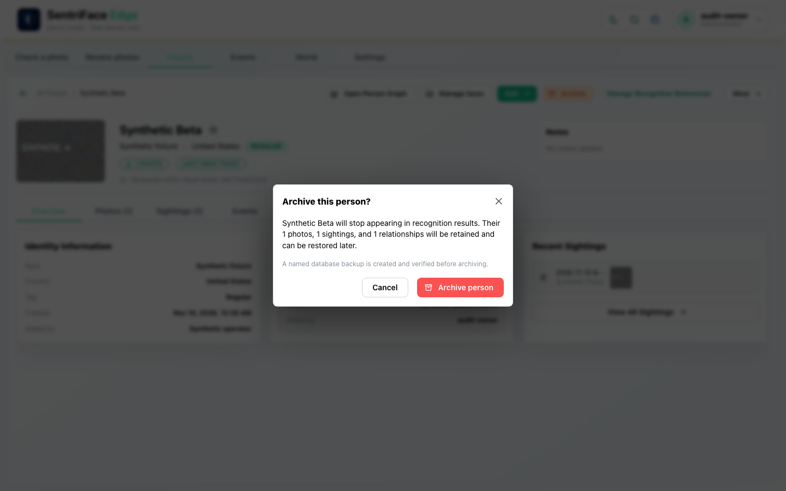](../screenshots/UX-08/UX-08_J13_Step-01_Archive-confirm.png)

Capture: `UX-08` · Administrator · light theme · 1440×900 CSS viewport · DPR 1 · `2026-11-10T08:29:50.320034+00:00` · fixture: synthetic.

Scroll recorded: x=0, y=80.

### Step 02 — Archived result

Choose Archive person and wait for the dialog to close. The library excludes Beta from active counts and reports “Person moved to Archived. A database backup was created first.”

[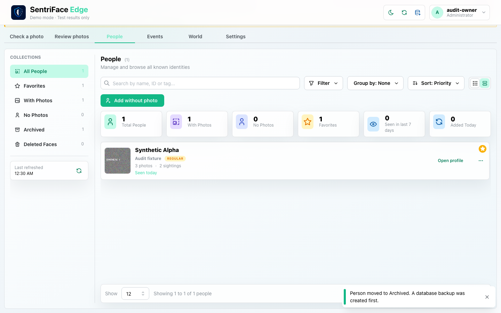](../screenshots/UX-08/UX-08_J13_Step-02_Archived-result.png)

Capture: `UX-08` · Administrator · light theme · 1440×900 CSS viewport · DPR 1 · `2026-11-10T08:30:06.285638+00:00` · fixture: synthetic.

Scroll recorded: x=0, y=80.

### Step 03 — Archived collection

Choose Archived. The collection shows Beta as a historical identity with retained counts.

[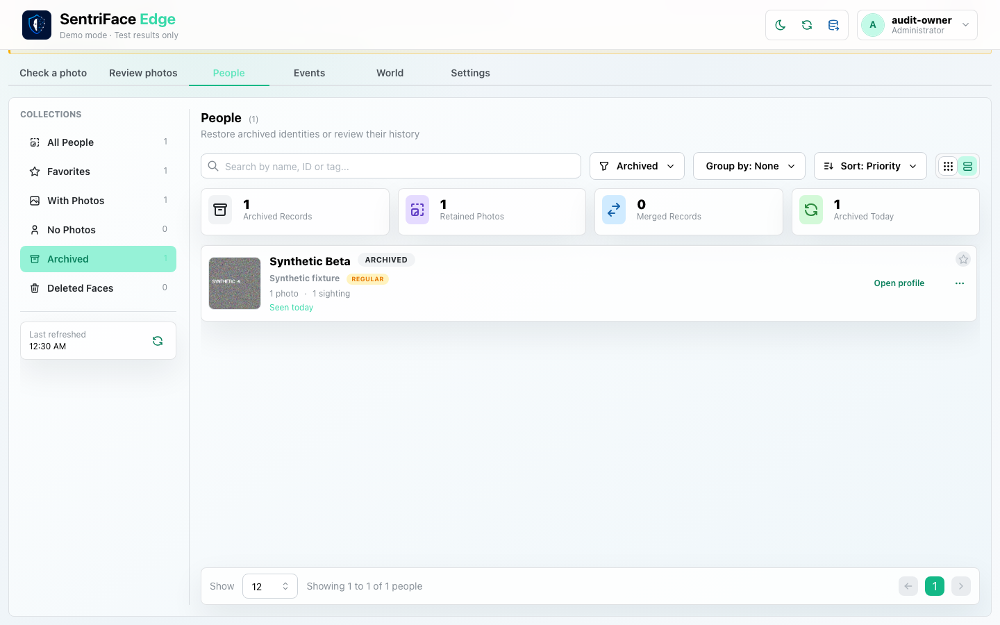](../screenshots/UX-05/UX-05_J13_Step-03_Archived-collection.png)

Capture: `UX-05` · Administrator · light theme · 1440×900 CSS viewport · DPR 1 · `2026-11-10T08:30:37.483165+00:00` · fixture: synthetic.

Scroll recorded: x=0, y=80.

### Step 04 — Historical profile

Open Historical identity Synthetic Beta. The historical profile exposes Restore rather than ordinary active editing controls.

[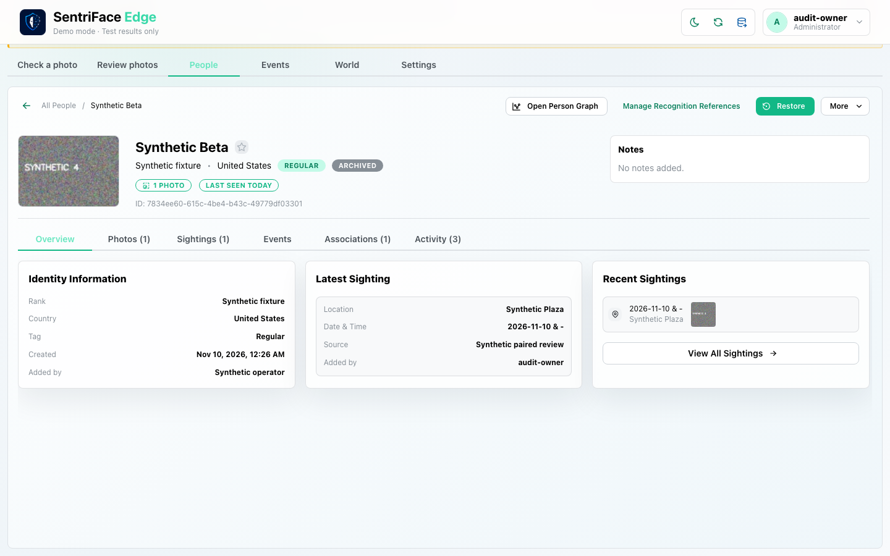](../screenshots/UX-08/UX-08_J13_Step-04_Historical-profile.png)

Capture: `UX-08` · Administrator · light theme · 1440×900 CSS viewport · DPR 1 · `2026-11-10T08:30:58.027808+00:00` · fixture: synthetic.

Scroll recorded: x=0, y=80.

### Step 05 — Restore confirm

Choose Restore. The confirmation describes returning the Person and retained photos to recognition and the active library.

[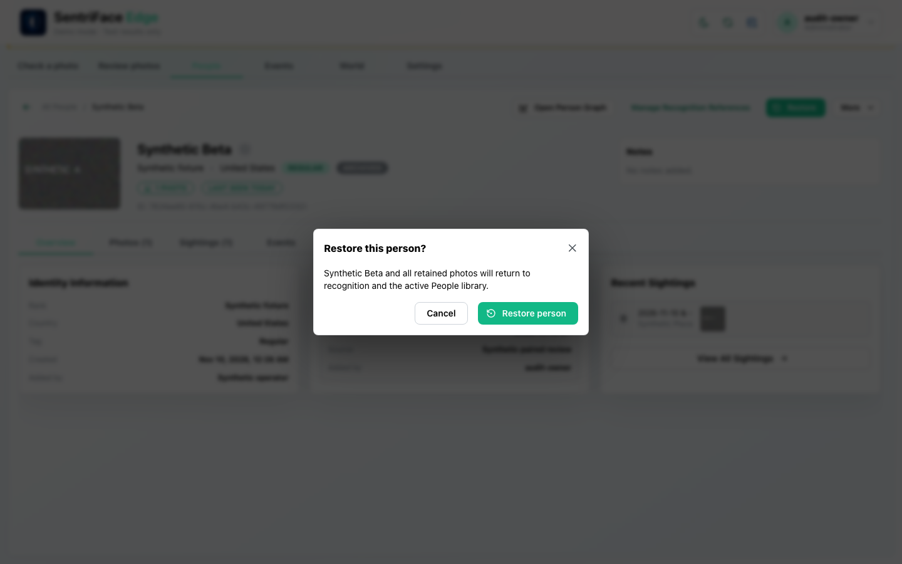](../screenshots/UX-08/UX-08_J13_Step-05_Restore-confirm.png)

Capture: `UX-08` · Administrator · light theme · 1440×900 CSS viewport · DPR 1 · `2026-11-10T08:30:58.703593+00:00` · fixture: synthetic.

Scroll recorded: x=0, y=80.

### Step 06 — Restored result

Choose Restore person. The active profile returns and “Person restored” is observed.

[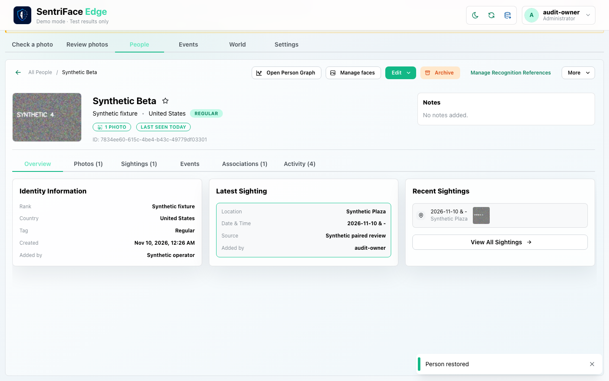](../screenshots/UX-08/UX-08_J13_Step-06_Restored-result.png)

Capture: `UX-08` · Administrator · light theme · 1440×900 CSS viewport · DPR 1 · `2026-11-10T08:31:00.277261+00:00` · fixture: synthetic.

Scroll recorded: x=0, y=80.

## Outcome, authority and return path

The actual Archive confirmation is completed after its backup prerequisite. Beta moves to Archived, its historical profile remains reachable, and Restore returns it to active use. The toast explicitly reports backup creation before archive.

## Limits and unexecuted branches

The archive-cancel and failed-backup paths, denied roles and historical graph-node behavior are not captured in this record. No deletion or history erasure is implied.

No redesign or implementation is specified by this record. Findings and recommended directions belong to the shared audit review and canonical design authority.

## macOS completion pass 2 — continuation B

Source product `b457f0a723e845dd1a92a07a577072c85146c89a`; full browser-content screenshots, 1440×900 CSS pixels, DPR 1, Day; dedicated disposable authority. See capture register for exact role, capture time and inference qualification.

Open archive confirmation for a synthetic Person, cancel and confirm the profile remains. Open again by keyboard; initial focus is on close, Tab advances, Escape closes and focus returns to Archive. This is a focused keyboard sample, not screen-reader certification.

### Step 07 — Pass2 Profile before cancel archive

[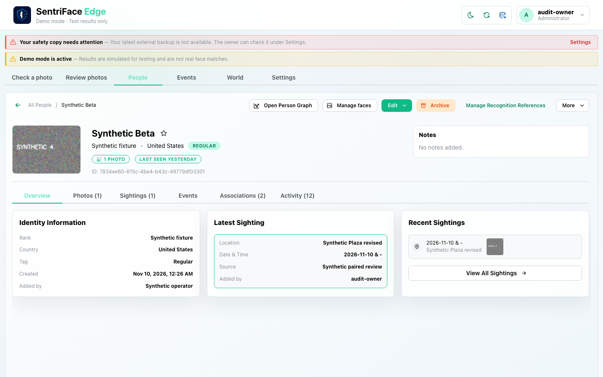](../screenshots/UX-06/UX-06_J13_Step-07_Pass2-Profile-before-cancel-archive.png)

Captured `2026-11-11T10:58:39.266661+00:00` · Administrator · UX-06 · scroll {'x': 0, 'y': 0}. Exact fixture and inference mode are described above and in the capture register.

### Step 08 — Pass2 Archive cancel confirmation

[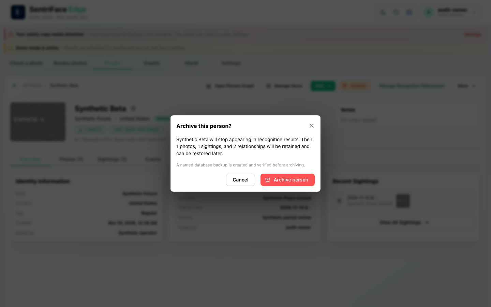](../screenshots/UX-08/UX-08_J13_Step-08_Pass2-Archive-cancel-confirmation.png)

Captured `2026-11-11T10:58:40.459020+00:00` · Administrator · UX-08 · scroll {'x': 0, 'y': 0}. Exact fixture and inference mode are described above and in the capture register.

### Step 09 — Pass2 Profile after cancel archive

[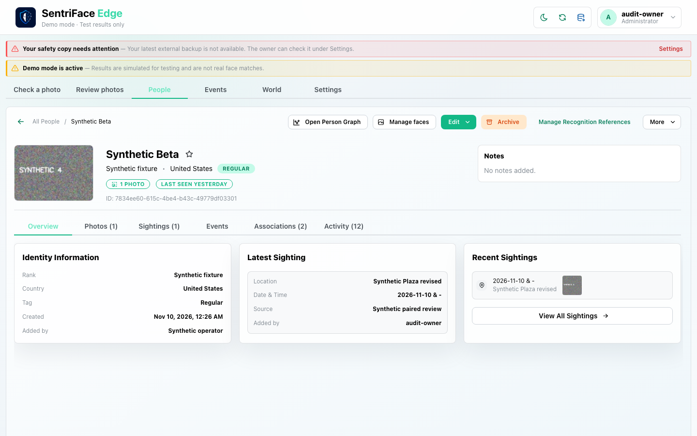](../screenshots/UX-06/UX-06_J13_Step-09_Pass2-Profile-after-cancel-archive.png)

Captured `2026-11-11T10:58:41.274812+00:00` · Administrator · UX-06 · scroll {'x': 0, 'y': 0}. Exact fixture and inference mode are described above and in the capture register.

### Step 10 — Pass2 Archive dialog keyboard open

[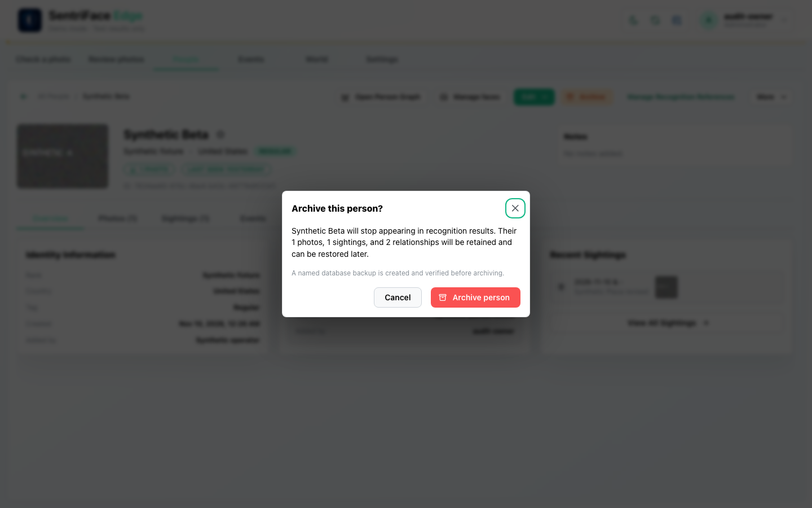](../screenshots/UX-08/UX-08_J13_Step-10_Pass2-Archive-dialog-keyboard-open.png)

Captured `2026-11-11T11:18:29.006793+00:00` · Administrator · UX-08 · scroll {'x': 0, 'y': 80}. Exact fixture and inference mode are described above and in the capture register.

### Step 11 — Pass2 Archive dialog escape

[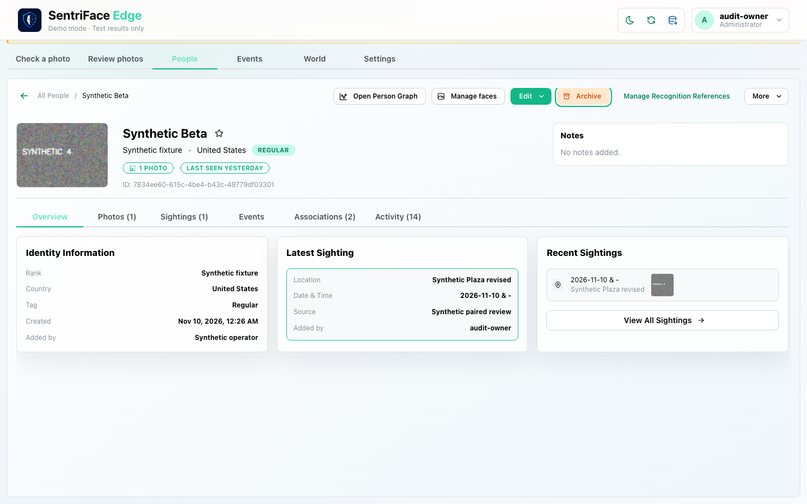](../screenshots/UX-06/UX-06_J13_Step-11_Pass2-Archive-dialog-escape.png)

Captured `2026-11-11T11:18:30.040577+00:00` · Administrator · UX-06 · scroll {'x': 0, 'y': 80}. Exact fixture and inference mode are described above and in the capture register.
