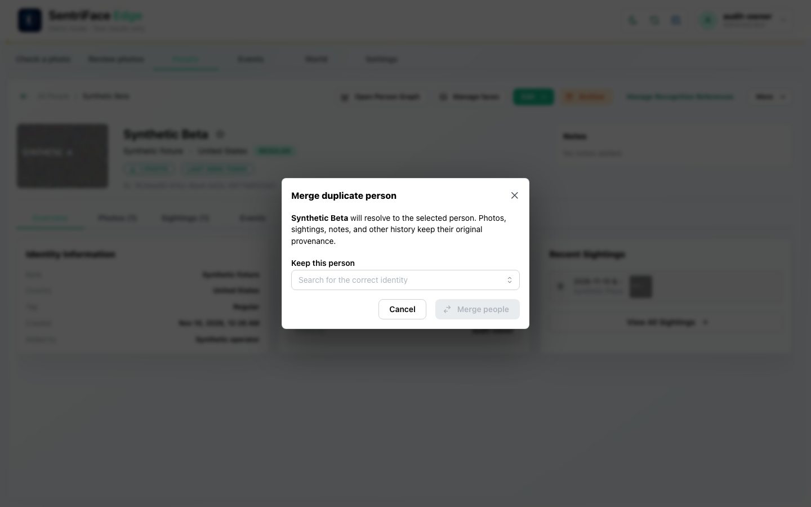
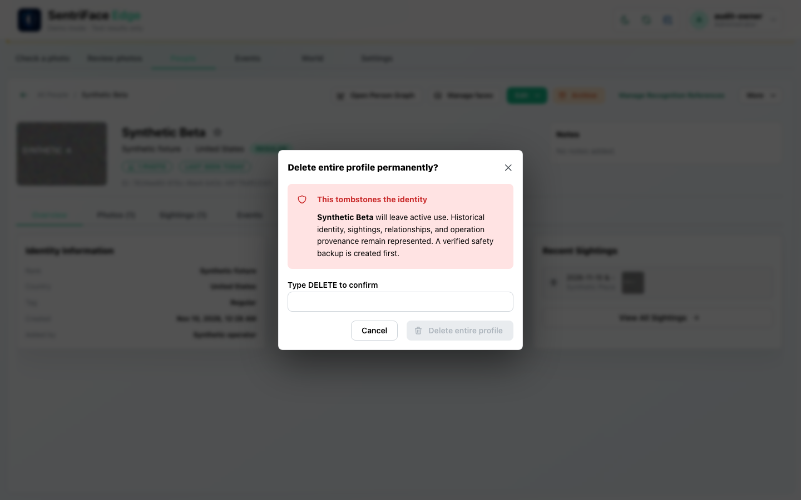
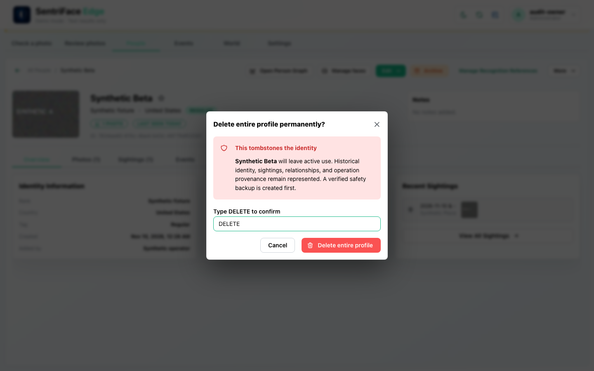
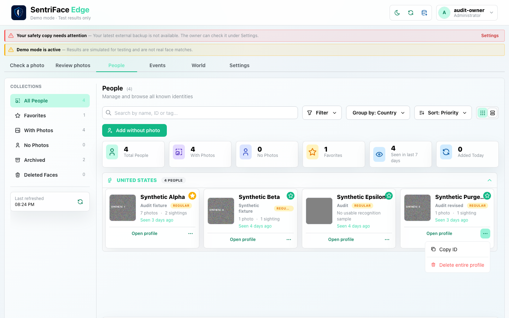
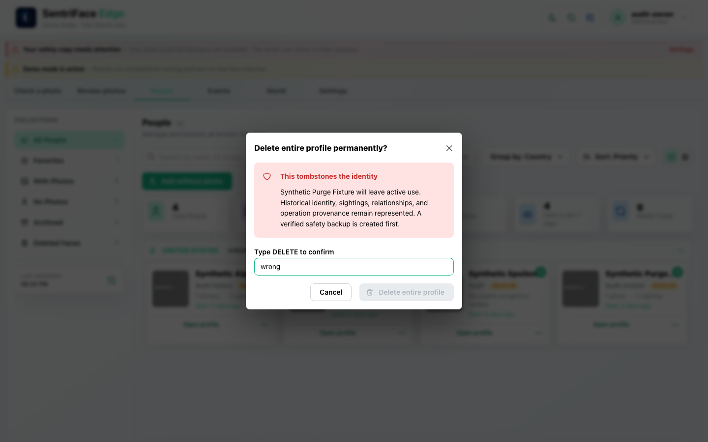
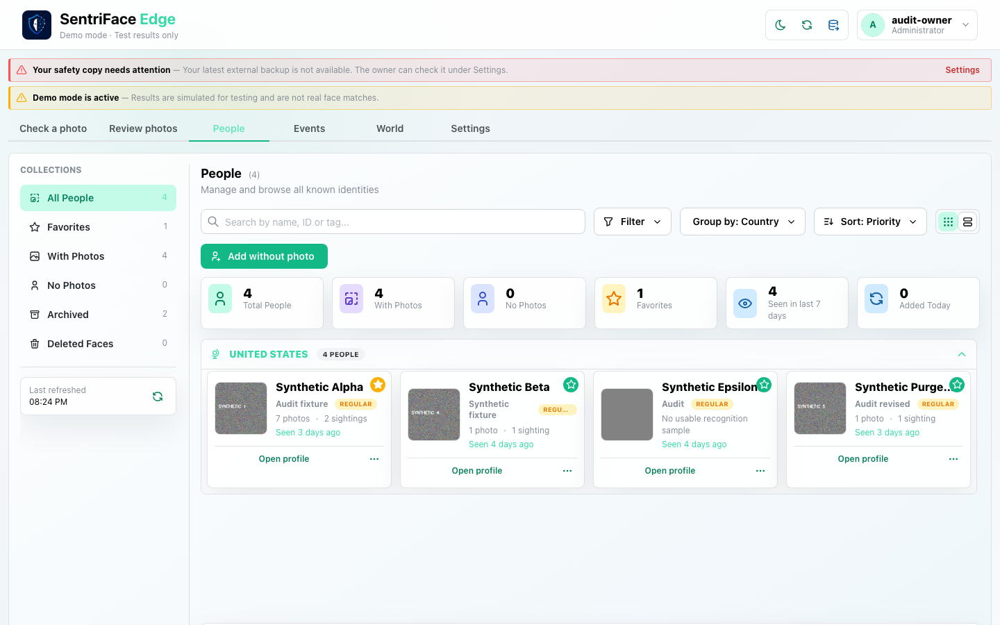

# J14 — Merge and tombstone confirmation safety

[Audit index](../INDEX.md) · [Source oracle](../source-map.md) · [Independent review](../review.md)

**Scope result: PARTIAL.** This record proves only the ordered observations below; source-contract branches outside them are not silently passed. Source tasks: [SJ-033](../source-journeys.csv), [SJ-034](../source-journeys.csv).

**Operator goal:** Inspect consequential Person identity actions and their confirmation requirements without committing them in this sequence.

**Starting state and required role:** Beta is ACTIVE again after J13; Administrator has destroy capability. Alpha is another active identity. All captures in this record use the disposable Administrator unless a step explicitly says unauthenticated.

**Implemented owners:** [`views/PeopleView.jsx::PeopleGalleryView`](../../../frontend/src/views/PeopleView.jsx).

**Evidence basis:** saved current-run screenshots, capture metadata and accessibility snapshots. Visual acceptance is documented in the independent review; this assembly does not claim a second independent visual inspection. Synthetic images are generated patterns, not biometric photographs. No source/UI manipulation produces these states.

**Source:** `b457f0a723e845dd1a92a07a577072c85146c89a`. Capture sequence numbers order the captured states; uncaptured return actions are named in the text. The audit was interrupted and resumed across November 5 and 10 at the same source SHA.

## Ordered interaction and visual evidence

### Step 01 — Merge dialog

Open More → Merge into another person. The modal explains canonical resolution and retained provenance, offers Keep this person, and disables Merge people until a survivor is selected. Cancel follows.

Capture: `UX-08` · Administrator · light theme · 1440×900 CSS viewport · DPR 1 · `2026-11-10T08:31:22.988686+00:00` · fixture: synthetic.

Scroll recorded: x=0, y=80.

### Step 02 — Delete profile confirm disabled

Open More → Delete entire profile. The tombstone warning explains retained historical identity and backup; Delete is disabled without the phrase.

Capture: `UX-08` · Administrator · light theme · 1440×900 CSS viewport · DPR 1 · `2026-11-10T08:31:24.328740+00:00` · fixture: synthetic.

Scroll recorded: x=0, y=80.

### Step 03 — Delete profile confirm enabled

Enter DELETE. Delete entire profile becomes available, then Cancel is chosen. This is deliberately not a deletion-success capture.

Capture: `UX-08` · Administrator · light theme · 1440×900 CSS viewport · DPR 1 · `2026-11-10T08:31:24.767037+00:00` · fixture: synthetic.

Scroll recorded: x=0, y=80.

## Outcome, authority and return path

Merge and tombstone confirmation controls are reachable. Missing survivor disables merge; the delete action is disabled until DELETE is entered. Both operations are cancelled. These frames establish confirmation states only, not successful mutation outcomes.

## Limits and unexecuted branches

Actual merge/tombstone, contradictory Relations, reference-cap rejection, safe backup refusal and historical canonical/tombstone outcomes are not run in this record. Future Encounter Split/Merge (#4) is distinct and is not implemented or designed here.

No redesign or implementation is specified by this record. Findings and recommended directions belong to the shared audit review and canonical design authority.

## macOS completion pass 2 — continuation D

Source product `b457f0a723e845dd1a92a07a577072c85146c89a`; disposable authority; full browser-content viewport 1440×900 CSS pixels, DPR 1, Day. Role and capture time are recorded per step.

From the synthetic Person card More actions, choose Delete entire profile. The confirmation explains tombstoning, retained history and a verified safety backup. A wrong DELETE phrase leaves the action disabled; cancel leaves the Person in the library. The Person is not deleted in this continuation.

### Step 04 — Pass2 Library more actions open

Captured `2026-11-14T04:24:21.794051+00:00` · Administrator · UX-05 · synthetic fixture · scroll {'x': 0, 'y': 0}.

### Step 05 — Pass2 Library delete confirmation

Captured `2026-11-14T04:24:31.877132+00:00` · Administrator · UX-08 · synthetic fixture · scroll {'x': 0, 'y': 0}.

### Step 06 — Pass2 Library delete invalid phrase

Captured `2026-11-14T04:24:32.555520+00:00` · Administrator · UX-08 · synthetic fixture · scroll {'x': 0, 'y': 0}.

### Step 07 — Pass2 Library delete cancelled

Captured `2026-11-14T04:24:33.540971+00:00` · Administrator · UX-05 · synthetic fixture · scroll {'x': 0, 'y': 0}.
