# J15 — Cross-feature Event correction, pair consent and retained history

[Audit index](../INDEX.md) · [Source oracle](../source-map.md) · [Independent review](../review.md)

**Scope result: PARTIAL.** This record proves only the ordered observations below; source-contract branches outside them are not silently passed. Source tasks: [SJ-026](../source-journeys.csv), [SJ-038](../source-journeys.csv), [SJ-041](../source-journeys.csv), [SJ-060](../source-journeys.csv).

**Operator goal:** Open an Event from a Person, correct its participants, and revise Relations while retaining prior interpretations.

**Starting state and required role:** Beta’s profile Events tab links to the finalized paired synthetic Encounter. Administrator has destroy capability; its face was restored in J11. All captures in this record use the disposable Administrator unless a step explicitly says unauthenticated.

**Implemented owners:** [`views/PeopleView.jsx`](../../../frontend/src/views/PeopleView.jsx); [`views/EventsView.jsx`](../../../frontend/src/views/EventsView.jsx); [`components/EncounterManagementModal.jsx`](../../../frontend/src/components/EncounterManagementModal.jsx).

**Evidence basis:** saved current-run screenshots, capture metadata and accessibility snapshots. Visual acceptance is documented in the independent review; this assembly does not claim a second independent visual inspection. Synthetic images are generated patterns, not biometric photographs. No source/UI manipulation produces these states.

**Source:** `b457f0a723e845dd1a92a07a577072c85146c89a`. Capture sequence numbers order the captured states; uncaptured return actions are named in the text. The audit was interrupted and resumed across November 5 and 10 at the same source SHA.

## Ordered interaction and visual evidence

### Step 01 — Person to global event

Select the paired Present occurrence in Beta’s Events tab. The shell transitions to global Events detail.

[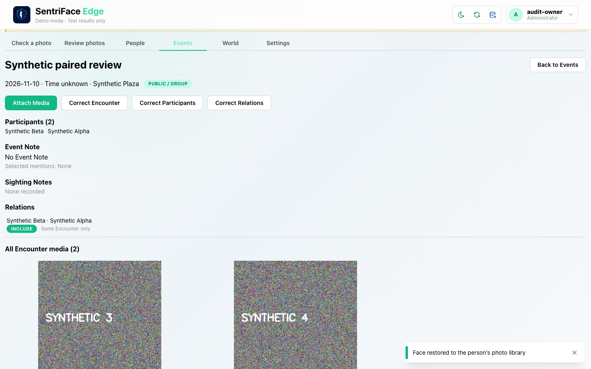](../screenshots/UX-15/UX-15_J15_Step-01_Person-to-global-event.png)

Capture: `UX-15` · Administrator · light theme · 1440×900 CSS viewport · DPR 1 · `2026-11-10T08:32:15.120008+00:00` · fixture: synthetic.

Scroll recorded: x=0, y=80.

### Step 02 — Participant remove ready

Choose Correct Participants → Remove incorrect participant and select Beta. The form shows the proposed one-Person interpretation before save.

[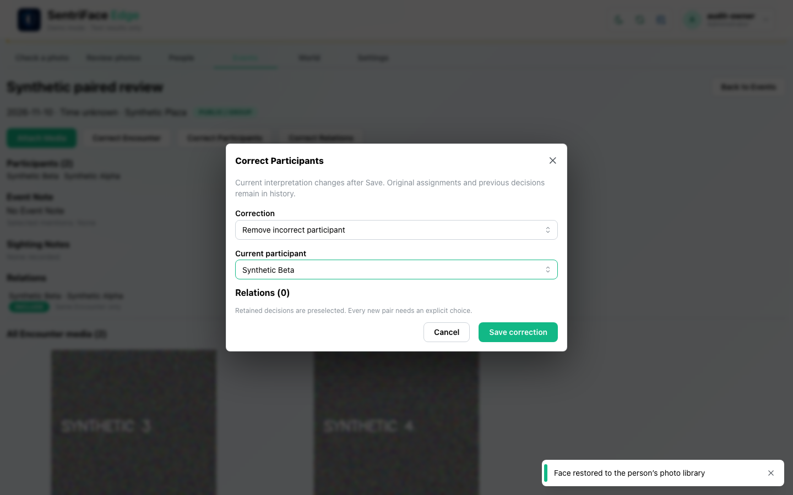](../screenshots/UX-10/UX-10_J15_Step-02_Participant-remove-ready.png)

Capture: `UX-10` · Administrator · light theme · 1440×900 CSS viewport · DPR 1 · `2026-11-10T08:32:16.281586+00:00` · fixture: synthetic.

Scroll recorded: x=0, y=80.

### Step 03 — Participant removed

Choose Save correction. The detail now has one participant, Alpha, and no explicit pair decision.

[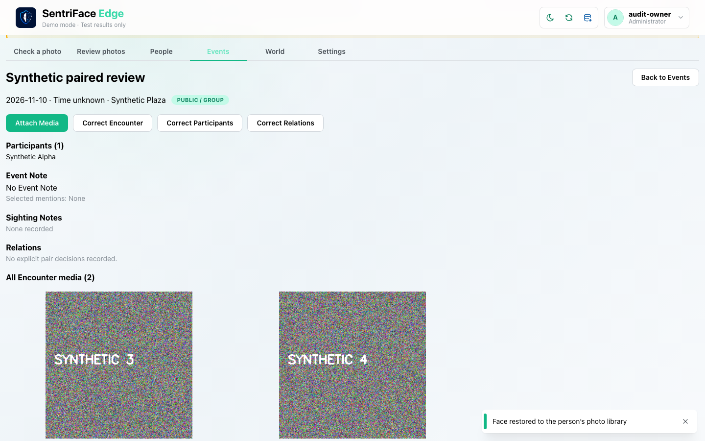](../screenshots/UX-10/UX-10_J15_Step-03_Participant-removed.png)

Capture: `UX-10` · Administrator · light theme · 1440×900 CSS viewport · DPR 1 · `2026-11-10T08:32:17.131629+00:00` · fixture: synthetic.

Scroll recorded: x=0, y=80.

### Step 04 — Added participant needs pair choice

Reopen Correct Participants → Add omitted participant and select Beta. The new pair has no choice, so Save correction is disabled.

[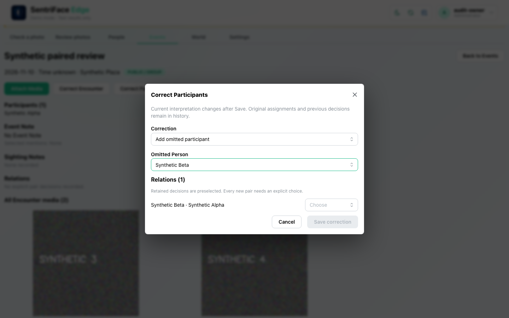](../screenshots/UX-10/UX-10_J15_Step-04_Added-participant-needs-pair-choice.png)

Capture: `UX-10` · Administrator · light theme · 1440×900 CSS viewport · DPR 1 · `2026-11-10T08:32:41.517811+00:00` · fixture: synthetic.

Scroll recorded: x=0, y=80.

### Step 05 — Participant restored

Choose INCLUDE for the new pair and save. Beta is present again and the pair is restored.

[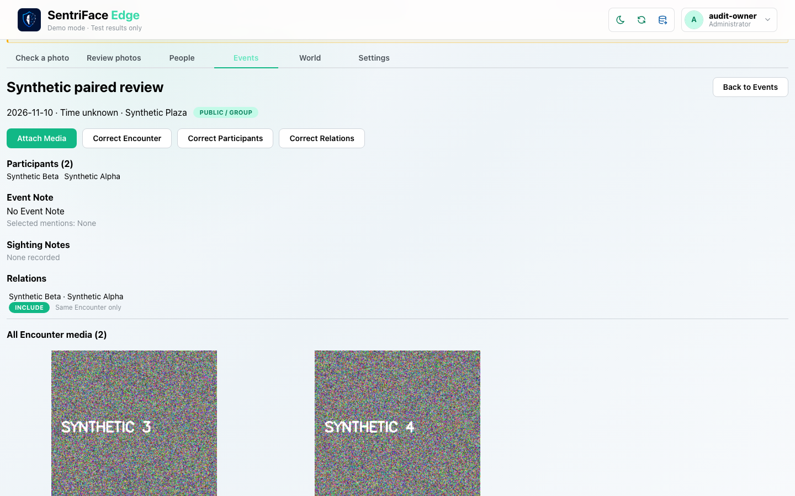](../screenshots/UX-10/UX-10_J15_Step-05_Participant-restored.png)

Capture: `UX-10` · Administrator · light theme · 1440×900 CSS viewport · DPR 1 · `2026-11-10T08:32:42.547980+00:00` · fixture: synthetic.

Scroll recorded: x=0, y=80.

### Step 06 — Relation exclude ready

Open Correct Relations and choose EXCLUDE. This is the ready-to-save proposal; the prior effective value is not yet replaced.

[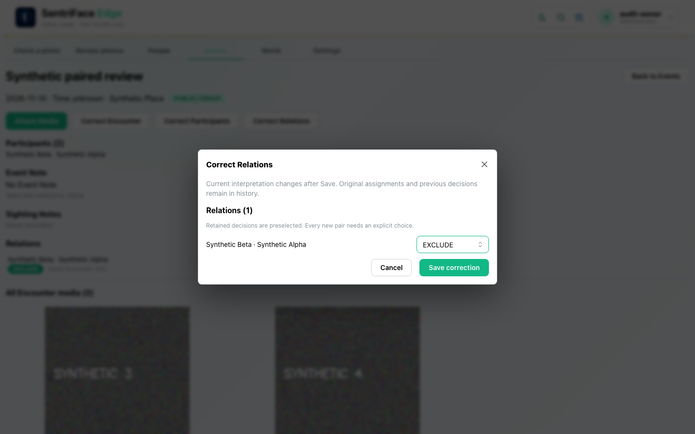](../screenshots/UX-10/UX-10_J15_Step-06_Relation-exclude-ready.png)

Capture: `UX-10` · Administrator · light theme · 1440×900 CSS viewport · DPR 1 · `2026-11-10T08:32:43.430224+00:00` · fixture: synthetic.

Scroll recorded: x=0, y=80.

### Step 07 — Relation excluded

Save correction. The detail renders EXCLUDE for Alpha–Beta.

Capture: `UX-10` · Administrator · light theme · 1440×900 CSS viewport · DPR 1 · `2026-11-10T08:32:44.210602+00:00` · fixture: synthetic.

Scroll recorded: x=0, y=80.

### Step 08 — History scrolled

Change the Relation back to INCLUDE, save, expand history and scroll. Prior INCLUDE→EXCLUDE, EXCLUDE→INCLUDE, participant remove/add and original completion remain visible together.

[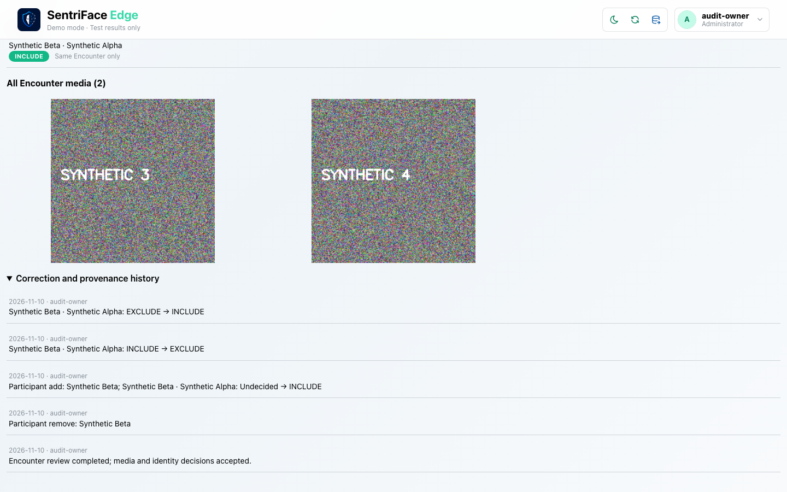](../screenshots/UX-10/UX-10_J15_Step-08_History-scrolled.png)

Capture: `UX-10` · Administrator · light theme · 1440×900 CSS viewport · DPR 1 · `2026-11-10T08:32:45.521883+00:00` · fixture: synthetic.

Scroll recorded: x=0, y=535.

## Outcome, authority and return path

Person Events opens global Event detail. Beta is removed, then added back with an explicit pair choice. Relation EXCLUDE is saved and subsequently INCLUDE is saved. The expanded scrolled history retains participant and Relation changes. These are append-only interpretation changes, not an Encounter split/merge.

## Limits and unexecuted branches

REASSIGN execution, last-participant refusal, invalid target, stale pair edits and concurrent Attach conflicts are not established here. The history viewport is scrolled; exact scroll offset is in capture metadata where available.

No redesign or implementation is specified by this record. Findings and recommended directions belong to the shared audit review and canonical design authority.

## macOS completion pass 2 — ordered continuation

**Status: PARTIAL overall.** Source remains `b457f0a723e845dd1a92a07a577072c85146c89a`; pass-one checkpoint `27a0532123389421b5cfdc5d0331eb1793e74c78` remains unchanged in history. Synthetic source mode and a dedicated disposable authority; 1440×900 CSS viewport, DPR 1, Day, Administrator unless the capture register says unauthenticated.

On a synthetic single-participant Event, attempt to remove its only participant. Save returns “Cannot remove the last or an absent participant” inline and as a toast, and the Event retains the participant. Choose REASSIGN from Synthetic Epsilon proof to Synthetic Alpha, save, then correct back. The Event returns to Epsilon and expanded history shows both corrections and original review completion. The earlier error remains visible when the user changes the form to REASSIGN, even before the next submission. Return to Events; mutations were restricted to the audit authority.

### Step 09 — Pass2 Single participant event

[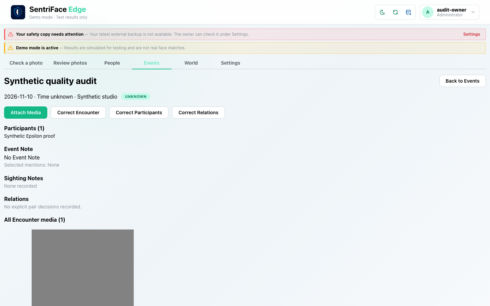](../screenshots/UX-09/UX-09_J15_Step-09_Pass2-Single-participant-event.png)

Capture `2026-11-11T06:33:41.189716+00:00` · Administrator · UX-09 · synthetic · scroll {'x': 0, 'y': 0}. Full browser viewport, not native window chrome.

### Step 10 — Pass2 Remove last participant ready

[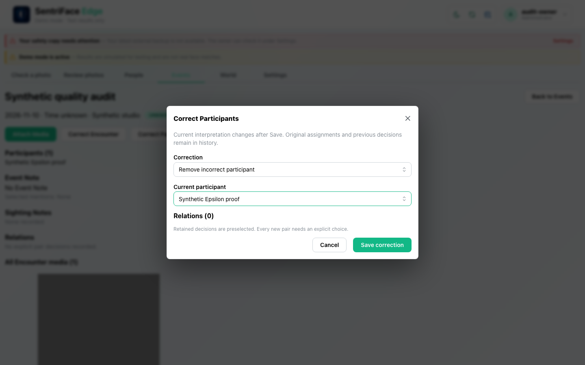](../screenshots/UX-10/UX-10_J15_Step-10_Pass2-Remove-last-participant-ready.png)

Capture `2026-11-11T06:34:02.240239+00:00` · Administrator · UX-10 · synthetic · scroll {'x': 0, 'y': 0}. Full browser viewport, not native window chrome.

### Step 11 — Pass2 Remove last participant response

[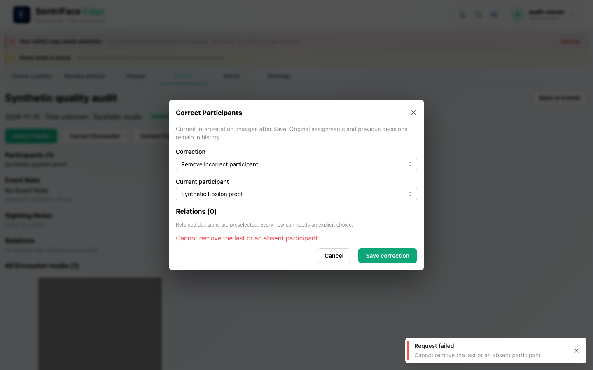](../screenshots/UX-10/UX-10_J15_Step-11_Pass2-Remove-last-participant-response.png)

Capture `2026-11-11T06:34:03.438684+00:00` · Administrator · UX-10 · synthetic · scroll {'x': 0, 'y': 0}. Full browser viewport, not native window chrome.

### Step 12 — Pass2 Reassign participant ready

[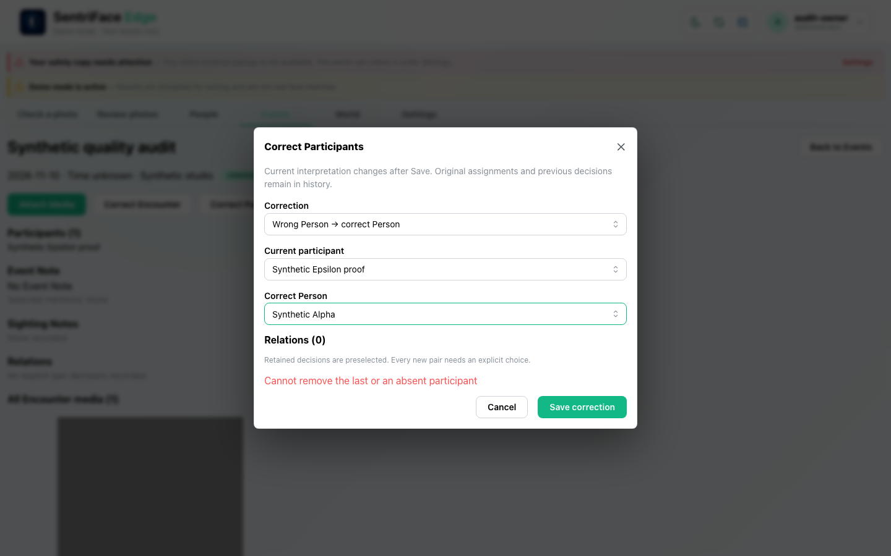](../screenshots/UX-10/UX-10_J15_Step-12_Pass2-Reassign-participant-ready.png)

Capture `2026-11-11T06:34:21.520566+00:00` · Administrator · UX-10 · synthetic · scroll {'x': 0, 'y': 0}. Full browser viewport, not native window chrome.

### Step 13 — Pass2 Reassign participant saved

[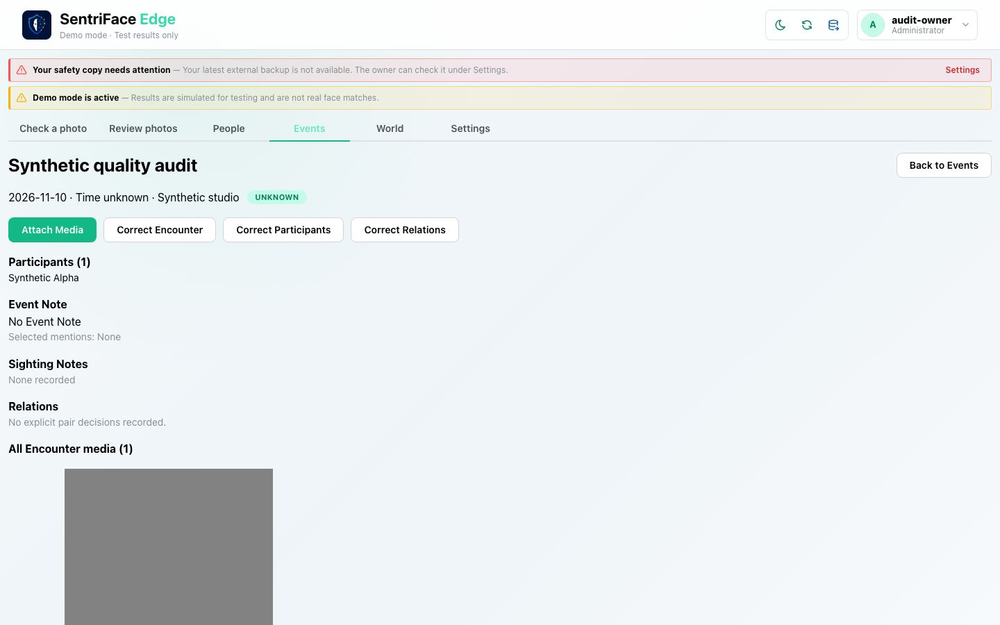](../screenshots/UX-09/UX-09_J15_Step-13_Pass2-Reassign-participant-saved.png)

Capture `2026-11-11T06:34:23.219072+00:00` · Administrator · UX-09 · synthetic · scroll {'x': 0, 'y': 0}. Full browser viewport, not native window chrome.

### Step 14 — Pass2 Original participant restored

Capture `2026-11-11T06:34:37.954625+00:00` · Administrator · UX-09 · synthetic · scroll {'x': 0, 'y': 0}. Full browser viewport, not native window chrome.

### Step 15 — Pass2 Reassignment history expanded

[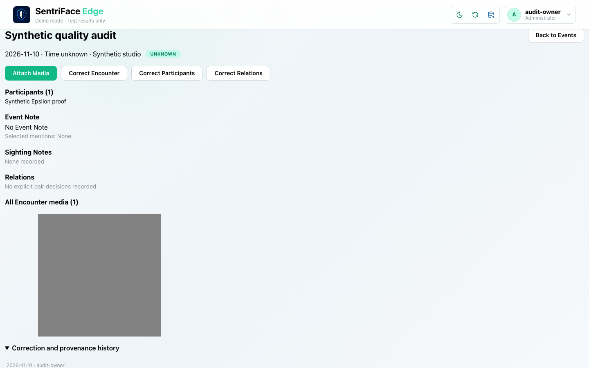](../screenshots/UX-10/UX-10_J15_Step-15_Pass2-Reassignment-history-expanded.png)

Capture `2026-11-11T06:34:38.949011+00:00` · Administrator · UX-10 · synthetic · scroll {'x': 0, 'y': 152}. Full browser viewport, not native window chrome.

### Step 16 — Pass2 Reassignment history visible

[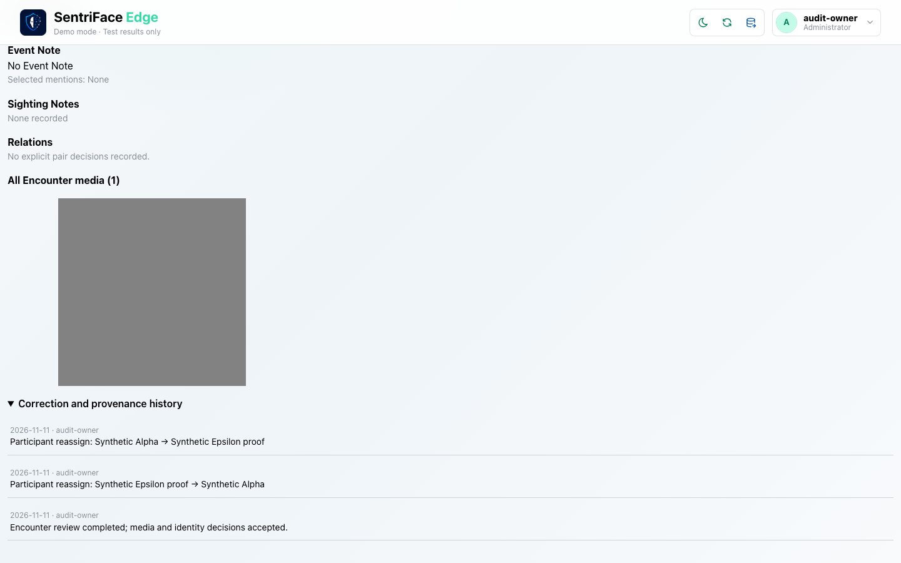](../screenshots/UX-10/UX-10_J15_Step-16_Pass2-Reassignment-history-visible.png)

Capture `2026-11-11T06:34:57.376422+00:00` · Administrator · UX-10 · synthetic · scroll {'x': 0, 'y': 358}. Full browser viewport, not native window chrome.

### Step 17 — Pass2 Return to event collection

[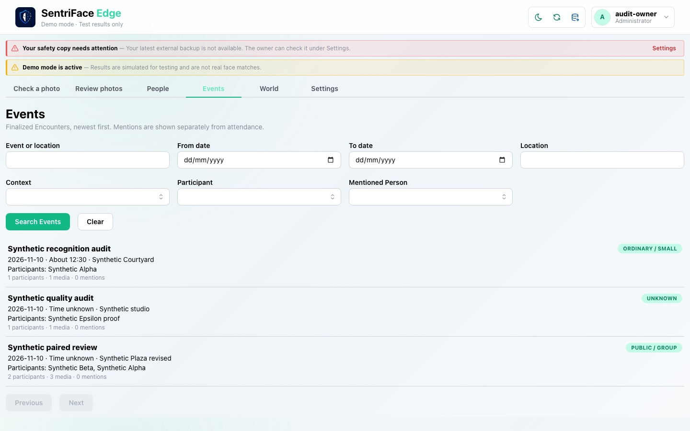](../screenshots/UX-09/UX-09_J15_Step-17_Pass2-Return-to-event-collection.png)

Capture `2026-11-11T06:34:58.369023+00:00` · Administrator · UX-09 · synthetic · scroll {'x': 0, 'y': 0}. Full browser viewport, not native window chrome.

## macOS completion pass 2 — continuation C

Source product `b457f0a723e845dd1a92a07a577072c85146c89a`; disposable authority; 1440×900 browser-content viewport, DPR 1, Day, Administrator.

Correct the synthetic paired Event: select a third synthetic Person as an Event Note mention, enter a synthetic note, and save. The Event displays two participants and the selected Person as a mention, not an additional participant.

### Step 18 — Pass2 Event correction before mention

[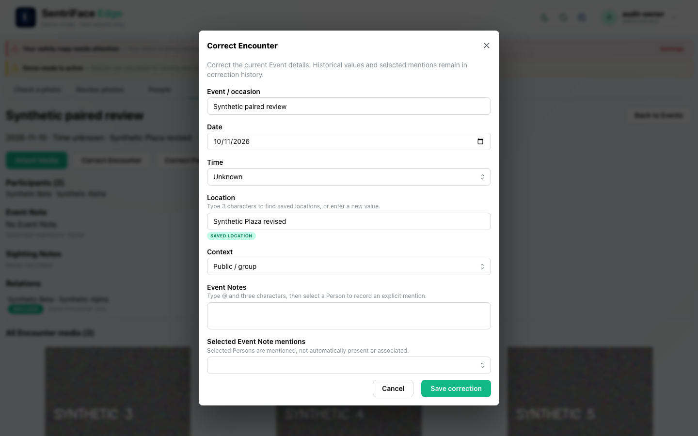](../screenshots/UX-10/UX-10_J15_Step-18_Pass2-Event-correction-before-mention.png)

Captured `2026-11-11T13:29:35.405360+00:00` · Administrator · UX-10 · synthetic fixture · scroll {'x': 0, 'y': 0}.

### Step 19 — Pass2 Event mention candidate

[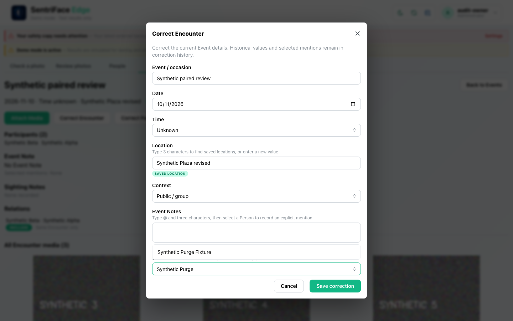](../screenshots/UX-10/UX-10_J15_Step-19_Pass2-Event-mention-candidate.png)

Captured `2026-11-11T13:29:47.995605+00:00` · Administrator · UX-10 · synthetic fixture · scroll {'x': 0, 'y': 0}.

### Step 20 — Pass2 Event mention selected

[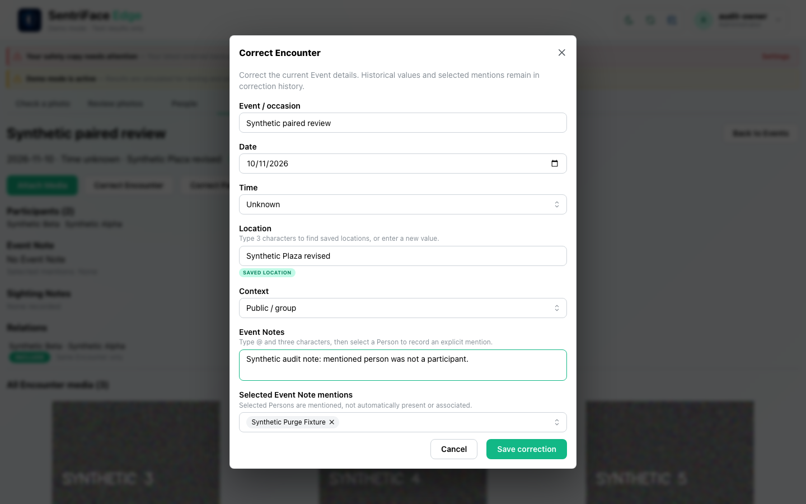](../screenshots/UX-10/UX-10_J15_Step-20_Pass2-Event-mention-selected.png)

Captured `2026-11-11T13:29:48.763333+00:00` · Administrator · UX-10 · synthetic fixture · scroll {'x': 0, 'y': 0}.

### Step 21 — Pass2 Event mention saved not participant

[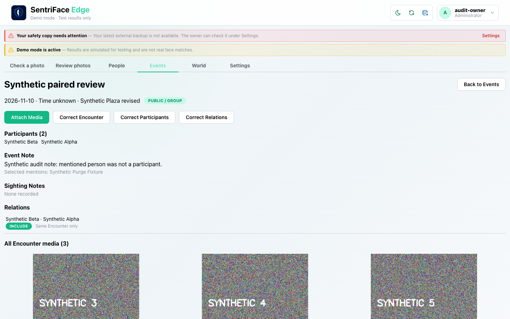](../screenshots/UX-10/UX-10_J15_Step-21_Pass2-Event-mention-saved-not-participant.png)

Captured `2026-11-11T13:30:00.678553+00:00` · Administrator · UX-10 · synthetic fixture · scroll {'x': 0, 'y': 0}.
