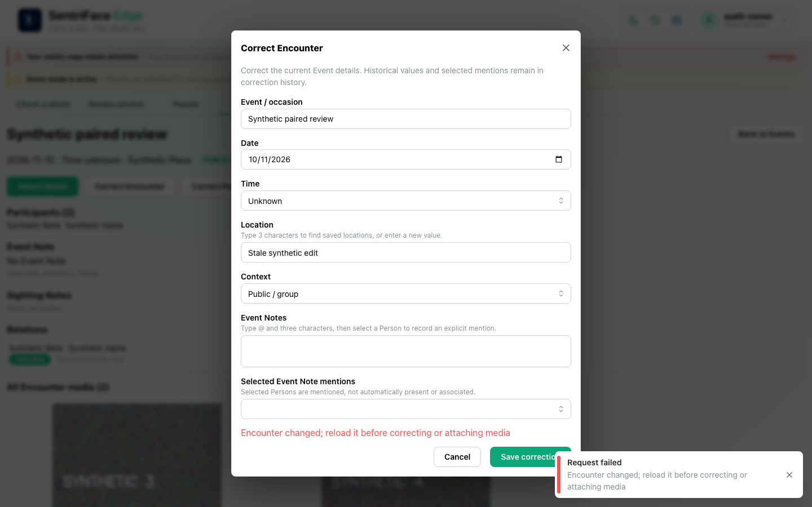
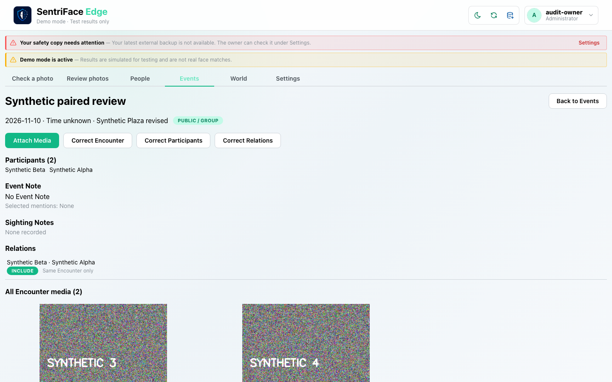

# J16 — Competing Event correction and stale-state recovery

[Audit index](../INDEX.md) · [Source oracle](../source-map.md) · [Independent review](../review.md)

**Scope result: PARTIAL.** This record proves only the ordered observations below; source-contract branches outside them are not silently passed. Source tasks: [SJ-040](../source-journeys.csv), [SJ-041](../source-journeys.csv).

**Operator goal:** Reject a stale edit from a second actual browser page and recover the current Event without overwriting the newer value.

**Starting state and required role:** Two authenticated pages load the same paired Event revision. Page one changes its location; page two retains the earlier correction form. Administrator has destroy capability. All captures in this record use the disposable Administrator unless a step explicitly says unauthenticated.

**Implemented owners:** [`views/EventsView.jsx`](../../../frontend/src/views/EventsView.jsx); [`components/EncounterDetailsModal.jsx`](../../../frontend/src/components/EncounterDetailsModal.jsx); [`hooks/useSentriFaceController.js`](../../../frontend/src/hooks/useSentriFaceController.js).

**Evidence basis:** saved current-run screenshots, capture metadata and accessibility snapshots. Visual acceptance is documented in the independent review; this assembly does not claim a second independent visual inspection. Synthetic images are generated patterns, not biometric photographs. No source/UI manipulation produces these states.

**Source:** `b457f0a723e845dd1a92a07a577072c85146c89a`. Capture sequence numbers order the captured states; uncaptured return actions are named in the text. The audit was interrupted and resumed across November 5 and 10 at the same source SHA.

## Ordered interaction and visual evidence

### Step 01 — Stale correction refused

With page one already saved as Synthetic Plaza revised, submit Stale synthetic edit from the older page. The error appears both as toast and modal alert; the stale form remains open.

Capture: `UX-10` · Administrator · light theme · 1440×900 CSS viewport · DPR 1 · `2026-11-10T08:32:53.798482+00:00` · fixture: synthetic.

Scroll recorded: x=0, y=0.

### Step 02 — Stale reloaded current

Cancel, return to Events and reopen the paired occurrence. The current revised location is visible, establishing the recovery path and preservation of the newer interpretation.

Capture: `UX-10` · Administrator · light theme · 1440×900 CSS viewport · DPR 1 · `2026-11-10T08:33:08.841256+00:00` · fixture: synthetic.

Scroll recorded: x=0, y=0.

## Outcome, authority and return path

The stale page’s Save correction is refused with “Encounter changed; reload it before correcting or attaching media”. The form remains with the attempted edit. Cancelling, returning to Events and reopening the row reloads Synthetic Plaza revised. No stale overwrite is claimed.

## Limits and unexecuted branches

Only this actual concurrent metadata conflict is sampled. Network timeout, lost-response idempotent retry, participant/Relation/Attach concurrent variants and process-kill recovery are not exercised here. The error gives no in-dialog reload action; the observed return path requires Cancel and reopening.

No redesign or implementation is specified by this record. Findings and recommended directions belong to the shared audit review and canonical design authority.
