# J17 — Attach Media, source restart and completion on the same Encounter

[Audit index](../INDEX.md) · [Source oracle](../source-map.md) · [Independent review](../review.md)

**Scope result: PARTIAL.** This record proves only the ordered observations below; source-contract branches outside them are not silently passed. Source tasks: [SJ-020](../source-journeys.csv), [SJ-039](../source-journeys.csv), [SJ-060](../source-journeys.csv).

**Operator goal:** Review an additional synthetic photo as evidence of an existing Encounter, survive a source restart and avoid creating another occurrence.

**Starting state and required role:** The corrected paired Event exists and is finalized. Administrator has add capability. synthetic-5.png is a new generated non-biometric pattern; the target is chosen through Event Attach Media. All captures in this record use the disposable Administrator unless a step explicitly says unauthenticated.

**Implemented owners:** [`views/EventsView.jsx`](../../../frontend/src/views/EventsView.jsx); [`hooks/useSentriFaceController.js`](../../../frontend/src/hooks/useSentriFaceController.js); [`hooks/useQueueController.js`](../../../frontend/src/hooks/useQueueController.js); [`views/QueueView.jsx`](../../../frontend/src/views/QueueView.jsx).

**Evidence basis:** saved current-run screenshots, capture metadata and accessibility snapshots. Visual acceptance is documented in the independent review; this assembly does not claim a second independent visual inspection. Synthetic images are generated patterns, not biometric photographs. No source/UI manipulation produces these states.

**Source:** `b457f0a723e845dd1a92a07a577072c85146c89a`. Capture sequence numbers order the captured states; uncaptured return actions are named in the text. The audit was interrupted and resumed across November 5 and 10 at the same source SHA.

## Ordered interaction and visual evidence

### Step 01 — Attach to review target

Choose Attach Media on the existing Event and select synthetic-5.png. Review photos opens with one unresolved face in a single Encounter draft. The generic screen does not visibly name its attachment target.

[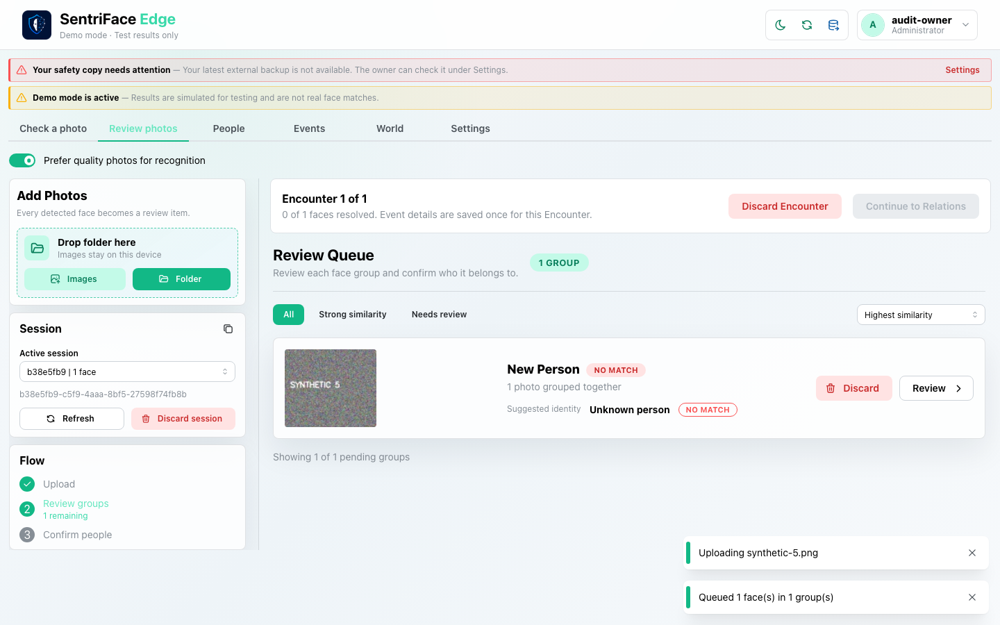](../screenshots/UX-15/UX-15_J17_Step-01_Attach-to-review-target.png)

Capture: `UX-15` · Administrator · light theme · 1440×900 CSS viewport · DPR 1 · `2026-11-10T08:33:10.032280+00:00` · fixture: synthetic.

Scroll recorded: x=0, y=0.

### Step 02 — Rejected automation sign-in state; not resumed attachment

Private rejected-state evidence: after restart the capture shows a sign-in/session-authorization error caused by the capture client retaining an obsolete server-session header. This is not a resumed attachment or a product-authentication defect; no credential content is published.

**Private evidence retained; no public image.** This state is withheld for path/credential privacy or is a rejected capture label. Its existence does not imply a successful workflow outcome.

Capture: `UX-04` · Unauthenticated (rejected capture-client state) · light theme · 1440×900 CSS viewport · DPR 1 · `2026-11-10T08:34:03.844896+00:00` · fixture: synthetic.

Scroll recorded: x=0, y=0.

### Step 03 — Attachment restored authenticated

Clear the capture client’s obsolete header, reload and sign in normally. The active one-face attachment draft returns. This is the accepted authenticated-resume evidence.

[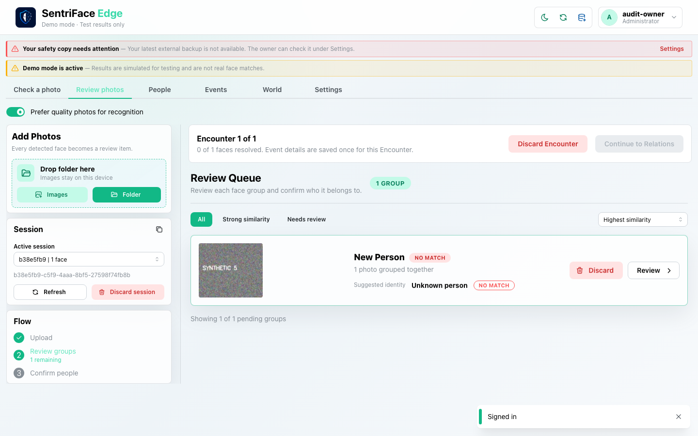](../screenshots/UX-04/UX-04_J17_Step-03_Attachment-restored-authenticated.png)

Capture: `UX-04` · Administrator · light theme · 1440×900 CSS viewport · DPR 1 · `2026-11-10T08:34:23.288615+00:00` · fixture: synthetic.

Scroll recorded: x=0, y=0.

### Step 04 — Attachment group review (metadata not shown)

Choose Review. The ordinary group-review screen is captured; despite the legacy Attachment-inherited-event filename, no Event metadata form or inherited metadata proof is visible in this frame.

[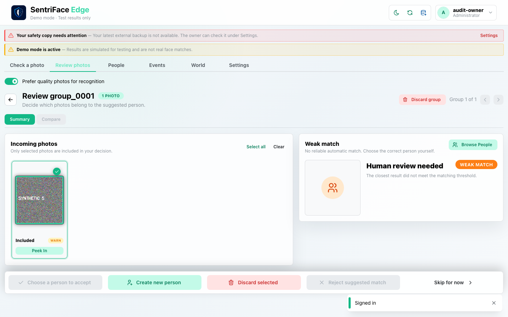](../screenshots/UX-04/UX-04_J17_Step-04_Attachment-inherited-event.png)

Capture: `UX-04` · Administrator · light theme · 1440×900 CSS viewport · DPR 1 · `2026-11-10T08:34:24.073308+00:00` · fixture: synthetic.

Scroll recorded: x=0, y=0.

### Step 05 — Attachment no new pairs

Choose Alpha via Browse People, accept and confirm its Sighting details, then Continue to Relations. No new participant pairs need decisions; existing Relations are retained.

[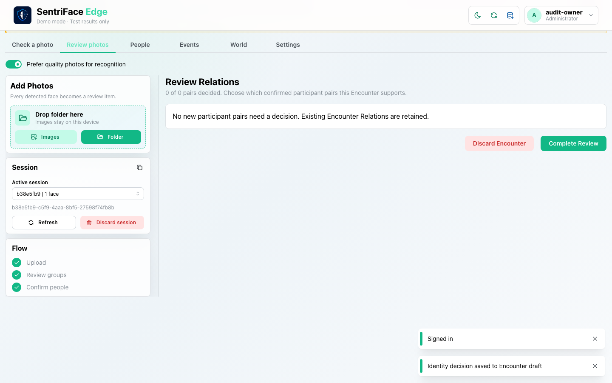](../screenshots/UX-04/UX-04_J17_Step-05_Attachment-no-new-pairs.png)

Capture: `UX-04` · Administrator · light theme · 1440×900 CSS viewport · DPR 1 · `2026-11-10T08:34:26.263293+00:00` · fixture: synthetic.

Scroll recorded: x=0, y=80.

### Step 06 — Attachment completed

Choose Complete Review. “Media attached to the existing Encounter” is observed. The independent audit check confirms the number of finalized Encounters remains two.

[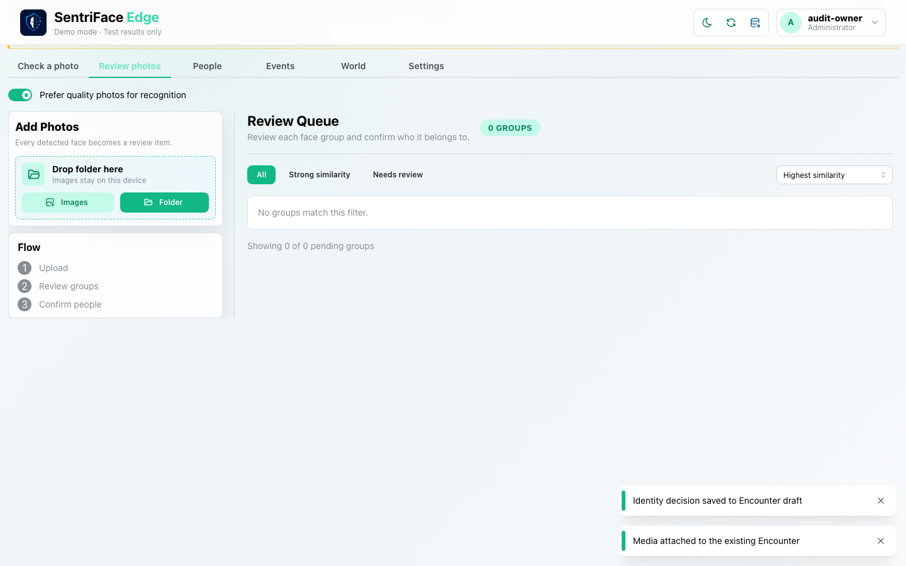](../screenshots/UX-04/UX-04_J17_Step-06_Attachment-completed.png)

Capture: `UX-04` · Administrator · light theme · 1440×900 CSS viewport · DPR 1 · `2026-11-10T08:34:27.622155+00:00` · fixture: synthetic.

Scroll recorded: x=0, y=80.

## Outcome, authority and return path

Attach transitions to an active Review draft. After graceful source restart and normal reauthentication, that draft is restored. It is resolved as existing Alpha, has no new pair decisions, and completes with “Media attached to the existing Encounter”. The audit’s independent count check remains two Encounters. Step 2 is rejected automation setup evidence, not successful resume or a product defect.

## Limits and unexecuted branches

No actual attachment planning failure/targeted retry/cancel, stale Attach target, duplicate finalized image or Reference-origin rejection is exercised here. Step 4 is only the generic group-review screen; its legacy filename does not prove inherited metadata. The target Event name is not apparent in these generic review surfaces, a presentation finding distinct from backend ownership.

No redesign or implementation is specified by this record. Findings and recommended directions belong to the shared audit review and canonical design authority.

## macOS completion pass 2 — continuation C

Source product `b457f0a723e845dd1a92a07a577072c85146c89a`; disposable authority; 1440×900 browser-content viewport, DPR 1, Day, Administrator.

Choose Attach Media on the paired synthetic Event and upload the exact synthetic image already finalized on that Event. The interface reports “Selected exact media is already attached to this Encounter” and “No new media to attach. Exact media already belongs to a finalized Encounter.” Review Photos shows a targeted Attach Media draft. Retry reports no new media; the draft survives browser reload. Cancel immediately clears the draft, returns an empty queue, and the Event still shows three media. This tests pre-planning duplicate validation, not a backend planner error or stale-target conflict.

### Step 07 — Pass2 Attach duplicate target event

[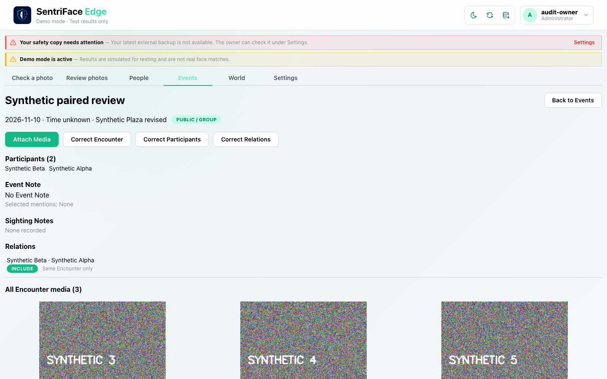](../screenshots/UX-10/UX-10_J17_Step-07_Pass2-Attach-duplicate-target-event.png)

Captured `2026-11-11T13:26:31.416156+00:00` · Administrator · UX-10 · synthetic fixture · scroll {'x': 0, 'y': 0}.

### Step 08 — Pass2 Duplicate media refused

[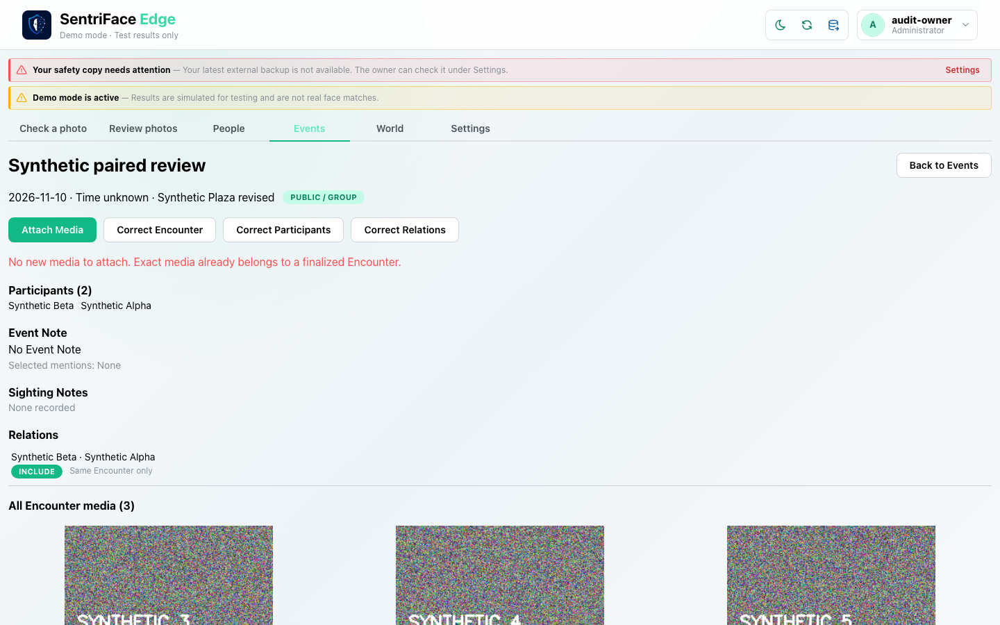](../screenshots/UX-10/UX-10_J17_Step-08_Pass2-Duplicate-media-refused.png)

Captured `2026-11-11T13:26:48.117807+00:00` · Administrator · UX-10 · synthetic fixture · scroll {'x': 0, 'y': 0}.

### Step 09 — Pass2 Failed attachment targeted draft

[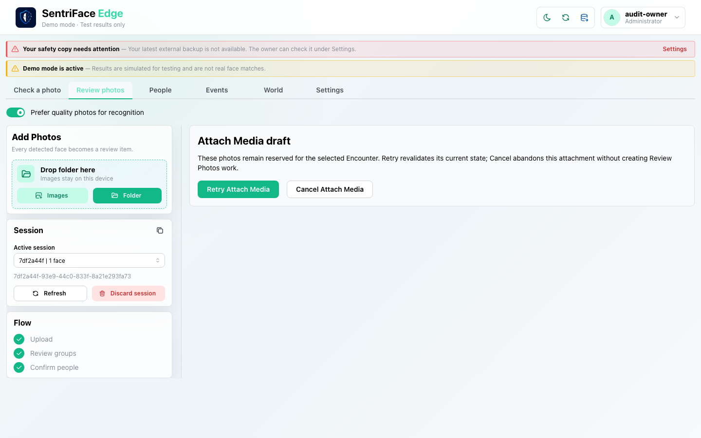](../screenshots/UX-15/UX-15_J17_Step-09_Pass2-Failed-attachment-targeted-draft.png)

Captured `2026-11-11T13:27:00.170074+00:00` · Administrator · UX-15 · synthetic fixture · scroll {'x': 0, 'y': 0}.

### Step 10 — Pass2 Retry duplicate still refused

[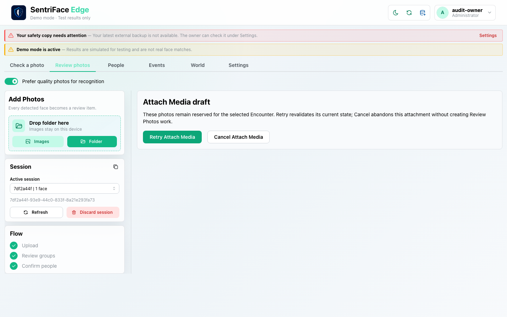](../screenshots/UX-15/UX-15_J17_Step-10_Pass2-Retry-duplicate-still-refused.png)

Captured `2026-11-11T13:27:19.669292+00:00` · Administrator · UX-15 · synthetic fixture · scroll {'x': 0, 'y': 0}.

### Step 11 — Pass2 Failed attachment survives reload

[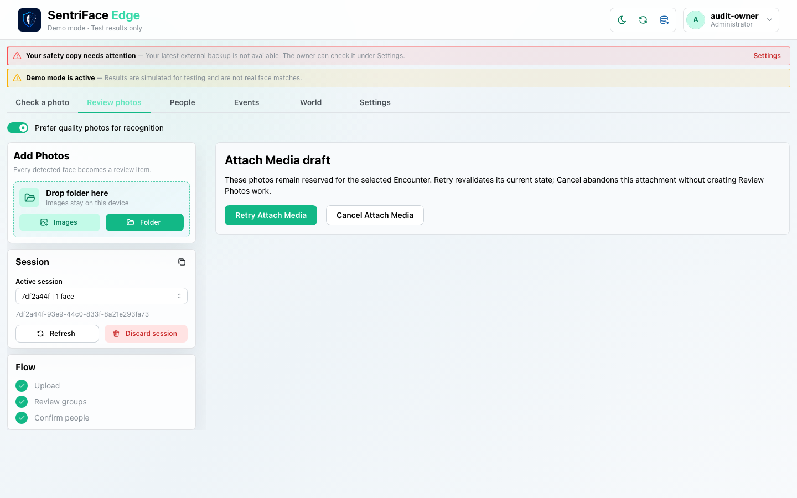](../screenshots/UX-15/UX-15_J17_Step-11_Pass2-Failed-attachment-survives-reload.png)

Captured `2026-11-11T13:27:31.397669+00:00` · Administrator · UX-15 · synthetic fixture · scroll {'x': 0, 'y': 0}.

### Step 12 — Pass2 Cancel failed attachment empty queue

[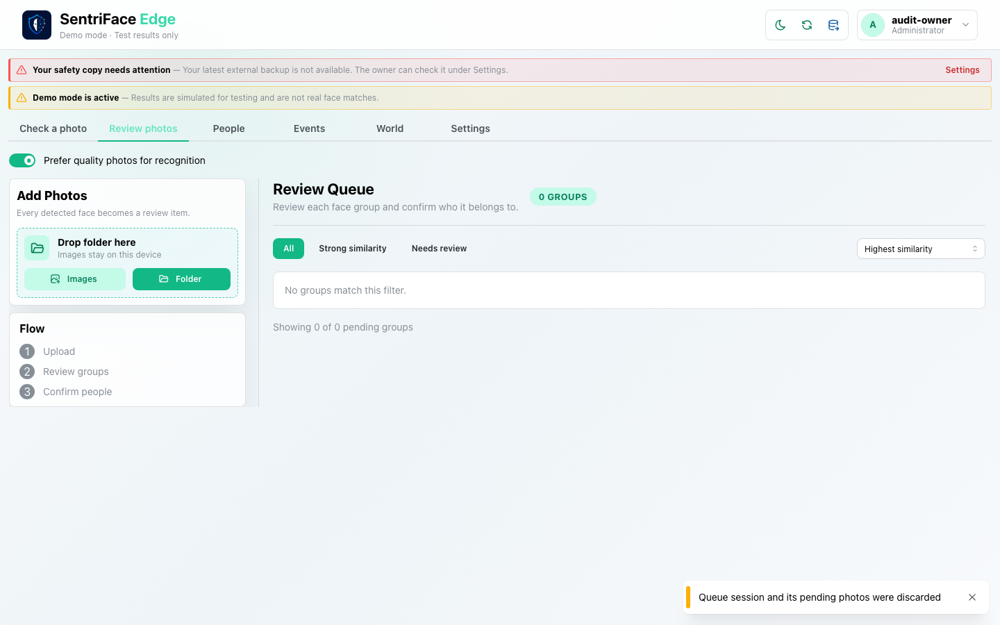](../screenshots/UX-15/UX-15_J17_Step-12_Pass2-Cancel-failed-attachment-empty-queue.png)

Captured `2026-11-11T13:27:36.033812+00:00` · Administrator · UX-15 · synthetic fixture · scroll {'x': 0, 'y': 0}.

### Step 13 — Pass2 Event media unchanged after cancel

Captured `2026-11-11T13:27:47.567732+00:00` · Administrator · UX-10 · synthetic fixture · scroll {'x': 0, 'y': 0}.
