# J18 — Explore criteria, inspector, proof, media and source hierarchy

[Audit index](../INDEX.md) · [Source oracle](../source-map.md) · [Independent review](../review.md)

**Scope result: PARTIAL.** This record proves only the ordered observations below; source-contract branches outside them are not silently passed. Source tasks: [SJ-042](../source-journeys.csv), [SJ-043](../source-journeys.csv), [SJ-044](../source-journeys.csv), [SJ-045](../source-journeys.csv), [SJ-048](../source-journeys.csv), [SJ-059](../source-journeys.csv), [SJ-060](../source-journeys.csv).

**Operator goal:** Trace a selected World relationship to authoritative evidence, media and its source occurrence, while preserving Explore criteria semantics.

**Starting state and required role:** The synthetic fixture has Alpha/Beta and one supported relationship. Administrator has view capability. All World reads use existing authoritative backend projections; there is no genuine inference in this record. All captures in this record use the disposable Administrator unless a step explicitly says unauthenticated.

**Implemented owners:** [`views/WorldExploreView.jsx`](../../../frontend/src/views/WorldExploreView.jsx); [`views/WorldExploreCanvas.jsx`](../../../frontend/src/views/WorldExploreCanvas.jsx); [`views/WorldRelationshipProof.jsx`](../../../frontend/src/views/WorldRelationshipProof.jsx); [`views/WorldEvidenceDrilldownView.jsx`](../../../frontend/src/views/WorldEvidenceDrilldownView.jsx); [`views/WorldEventDrilldownView.jsx`](../../../frontend/src/views/WorldEventDrilldownView.jsx); [`components/WorldMediaPreview.jsx`](../../../frontend/src/components/WorldMediaPreview.jsx).

**Evidence basis:** saved current-run screenshots, capture metadata and accessibility snapshots. Visual acceptance is documented in the independent review; this assembly does not claim a second independent visual inspection. Synthetic images are generated patterns, not biometric photographs. No source/UI manipulation produces these states.

**Source:** `b457f0a723e845dd1a92a07a577072c85146c89a`. Capture sequence numbers order the captured states; uncaptured return actions are named in the text. The audit was interrupted and resumed across November 5 and 10 at the same source SHA.

## Ordered interaction and visual evidence

### Step 01 — Explore default sparse

Select World. Explore opens with default CO_OBSERVED, minimum strength 2, Discover/Canvas/Inspector and no selected canvas subject.

[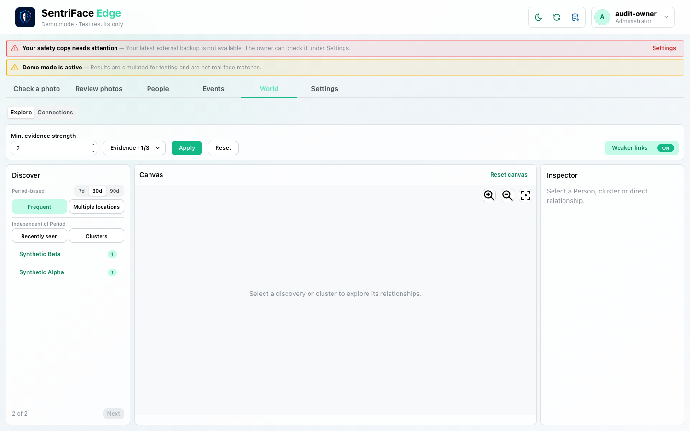](../screenshots/UX-11/UX-11_J18_Step-01_Explore-default-sparse.png)

Capture: `UX-11` · Administrator · light theme · 1440×900 CSS viewport · DPR 1 · `2026-11-10T08:34:55.577829+00:00` · fixture: synthetic.

Scroll recorded: x=0, y=0.

### Step 02 — Evidence popover

Open Evidence · 1/3. Three independent evidence types are exposed in the popover.

[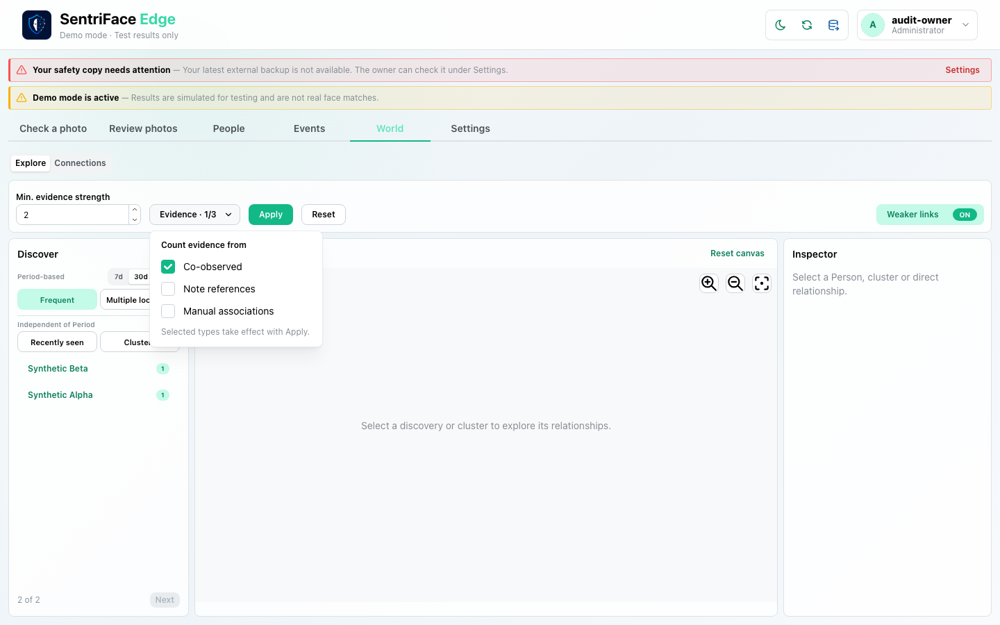](../screenshots/UX-11/UX-11_J18_Step-02_Evidence-popover.png)

Capture: `UX-11` · Administrator · light theme · 1440×900 CSS viewport · DPR 1 · `2026-11-10T08:34:56.274271+00:00` · fixture: synthetic.

Scroll recorded: x=0, y=0.

### Step 03 — Empty evidence refused

Uncheck Co-observed, close the popover and Apply. “Select at least one evidence type.” refuses the empty selection.

[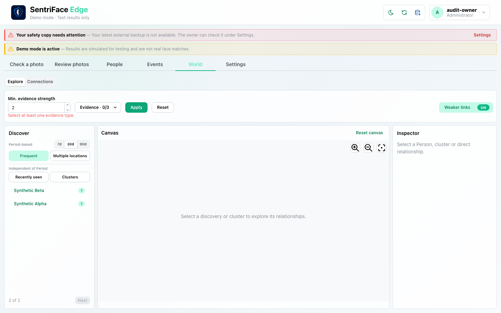](../screenshots/UX-11/UX-11_J18_Step-03_Empty-evidence-refused.png)

Capture: `UX-11` · Administrator · light theme · 1440×900 CSS viewport · DPR 1 · `2026-11-10T08:34:57.044930+00:00` · fixture: synthetic.

Scroll recorded: x=0, y=0.

### Step 04 — Person inspector

Reset criteria, set minimum strength 1, Apply and choose Synthetic Alpha. The Person inspector is populated.

[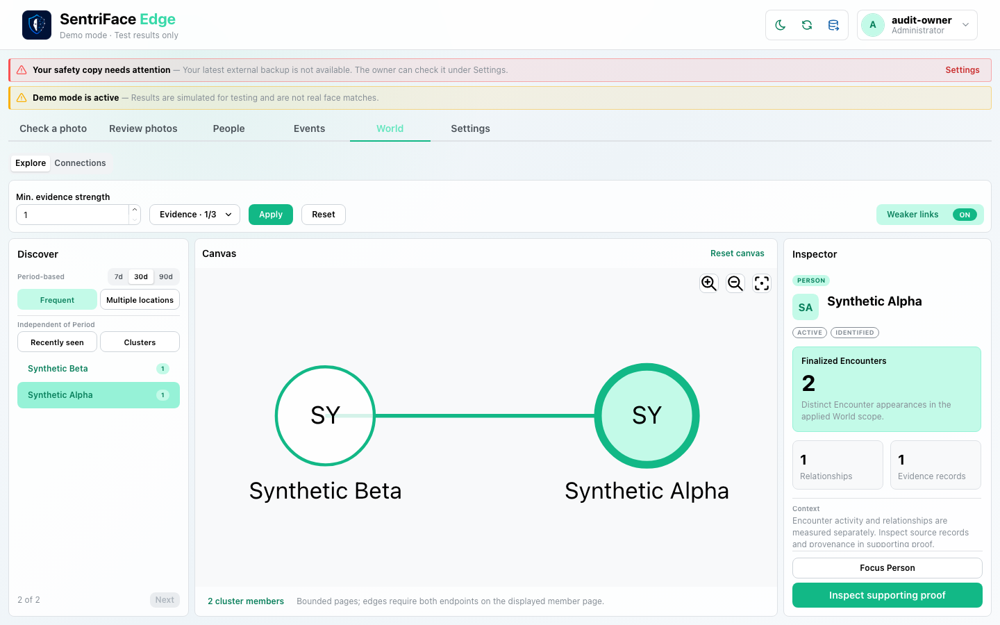](../screenshots/UX-11/UX-11_J18_Step-04_Person-inspector.png)

Capture: `UX-11` · Administrator · light theme · 1440×900 CSS viewport · DPR 1 · `2026-11-10T08:35:14.527029+00:00` · fixture: synthetic.

Scroll recorded: x=0, y=0.

### Step 05 — Focused cluster

Choose Focus Person. The authoritative sparse cluster is drawn with both endpoints.

[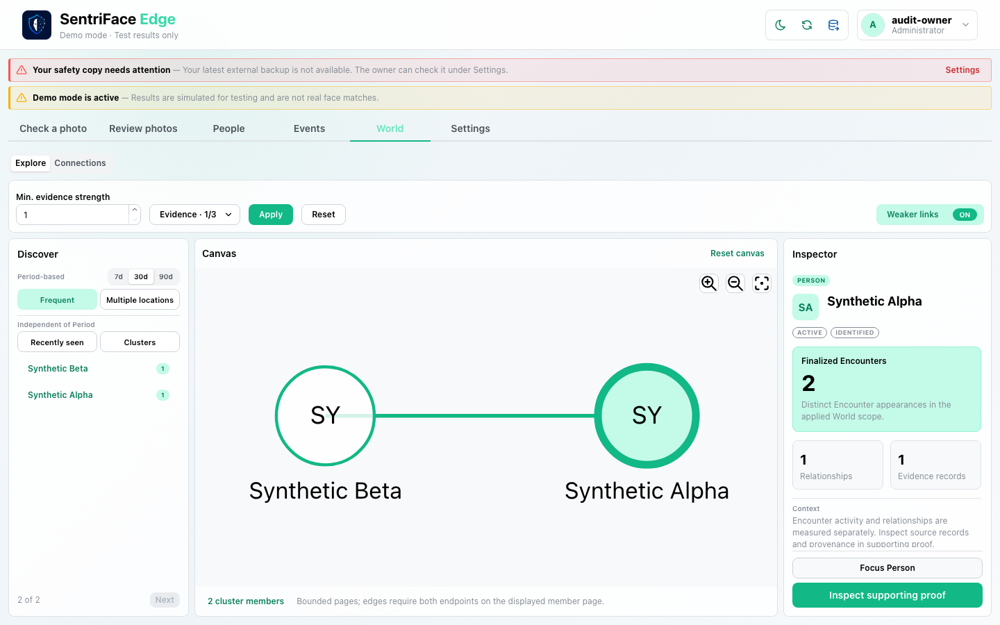](../screenshots/UX-11/UX-11_J18_Step-05_Focused-cluster.png)

Capture: `UX-11` · Administrator · light theme · 1440×900 CSS viewport · DPR 1 · `2026-11-10T08:35:15.240307+00:00` · fixture: synthetic.

Scroll recorded: x=0, y=0.

### Step 06 — Relationship inspector

Select the direct relationship edge. Inspector shows selected evidence strength, qualification and context.

[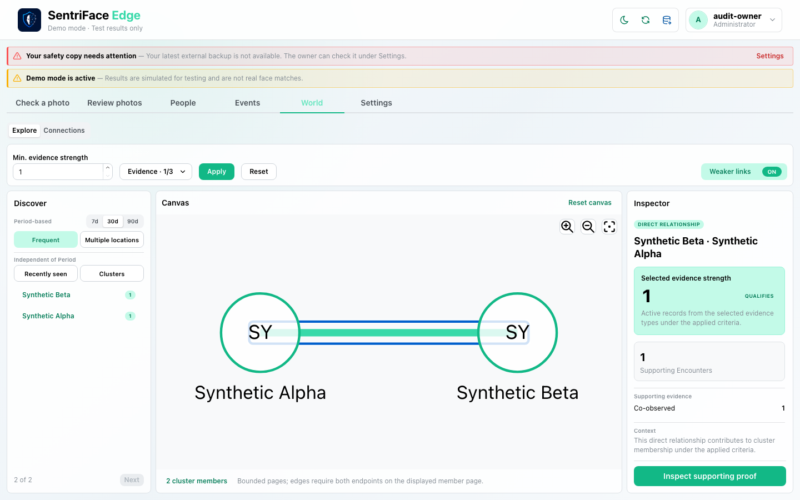](../screenshots/UX-11/UX-11_J18_Step-06_Relationship-inspector.png)

Capture: `UX-11` · Administrator · light theme · 1440×900 CSS viewport · DPR 1 · `2026-11-10T08:35:15.941172+00:00` · fixture: synthetic.

Scroll recorded: x=0, y=0.

### Step 07 — Relationship proof overlay

Choose Inspect supporting proof. The World supporting proof modal lists the one co-observed record.

[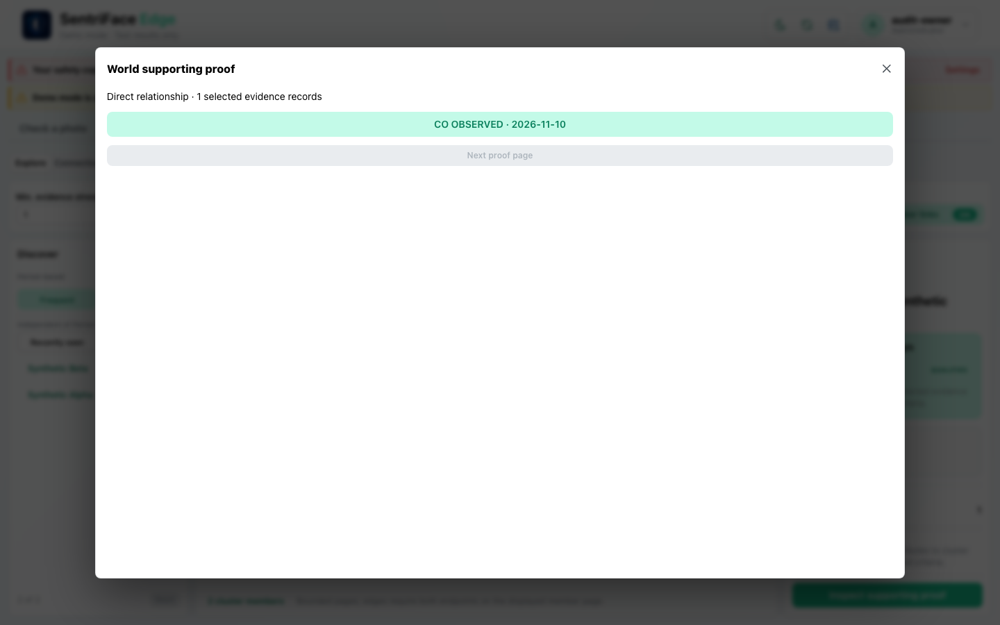](../screenshots/UX-11/UX-11_J18_Step-07_Relationship-proof-overlay.png)

Capture: `UX-11` · Administrator · light theme · 1440×900 CSS viewport · DPR 1 · `2026-11-10T08:35:16.694990+00:00` · fixture: synthetic.

Scroll recorded: x=0, y=0.

### Step 08 — Proof evidence expanded

Open that record. Evidence detail distinguishes raw and effective endpoints, direction, source and explanation.

[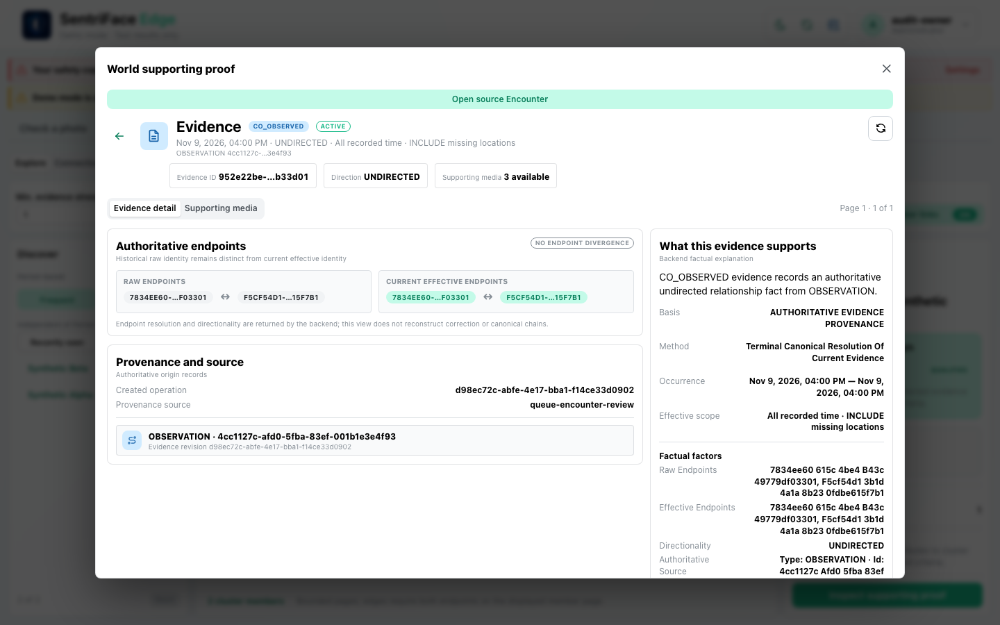](../screenshots/UX-11/UX-11_J18_Step-08_Proof-evidence-expanded.png)

Capture: `UX-11` · Administrator · light theme · 1440×900 CSS viewport · DPR 1 · `2026-11-10T08:35:28.747629+00:00` · fixture: synthetic.

Scroll recorded: x=0, y=0.

### Step 09 — Supporting media collection

Choose Request supporting media. A separately loaded three-item media collection appears.

[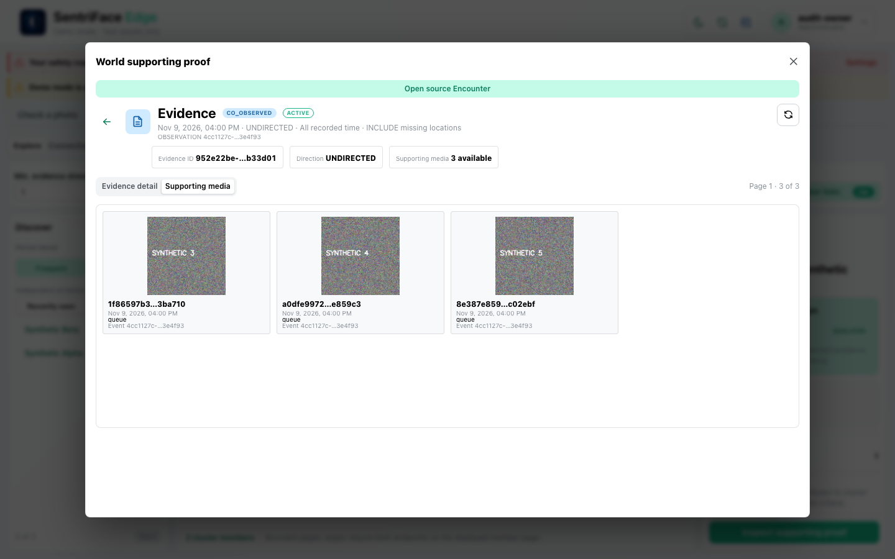](../screenshots/UX-11/UX-11_J18_Step-09_Supporting-media-collection.png)

Capture: `UX-11` · Administrator · light theme · 1440×900 CSS viewport · DPR 1 · `2026-11-10T08:35:35.382421+00:00` · fixture: synthetic.

Scroll recorded: x=0, y=0.

### Step 10 — Nested media preview

Open a media row. The nested World media inspection modal identifies its Evidence origin and inspection-only role; Escape closes only this modal.

[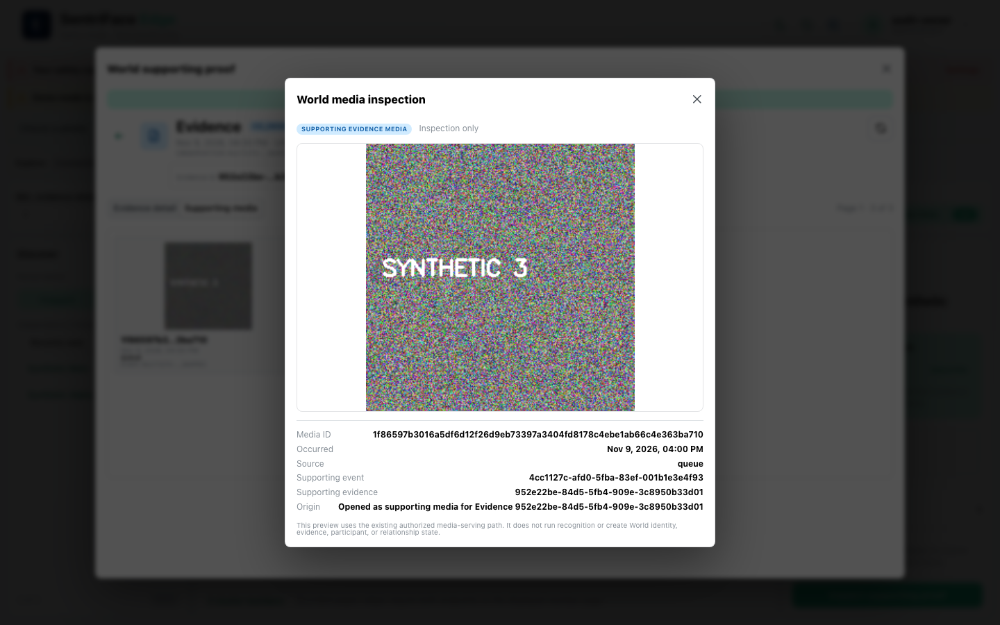](../screenshots/UX-14/UX-14_J18_Step-10_Nested-media-preview.png)

Capture: `UX-14` · Administrator · light theme · 1440×900 CSS viewport · DPR 1 · `2026-11-10T08:35:43.594878+00:00` · fixture: synthetic.

Scroll recorded: x=0, y=0.

### Step 11 — Proof source Encounter

Choose Open source Encounter from proof. The World Event detail displays effective participants, raw provenance, evidence and media counts.

[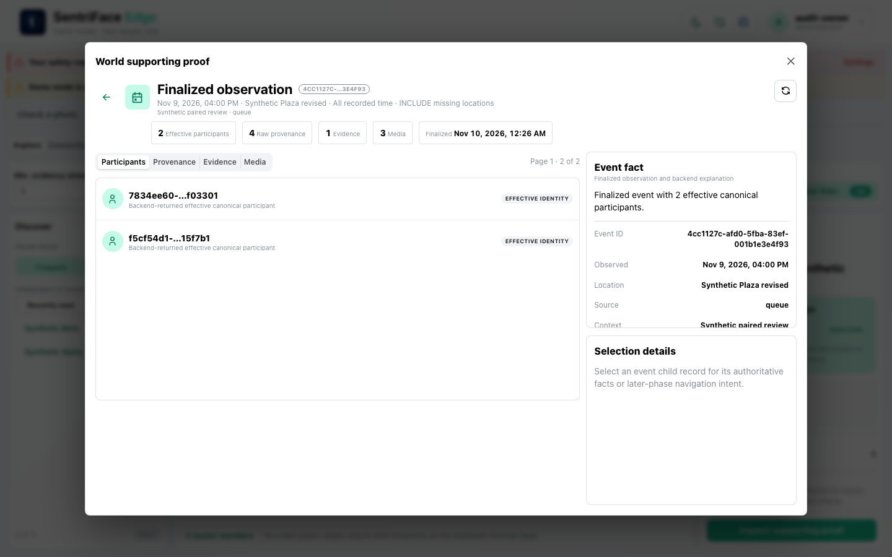](../screenshots/UX-15/UX-15_J18_Step-11_Proof-source-Encounter.png)

Capture: `UX-15` · Administrator · light theme · 1440×900 CSS viewport · DPR 1 · `2026-11-10T08:35:51.205487+00:00` · fixture: synthetic.

Scroll recorded: x=0, y=0.

### Step 12 — World event provenance

Select the World Event Provenance collection. Raw provenance is requested separately from effective participation.

[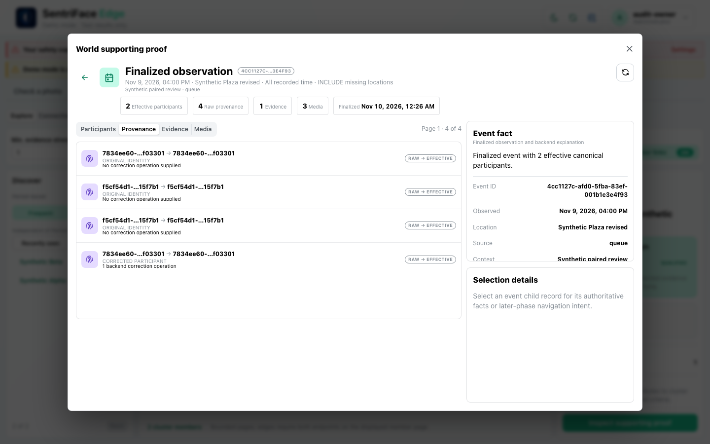](../screenshots/UX-12/UX-12_J18_Step-12_World-event-provenance.png)

Capture: `UX-12` · Administrator · light theme · 1440×900 CSS viewport · DPR 1 · `2026-11-10T08:36:33.280462+00:00` · fixture: synthetic.

Scroll recorded: x=0, y=0.

### Step 13 — World event evidence

Select Evidence in the World Event collection. Its bounded evidence records are shown.

[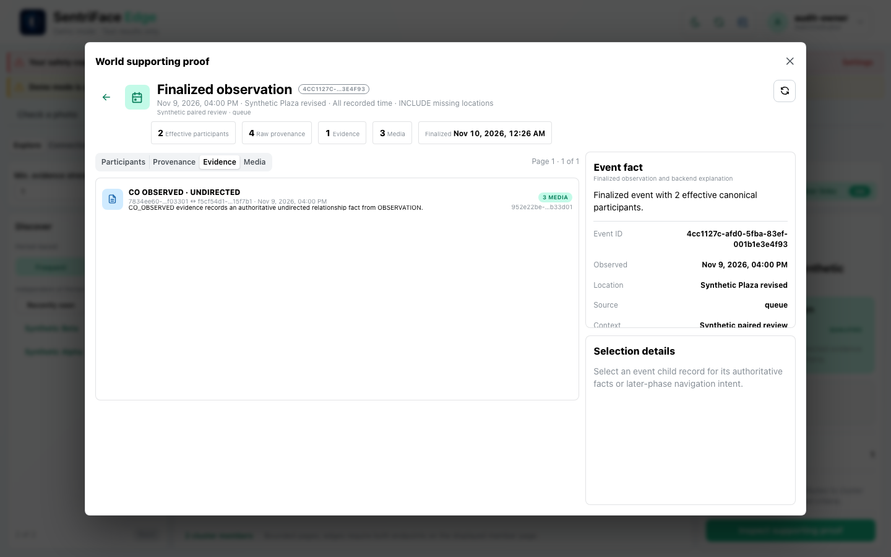](../screenshots/UX-12/UX-12_J18_Step-13_World-event-evidence.png)

Capture: `UX-12` · Administrator · light theme · 1440×900 CSS viewport · DPR 1 · `2026-11-10T08:36:42.823038+00:00` · fixture: synthetic.

Scroll recorded: x=0, y=0.

### Step 14 — World event media

Select Media. The source Event media collection is shown as a separate read.

[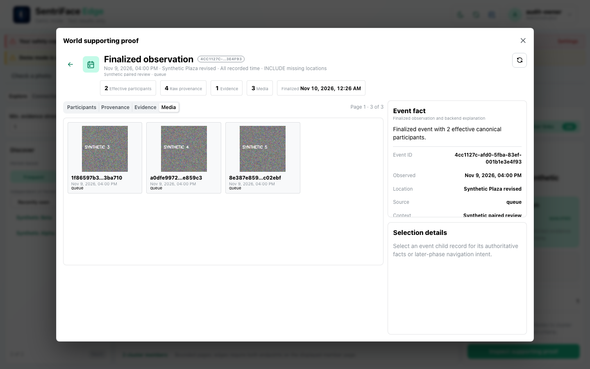](../screenshots/UX-12/UX-12_J18_Step-14_World-event-media.png)

Capture: `UX-12` · Administrator · light theme · 1440×900 CSS viewport · DPR 1 · `2026-11-10T08:36:43.436805+00:00` · fixture: synthetic.

Scroll recorded: x=0, y=0.

### Step 15 — Weaker links off

Close proof and choose Weaker links. The OFF pressed-state representation is captured; this is a visual-only canvas choice.

[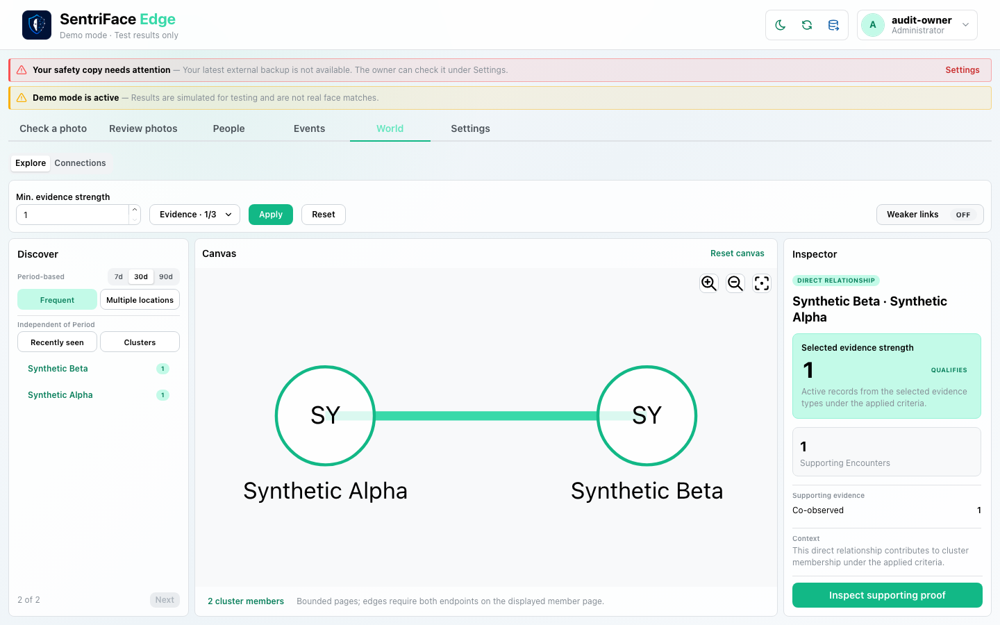](../screenshots/UX-11/UX-11_J18_Step-15_Weaker-links-off.png)

Capture: `UX-11` · Administrator · light theme · 1440×900 CSS viewport · DPR 1 · `2026-11-10T08:36:44.440158+00:00` · fixture: synthetic.

Scroll recorded: x=0, y=0.

### Step 16 — Explore cluster discovery

Choose Clusters discovery. The sparse authoritative cluster result is listed under the applied criteria.

[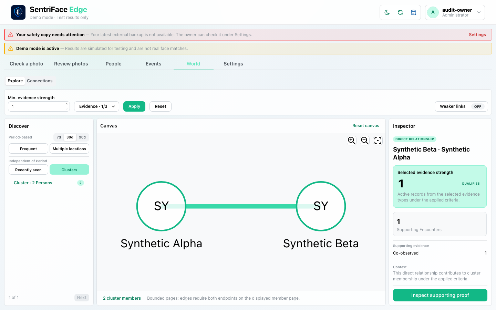](../screenshots/UX-11/UX-11_J18_Step-16_Explore-cluster-discovery.png)

Capture: `UX-11` · Administrator · light theme · 1440×900 CSS viewport · DPR 1 · `2026-11-10T08:36:45.171805+00:00` · fixture: synthetic.

Scroll recorded: x=0, y=0.

## Outcome, authority and return path

Explore opens by default. Empty evidence selection is refused; strength one exposes the sparse pair. The inspector opens relationship proof, exact evidence, media and source Event. Escape closes the nested media while proof remains. Source provenance, evidence and media collections are separately requested. Weaker links is changed visually and Clusters discovery is sampled without writing graph state.

## Limits and unexecuted branches

This is a sparse two-Person case. Person/cluster-specific proof variants, all discovery periods/collections, compact panel selector, pan/zoom/fit, bounded next pages, archived/deleted nodes and stale-proof refresh are not all exercised here. Unknown occurrence time appears as an exact prior-day local timestamp in World; this is a confirmed cross-view presentation discrepancy, not proof of storage corruption.

No redesign or implementation is specified by this record. Findings and recommended directions belong to the shared audit review and canonical design authority.

## macOS completion pass 2 — continuation E

Source product `b457f0a723e845dd1a92a07a577072c85146c89a`; dedicated disposable authority; Administrator; Day; full browser-content viewport 1440×900 CSS pixels, DPR 1.

Connections: apply Last 7 days, then Reset to all recorded time and re-enable dates. Open the Relationships collection and select a mixed relationship; the inspector shows its two active evidence records and explains that strength is a count, not confidence. Open a cluster, choose Relationships and select one; the cluster inspector shows evidence types and authoritative summary. The current fixture has no measured patterns, so pattern selection remains untested.

### Step 17 — Pass2 Connections before reset test

[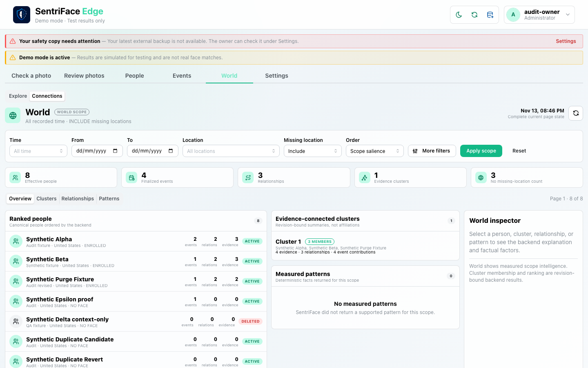](../screenshots/UX-12/UX-12_J18_Step-17_Pass2-Connections-before-reset-test.png)

Captured `2026-11-14T04:48:36.144864+00:00` · Administrator · UX-12 · generated synthetic fixtures · scroll {'x': 0, 'y': 0}.

### Step 18 — Pass2 Connections seven day scope

[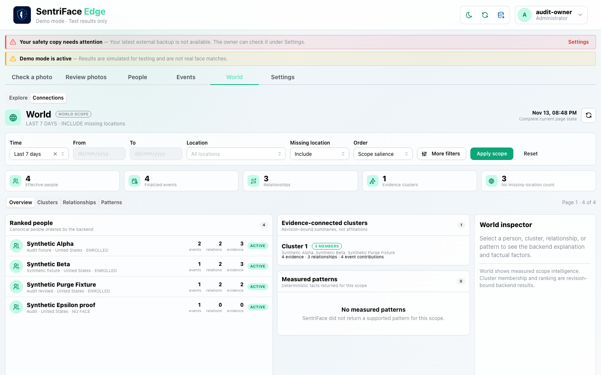](../screenshots/UX-12/UX-12_J18_Step-18_Pass2-Connections-seven-day-scope.png)

Captured `2026-11-14T04:48:43.605133+00:00` · Administrator · UX-12 · generated synthetic fixtures · scroll {'x': 0, 'y': 0}.

### Step 19 — Pass2 Connections reset default scope

[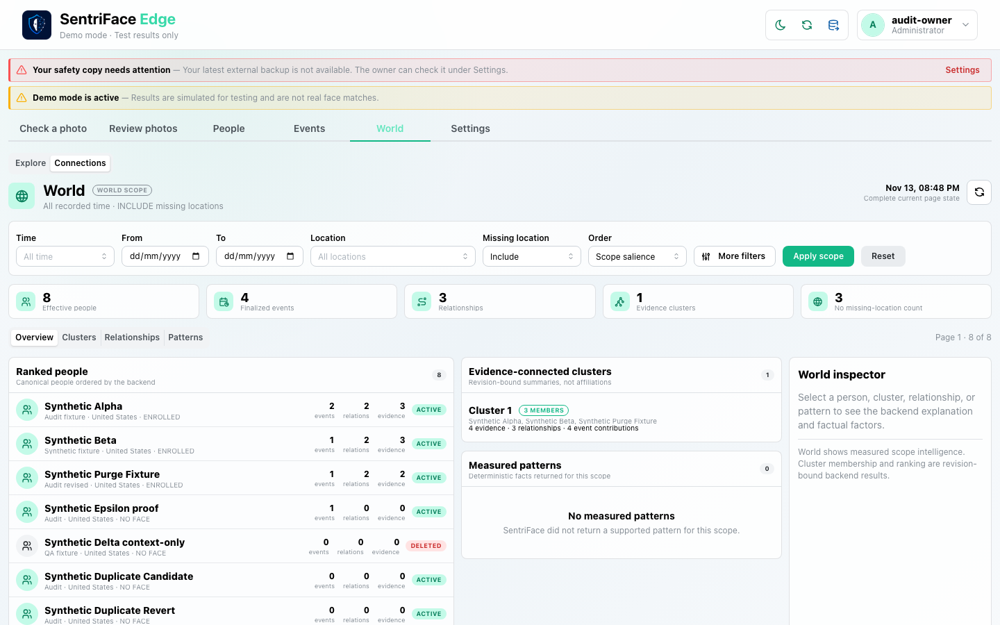](../screenshots/UX-12/UX-12_J18_Step-19_Pass2-Connections-reset-default-scope.png)

Captured `2026-11-14T04:48:58.013009+00:00` · Administrator · UX-12 · generated synthetic fixtures · scroll {'x': 0, 'y': 0}.

### Step 20 — Pass2 Connections relationship collection

[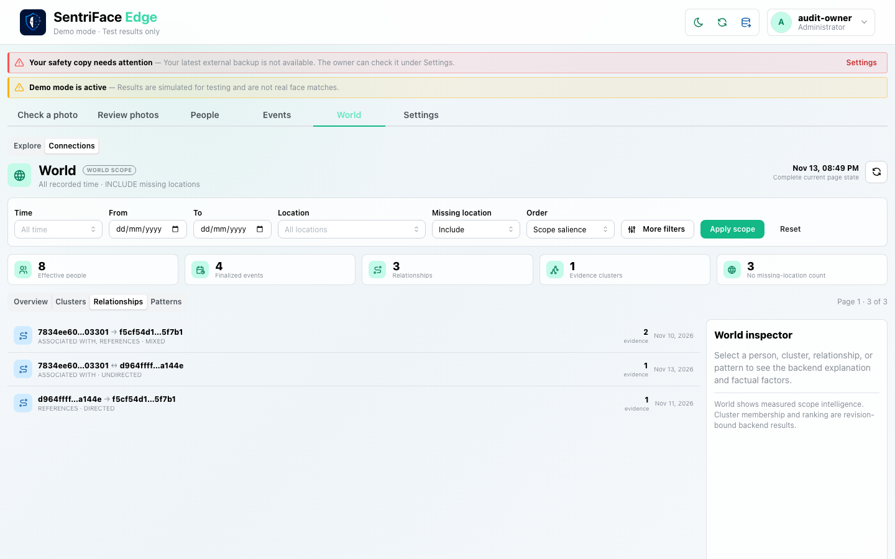](../screenshots/UX-12/UX-12_J18_Step-20_Pass2-Connections-relationship-collection.png)

Captured `2026-11-14T04:49:19.262026+00:00` · Administrator · UX-12 · generated synthetic fixtures · scroll {'x': 0, 'y': 0}.

### Step 21 — Pass2 Connections relationship selected

[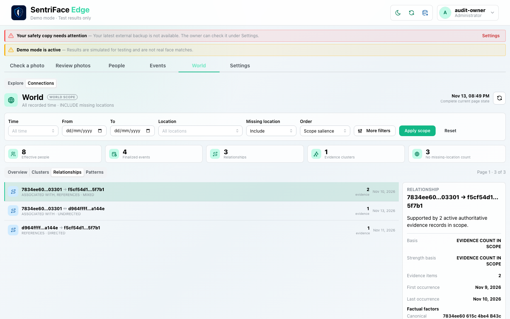](../screenshots/UX-12/UX-12_J18_Step-21_Pass2-Connections-relationship-selected.png)

Captured `2026-11-14T04:49:20.660459+00:00` · Administrator · UX-12 · generated synthetic fixtures · scroll {'x': 0, 'y': 0}.

### Step 22 — Pass2 Connections cluster selected

[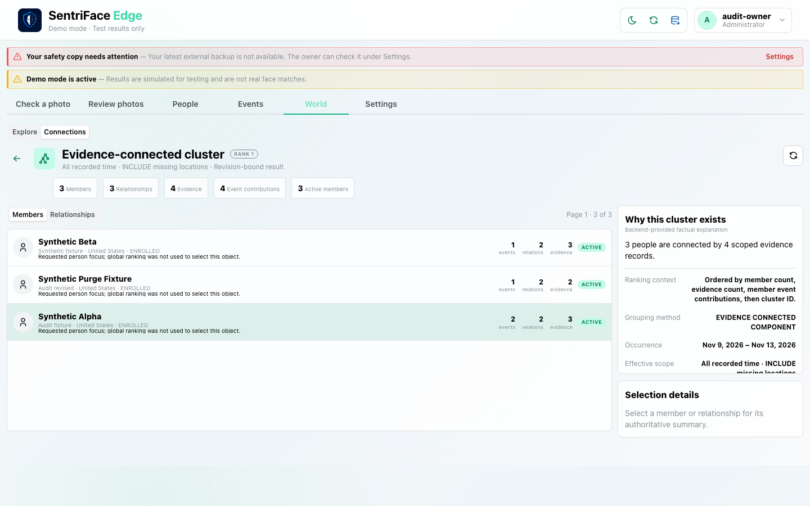](../screenshots/UX-12/UX-12_J18_Step-22_Pass2-Connections-cluster-selected.png)

Captured `2026-11-14T04:49:41.402559+00:00` · Administrator · UX-12 · generated synthetic fixtures · scroll {'x': 0, 'y': 0}.

### Step 23 — Pass2 Cluster relationships

[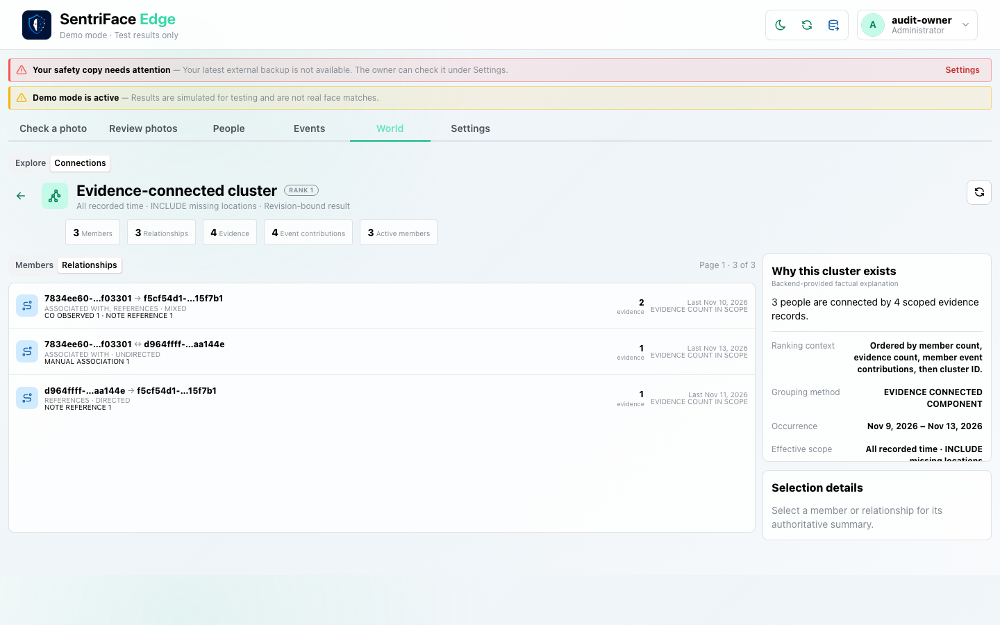](../screenshots/UX-12/UX-12_J18_Step-23_Pass2-Cluster-relationships.png)

Captured `2026-11-14T04:51:03.332554+00:00` · Administrator · UX-12 · generated synthetic fixtures · scroll {'x': 0, 'y': 0}.

### Step 24 — Pass2 Cluster relationship selected

[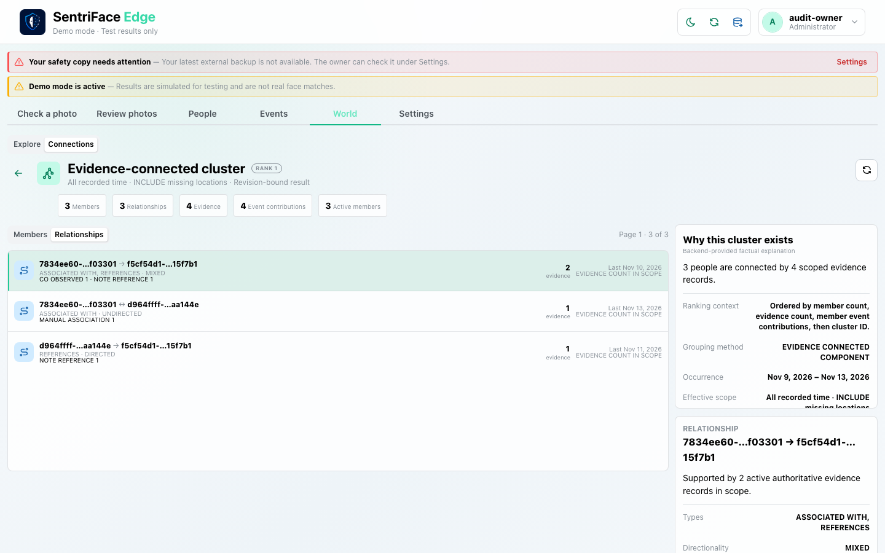](../screenshots/UX-12/UX-12_J18_Step-24_Pass2-Cluster-relationship-selected.png)

Captured `2026-11-14T04:51:18.486747+00:00` · Administrator · UX-12 · generated synthetic fixtures · scroll {'x': 0, 'y': 0}.
