# J19 — Connections filters and nested cluster–Person–Event navigation

[Audit index](../INDEX.md) · [Source oracle](../source-map.md) · [Independent review](../review.md)

**Scope result: PARTIAL.** This record proves only the ordered observations below; source-contract branches outside them are not silently passed. Source tasks: [SJ-046](../source-journeys.csv), [SJ-047](../source-journeys.csv), [SJ-048](../source-journeys.csv), [SJ-060](../source-journeys.csv).

**Operator goal:** Use the preserved Connections interface and follow revision-bound semantic levels with a recoverable Back hierarchy.

**Starting state and required role:** The sparse synthetic fixture remains unchanged after J18. Administrator has view capability. Connections preserves CURRENT backend semantics; Explore remains a separate workspace mode. All captures in this record use the disposable Administrator unless a step explicitly says unauthenticated.

**Implemented owners:** [`views/WorldView.jsx`](../../../frontend/src/views/WorldView.jsx); [`views/ClusterDrilldownView.jsx`](../../../frontend/src/views/ClusterDrilldownView.jsx); [`views/WorldPersonDrilldownView.jsx`](../../../frontend/src/views/WorldPersonDrilldownView.jsx); [`views/WorldEventDrilldownView.jsx`](../../../frontend/src/views/WorldEventDrilldownView.jsx); [`views/WorldWorkspace.jsx`](../../../frontend/src/views/WorldWorkspace.jsx).

**Evidence basis:** saved current-run screenshots, capture metadata and accessibility snapshots. Visual acceptance is documented in the independent review; this assembly does not claim a second independent visual inspection. Synthetic images are generated patterns, not biometric photographs. No source/UI manipulation produces these states.

**Source:** `b457f0a723e845dd1a92a07a577072c85146c89a`. Capture sequence numbers order the captured states; uncaptured return actions are named in the text. The audit was interrupted and resumed across November 5 and 10 at the same source SHA.

## Ordered interaction and visual evidence

### Step 01 — Connections overview

Select Connections. Overview shows scope totals, ranked people, a cluster, empty measured patterns and a “Cluster view refreshed” notice following earlier graph changes.

[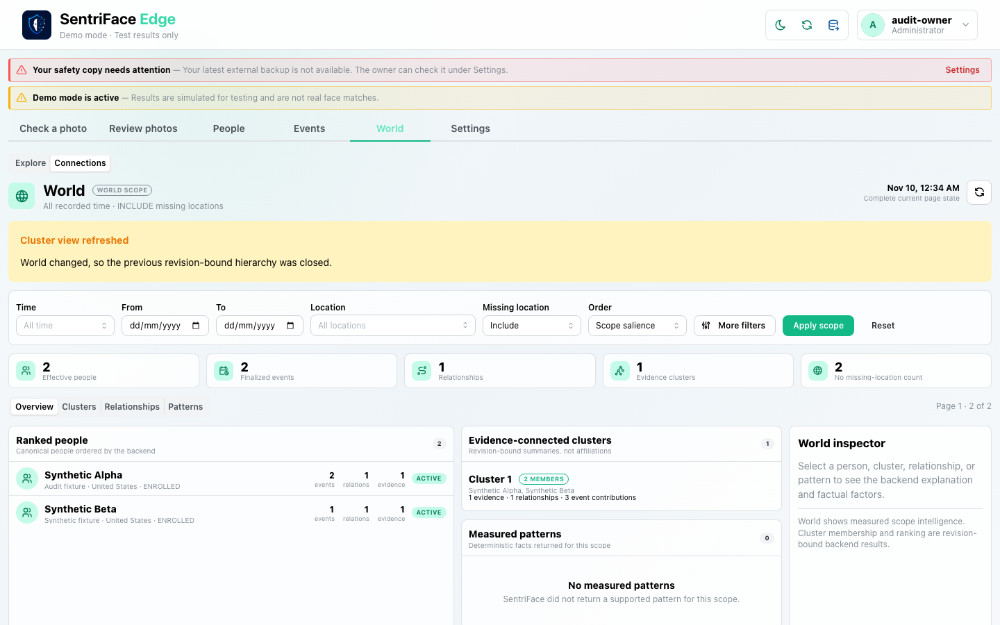](../screenshots/UX-12/UX-12_J19_Step-01_Connections-overview.png)

Capture: `UX-12` · Administrator · light theme · 1440×900 CSS viewport · DPR 1 · `2026-11-10T08:36:45.955182+00:00` · fixture: synthetic.

Scroll recorded: x=0, y=0.

### Step 02 — Advanced filters popover

Open More filters. Lifecycle, identity/biometric state, country/rank/priority, evidence/activity/pattern and relationship criteria are exposed together.

[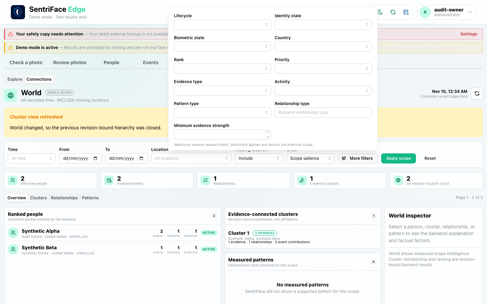](../screenshots/UX-12/UX-12_J19_Step-02_Advanced-filters-popover.png)

Capture: `UX-12` · Administrator · light theme · 1440×900 CSS viewport · DPR 1 · `2026-11-10T08:37:06.256575+00:00` · fixture: synthetic.

Scroll recorded: x=0, y=0.

### Step 03 — Facet dropdown

Open Country. The facet dropdown is sampled; it is not proof that every facet value was applied.

[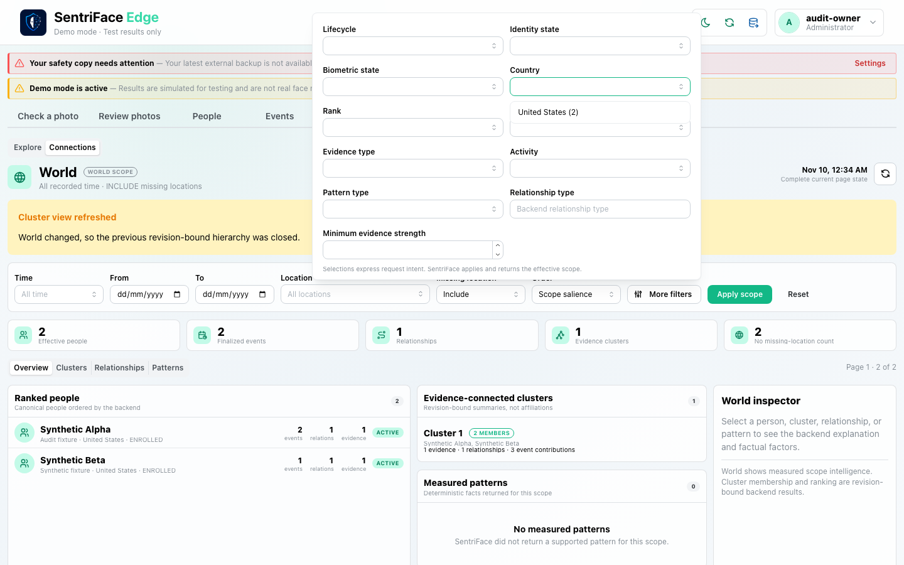](../screenshots/UX-12/UX-12_J19_Step-03_Facet-dropdown.png)

Capture: `UX-12` · Administrator · light theme · 1440×900 CSS viewport · DPR 1 · `2026-11-10T08:37:16.037108+00:00` · fixture: synthetic.

Scroll recorded: x=0, y=0.

### Step 04 — Recent disables date range

Choose Last 7 days. From/To become disabled, expressing the period/date-range exclusion. Apply scope after this capture.

[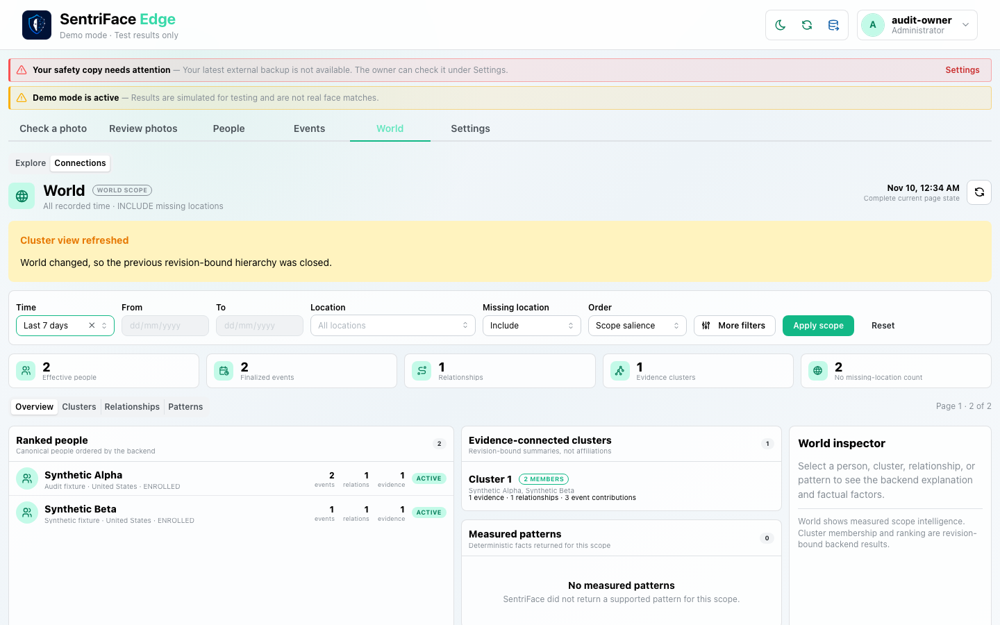](../screenshots/UX-12/UX-12_J19_Step-04_Recent-disables-date-range.png)

Capture: `UX-12` · Administrator · light theme · 1440×900 CSS viewport · DPR 1 · `2026-11-10T08:37:16.930390+00:00` · fixture: synthetic.

Scroll recorded: x=0, y=0.

### Step 05 — Relationships collection

Select Relationships. The typed relationship collection is shown under the applied scope.

[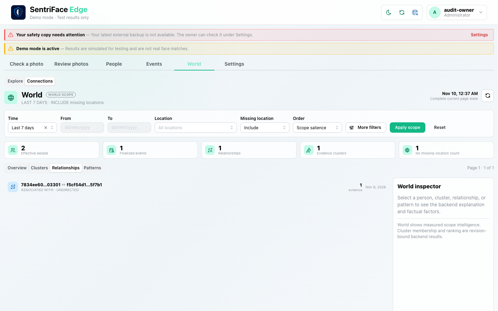](../screenshots/UX-12/UX-12_J19_Step-05_Relationships-collection.png)

Capture: `UX-12` · Administrator · light theme · 1440×900 CSS viewport · DPR 1 · `2026-11-10T08:37:17.856046+00:00` · fixture: synthetic.

Scroll recorded: x=0, y=0.

### Step 06 — Patterns empty

Select Patterns. No measured patterns is a genuine sparse-fixture empty result.

[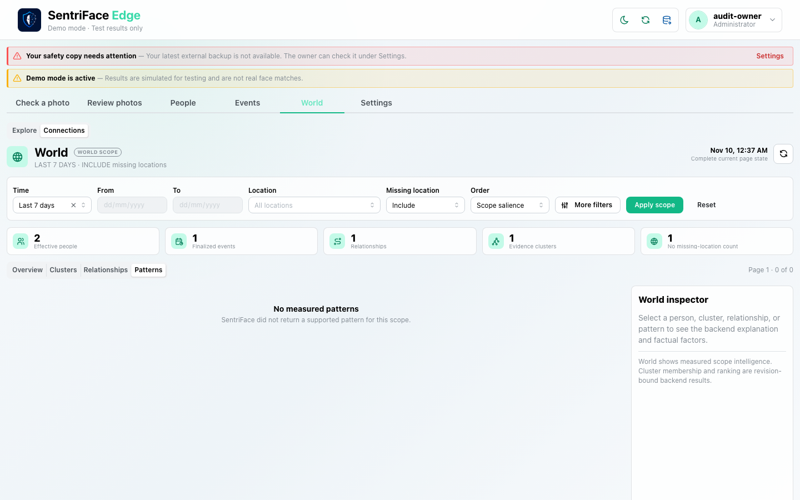](../screenshots/UX-12/UX-12_J19_Step-06_Patterns-empty.png)

Capture: `UX-12` · Administrator · light theme · 1440×900 CSS viewport · DPR 1 · `2026-11-10T08:37:18.408661+00:00` · fixture: synthetic.

Scroll recorded: x=0, y=0.

### Step 07 — Clusters collection

Select Clusters. The one cluster summary is shown.

Capture: `UX-12` · Administrator · light theme · 1440×900 CSS viewport · DPR 1 · `2026-11-10T08:37:18.939126+00:00` · fixture: synthetic.

Scroll recorded: x=0, y=0.

### Step 08 — Cluster selected

Open the cluster. Its members, evidence totals, explanation and Relationships collection control are available.

[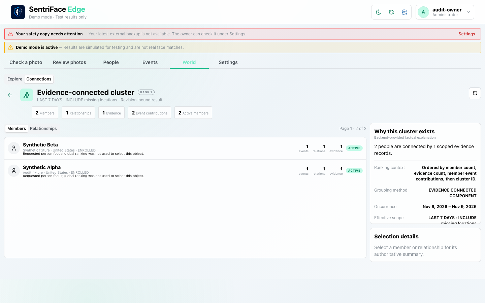](../screenshots/UX-12/UX-12_J19_Step-08_Cluster-selected.png)

Capture: `UX-12` · Administrator · light theme · 1440×900 CSS viewport · DPR 1 · `2026-11-10T08:37:36.818159+00:00` · fixture: synthetic.

Scroll recorded: x=0, y=0.

### Step 09 — Cluster person selected

Select Synthetic Alpha. Member navigation intent and Open scoped person appear; the summary itself is not treated as loaded Person detail.

[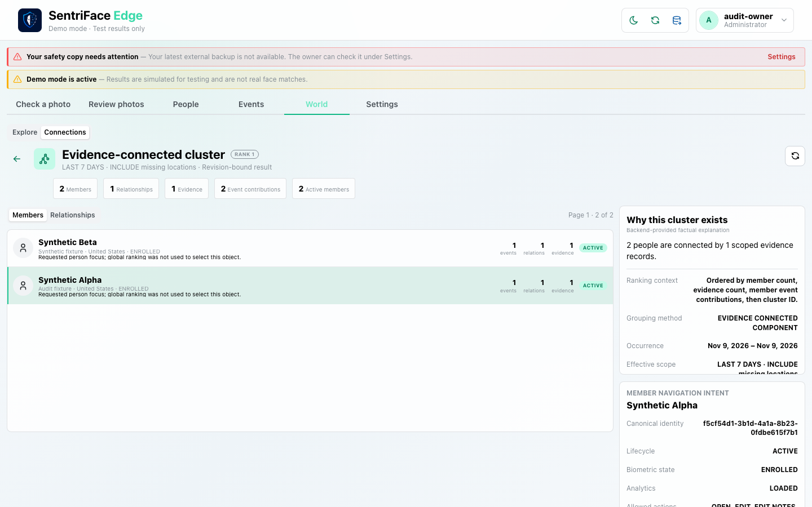](../screenshots/UX-12/UX-12_J19_Step-09_Cluster-person-selected.png)

Capture: `UX-12` · Administrator · light theme · 1440×900 CSS viewport · DPR 1 · `2026-11-10T08:37:42.560142+00:00` · fixture: synthetic.

Scroll recorded: x=0, y=0.

### Step 10 — Scoped person detail

Choose Open scoped person. A fresh World Person view shows its relationship collection and current cluster membership.

[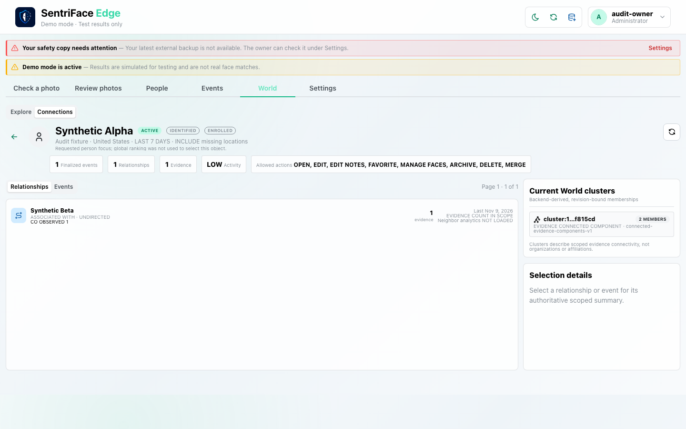](../screenshots/UX-12/UX-12_J19_Step-10_Scoped-person-detail.png)

Capture: `UX-12` · Administrator · light theme · 1440×900 CSS viewport · DPR 1 · `2026-11-10T08:37:48.817838+00:00` · fixture: synthetic.

Scroll recorded: x=0, y=0.

### Step 11 — World person events

Select Events within World Person. The finalized occurrence is returned under the same scope.

[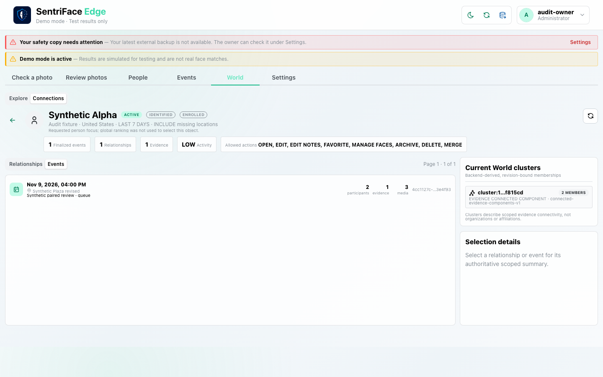](../screenshots/UX-12/UX-12_J19_Step-11_World-person-events.png)

Capture: `UX-12` · Administrator · light theme · 1440×900 CSS viewport · DPR 1 · `2026-11-10T08:37:57.167355+00:00` · fixture: synthetic.

Scroll recorded: x=0, y=0.

### Step 12 — World event selected

Select the Event row. Event navigation intent and Open finalized event appear; this is still a selected summary.

[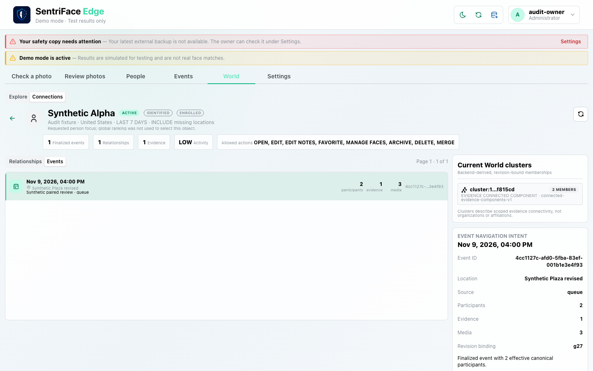](../screenshots/UX-12/UX-12_J19_Step-12_World-event-selected.png)

Capture: `UX-12` · Administrator · light theme · 1440×900 CSS viewport · DPR 1 · `2026-11-10T08:38:03.780628+00:00` · fixture: synthetic.

Scroll recorded: x=0, y=0.

### Step 13 — Connections event detail

Choose Open finalized event. Fresh Event detail distinguishes effective participants, raw provenance and supporting collections.

[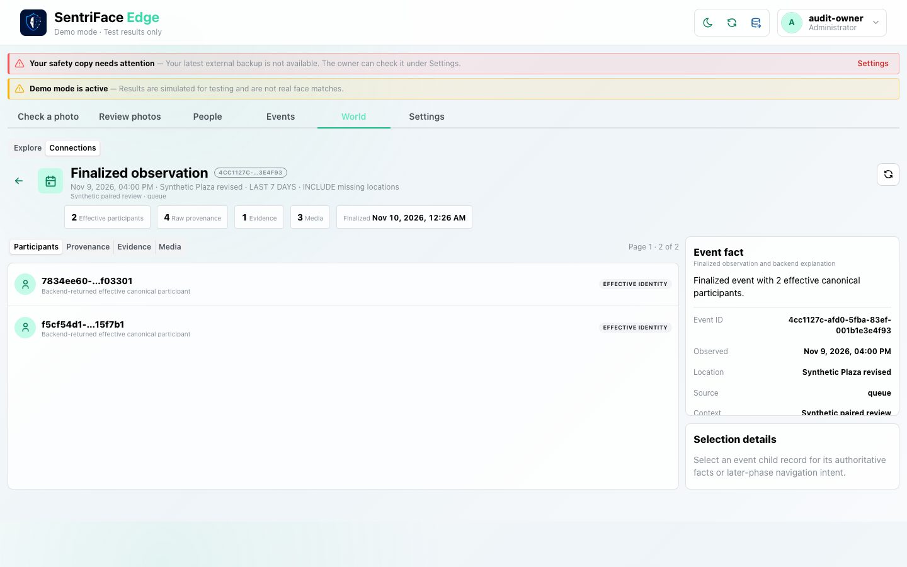](../screenshots/UX-12/UX-12_J19_Step-13_Connections-event-detail.png)

Capture: `UX-12` · Administrator · light theme · 1440×900 CSS viewport · DPR 1 · `2026-11-10T08:38:13.061324+00:00` · fixture: synthetic.

Scroll recorded: x=0, y=0.

### Step 14 — World hierarchy return

Use Back to scoped person → Back to cluster → Back to World scope. The parent scope/collection context is restored.

[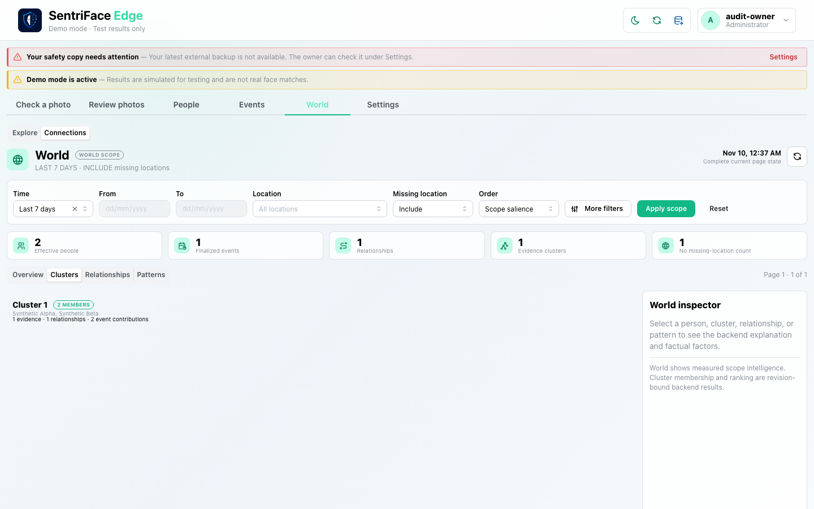](../screenshots/UX-15/UX-15_J19_Step-14_World-hierarchy-return.png)

Capture: `UX-15` · Administrator · light theme · 1440×900 CSS viewport · DPR 1 · `2026-11-10T08:38:14.397124+00:00` · fixture: synthetic.

Scroll recorded: x=0, y=0.

## Outcome, authority and return path

Connections scope, advanced filters and all four collection selectors are exposed. Last 7 days disables explicit dates. A cluster opens, a selected member opens a fresh scoped Person, an Event summary opens a fresh World Event, and the Back chain returns to scope. The initial hierarchy-refreshed notice is observed rather than silently ignored.

## Limits and unexecuted branches

Not every facet value/order/location/date-error combination is applied. Sparse counts do not exercise bounded next pages or populated patterns. Cluster Relationship selection and same-level evidence navigation are not all repeated because shared proof surfaces are sampled in J18; coverage must retain those exact entry-point gaps.

No redesign or implementation is specified by this record. Findings and recommended directions belong to the shared audit review and canonical design authority.

## macOS completion pass 2 — continuation E

Source product `b457f0a723e845dd1a92a07a577072c85146c89a`; dedicated disposable authority; Administrator; Day; full browser-content viewport 1440×900 CSS pixels, DPR 1.

Explore: select Alpha in a scope where it has no qualifying relationships, producing an isolated node and Person inspector. Zoom in reduces the SVG viewBox width, zoom out restores it, and pointer drag changes camera coordinates. Clicking the canvas background leaves the Person selected; the separate Reset canvas action clears canvas and inspector. The existing source canvas has pointer-pan handlers but no background-clear click handler; the original background-clear contract needs clarification rather than a fabricated PASS.

### Step 15 — Pass2 Explore initial

[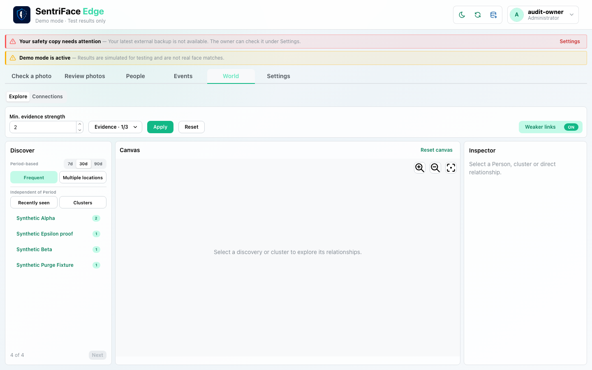](../screenshots/UX-11/UX-11_J19_Step-15_Pass2-Explore-initial.png)

Captured `2026-11-14T04:46:34.774598+00:00` · Administrator · UX-11 · generated synthetic fixtures · scroll {'x': 0, 'y': 0}.

### Step 16 — Pass2 Explore isolated person

[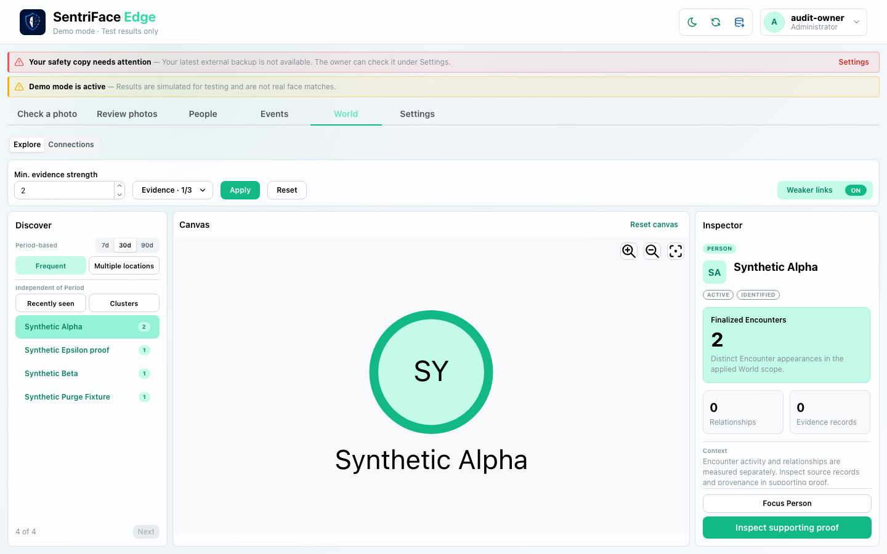](../screenshots/UX-11/UX-11_J19_Step-16_Pass2-Explore-isolated-person.png)

Captured `2026-11-14T04:46:49.436621+00:00` · Administrator · UX-11 · generated synthetic fixtures · scroll {'x': 0, 'y': 0}.

### Step 17 — Pass2 Explore zoom in

[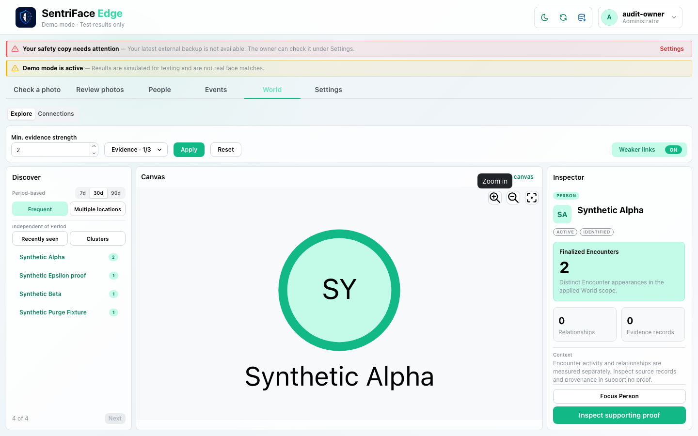](../screenshots/UX-11/UX-11_J19_Step-17_Pass2-Explore-zoom-in.png)

Captured `2026-11-14T04:46:56.918995+00:00` · Administrator · UX-11 · generated synthetic fixtures · scroll {'x': 0, 'y': 0}.

### Step 18 — Pass2 Explore fit

[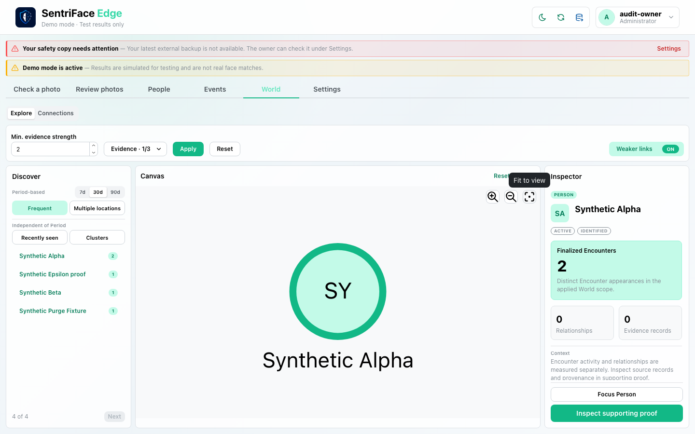](../screenshots/UX-11/UX-11_J19_Step-18_Pass2-Explore-fit.png)

Captured `2026-11-14T04:46:58.127033+00:00` · Administrator · UX-11 · generated synthetic fixtures · scroll {'x': 0, 'y': 0}.

### Step 19 — Pass2 Explore canvas pan

Captured `2026-11-14T04:47:17.505725+00:00` · Administrator · UX-11 · generated synthetic fixtures · scroll {'x': 0, 'y': 0}.

### Step 20 — Pass2 Explore background click

[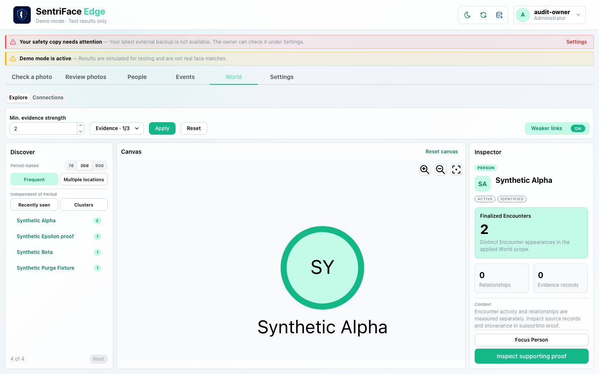](../screenshots/UX-11/UX-11_J19_Step-20_Pass2-Explore-background-click.png)

Captured `2026-11-14T04:47:23.620388+00:00` · Administrator · UX-11 · generated synthetic fixtures · scroll {'x': 0, 'y': 0}.

### Step 21 — Pass2 Explore reset clears canvas

[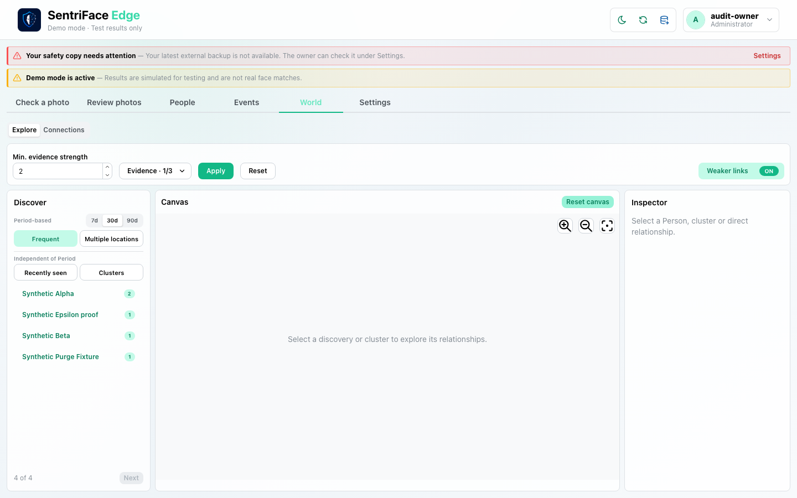](../screenshots/UX-11/UX-11_J19_Step-21_Pass2-Explore-reset-clears-canvas.png)

Captured `2026-11-14T04:47:48.558258+00:00` · Administrator · UX-11 · generated synthetic fixtures · scroll {'x': 0, 'y': 0}.
