# J20 — License status and five local role accounts

[Audit index](../INDEX.md) · [Source oracle](../source-map.md) · [Independent review](../review.md)

**Scope result: PARTIAL.** This record proves only the ordered observations below; source-contract branches outside them are not silently passed. Source tasks: [SJ-049](../source-journeys.csv), [SJ-053](../source-journeys.csv).

**Operator goal:** Inspect source-runtime license status and prepare actual disposable accounts for each repository role.

**Starting state and required role:** Administrator is signed into the disposable audit store. This macOS synthetic source runtime does not enforce packaged Windows licensing. All captures in this record use the disposable Administrator unless a step explicitly says unauthenticated.

**Implemented owners:** [`views/LicensePanel.jsx`](../../../frontend/src/views/LicensePanel.jsx); [`views/AccountsPanel.jsx`](../../../frontend/src/views/AccountsPanel.jsx); [`views/DebugView.jsx`](../../../frontend/src/views/DebugView.jsx).

**Evidence basis:** saved current-run screenshots, capture metadata and accessibility snapshots. Visual acceptance is documented in the independent review; this assembly does not claim a second independent visual inspection. Synthetic images are generated patterns, not biometric photographs. No source/UI manipulation produces these states.

**Source:** `b457f0a723e845dd1a92a07a577072c85146c89a`. Capture sequence numbers order the captured states; uncaptured return actions are named in the text. The audit was interrupted and resumed across November 5 and 10 at the same source SHA.

## Ordered interaction and visual evidence

### Step 01 — License runtime status

Select Settings. License & activation displays its source-runtime not-enforced status without an activation form.

[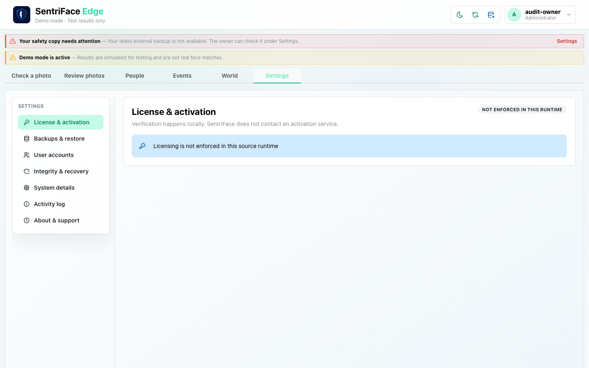](../screenshots/UX-13/UX-13_J20_Step-01_License-runtime-status.png)

Capture: `UX-13` · Administrator · light theme · 1440×900 CSS viewport · DPR 1 · `2026-11-10T08:38:15.178455+00:00` · fixture: synthetic.

Scroll recorded: x=0, y=0.

### Step 02 — Machine accounts

Choose User accounts. The initial owner is listed and Backend-enforced roles explains that hidden controls are not authorization.

[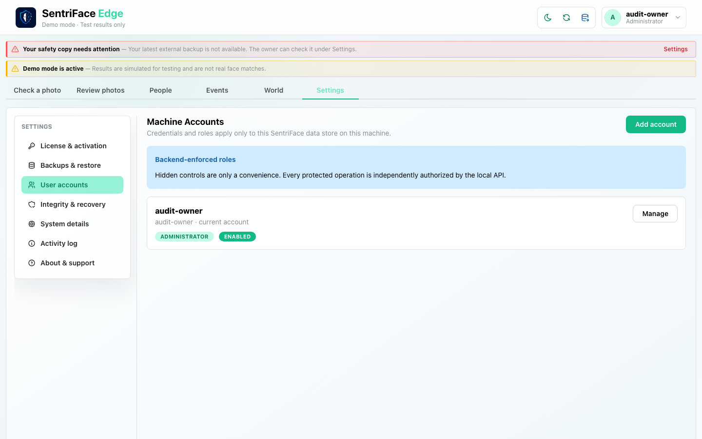](../screenshots/UX-13/UX-13_J20_Step-02_Machine-accounts.png)

Capture: `UX-13` · Administrator · light theme · 1440×900 CSS viewport · DPR 1 · `2026-11-10T08:38:15.963843+00:00` · fixture: synthetic.

Scroll recorded: x=0, y=0.

### Step 03 — Create account empty

Choose Add account. Empty Username/Display name/Temporary password/Roles form and disabled Create are visible.

[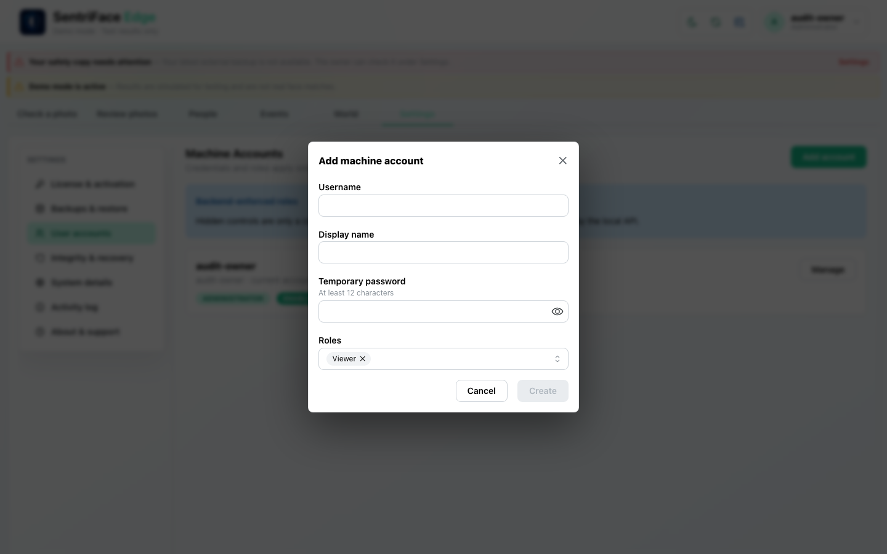](../screenshots/UX-13/UX-13_J20_Step-03_Create-account-empty.png)

Capture: `UX-13` · Administrator · light theme · 1440×900 CSS viewport · DPR 1 · `2026-11-10T08:38:16.689330+00:00` · fixture: synthetic.

Scroll recorded: x=0, y=0.

### Step 04 — Role catalog

Open Roles. Viewer, Operator, Custodian, Technician and Administrator are listed; Viewer is the default selection.

[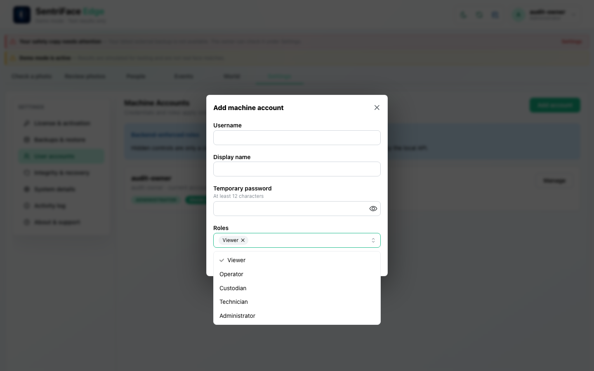](../screenshots/UX-13/UX-13_J20_Step-04_Role-catalog.png)

Capture: `UX-13` · Administrator · light theme · 1440×900 CSS viewport · DPR 1 · `2026-11-10T08:38:17.746869+00:00` · fixture: synthetic.

Scroll recorded: x=0, y=0.

### Step 05 — Viewer account created

Create the disposable Viewer and wait for the modal to close. The collection and “Machine account created” toast establish this creation.

[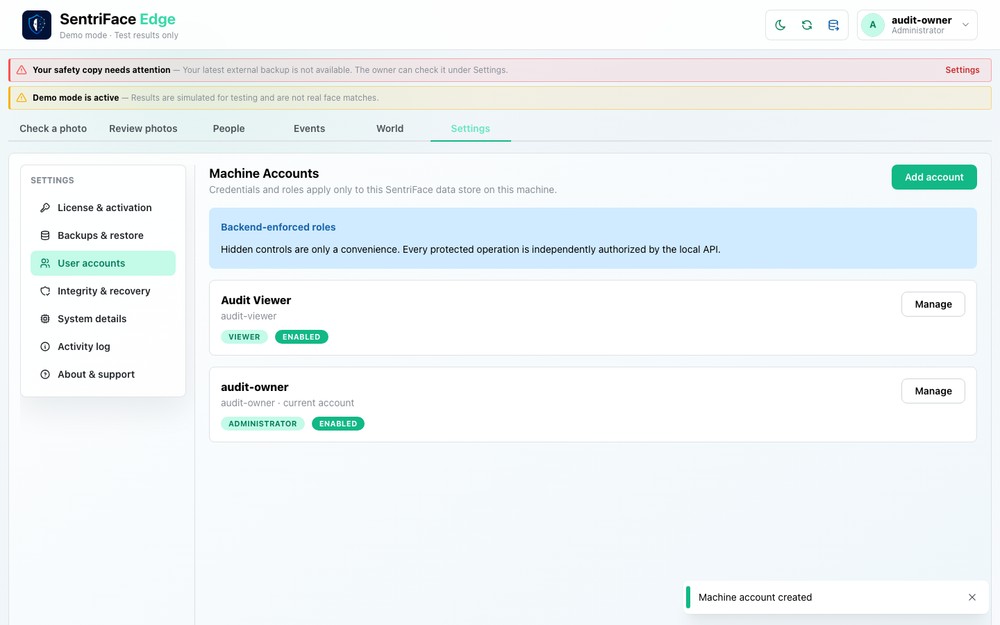](../screenshots/UX-13/UX-13_J20_Step-05_Viewer-account-created.png)

Capture: `UX-13` · Administrator · light theme · 1440×900 CSS viewport · DPR 1 · `2026-11-10T08:38:39.710665+00:00` · fixture: synthetic.

Scroll recorded: x=0, y=0.

### Step 06 — Operator account form, not five-account outcome

Private intermediate form evidence: an Operator account form and open Roles dropdown are visible. The legacy Five-role-fixture-accounts filename is rejected as an outcome label. No five-account success is inferred here.

**Private evidence retained; no public image.** This state is withheld for path/credential privacy or is a rejected capture label. Its existence does not imply a successful workflow outcome.

Capture: `UX-13` · Administrator · light theme · 1440×900 CSS viewport · DPR 1 · `2026-11-10T08:38:47.814606+00:00` · fixture: synthetic.

Scroll recorded: x=0, y=0.

### Step 07 — All five roles created

Finish actual UI creation of Operator, Custodian and Technician. The collection now contains the five intended roles; source read separately confirms exact single-role assignments.

[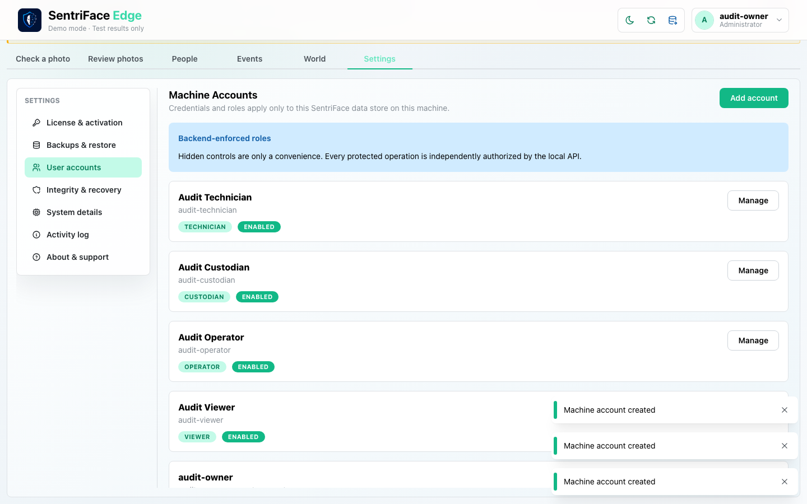](../screenshots/UX-13/UX-13_J20_Step-07_All-five-roles-created.png)

Capture: `UX-13` · Administrator · light theme · 1440×900 CSS viewport · DPR 1 · `2026-11-10T08:40:07.073355+00:00` · fixture: synthetic.

Scroll recorded: x=0, y=80.

### Step 08 — Manage account dialog

Open Manage on an existing fixture account. Display name, roles, disable and Administrator password-reset controls are inspectable with empty password input. Cancel leaves them unchanged.

[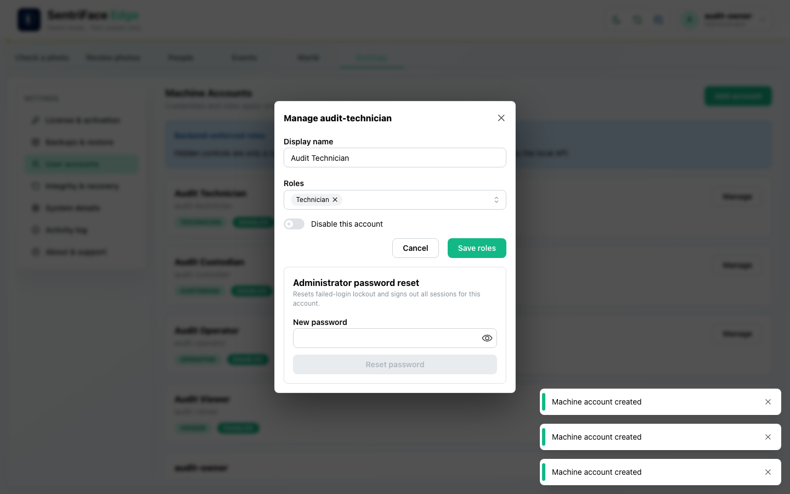](../screenshots/UX-13/UX-13_J20_Step-08_Manage-account-dialog.png)

Capture: `UX-13` · Administrator · light theme · 1440×900 CSS viewport · DPR 1 · `2026-11-10T08:40:07.554186+00:00` · fixture: synthetic.

Scroll recorded: x=0, y=80.

## Outcome, authority and return path

License status accurately says “Licensing is not enforced in this source runtime”. The actual account form creates Viewer, Operator, Custodian and Technician fixtures beside the initial Administrator. The final list and authenticated user-list read establish all five single-role accounts. Manage is inspected and cancelled; it is not proof of role changes, disabling or password reset.

## Limits and unexecuted branches

Packaged unlicensed recovery shell, valid/invalid signed activation and machine binding are outside this source runtime. Account disable/reset/self-protection/invalid-input/lockout and cross-role operations are not established by merely creating accounts. Step 6 is a private form-state capture, not a five-account result.

No redesign or implementation is specified by this record. Findings and recommended directions belong to the shared audit review and canonical design authority.

## macOS completion pass 2 — ordered continuation

**Status: PARTIAL overall.** Source remains `b457f0a723e845dd1a92a07a577072c85146c89a`; pass-one checkpoint `27a0532123389421b5cfdc5d0331eb1793e74c78` remains unchanged in history. Synthetic source mode and a dedicated disposable authority; 1440×900 CSS viewport, DPR 1, Day, Administrator unless the capture register says unauthenticated.

Create a new disposable Viewer account. A short temporary password disabled Create. Update its display name, perform administrator password reset, then disable it. A separate browser login was refused with “This account is disabled”. Password-containing screenshots are private. The reset produced a success message, but new-password authentication before disable was not independently tested; role changes and invalid username remain incomplete.

### Step 09 — Pass2 Pass2 add account empty

[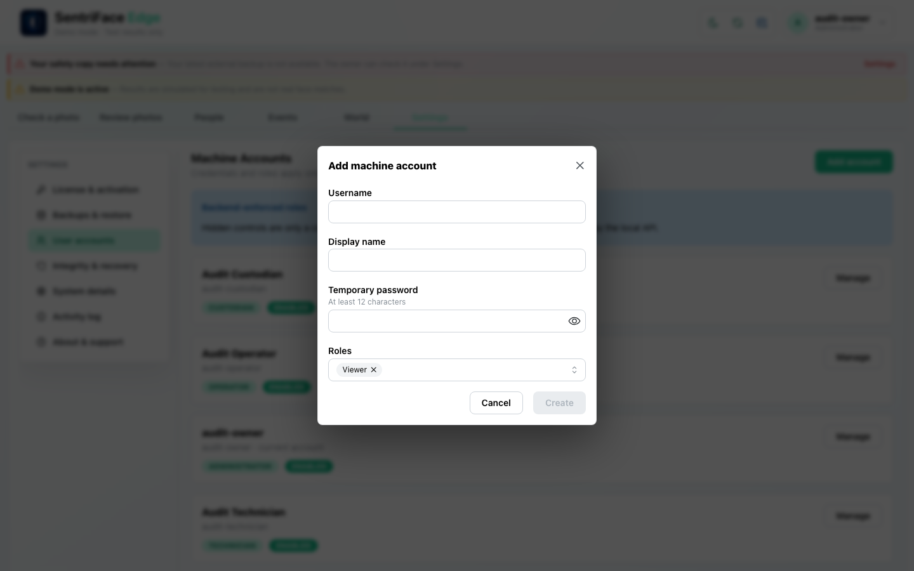](../screenshots/UX-13/UX-13_J20_Step-09_Pass2-Pass2-add-account-empty.png)

Capture `2026-11-11T06:31:49.129160+00:00` · Administrator · UX-13 · synthetic · scroll {'x': 0, 'y': 0}. Full browser viewport, not native window chrome.

### Step 10 — Pass2 Account short password disabled

Private original retained in the local archive; credential-field capture is not published.

Capture `2026-11-11T06:31:56.999668+00:00` · Administrator · UX-13 · synthetic · scroll {'x': 0, 'y': 0}. Full browser viewport, not native window chrome.

### Step 11 — Pass2 Pass2 account created

[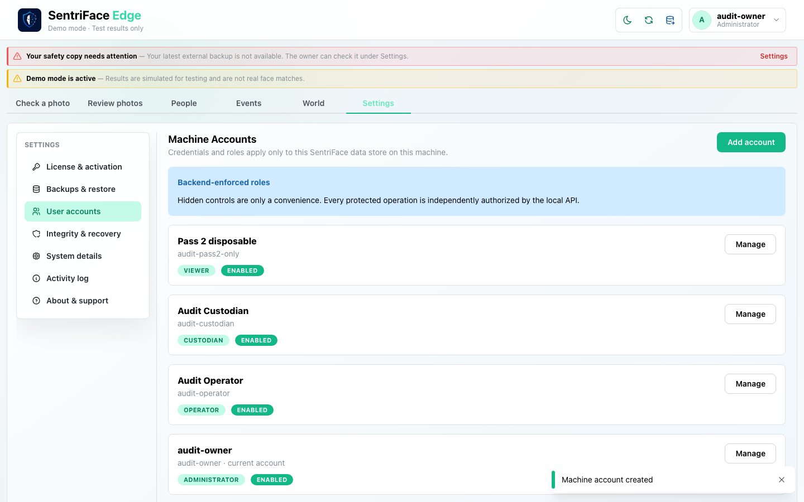](../screenshots/UX-13/UX-13_J20_Step-11_Pass2-Pass2-account-created.png)

Capture `2026-11-11T06:31:58.552631+00:00` · Administrator · UX-13 · synthetic · scroll {'x': 0, 'y': 0}. Full browser viewport, not native window chrome.

### Step 12 — Pass2 Manage new account

[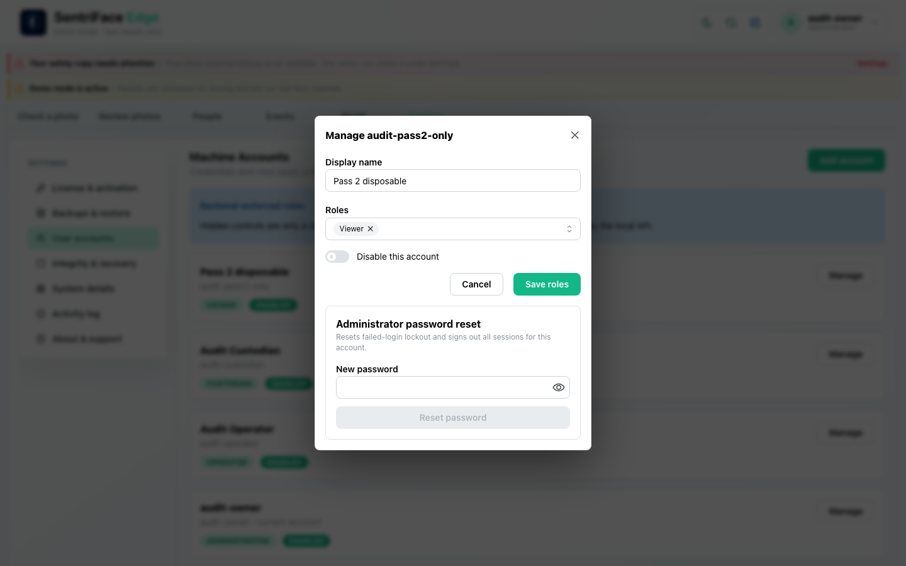](../screenshots/UX-13/UX-13_J20_Step-12_Pass2-Manage-new-account.png)

Capture `2026-11-11T06:32:18.502768+00:00` · Administrator · UX-13 · synthetic · scroll {'x': 0, 'y': 0}. Full browser viewport, not native window chrome.

### Step 13 — Pass2 Account display name saved

[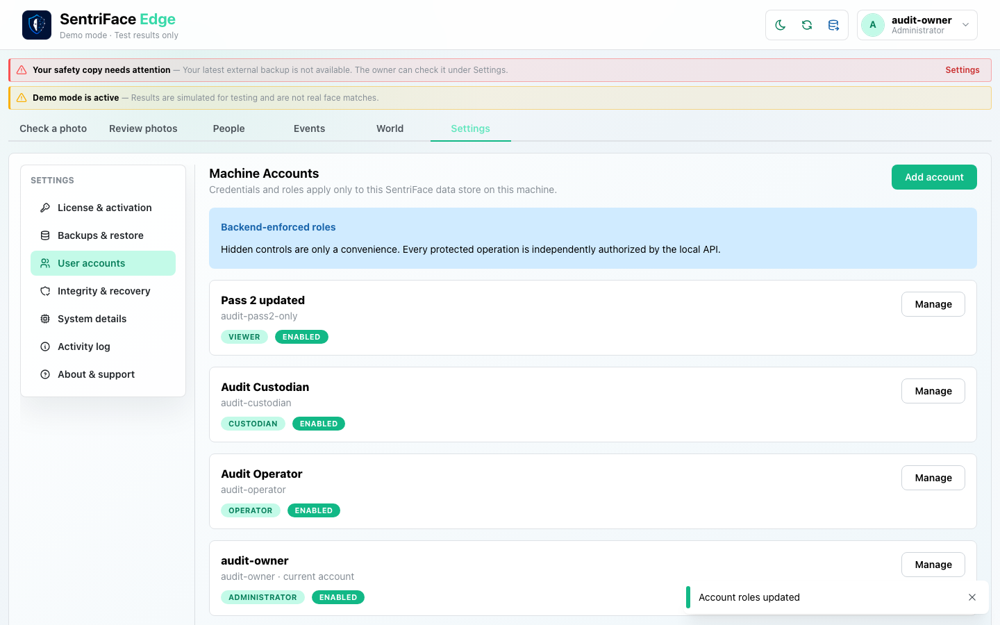](../screenshots/UX-13/UX-13_J20_Step-13_Pass2-Account-display-name-saved.png)

Capture `2026-11-11T06:32:26.841293+00:00` · Administrator · UX-13 · synthetic · scroll {'x': 0, 'y': 0}. Full browser viewport, not native window chrome.

### Step 14 — Pass2 Account password reset result

Private original retained in the local archive; credential-field capture is not published.

Capture `2026-11-11T06:32:44.623789+00:00` · Administrator · UX-13 · synthetic · scroll {'x': 0, 'y': 0}. Full browser viewport, not native window chrome.

### Step 15 — Pass2 Disposable account disabled

Capture `2026-11-11T06:33:04.185133+00:00` · Administrator · UX-13 · synthetic · scroll {'x': 0, 'y': 0}. Full browser viewport, not native window chrome.

### Step 16 — Pass2 Disabled account sign in refused

Private original retained in the local archive; credential-field capture is not published.

Capture `2026-11-11T06:33:18.952593+00:00` · Unauthenticated · UX-00 · synthetic · scroll {'x': 0, 'y': 0}. Full browser viewport, not native window chrome.
