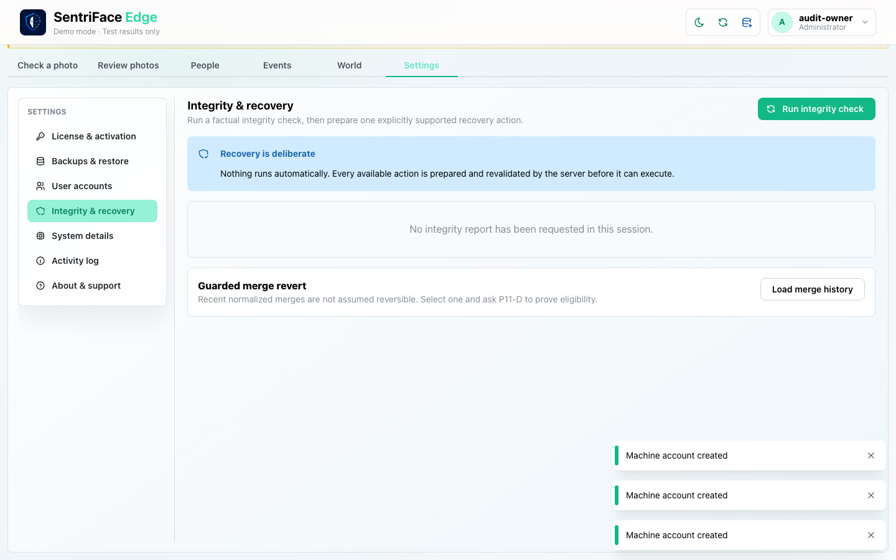
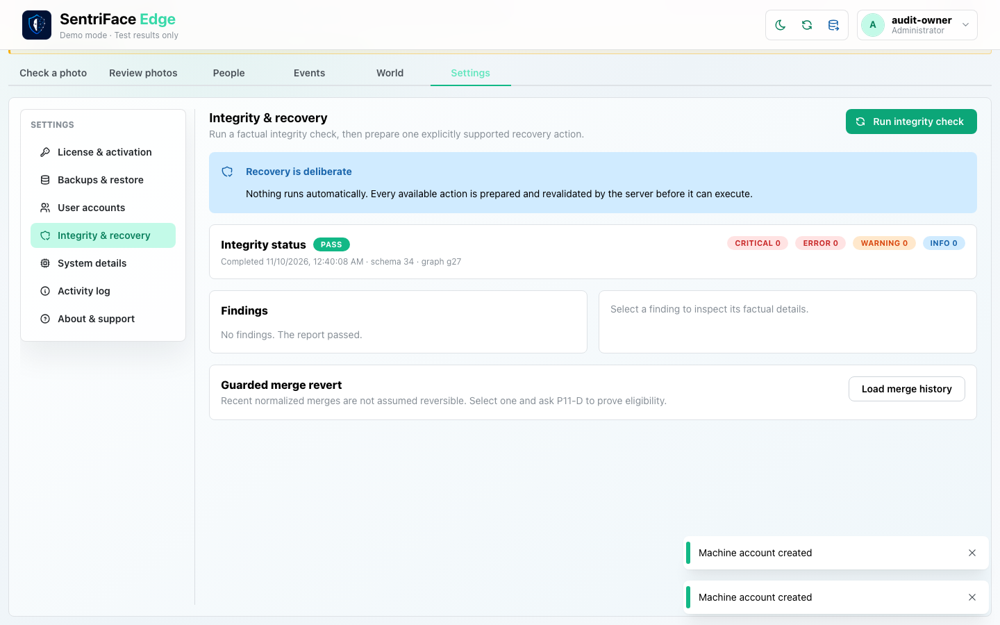
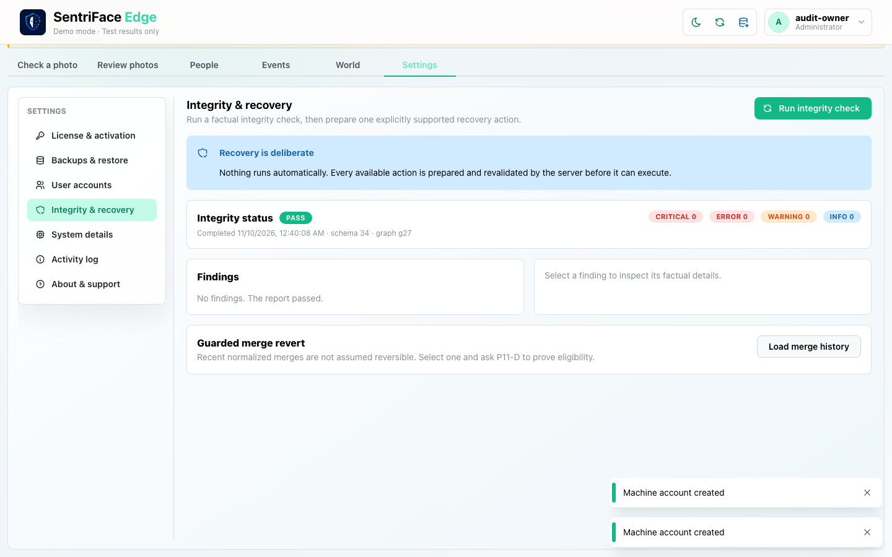
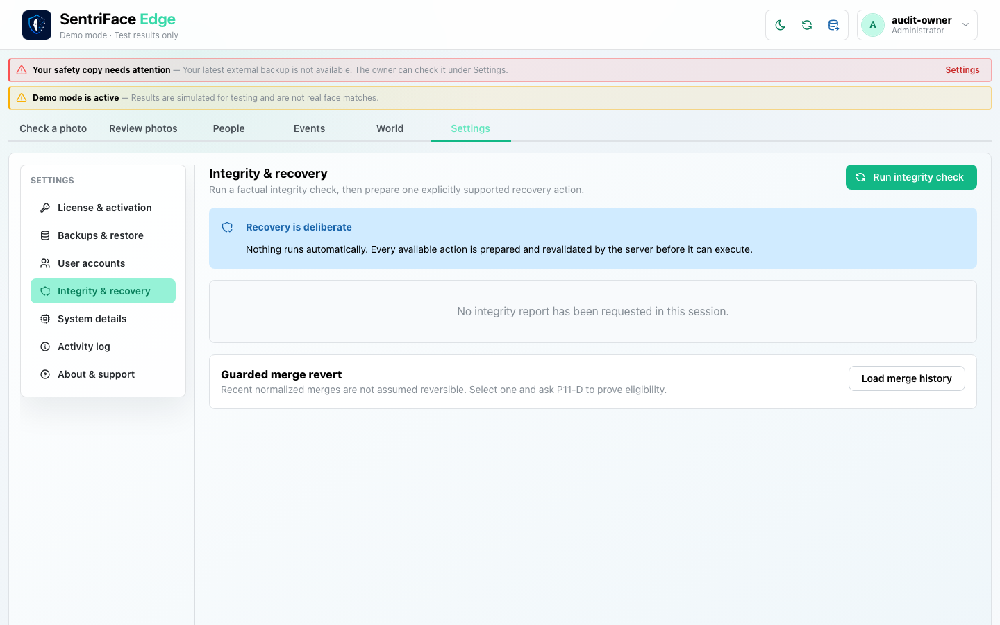
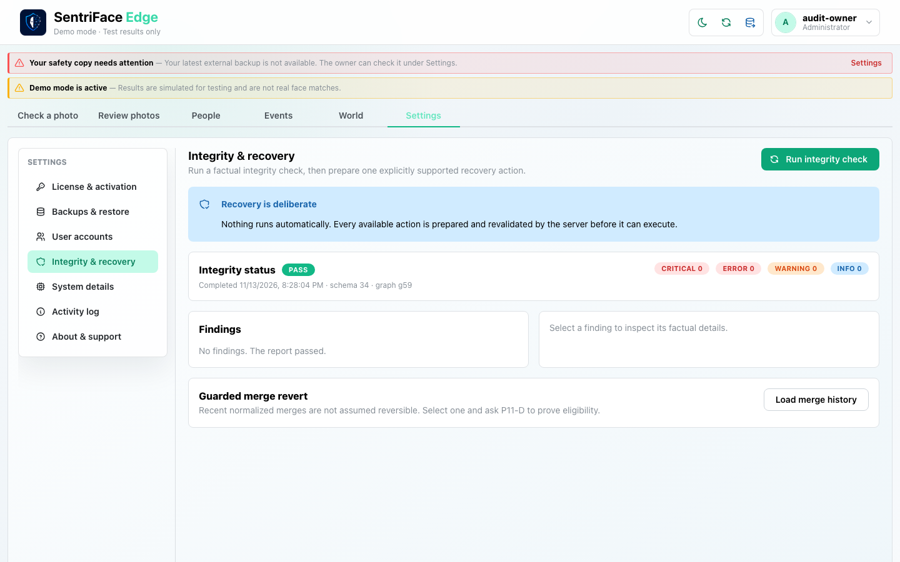

# J21 — Deliberate integrity check and empty merge history

[Audit index](../INDEX.md) · [Source oracle](../source-map.md) · [Independent review](../review.md)

**Scope result: PARTIAL.** This record proves only the ordered observations below; source-contract branches outside them are not silently passed. Source tasks: [SJ-054](../source-journeys.csv), [SJ-055](../source-journeys.csv).

**Operator goal:** Request an integrity report explicitly and inspect guarded merge-revert discovery without manufacturing invalid authority.

**Starting state and required role:** Administrator has recovery capability. The current disposable history contains the performed review, correction and lifecycle operations; no merge has yet been committed. All captures in this record use the disposable Administrator unless a step explicitly says unauthenticated.

**Implemented owners:** [`views/RecoveryPanel.jsx`](../../../frontend/src/views/RecoveryPanel.jsx); [`hooks/useRecoveryController.js`](../../../frontend/src/hooks/useRecoveryController.js).

**Evidence basis:** saved current-run screenshots, capture metadata and accessibility snapshots. Visual acceptance is documented in the independent review; this assembly does not claim a second independent visual inspection. Synthetic images are generated patterns, not biometric photographs. No source/UI manipulation produces these states.

**Source:** `b457f0a723e845dd1a92a07a577072c85146c89a`. Capture sequence numbers order the captured states; uncaptured return actions are named in the text. The audit was interrupted and resumed across November 5 and 10 at the same source SHA.

## Ordered interaction and visual evidence

### Step 01 — Integrity unrequested

Choose Integrity & recovery. The panel says no report has been requested in this session and explains that recovery is deliberate.

Capture: `UX-13` · Administrator · light theme · 1440×900 CSS viewport · DPR 1 · `2026-11-10T08:40:08.567978+00:00` · fixture: synthetic.

Scroll recorded: x=0, y=80.

### Step 02 — Integrity passed

Choose Run integrity check and wait for the actual result. PASS, schema 34, zero findings and the no-findings text are visible.

Capture: `UX-13` · Administrator · light theme · 1440×900 CSS viewport · DPR 1 · `2026-11-10T08:40:09.246376+00:00` · fixture: synthetic.

Scroll recorded: x=0, y=80.

### Step 03 — Merge history empty

Choose Load merge history. The guarded section remains without listed operations because no merge has been executed at this checkpoint; this is not a revert result.

Capture: `UX-13` · Administrator · light theme · 1440×900 CSS viewport · DPR 1 · `2026-11-10T08:40:09.929599+00:00` · fixture: synthetic.

Scroll recorded: x=0, y=80.

## Outcome, authority and return path

The unrequested state is distinct from a requested report. Run integrity check returns PASS, schema 34, zero severity counts and “No findings. The report passed.” Load merge history is invoked with no eligible history shown. No repair/rebuild/revert command is prepared or executed.

## Limits and unexecuted branches

A clean report cannot qualify finding selection, R01/R02, truncated/refused preparation, typed reason/phrase, stale tokens, committed-postcheck failure or merge-revert execution. No corrupt database or artificial frontend state is introduced to obtain those screenshots. The empty history has no separate explicit completion message in this capture.

No redesign or implementation is specified by this record. Findings and recommended directions belong to the shared audit review and canonical design authority.

## macOS completion pass 2 — continuation D

Source product `b457f0a723e845dd1a92a07a577072c85146c89a`; disposable authority; full browser-content viewport 1440×900 CSS pixels, DPR 1, Day. Role and capture time are recorded per step.

Run the actual integrity check after the synthetic note and ownership corrections. It reports PASS with zero findings. This is a result for the checks implemented at that moment; it does not prove every issue or historical invariant is absent.

### Step 04 — Pass2 Integrity start post corrections

Captured `2026-11-14T04:28:04.745921+00:00` · Administrator · UX-13 · synthetic fixture · scroll {'x': 0, 'y': 0}.

### Step 05 — Pass2 Integrity passes after corrections

Captured `2026-11-14T04:28:20.864213+00:00` · Administrator · UX-13 · synthetic fixture · scroll {'x': 0, 'y': 0}.
