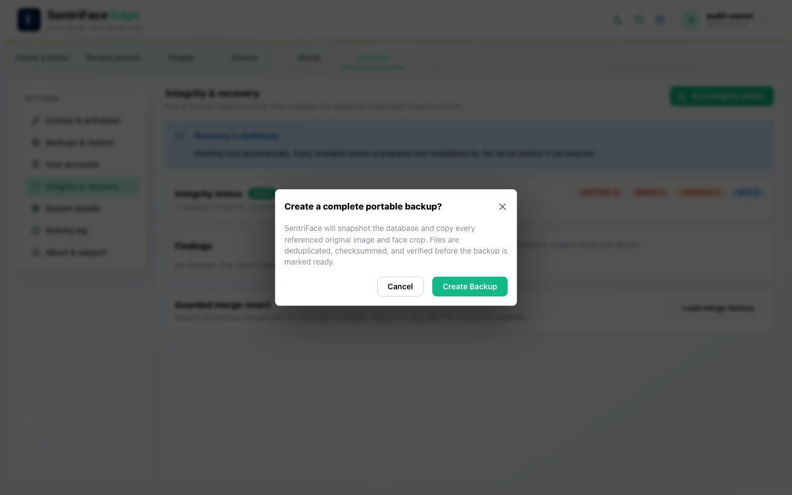
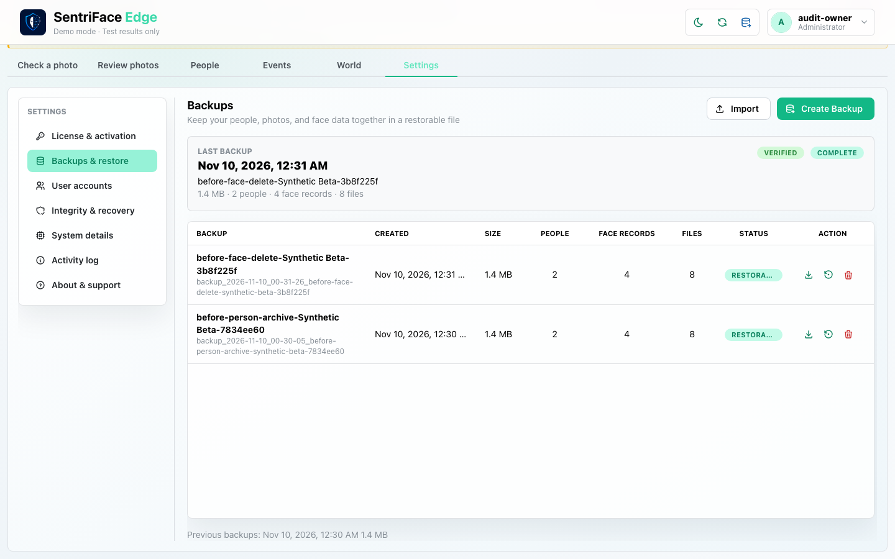
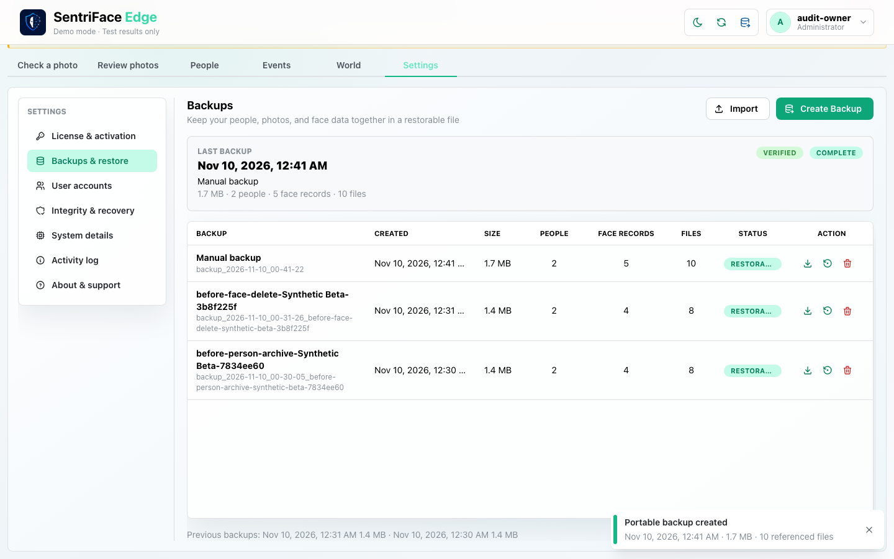
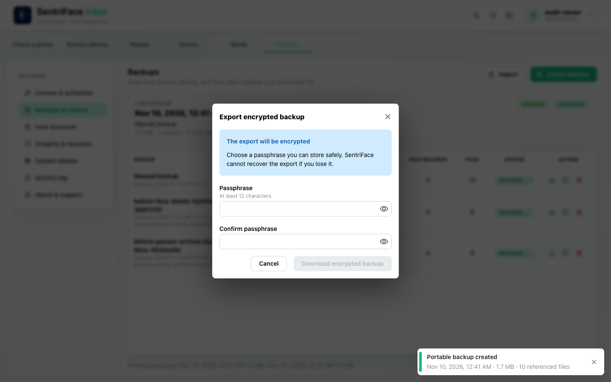
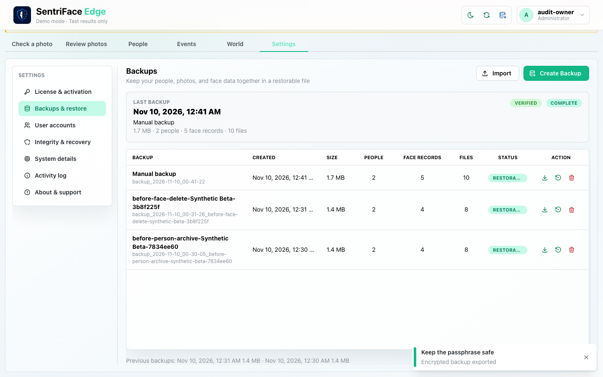
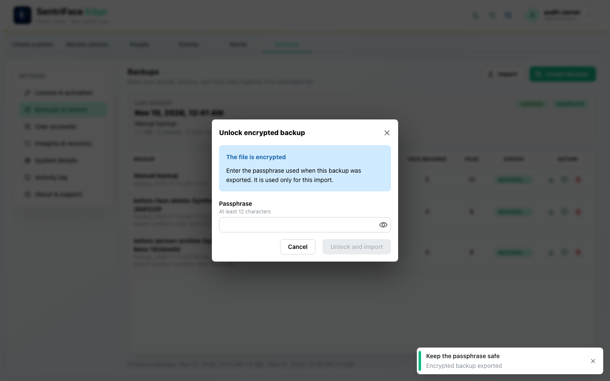
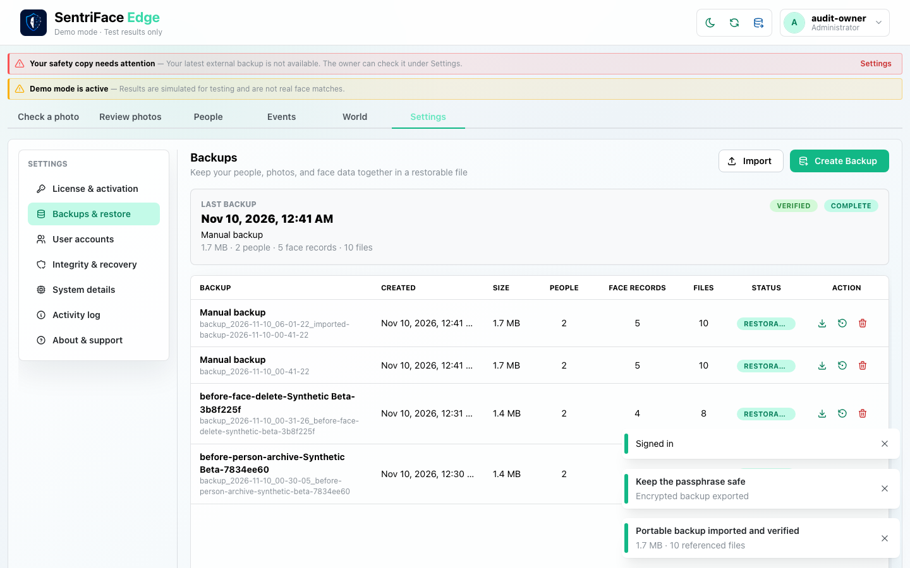
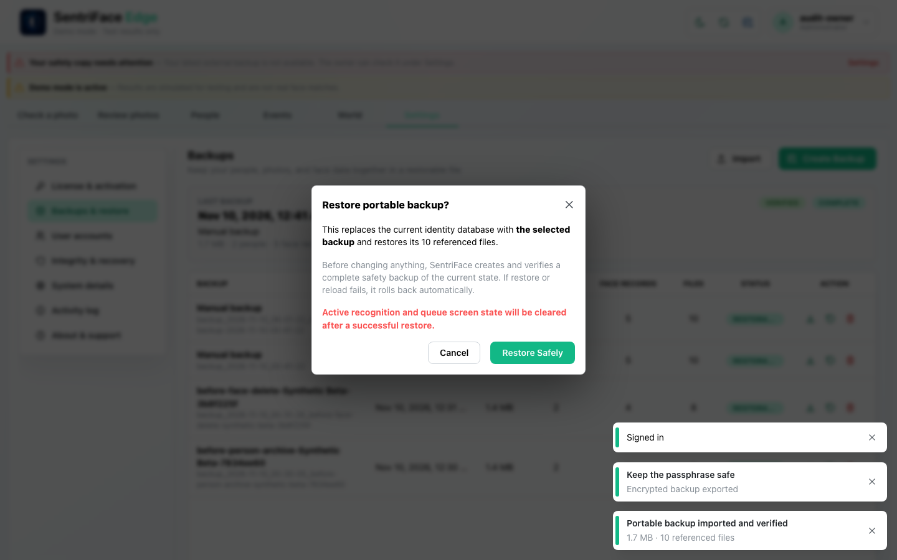
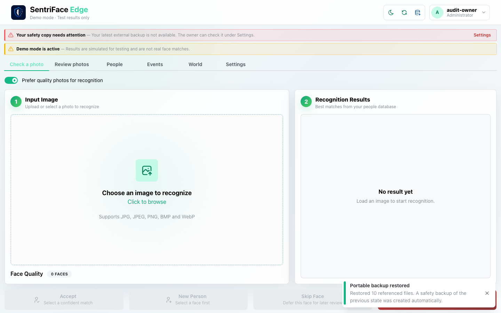

# J22 — Portable backup, encrypted export and import validation

[Audit index](../INDEX.md) · [Source oracle](../source-map.md) · [Independent review](../review.md)

**Scope result: PARTIAL.** This record proves only the ordered observations below; source-contract branches outside them are not silently passed. Source tasks: [SJ-050](../source-journeys.csv), [SJ-051](../source-journeys.csv), [SJ-052](../source-journeys.csv), [SJ-059](../source-journeys.csv).

**Operator goal:** Create a complete disposable backup, export it encrypted and test import validation through actual controls.

**Starting state and required role:** Administrator has backups/database_restore capabilities. Two automatic safety backups already exist from destructive fixture operations. All authority and media are synthetic; encrypted exports stay private. All captures in this record use the disposable Administrator unless a step explicitly says unauthenticated.

**Implemented owners:** [`SentriFaceApp.jsx`](../../../frontend/src/SentriFaceApp.jsx); [`views/DebugView.jsx::DatabaseBackupsPanel`](../../../frontend/src/views/DebugView.jsx); [`hooks/useAppData.js`](../../../frontend/src/hooks/useAppData.js).

**Evidence basis:** saved current-run screenshots, capture metadata and accessibility snapshots. Visual acceptance is documented in the independent review; this assembly does not claim a second independent visual inspection. Synthetic images are generated patterns, not biometric photographs. No source/UI manipulation produces these states.

**Source:** `b457f0a723e845dd1a92a07a577072c85146c89a`. Capture sequence numbers order the captured states; uncaptured return actions are named in the text. The audit was interrupted and resumed across November 5 and 10 at the same source SHA.

## Ordered interaction and visual evidence

### Step 01 — Quick backup confirm

Choose Create backup now in the header. The complete portable-backup confirmation describes database and referenced media verification; Cancel follows.

Capture: `UX-13` · Administrator · light theme · 1440×900 CSS viewport · DPR 1 · `2026-11-10T08:40:57.211532+00:00` · fixture: synthetic.

Scroll recorded: x=0, y=80.

### Step 02 — Backups populated

Choose Backups & restore. Existing verified safety backups are listed with complete/restorable status.

Capture: `UX-13` · Administrator · light theme · 1440×900 CSS viewport · DPR 1 · `2026-11-10T08:40:58.283585+00:00` · fixture: synthetic.

Scroll recorded: x=0, y=80.

### Step 03 — New backup created

Choose Create Backup in Settings. A new manual backup appears and “Portable backup created” reports 10 referenced files.

Capture: `UX-13` · Administrator · light theme · 1440×900 CSS viewport · DPR 1 · `2026-11-10T08:41:23.292745+00:00` · fixture: synthetic.

Scroll recorded: x=0, y=80.

### Step 04 — Export passphrase dialog

Choose the newest Download backup action. Export encrypted backup opens with empty passphrase/confirmation inputs and disabled download.

Capture: `UX-13` · Administrator · light theme · 1440×900 CSS viewport · DPR 1 · `2026-11-10T08:41:23.810114+00:00` · fixture: synthetic.

Scroll recorded: x=0, y=80.

### Step 05 — Export mismatch

Enter nonmatching passphrase values. Private evidence captures disabled/mismatch validation; no credential text is published.

**Private evidence retained; no public image.** This state is withheld for path/credential privacy or is a rejected capture label. Its existence does not imply a successful workflow outcome.

Capture: `UX-13` · Administrator · light theme · 1440×900 CSS viewport · DPR 1 · `2026-11-10T08:41:54.272756+00:00` · fixture: synthetic.

Scroll recorded: x=0, y=80.

### Step 06 — Encrypted export completed

Use matching values and Download encrypted backup. The dialog closes and “Encrypted backup exported” is observed; the actual encrypted file remains private.

Capture: `UX-13` · Administrator · light theme · 1440×900 CSS viewport · DPR 1 · `2026-11-10T08:41:55.405198+00:00` · fixture: synthetic.

Scroll recorded: x=0, y=80.

### Step 07 — Import unlock dialog

Select that encrypted file through Import. Unlock encrypted backup opens and requests its passphrase.

Capture: `UX-13` · Administrator · light theme · 1440×900 CSS viewport · DPR 1 · `2026-11-10T08:41:55.892064+00:00` · fixture: synthetic.

Scroll recorded: x=0, y=80.

### Step 08 — Wrong passphrase error

Submit an intentionally wrong disposable passphrase. Import is refused with “Incorrect passphrase or encrypted backup is damaged”; no successful import is inferred from this frame.

**Private evidence retained; no public image.** This state is withheld for path/credential privacy or is a rejected capture label. Its existence does not imply a successful workflow outcome.

Capture: `UX-13` · Administrator · light theme · 1440×900 CSS viewport · DPR 1 · `2026-11-10T08:42:17.430020+00:00` · fixture: synthetic.

Scroll recorded: x=0, y=80.

### Step 09 — Import retry result

Re-export with a fresh private passphrase, import that encrypted file and unlock it correctly. “Portable backup imported and verified” is visible; the imported archive stays private.

Capture: `UX-13` · Administrator · light theme · 1440×900 CSS viewport · DPR 1 · `2026-11-10T14:01:22.832266+00:00` · fixture: synthetic.

Scroll recorded: x=0, y=0.

### Step 10 — Restore confirmation

Choose Restore on the imported/restorable backup. The Restore portable backup? confirmation explains replacement, verified safety backup, rollback and screen-state clearing. This frame is not restore success.

Capture: `UX-13` · Administrator · light theme · 1440×900 CSS viewport · DPR 1 · `2026-11-10T14:01:23.355911+00:00` · fixture: synthetic.

Scroll recorded: x=0, y=0.

### Step 11 — Restore result

Choose Restore Safely and wait for the actual operation result. “Portable backup restored” reports 10 referenced files restored and an automatically created safety backup of the previous state. This is the observed success feedback; independent post-restore counts are reported separately by the coordinator.

Capture: `UX-13` · Administrator · light theme · 1440×900 CSS viewport · DPR 1 · `2026-11-10T14:01:57.584345+00:00` · fixture: synthetic.

Scroll recorded: x=0, y=0.

## Outcome, authority and return path

The header backup confirmation is cancelled; a manual backup is then created from Settings and listed Restorable. Encrypted export completes. Wrong-passphrase import is refused. Retrying with a newly exported file and its correct private passphrase produces “Portable backup imported and verified”. The subsequent Restore Safely operation reports “Portable backup restored” and 10 referenced files restored, with an automatic safety backup of the displaced state. This is a same-authority synthetic restore; it is not a fresh-machine or independent external-backup qualification.

## Limits and unexecuted branches

No independent external backup is established. Password/credential-filled originals are withheld. Incomplete/legacy backup eligibility, interrupted create/export/import, corrupt closure, fresh-authority import and restore rollback are not exercised here. Backup files/databases/passphrases are not public artifacts.

No redesign or implementation is specified by this record. Findings and recommended directions belong to the shared audit review and canonical design authority.
