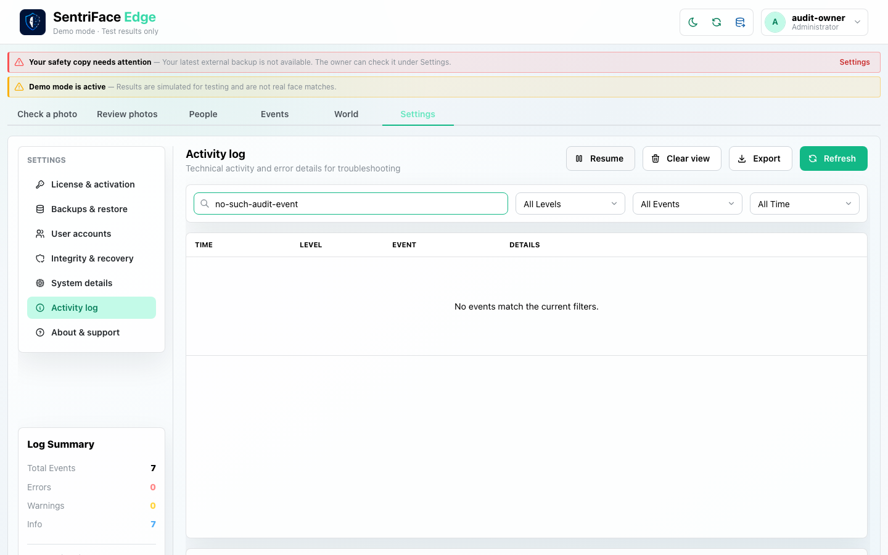
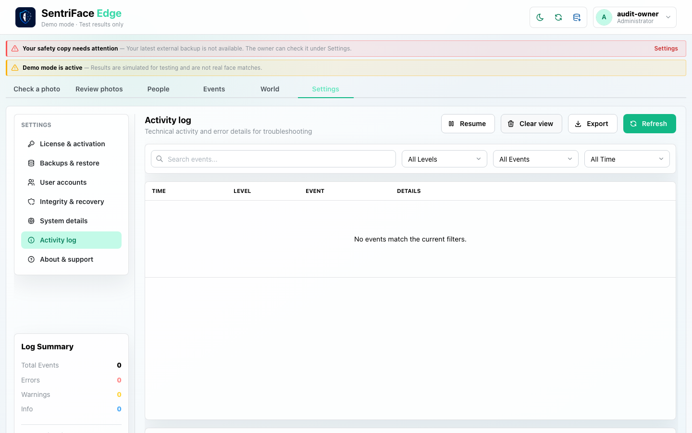
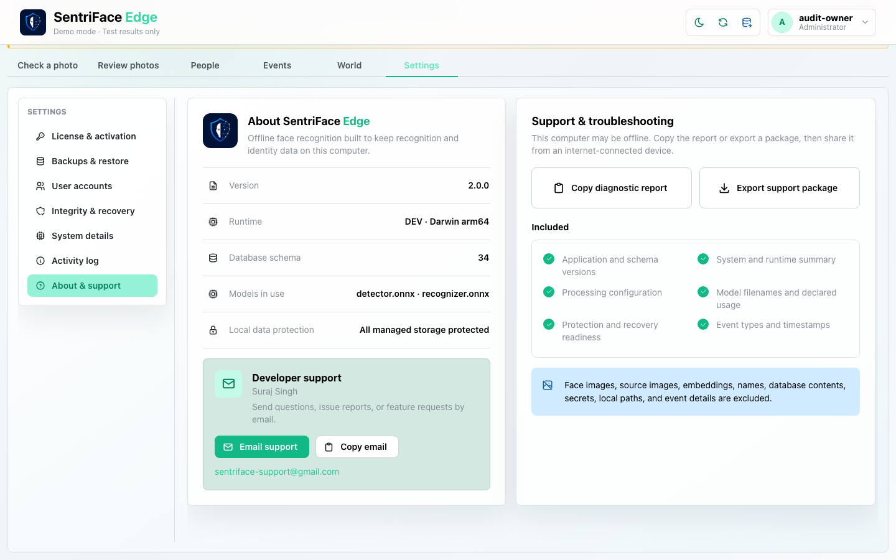
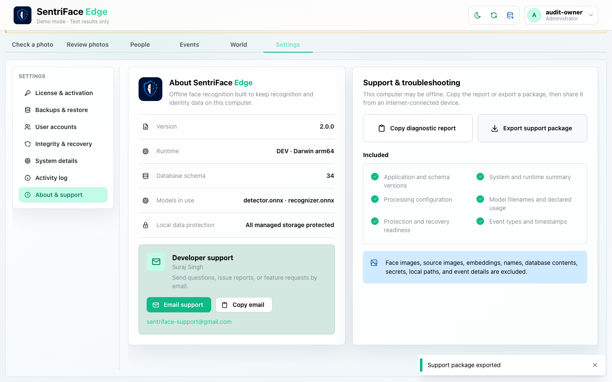

# J23 — System facts, Activity log and support export

[Audit index](../INDEX.md) · [Source oracle](../source-map.md) · [Independent review](../review.md)

**Scope result: PARTIAL.** Source tasks: SJ-056,SJ-057,SJ-058. Only the following observations are qualified; full source-contract branches remain in [the execution ledger](../source-branches.csv).

**Operator goal and entry:** System facts, Activity log and support export. Inspect Settings sections. Pause the log, search for a nonexistent event, clear only the view, refresh, then export the support package.

**Starting state / role:** Administrator; technical capability; synthetic audit authority.

**Source:** `b457f0a723e845dd1a92a07a577072c85146c89a`. Captures were interrupted/resumed at this same product source. Synthetic means generated non-biometric patterns, not ONNX inference.

## Interaction sequence and authority

1. From Settings, select System and inspect facts (step 1); select Activity log, then Pause (steps 2–3). These frames include local environment/log context and are deliberately private.
2. Search for a nonexistent log event (step 4), then clear the displayed view (step 5). This exercises the empty result and cleared-view states, not deletion of the underlying log authority.
3. Open About (step 6); trigger the existing support export (step 7). The observed toast says **Support package exported** and the browser receives a download. The package itself stays private.
4. Ordinary Settings navigation returns to the other sections. No support message was sent. Package content privacy, export-failure/retry and restart persistence are unverified.

## Step 01 — System details private

Private original retained outside Git; no public screenshot.

Capture: UX-13 · Administrator · light · 1440×900 CSS viewport · DPR 1 · `2026-11-10T14:02:40.310749+00:00` · synthetic.

Scroll: x=0, y=0.

## Step 02 — Activity log private

Private original retained outside Git; no public screenshot.

Capture: UX-13 · Administrator · light · 1440×900 CSS viewport · DPR 1 · `2026-11-10T14:02:41.104305+00:00` · synthetic.

Scroll: x=0, y=0.

## Step 03 — Log paused private

Private original retained outside Git; no public screenshot.

Capture: UX-13 · Administrator · light · 1440×900 CSS viewport · DPR 1 · `2026-11-10T14:03:36.913351+00:00` · synthetic.

Scroll: x=0, y=0.

## Step 04 — Log search empty

Capture: UX-13 · Administrator · light · 1440×900 CSS viewport · DPR 1 · `2026-11-10T14:03:37.348222+00:00` · synthetic.

Scroll: x=0, y=0.

## Step 05 — Log cleared view

Capture: UX-13 · Administrator · light · 1440×900 CSS viewport · DPR 1 · `2026-11-10T14:03:38.084304+00:00` · synthetic.

Scroll: x=0, y=0.

## Step 06 — About support

Capture: UX-13 · Administrator · light · 1440×900 CSS viewport · DPR 1 · `2026-11-10T14:03:39.079917+00:00` · synthetic.

Scroll: x=0, y=80.

## Step 07 — Support export feedback

Capture: UX-13 · Administrator · light · 1440×900 CSS viewport · DPR 1 · `2026-11-10T14:06:01.182741+00:00` · synthetic.

Scroll: x=0, y=80.

## Outcome, authority, return and limits

System details and populated/paused logs stay private. Empty search/cleared view and About/export feedback are safe. No email was sent. A downloaded support package is not an independently audited privacy guarantee.

Navigation/read controls do not create authoritative identity or occurrence state. Mutations above use existing product commands. Return paths and later-session results are only claimed where ordered evidence or explicit checks demonstrate them. Missing cancellation, failure, stale, role or restart branches remain visible in the source execution ledger.

## macOS completion pass 2 — continuation C

Source product `b457f0a723e845dd1a92a07a577072c85146c89a`; disposable authority; 1440×900 browser-content viewport, DPR 1, Day, Administrator.

On the disposable authority, choose Warning level (empty), queue-scan event type, Last 1 hour, and page size 10; submit a no-match search and invoke Export. The browser reported an actual JSONL download. Log frames and exported contents are private; the small event sample did not qualify pagination or a contrasting time exclusion.

### Step 08 — Pass2 Activity log start

Private original: technical activity log; no log content published.

Captured `2026-11-11T13:28:10.595040+00:00` · Administrator · UX-13 · synthetic fixture · scroll {'x': 0, 'y': 0}.

### Step 09 — Pass2 Activity warning filter empty

Private original: technical activity log; no log content published.

Captured `2026-11-11T13:28:22.995750+00:00` · Administrator · UX-13 · synthetic fixture · scroll {'x': 0, 'y': 0}.

### Step 10 — Pass2 Activity event type filter

Private original: technical activity log; no log content published.

Captured `2026-11-11T13:28:27.439504+00:00` · Administrator · UX-13 · synthetic fixture · scroll {'x': 0, 'y': 0}.

### Step 11 — Pass2 Activity time filter

Private original: technical activity log; no log content published.

Captured `2026-11-11T13:28:32.148913+00:00` · Administrator · UX-13 · synthetic fixture · scroll {'x': 0, 'y': 0}.

### Step 12 — Pass2 Activity page size ten

Private original: technical activity log; no log content published.

Captured `2026-11-11T13:28:36.823746+00:00` · Administrator · UX-13 · synthetic fixture · scroll {'x': 0, 'y': 80}.

### Step 13 — Pass2 Activity search empty

Private original: technical activity log; no log content published.

Captured `2026-11-11T13:28:37.453380+00:00` · Administrator · UX-13 · synthetic fixture · scroll {'x': 0, 'y': 80}.

### Step 14 — Pass2 Activity export triggered

Private original: technical activity log; no log content published.

Captured `2026-11-11T13:28:55.326194+00:00` · Administrator · UX-13 · synthetic fixture · scroll {'x': 0, 'y': 80}.
