# J24 — Role and capability boundaries

[Audit index](../INDEX.md) · [Source oracle](../source-map.md) · [Independent review](../review.md)

**Scope result: PARTIAL.** Source tasks: SJ-005,SJ-021,SJ-024,SJ-038,SJ-053. Only the following observations are qualified; full source-contract branches remain in [the execution ledger](../source-branches.csv).

**Operator goal and entry:** Role and capability boundaries. Sign in as each non-admin role, browse People/profile/Events, and inspect available Settings/backup actions.

**Starting state / role:** Viewer, Operator, Custodian, Technician; separate real local logins at1280×800 Day.

**Source:** `b457f0a723e845dd1a92a07a577072c85146c89a`. Captures were interrupted/resumed at this same product source. Synthetic means generated non-biometric patterns, not ONNX inference.

## Interaction sequence and authority

1. Use the five accounts established in J20. Sign in independently as Viewer, then open People and a profile. Clicking the visibly enabled Favorite control produces a server-denial toast (steps 1–3, repeated at steps 4–6); open Events for its restricted action surface (step 7).
2. Sign in as Operator and inspect shell, profile and Event actions (steps 8–10). Sign in as Custodian and inspect those surfaces plus Settings and backup actions (steps 11–15). Repeat as Technician (steps 16–20). Administrator is covered by the surrounding journeys.
3. Independent requests test one forbidden operation per non-admin role: Viewer `/api/person-update`, Operator `/api/integrity/check`, Custodian `/api/users`, Technician `/api/person-update`. Each returned HTTP 403; see [the separate result](../checks/role-checks.json). These are not UI screenshots or a comprehensive permission proof.
4. Return between roles by ordinary sign-out/sign-in. No denied update is treated as a successful change. The repeated Viewer frames are repeated attempts, not additional distinct behavior.

## Step 01 — viewer shell

Capture: UX-01 · Viewer · light · 1280×800 CSS viewport · DPR 1 · `2026-11-10T14:03:40.147184+00:00` · synthetic.

Scroll: x=0, y=0.

## Step 02 — viewer profile

[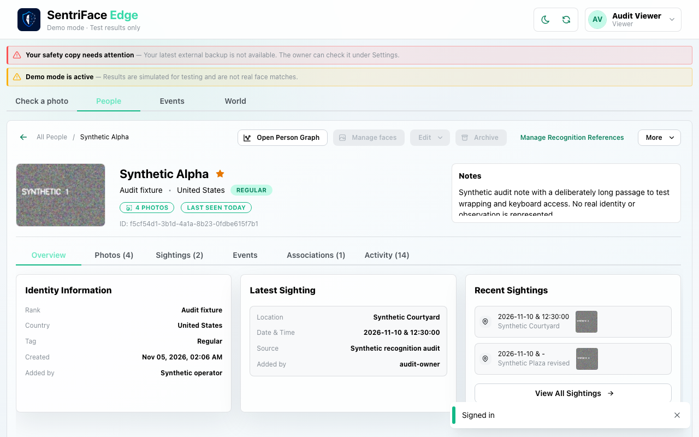](../screenshots/UX-06/UX-06_J24_Step-02_viewer-profile.png)

Capture: UX-06 · Viewer · light · 1280×800 CSS viewport · DPR 1 · `2026-11-10T14:03:41.225057+00:00` · synthetic.

Scroll: x=0, y=0.

## Step 03 — viewer favorite server denial

[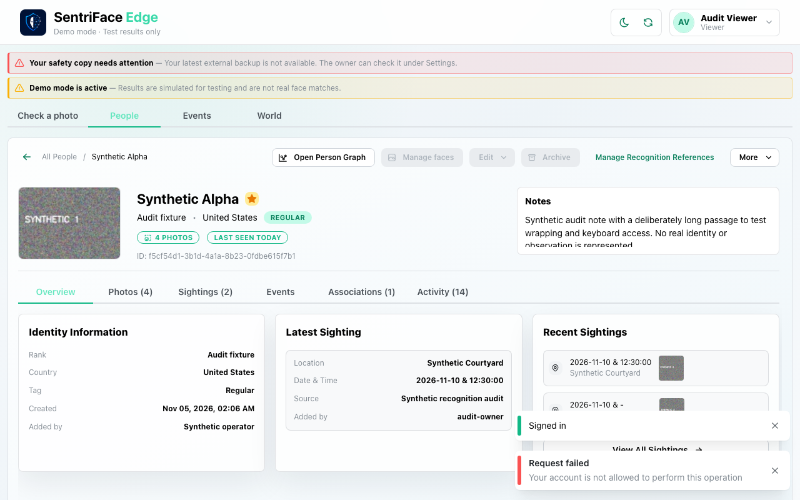](../screenshots/UX-07/UX-07_J24_Step-03_viewer-favorite-server-denial.png)

Capture: UX-07 · Viewer · light · 1280×800 CSS viewport · DPR 1 · `2026-11-10T14:03:41.949984+00:00` · synthetic.

Scroll: x=0, y=0.

## Step 04 — viewer shell

Capture: UX-01 · Viewer · light · 1280×800 CSS viewport · DPR 1 · `2026-11-10T14:04:40.662556+00:00` · synthetic.

Scroll: x=0, y=0.

## Step 05 — viewer profile

Capture: UX-06 · Viewer · light · 1280×800 CSS viewport · DPR 1 · `2026-11-10T14:04:41.749051+00:00` · synthetic.

Scroll: x=0, y=0.

## Step 06 — viewer favorite server denial

Capture: UX-07 · Viewer · light · 1280×800 CSS viewport · DPR 1 · `2026-11-10T14:04:42.477942+00:00` · synthetic.

Scroll: x=0, y=0.

## Step 07 — viewer event actions

[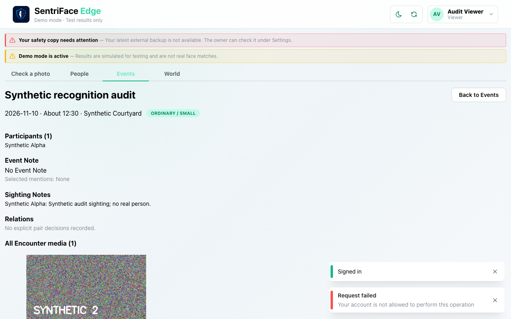](../screenshots/UX-09/UX-09_J24_Step-07_viewer-event-actions.png)

Capture: UX-09 · Viewer · light · 1280×800 CSS viewport · DPR 1 · `2026-11-10T14:04:43.247864+00:00` · synthetic.

Scroll: x=0, y=0.

## Step 08 — operator shell

[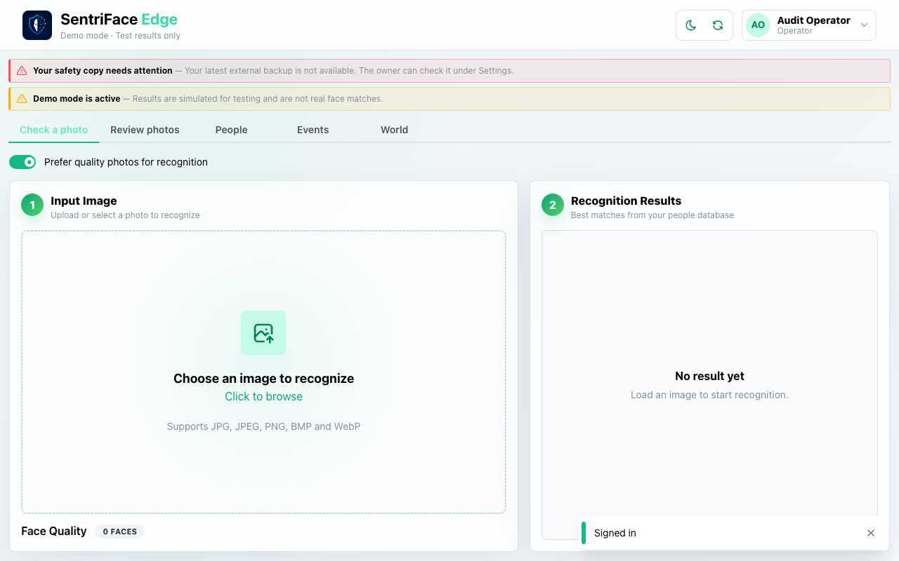](../screenshots/UX-01/UX-01_J24_Step-08_operator-shell.png)

Capture: UX-01 · Operator · light · 1280×800 CSS viewport · DPR 1 · `2026-11-10T14:04:44.203595+00:00` · synthetic.

Scroll: x=0, y=0.

## Step 09 — operator profile

[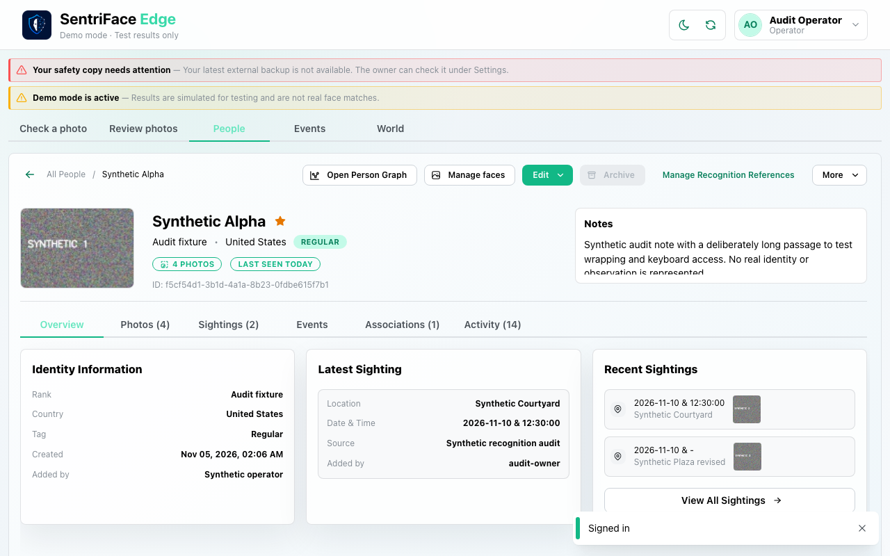](../screenshots/UX-06/UX-06_J24_Step-09_operator-profile.png)

Capture: UX-06 · Operator · light · 1280×800 CSS viewport · DPR 1 · `2026-11-10T14:04:45.251749+00:00` · synthetic.

Scroll: x=0, y=0.

## Step 10 — operator event actions

[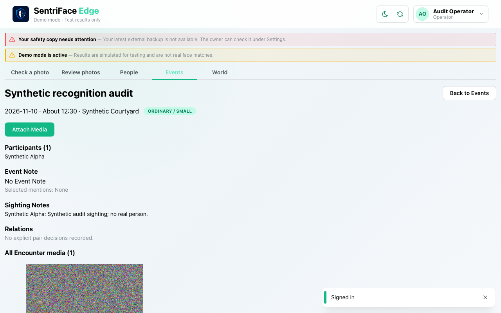](../screenshots/UX-09/UX-09_J24_Step-10_operator-event-actions.png)

Capture: UX-09 · Operator · light · 1280×800 CSS viewport · DPR 1 · `2026-11-10T14:04:46.056799+00:00` · synthetic.

Scroll: x=0, y=0.

## Step 11 — custodian shell

[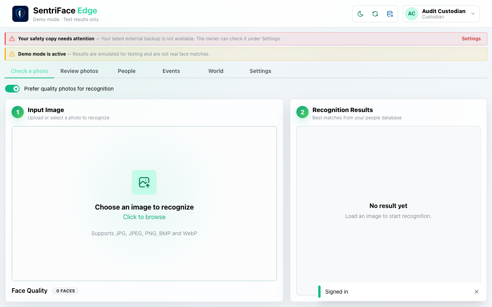](../screenshots/UX-01/UX-01_J24_Step-11_custodian-shell.png)

Capture: UX-01 · Custodian · light · 1280×800 CSS viewport · DPR 1 · `2026-11-10T14:04:47.027996+00:00` · synthetic.

Scroll: x=0, y=0.

## Step 12 — custodian profile

[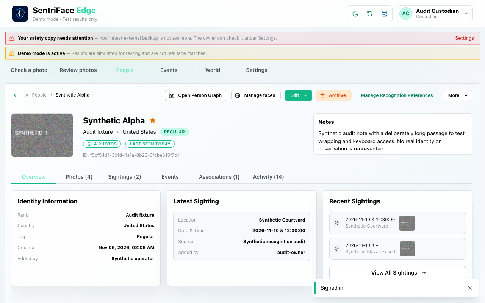](../screenshots/UX-06/UX-06_J24_Step-12_custodian-profile.png)

Capture: UX-06 · Custodian · light · 1280×800 CSS viewport · DPR 1 · `2026-11-10T14:04:48.056322+00:00` · synthetic.

Scroll: x=0, y=0.

## Step 13 — custodian event actions

[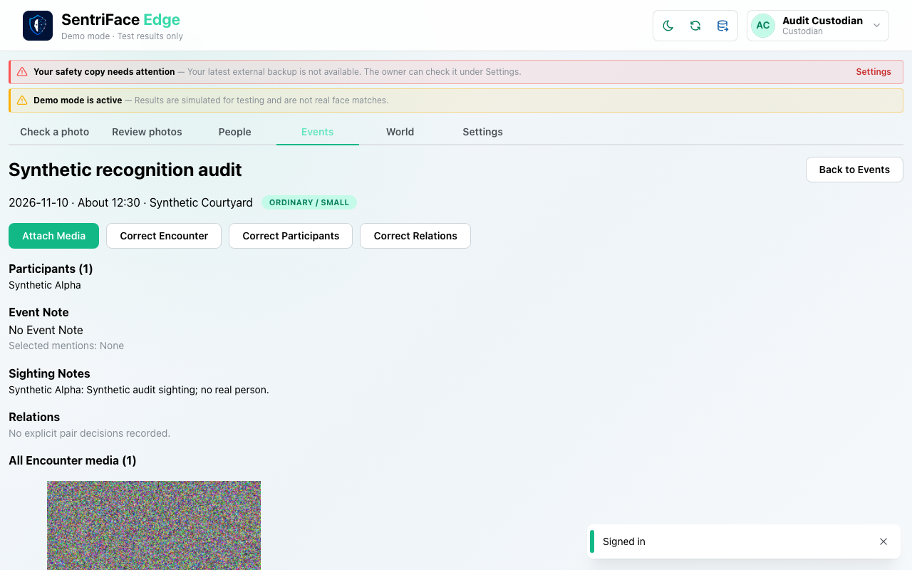](../screenshots/UX-09/UX-09_J24_Step-13_custodian-event-actions.png)

Capture: UX-09 · Custodian · light · 1280×800 CSS viewport · DPR 1 · `2026-11-10T14:04:48.813166+00:00` · synthetic.

Scroll: x=0, y=0.

## Step 14 — custodian settings

[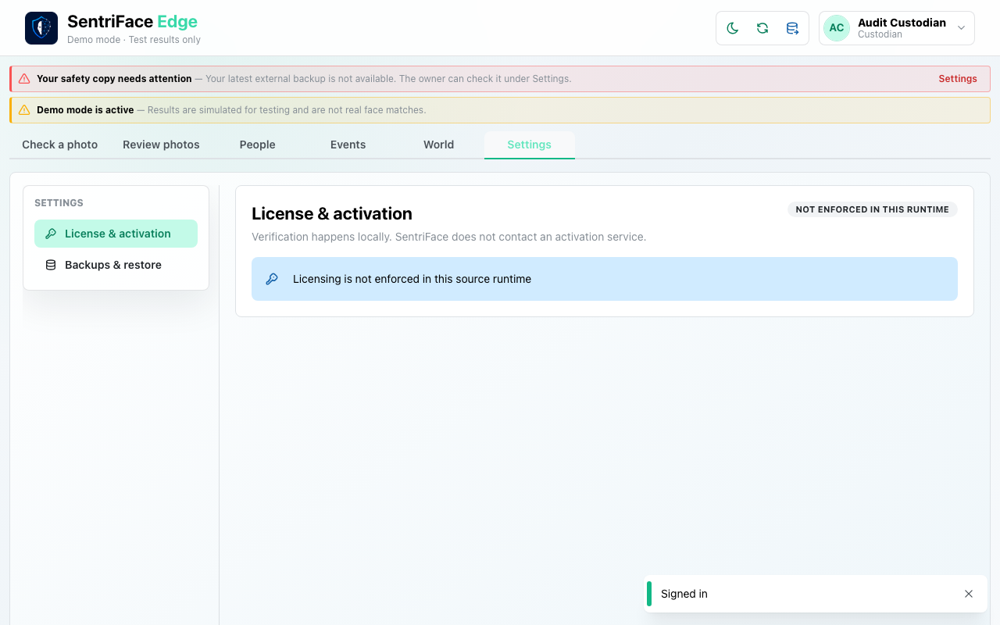](../screenshots/UX-13/UX-13_J24_Step-14_custodian-settings.png)

Capture: UX-13 · Custodian · light · 1280×800 CSS viewport · DPR 1 · `2026-11-10T14:04:49.515590+00:00` · synthetic.

Scroll: x=0, y=0.

## Step 15 — custodian backup actions

[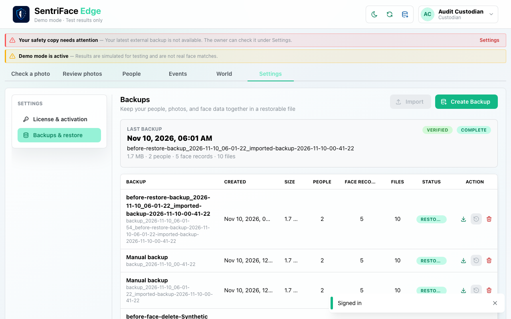](../screenshots/UX-13/UX-13_J24_Step-15_custodian-backup-actions.png)

Capture: UX-13 · Custodian · light · 1280×800 CSS viewport · DPR 1 · `2026-11-10T14:04:50.207488+00:00` · synthetic.

Scroll: x=0, y=0.

## Step 16 — technician shell

[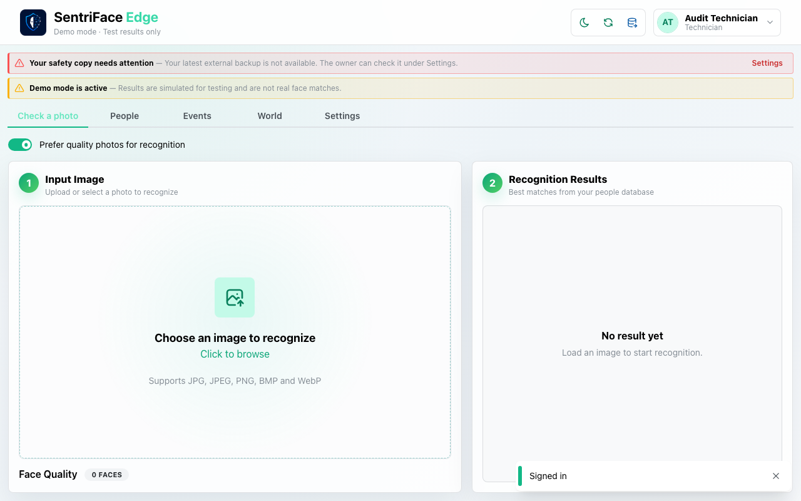](../screenshots/UX-01/UX-01_J24_Step-16_technician-shell.png)

Capture: UX-01 · Technician · light · 1280×800 CSS viewport · DPR 1 · `2026-11-10T14:04:51.168936+00:00` · synthetic.

Scroll: x=0, y=0.

## Step 17 — technician profile

[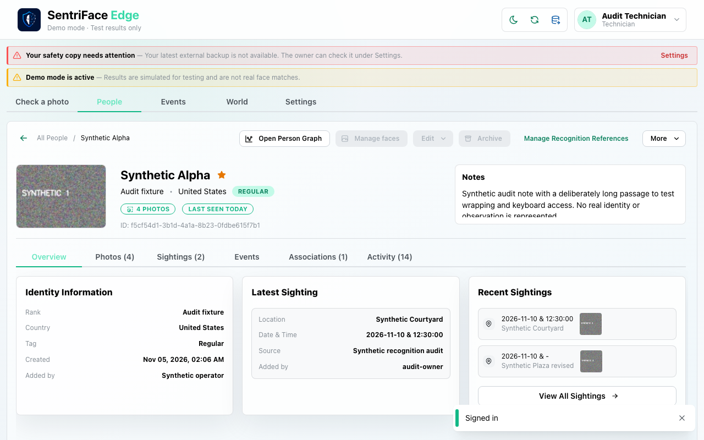](../screenshots/UX-06/UX-06_J24_Step-17_technician-profile.png)

Capture: UX-06 · Technician · light · 1280×800 CSS viewport · DPR 1 · `2026-11-10T14:04:52.196519+00:00` · synthetic.

Scroll: x=0, y=0.

## Step 18 — technician event actions

[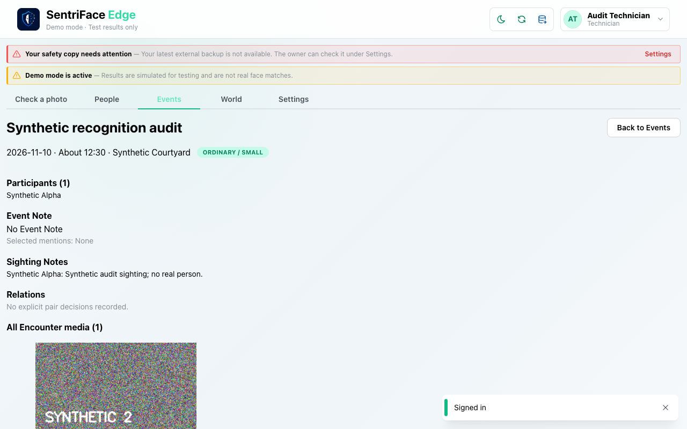](../screenshots/UX-09/UX-09_J24_Step-18_technician-event-actions.png)

Capture: UX-09 · Technician · light · 1280×800 CSS viewport · DPR 1 · `2026-11-10T14:04:52.954075+00:00` · synthetic.

Scroll: x=0, y=0.

## Step 19 — technician settings

[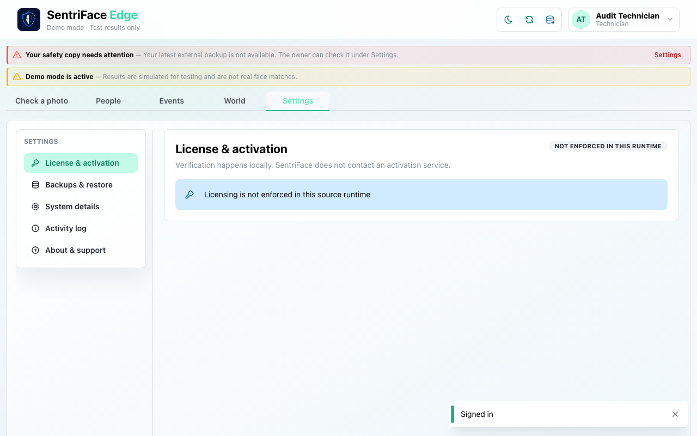](../screenshots/UX-13/UX-13_J24_Step-19_technician-settings.png)

Capture: UX-13 · Technician · light · 1280×800 CSS viewport · DPR 1 · `2026-11-10T14:04:53.627485+00:00` · synthetic.

Scroll: x=0, y=0.

## Step 20 — technician backup actions

[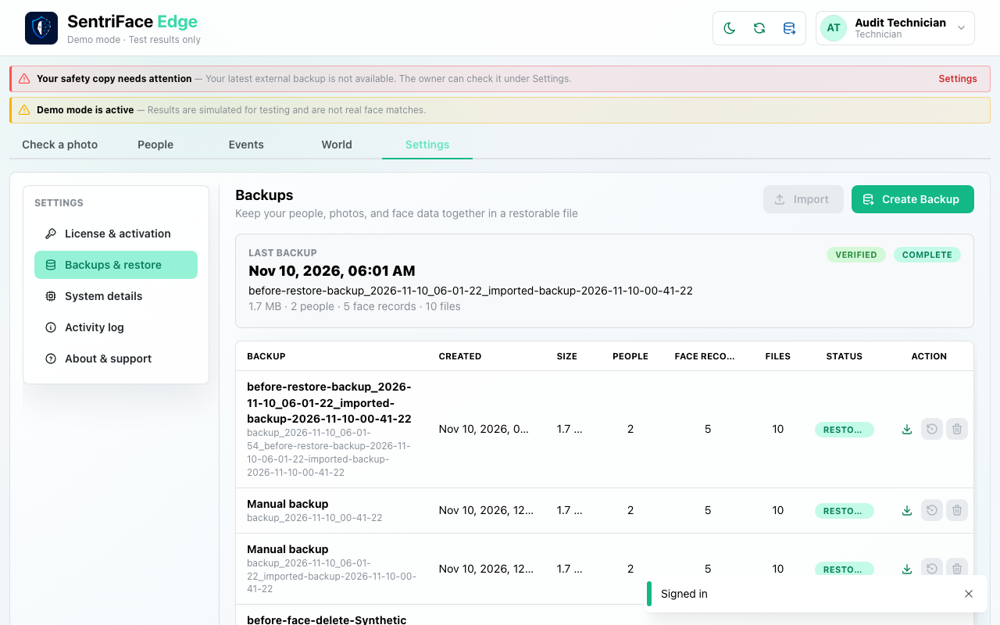](../screenshots/UX-13/UX-13_J24_Step-20_technician-backup-actions.png)

Capture: UX-13 · Technician · light · 1280×800 CSS viewport · DPR 1 · `2026-11-10T14:04:54.307845+00:00` · synthetic.

Scroll: x=0, y=0.

## Outcome, authority, return and limits

The four independent forbidden HTTP operations returned403 (checks/role-checks.json). They are API checks, not fabricated UI messages. Viewer Favorite is visibly enabled and produces a real denial toast. First three Viewer captures repeat the later Viewer attempt and are not three additional unique states. Administrator is the main audit role. No full per-command authorization audit is claimed.

Navigation/read controls do not create authoritative identity or occurrence state. Mutations above use existing product commands. Return paths and later-session results are only claimed where ordered evidence or explicit checks demonstrate them. Missing cancellation, failure, stale, role or restart branches remain visible in the source execution ledger.

## macOS completion pass 2 — ordered continuation

**Status: PARTIAL overall.** Source remains `b457f0a723e845dd1a92a07a577072c85146c89a`; pass-one checkpoint `27a0532123389421b5cfdc5d0331eb1793e74c78` remains unchanged in history. Synthetic source mode and a dedicated disposable authority; 1440×900 CSS viewport, DPR 1, Day, Administrator unless the capture register says unauthenticated.

In a fresh unauthenticated browser, open sign-in, submit an invalid disposable password, then sign in successfully. Open the account menu and sign out. The menu frame caught its opening animation; the sign-out frame still shows a lingering earlier Signed in toast. The underlying sign-in form and Signed out text in the runtime snapshot establish the return. Session expiry is separate and remains untested.

### Step 21 — Pass2 Sign in start

[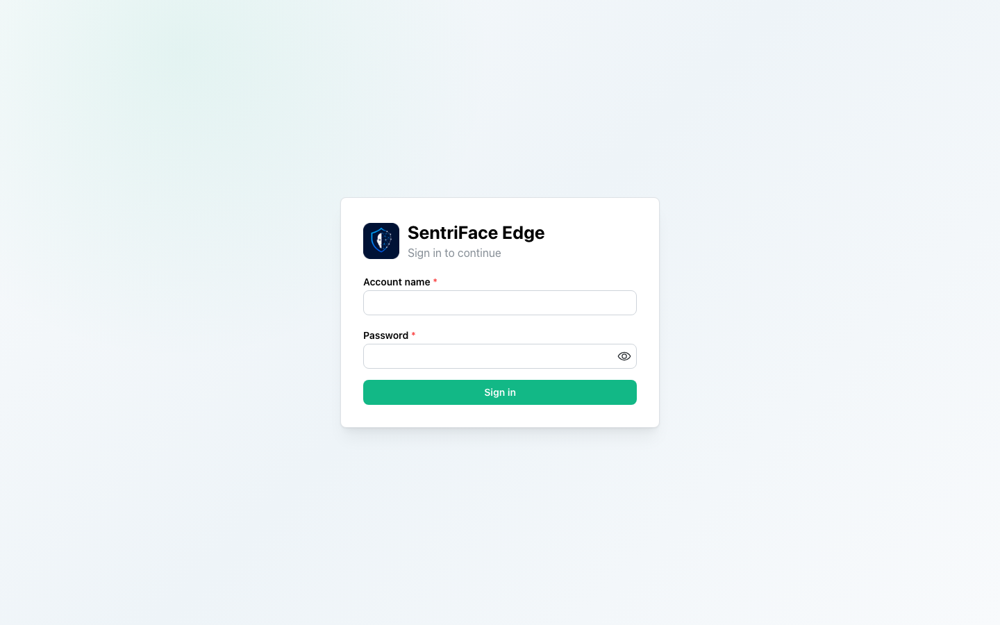](../screenshots/UX-00/UX-00_J24_Step-21_Pass2-Sign-in-start.png)

Capture `2026-11-11T06:11:52.820096+00:00` · Unauthenticated · UX-00 · synthetic · scroll {'x': 0, 'y': 0}. Full browser viewport, not native window chrome.

### Step 22 — Pass2 Invalid sign in

[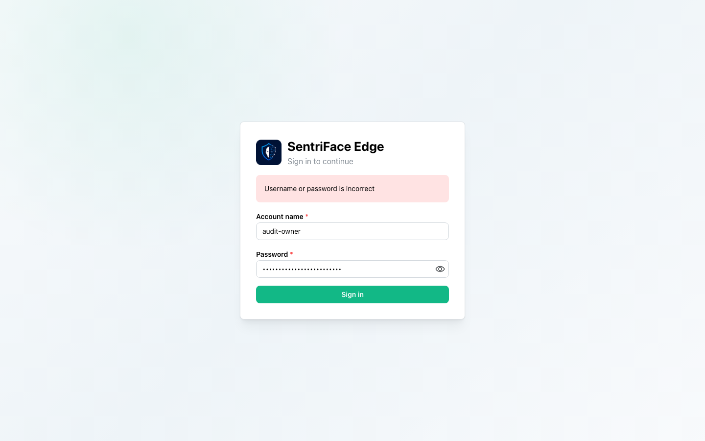](../screenshots/UX-00/UX-00_J24_Step-22_Pass2-Invalid-sign-in.png)

Capture `2026-11-11T06:12:40.871650+00:00` · Unauthenticated · UX-00 · synthetic · scroll {'x': 0, 'y': 0}. Full browser viewport, not native window chrome.

### Step 23 — Pass2 Signed in

[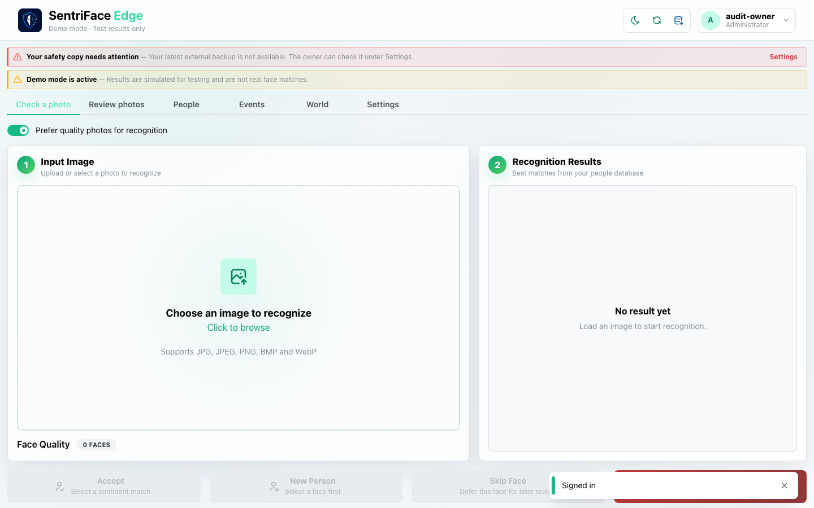](../screenshots/UX-00/UX-00_J24_Step-23_Pass2-Signed-in.png)

Capture `2026-11-11T06:12:41.359624+00:00` · Administrator · UX-00 · synthetic · scroll {'x': 0, 'y': 0}. Full browser viewport, not native window chrome.

### Step 24 — Pass2 Account menu before sign out

[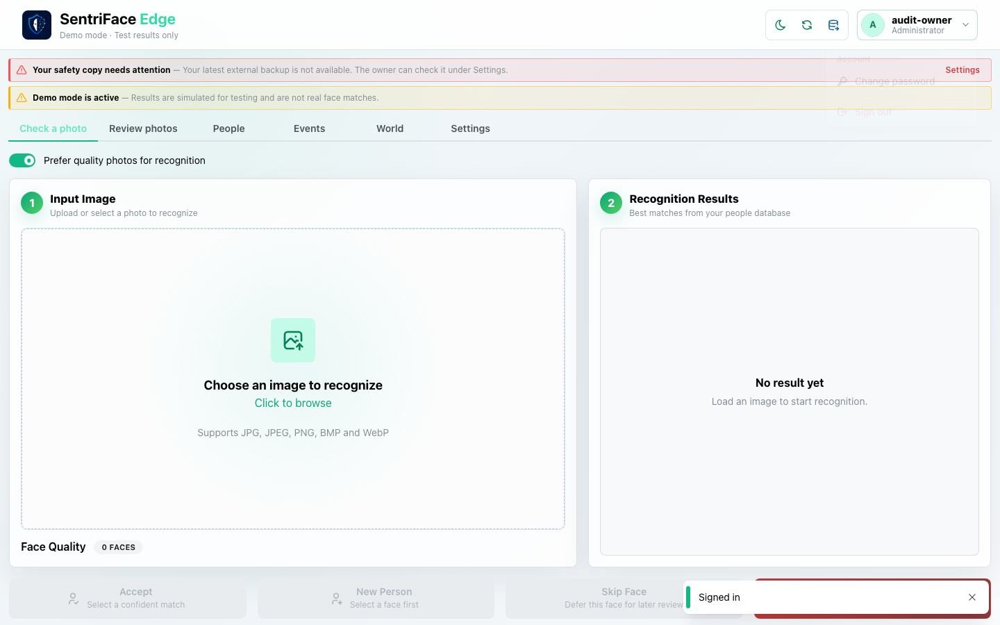](../screenshots/UX-00/UX-00_J24_Step-24_Pass2-Account-menu-before-sign-out.png)

Capture `2026-11-11T06:13:16.452914+00:00` · Administrator · UX-00 · synthetic · scroll {'x': 0, 'y': 0}. Full browser viewport, not native window chrome.

### Step 25 — Pass2 Signed out

[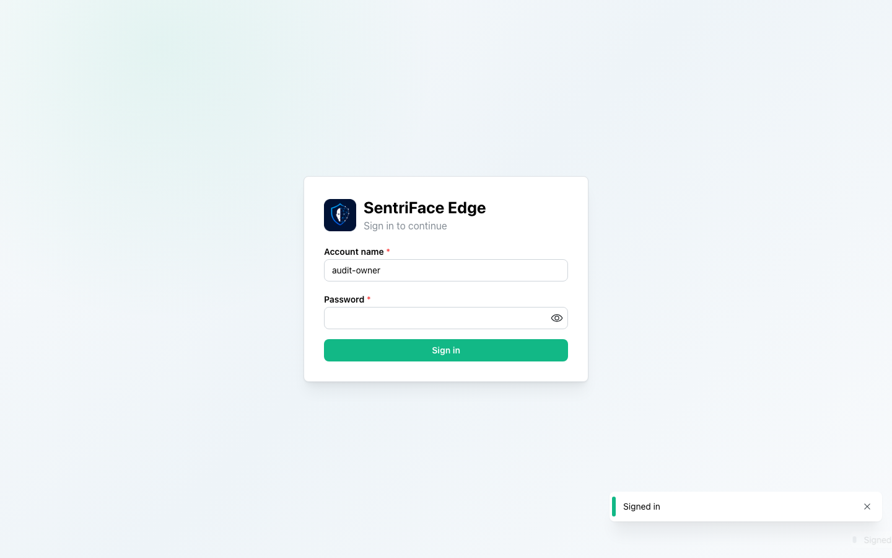](../screenshots/UX-00/UX-00_J24_Step-25_Pass2-Signed-out.png)

Capture `2026-11-11T06:13:16.726591+00:00` · Unauthenticated · UX-00 · synthetic · scroll {'x': 0, 'y': 0}. Full browser viewport, not native window chrome.

## macOS completion pass 2 — continuation B

Source product `b457f0a723e845dd1a92a07a577072c85146c89a`; full browser-content screenshots, 1440×900 CSS pixels, DPR 1, Day; dedicated disposable authority. See capture register for exact role, capture time and inference qualification.

Signing out in one tab revoked the other; refreshing it required sign-in and reauthentication succeeded. Separately, a controlled stop and restart of only the disposable backend produced “Failed to fetch”, then “SentriFace session authorization is required”. Browser reload returned to sign-in and authentication restored the collection; the refresh button alone did not transition automatically. This is not a natural idle-expiry test.

### Step 26 — Pass2 Stale second tab before refresh

[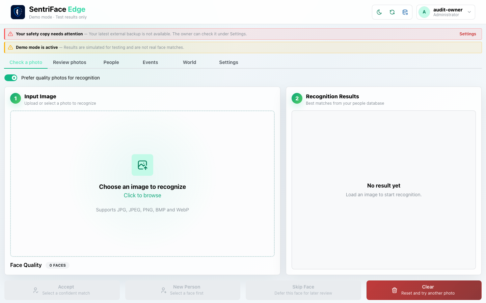](../screenshots/UX-01/UX-01_J24_Step-26_Pass2-Stale-second-tab-before-refresh.png)

Captured `2026-11-11T10:58:05.607555+00:00` · Administrator · UX-01 · scroll {'x': 0, 'y': 0}. Exact fixture and inference mode are described above and in the capture register.

### Step 27 — Pass2 Stale session refresh response

[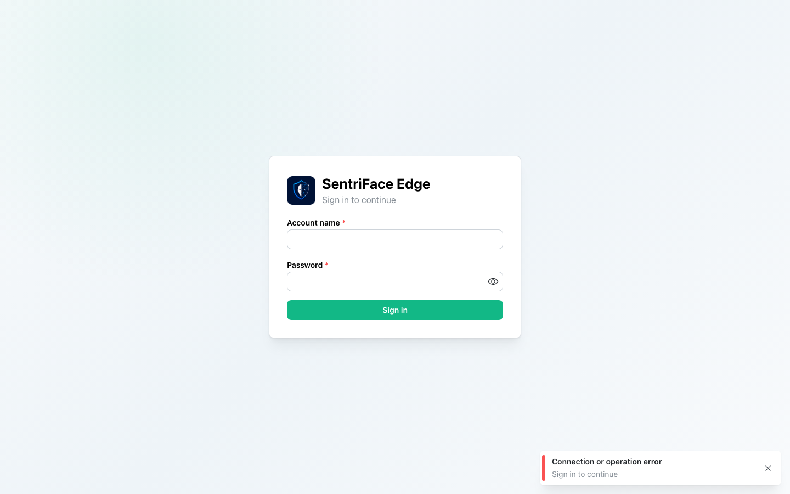](../screenshots/UX-00/UX-00_J24_Step-27_Pass2-Stale-session-refresh-response.png)

Captured `2026-11-11T10:58:07.759512+00:00` · Unauthenticated · UX-00 · scroll {'x': 0, 'y': 0}. Exact fixture and inference mode are described above and in the capture register.

### Step 28 — Pass2 Reauthenticated after session revocation

[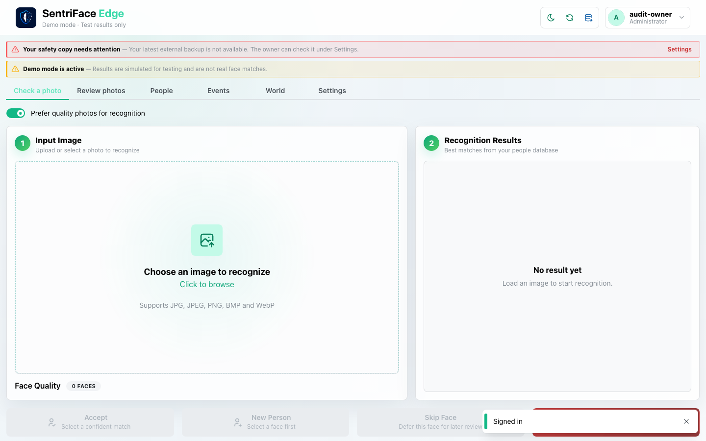](../screenshots/UX-01/UX-01_J24_Step-28_Pass2-Reauthenticated-after-session-revocation.png)

Captured `2026-11-11T10:58:22.087852+00:00` · Administrator · UX-01 · scroll {'x': 0, 'y': 0}. Exact fixture and inference mode are described above and in the capture register.

### Step 29 — Pass2 Backend outage refresh response

[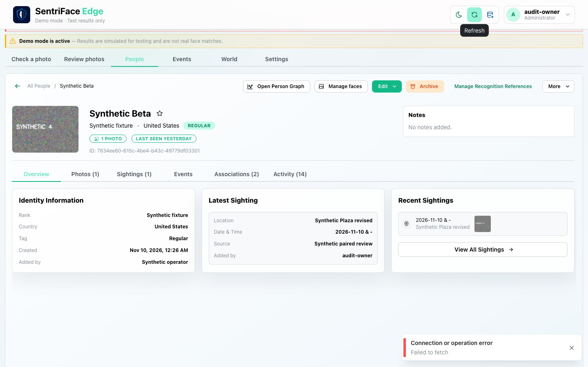](../screenshots/UX-01/UX-01_J24_Step-29_Pass2-Backend-outage-refresh-response.png)

Captured `2026-11-11T11:18:55.356277+00:00` · Administrator · UX-01 · scroll {'x': 0, 'y': 80}. Exact fixture and inference mode are described above and in the capture register.

### Step 30 — Pass2 Backend restart refresh response

[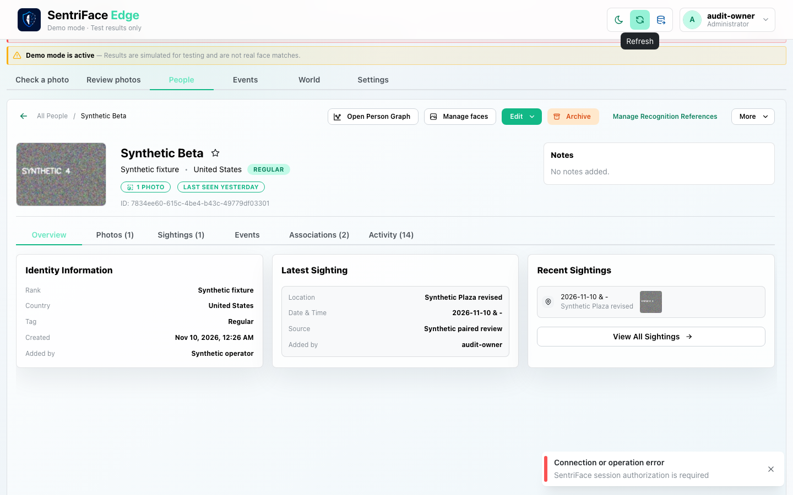](../screenshots/UX-01/UX-01_J24_Step-30_Pass2-Backend-restart-refresh-response.png)

Captured `2026-11-11T11:19:17.241619+00:00` · Administrator · UX-01 · scroll {'x': 0, 'y': 80}. Exact fixture and inference mode are described above and in the capture register.

### Step 31 — Pass2 Backend restart after page reload

Captured `2026-11-11T13:05:56.526840+00:00` · Unauthenticated · UX-00 · scroll {'x': 0, 'y': 0}. Exact fixture and inference mode are described above and in the capture register.

### Step 32 — Pass2 Backend restart reauthenticated

[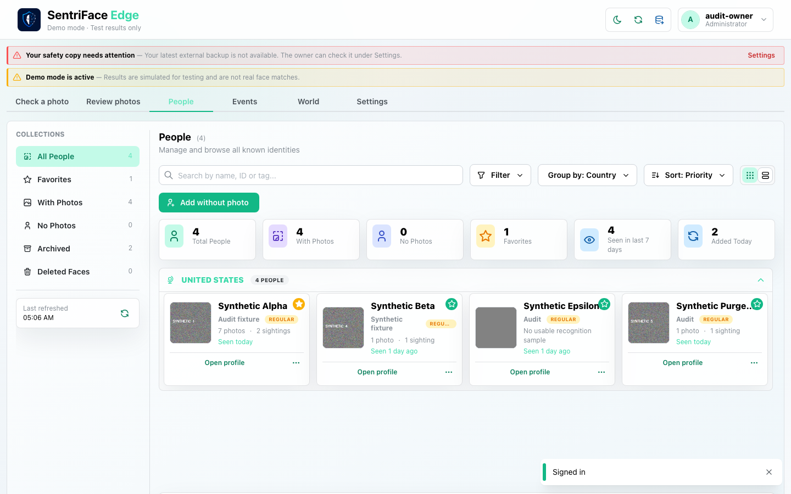](../screenshots/UX-01/UX-01_J24_Step-32_Pass2-Backend-restart-reauthenticated.png)

Captured `2026-11-11T13:06:12.763908+00:00` · Administrator · UX-01 · scroll {'x': 0, 'y': 0}. Exact fixture and inference mode are described above and in the capture register.

## macOS completion pass 2 — continuation C

Source product `b457f0a723e845dd1a92a07a577072c85146c89a`; disposable authority; 1440×900 browser-content viewport, DPR 1, Day, Administrator.

Click Settings in the safety-copy warning while viewing a Person. It opens the Settings tab at License & activation; the operator must separately choose Backups & restore. This is the observed state from this starting context, not a claim about all prior settings selection.

### Step 33 — Pass2 Safety warning before navigation

[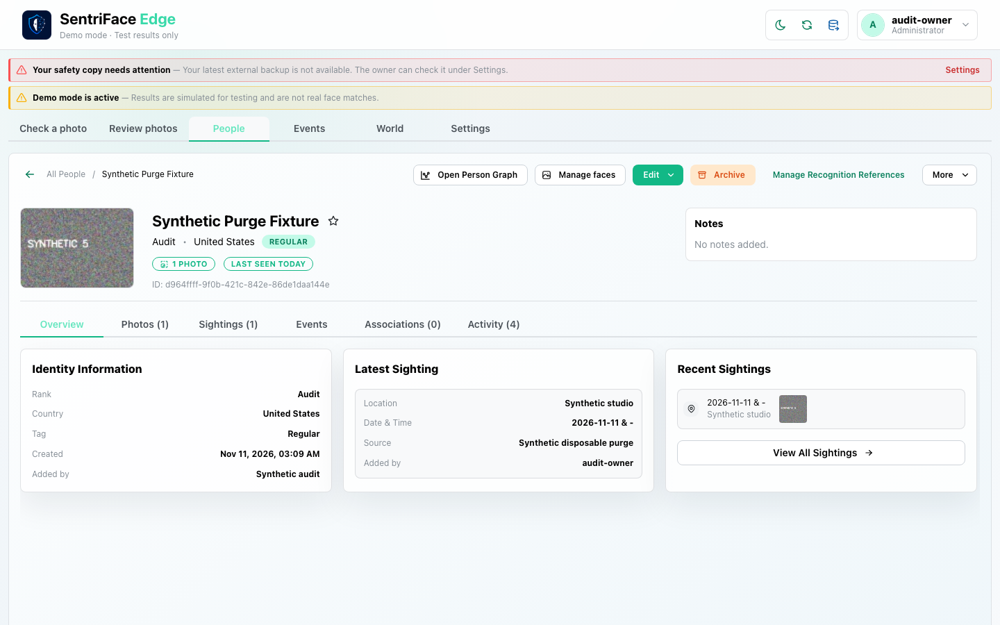](../screenshots/UX-01/UX-01_J24_Step-33_Pass2-Safety-warning-before-navigation.png)

Captured `2026-11-11T13:31:17.326620+00:00` · Administrator · UX-01 · synthetic fixture · scroll {'x': 0, 'y': 0}.

### Step 34 — Pass2 Safety warning opens license settings

[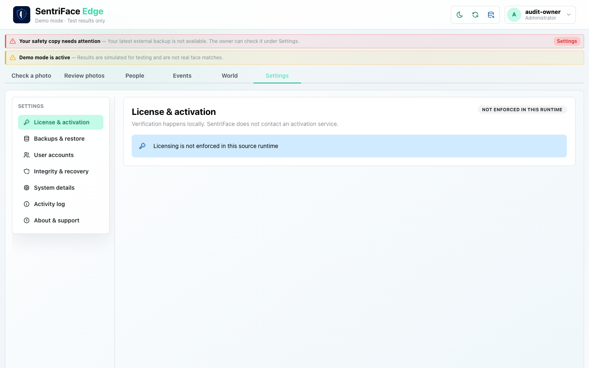](../screenshots/UX-13/UX-13_J24_Step-34_Pass2-Safety-warning-opens-license-settings.png)

Captured `2026-11-11T13:31:31.354983+00:00` · Administrator · UX-13 · synthetic fixture · scroll {'x': 0, 'y': 0}.

### Step 35 — Pass2 Manual navigation to backups

[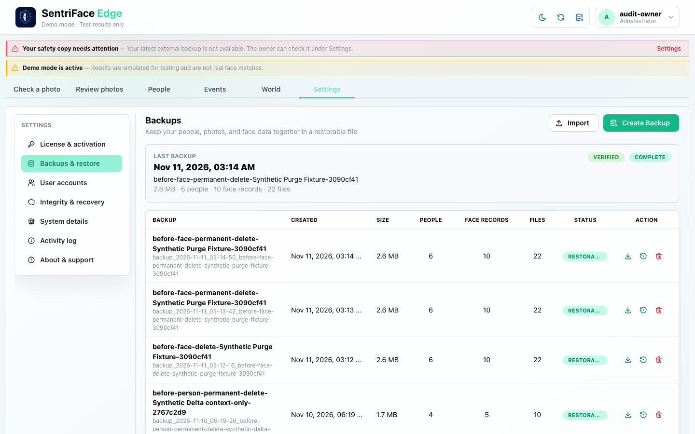](../screenshots/UX-13/UX-13_J24_Step-35_Pass2-Manual-navigation-to-backups.png)

Captured `2026-11-11T13:31:44.509056+00:00` · Administrator · UX-13 · synthetic fixture · scroll {'x': 0, 'y': 0}.
