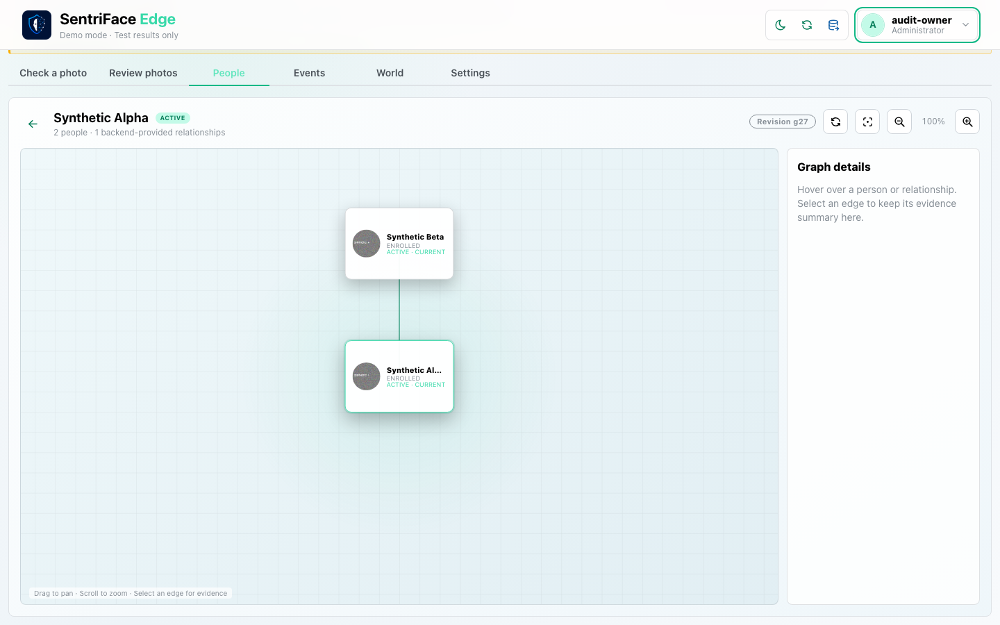
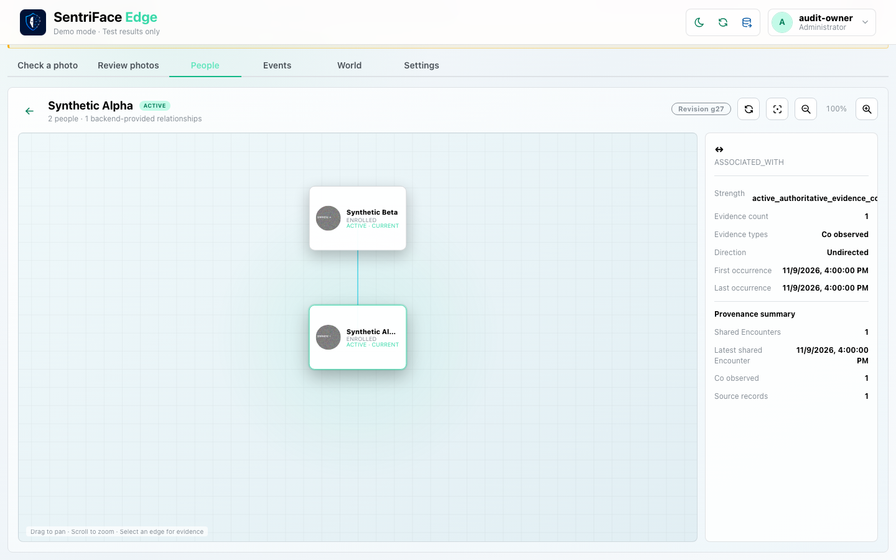
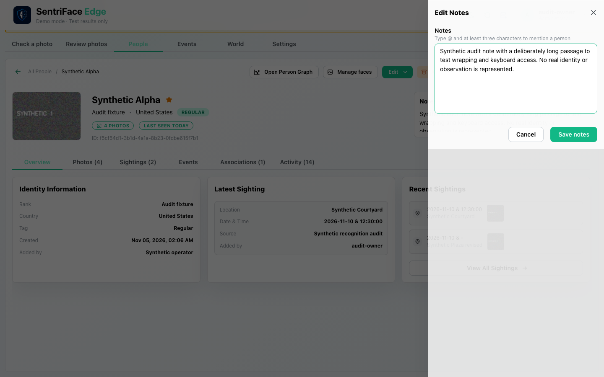
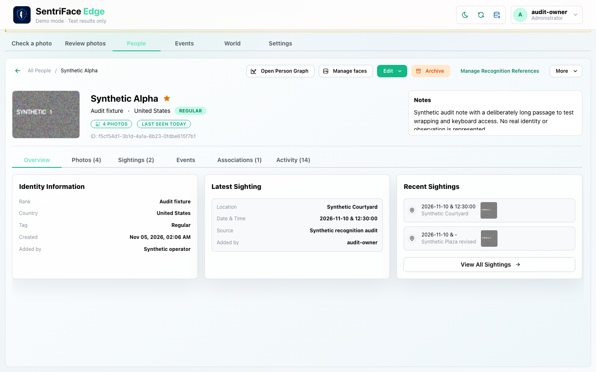
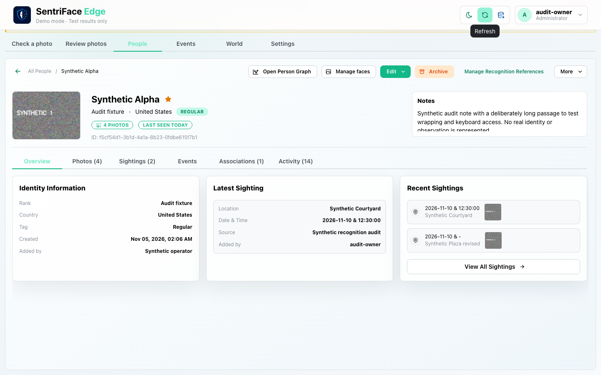

# J25 — Keyboard, pointer evidence, drawer and tooltip

[Audit index](../INDEX.md) · [Source oracle](../source-map.md) · [Independent review](../review.md)

**Scope result: PARTIAL.** Source tasks: SJ-027,SJ-059. Only the following observations are qualified; full source-contract branches remain in [the execution ledger](../source-branches.csv).

**Operator goal and entry:** Keyboard, pointer evidence, drawer and tooltip. Traverse forty actual Tab presses, compare graph pointer selection, open Notes drawer, Tab, Escape, and hover Refresh.

**Starting state / role:** Administrator; two-Person graph fixture.

**Source:** `b457f0a723e845dd1a92a07a577072c85146c89a`. Captures were interrupted/resumed at this same product source. Synthetic means generated non-biometric patterns, not ONNX inference.

## Interaction sequence and authority

1. The first setup attempt failed while still on People (step 1). Retain it as rejected automation evidence; it contains no executed Graph keyboard traversal.
2. Open the actual Person Graph and press Tab forty times (step 2). The private focus trace never reaches the relationship edge. Selecting the edge with the pointer then opens its evidence summary (step 3).
3. Open the Notes drawer, press Tab to inspect the visible focus (step 4), and press Escape to return to the profile (step 5). Hover Refresh for the captured tooltip (step 6).
4. These are read/focus interactions. Source [PersonGraphView.jsx](../../../frontend/src/views/PersonGraphView.jsx#L218) gives the edge pointer handlers without a focusable keyboard target, while [WorldExploreCanvas.jsx](../../../frontend/src/views/WorldExploreCanvas.jsx#L48) provides the existing role/tabIndex/Enter/Space pattern. Together they support the keyboard finding in [review](../review.md); they do not certify VoiceOver, all focus traps or all graph densities.

## Step 01 — People library before keyboard setup retry

Rejected audit attempt retained privately; no product success/failure inferred.

Capture: UX-06 · Administrator · light · 1440×900 CSS viewport · DPR 1 · `2026-11-10T14:06:09.004546+00:00` · synthetic.

Setup locator failed before keyboard execution; no Graph claim. Step2 is actual traversal.

Scroll: x=0, y=80.

## Step 02 — Graph actual keyboard cycle

Capture: UX-06 · Administrator · light · 1440×900 CSS viewport · DPR 1 · `2026-11-10T14:06:59.694671+00:00` · synthetic.

Scroll: x=0, y=80.

## Step 03 — Graph pointer evidence

Capture: UX-06 · Administrator · light · 1440×900 CSS viewport · DPR 1 · `2026-11-10T14:08:15.847877+00:00` · synthetic.

Scroll: x=0, y=80.

## Step 04 — Drawer keyboard focus

Capture: UX-14 · Administrator · light · 1440×900 CSS viewport · DPR 1 · `2026-11-10T14:08:17.168359+00:00` · synthetic.

Scroll: x=0, y=80.

## Step 05 — Drawer escape return

Capture: UX-14 · Administrator · light · 1440×900 CSS viewport · DPR 1 · `2026-11-10T14:08:17.625221+00:00` · synthetic.

Scroll: x=0, y=80.

## Step 06 — Refresh tooltip

Capture: UX-14 · Administrator · light · 1440×900 CSS viewport · DPR 1 · `2026-11-10T14:08:18.737462+00:00` · synthetic.

Scroll: x=0, y=80.

## Outcome, authority, return and limits

Step1 is rejected audit setup showing People before traversal; it does not establish Graph behavior. Step2 is the actual keyboard cycle; private focus trace + source show no edge target. Step3 pointer selection opens evidence. Drawer focus/Escape and tooltip are bounded checks; no VoiceOver or complete contrast qualification.

Navigation/read controls do not create authoritative identity or occurrence state. Mutations above use existing product commands. Return paths and later-session results are only claimed where ordered evidence or explicit checks demonstrate them. Missing cancellation, failure, stale, role or restart branches remain visible in the source execution ledger.
