# J26 — Viewport and theme equivalence sample

[Audit index](../INDEX.md) · [Source oracle](../source-map.md) · [Independent review](../review.md)

**Scope result: PARTIAL.** Source tasks: SJ-005,SJ-006,SJ-044,SJ-059. Only the following observations are qualified; full source-contract branches remain in [the execution ledger](../source-branches.csv).

**Operator goal and entry:** Viewport and theme equivalence sample. Use actual theme control and browser viewport resizing; visit six top-level areas for each sampled size/theme.

**Starting state / role:** Administrator; ordinary sparse synthetic states.

**Source:** `b457f0a723e845dd1a92a07a577072c85146c89a`. Captures were interrupted/resumed at this same product source. Synthetic means generated non-biometric patterns, not ONNX inference.

## Interaction sequence and authority

1. Resize the actual browser content viewport to **1366×768 Day** and visit Check a Photo, Review Photos, People, Events, World and Settings (steps 1–6).
2. Use the actual theme control and resize to **1280×800 Night**, visiting the same six areas (steps 7–12).
3. Resize to **900×700 Night** and repeat; additionally select the compact Explore Canvas and Details controls (steps 13–20).
4. Resize to **1440×900 Night** and repeat the six areas (steps 21–26). The ordinary 1440×900 Day captures across the other journeys provide the complementary baseline.
5. All these captures are DPR 1 browser-content viewports. They do not claim that the VM provided a full native window of each size; native DPR 2 geometry is separately measured in [J40](J40.md). Navigation/theme/viewport changes do not mutate Person or Event authority. Every role/theme/size permutation was not repeated.

## Step 01 — 1366x768 light Check a photo

[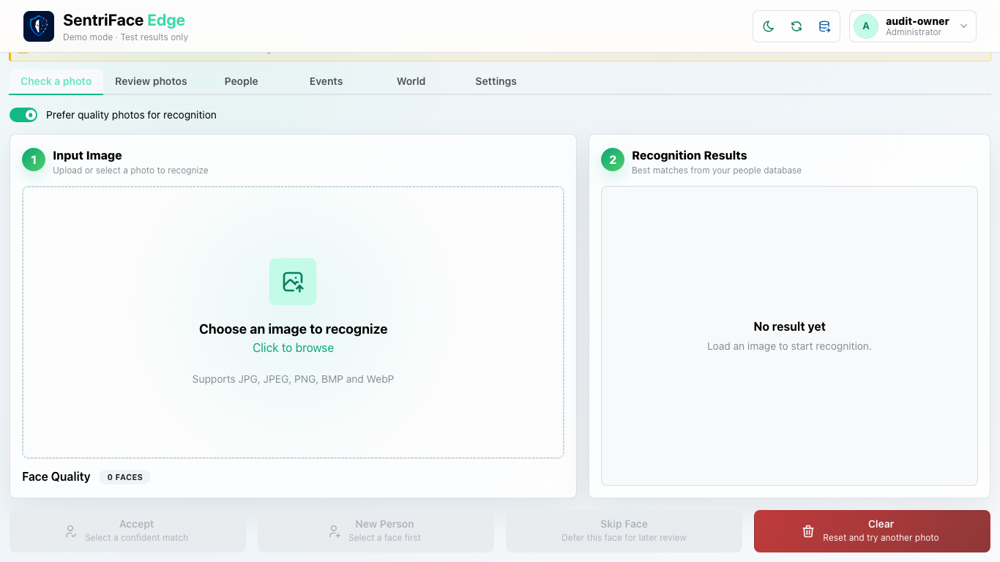](../screenshots/UX-02/UX-02_J26_Step-01_1366x768-light-Check-a-photo.png)

Capture: UX-02 · Administrator · light · 1366×768 CSS viewport · DPR 1 · `2026-11-10T14:08:19.488165+00:00` · synthetic.

Scroll: x=0, y=74.

## Step 02 — 1366x768 light Review photos

[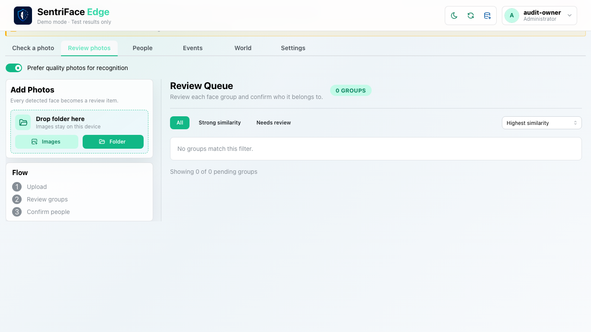](../screenshots/UX-03/UX-03_J26_Step-02_1366x768-light-Review-photos.png)

Capture: UX-03 · Administrator · light · 1366×768 CSS viewport · DPR 1 · `2026-11-10T14:08:20.194752+00:00` · synthetic.

Scroll: x=0, y=74.

## Step 03 — 1366x768 light People

[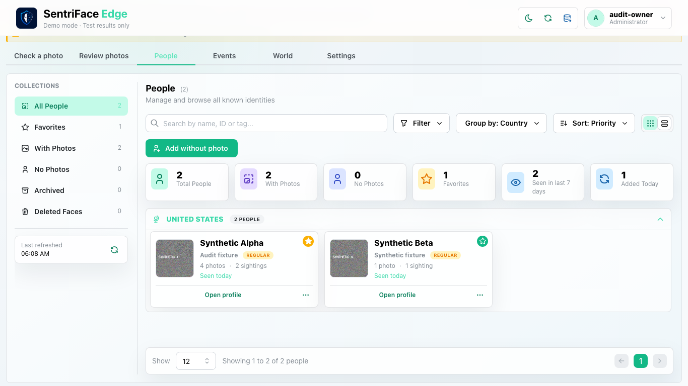](../screenshots/UX-05/UX-05_J26_Step-03_1366x768-light-People.png)

Capture: UX-05 · Administrator · light · 1366×768 CSS viewport · DPR 1 · `2026-11-10T14:08:21.240164+00:00` · synthetic.

Scroll: x=0, y=74.

## Step 04 — 1366x768 light Events

[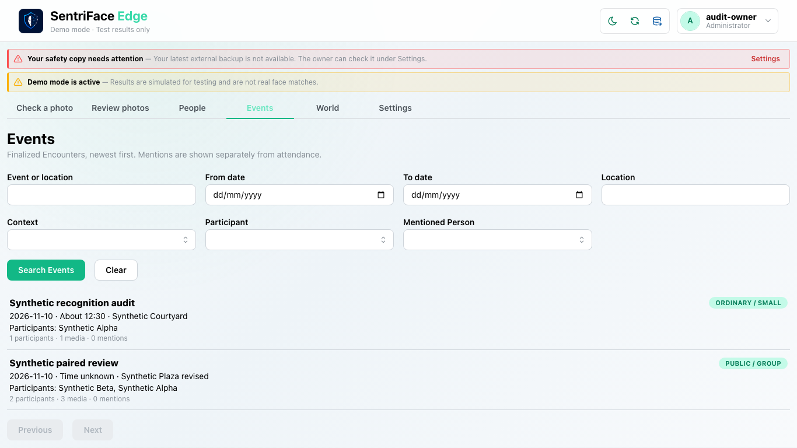](../screenshots/UX-09/UX-09_J26_Step-04_1366x768-light-Events.png)

Capture: UX-09 · Administrator · light · 1366×768 CSS viewport · DPR 1 · `2026-11-10T14:08:22.034726+00:00` · synthetic.

Scroll: x=0, y=0.

## Step 05 — 1366x768 light World

[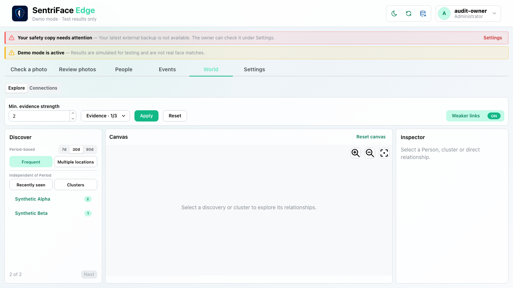](../screenshots/UX-11/UX-11_J26_Step-05_1366x768-light-World.png)

Capture: UX-11 · Administrator · light · 1366×768 CSS viewport · DPR 1 · `2026-11-10T14:08:22.799042+00:00` · synthetic.

Scroll: x=0, y=0.

## Step 06 — 1366x768 light Settings

[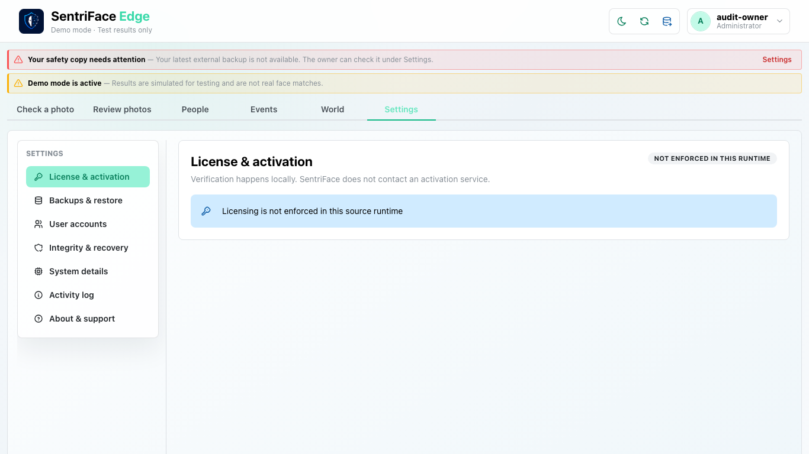](../screenshots/UX-13/UX-13_J26_Step-06_1366x768-light-Settings.png)

Capture: UX-13 · Administrator · light · 1366×768 CSS viewport · DPR 1 · `2026-11-10T14:08:23.764123+00:00` · synthetic.

Scroll: x=0, y=0.

## Step 07 — 1280x800 dark Check a photo

[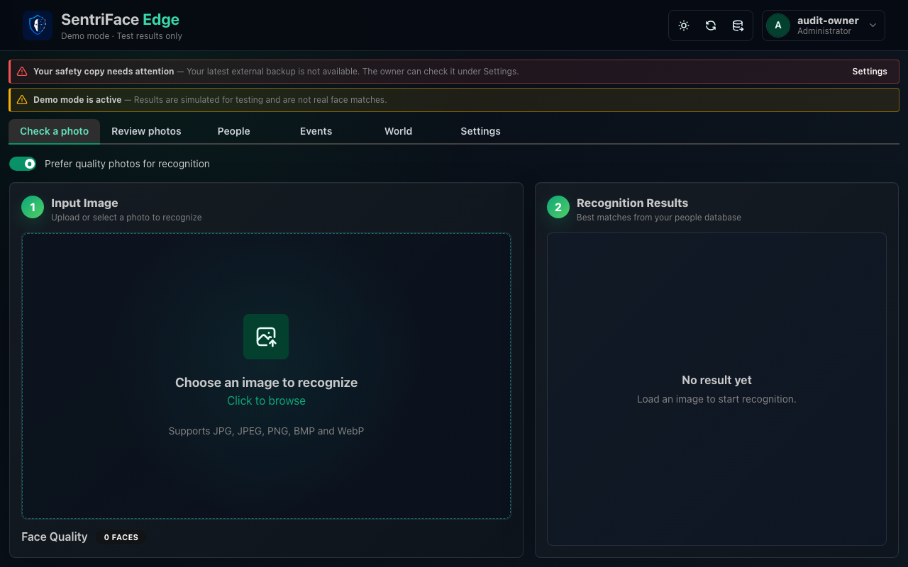](../screenshots/UX-02/UX-02_J26_Step-07_1280x800-dark-Check-a-photo.png)

Capture: UX-02 · Administrator · dark · 1280×800 CSS viewport · DPR 1 · `2026-11-10T14:08:24.780439+00:00` · synthetic.

Scroll: x=0, y=0.

## Step 08 — 1280x800 dark Review photos

[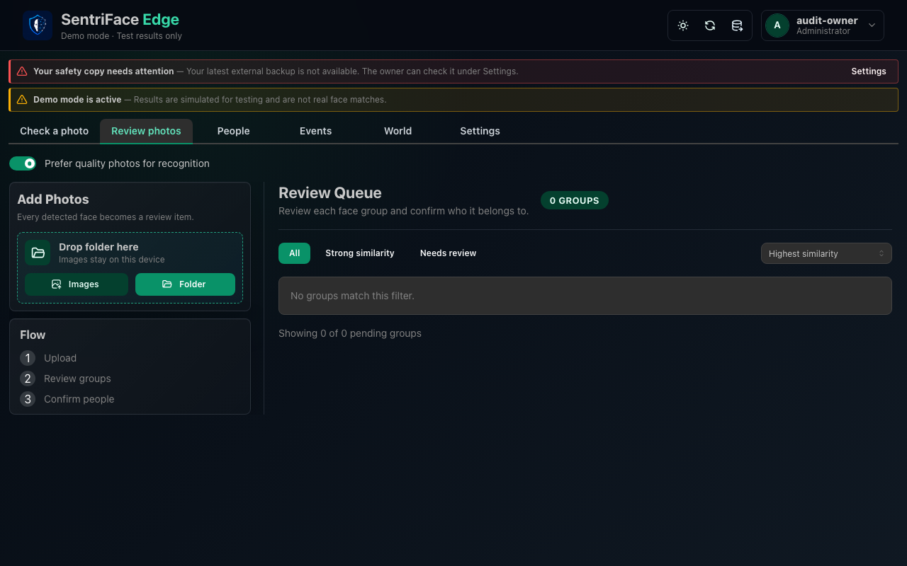](../screenshots/UX-03/UX-03_J26_Step-08_1280x800-dark-Review-photos.png)

Capture: UX-03 · Administrator · dark · 1280×800 CSS viewport · DPR 1 · `2026-11-10T14:08:25.517208+00:00` · synthetic.

Scroll: x=0, y=0.

## Step 09 — 1280x800 dark People

[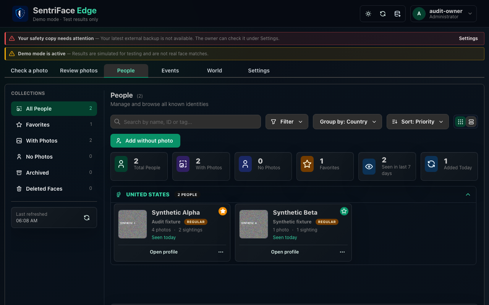](../screenshots/UX-05/UX-05_J26_Step-09_1280x800-dark-People.png)

Capture: UX-05 · Administrator · dark · 1280×800 CSS viewport · DPR 1 · `2026-11-10T14:08:26.239166+00:00` · synthetic.

Scroll: x=0, y=0.

## Step 10 — 1280x800 dark Events

[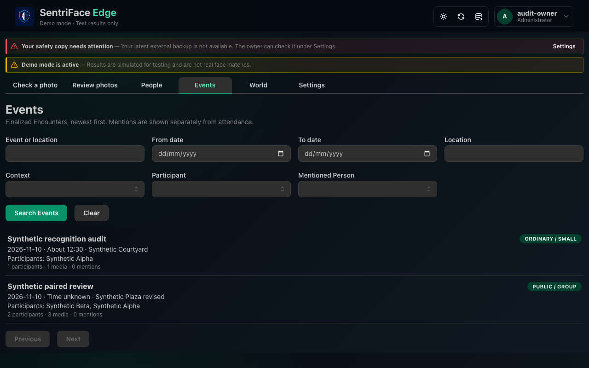](../screenshots/UX-09/UX-09_J26_Step-10_1280x800-dark-Events.png)

Capture: UX-09 · Administrator · dark · 1280×800 CSS viewport · DPR 1 · `2026-11-10T14:08:26.986343+00:00` · synthetic.

Scroll: x=0, y=0.

## Step 11 — 1280x800 dark World

[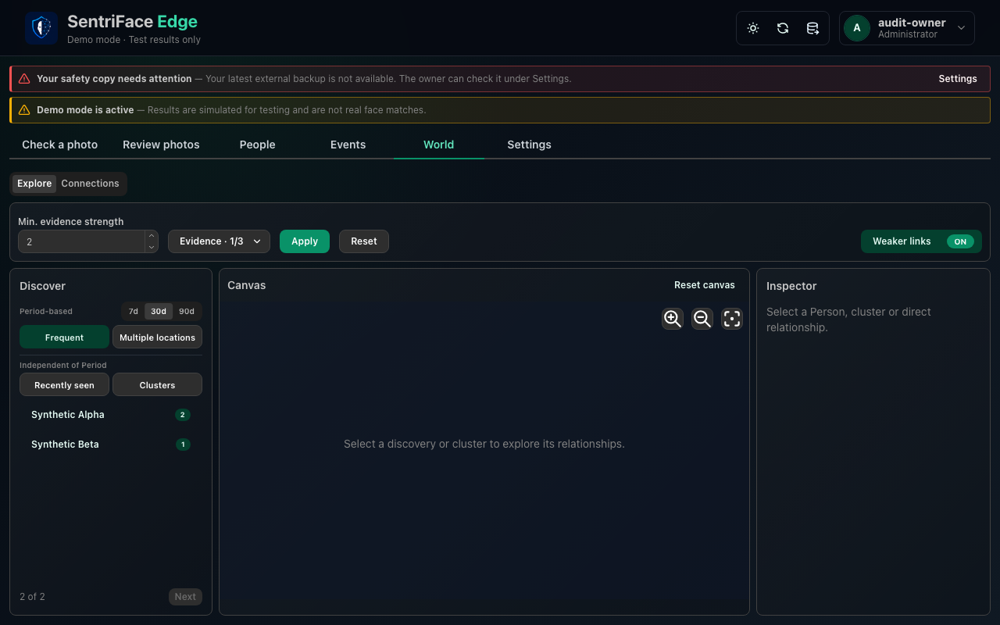](../screenshots/UX-11/UX-11_J26_Step-11_1280x800-dark-World.png)

Capture: UX-11 · Administrator · dark · 1280×800 CSS viewport · DPR 1 · `2026-11-10T14:08:27.755782+00:00` · synthetic.

Scroll: x=0, y=0.

## Step 12 — 1280x800 dark Settings

[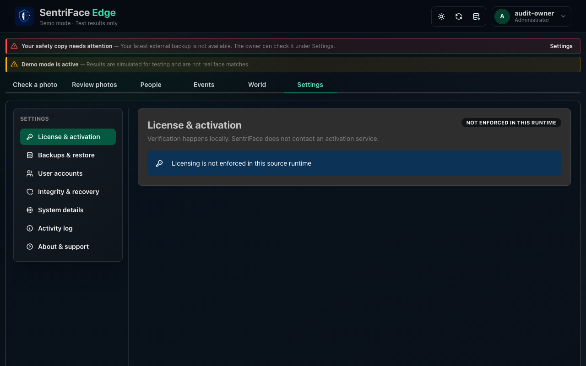](../screenshots/UX-13/UX-13_J26_Step-12_1280x800-dark-Settings.png)

Capture: UX-13 · Administrator · dark · 1280×800 CSS viewport · DPR 1 · `2026-11-10T14:08:28.694796+00:00` · synthetic.

Scroll: x=0, y=0.

## Step 13 — 900x700 dark Check a photo

[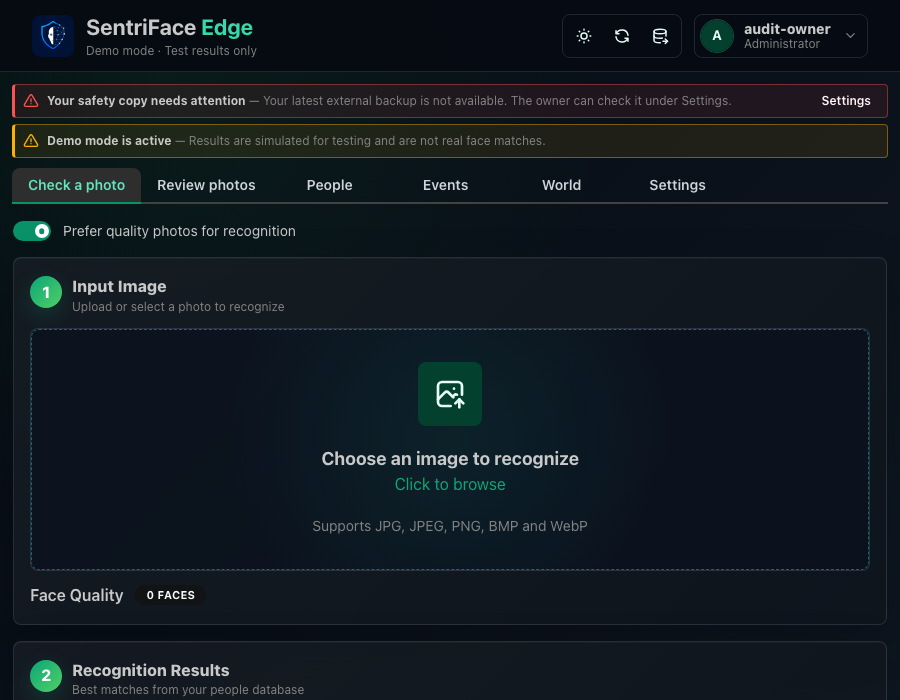](../screenshots/UX-02/UX-02_J26_Step-13_900x700-dark-Check-a-photo.png)

Capture: UX-02 · Administrator · dark · 900×700 CSS viewport · DPR 1 · `2026-11-10T14:08:29.370941+00:00` · synthetic.

Scroll: x=0, y=0.

## Step 14 — 900x700 dark Review photos

[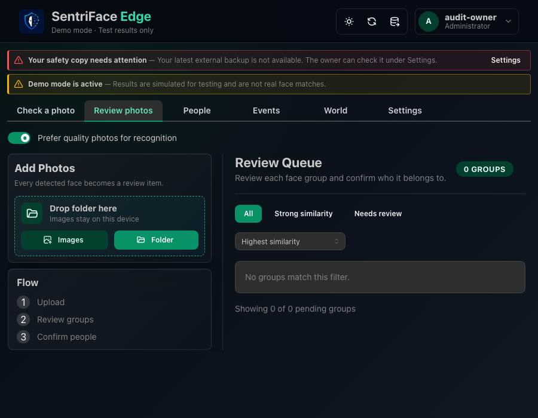](../screenshots/UX-03/UX-03_J26_Step-14_900x700-dark-Review-photos.png)

Capture: UX-03 · Administrator · dark · 900×700 CSS viewport · DPR 1 · `2026-11-10T14:08:30.044445+00:00` · synthetic.

Scroll: x=0, y=0.

## Step 15 — 900x700 dark People

[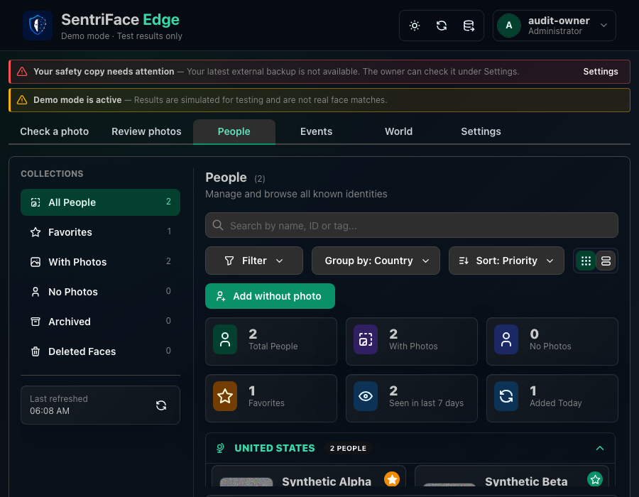](../screenshots/UX-05/UX-05_J26_Step-15_900x700-dark-People.png)

Capture: UX-05 · Administrator · dark · 900×700 CSS viewport · DPR 1 · `2026-11-10T14:08:30.754167+00:00` · synthetic.

Scroll: x=0, y=0.

## Step 16 — 900x700 dark Events

[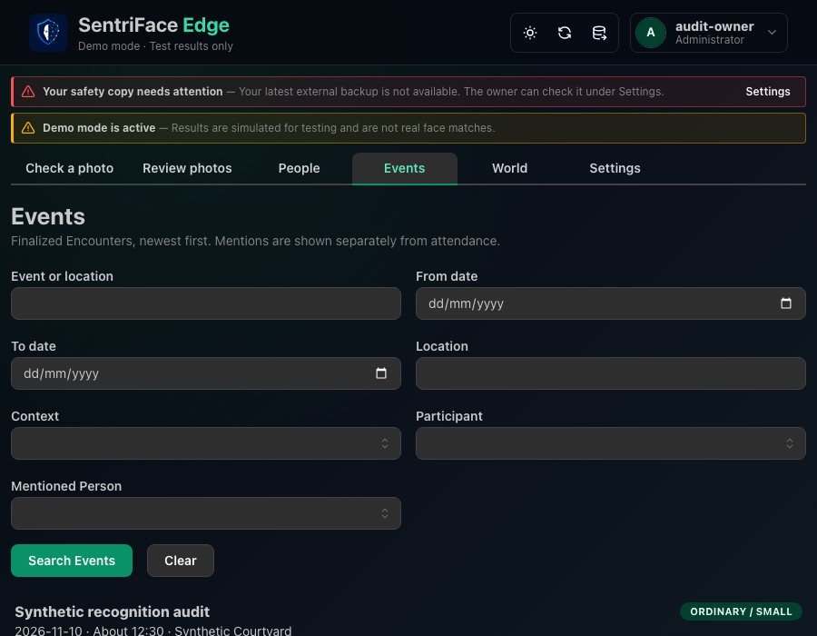](../screenshots/UX-09/UX-09_J26_Step-16_900x700-dark-Events.png)

Capture: UX-09 · Administrator · dark · 900×700 CSS viewport · DPR 1 · `2026-11-10T14:08:31.459014+00:00` · synthetic.

Scroll: x=0, y=0.

## Step 17 — 900x700 dark World

[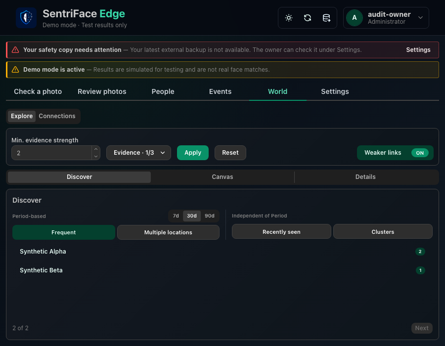](../screenshots/UX-11/UX-11_J26_Step-17_900x700-dark-World.png)

Capture: UX-11 · Administrator · dark · 900×700 CSS viewport · DPR 1 · `2026-11-10T14:08:32.165141+00:00` · synthetic.

Scroll: x=0, y=0.

## Step 18 — 900x700 dark Explore Canvas

[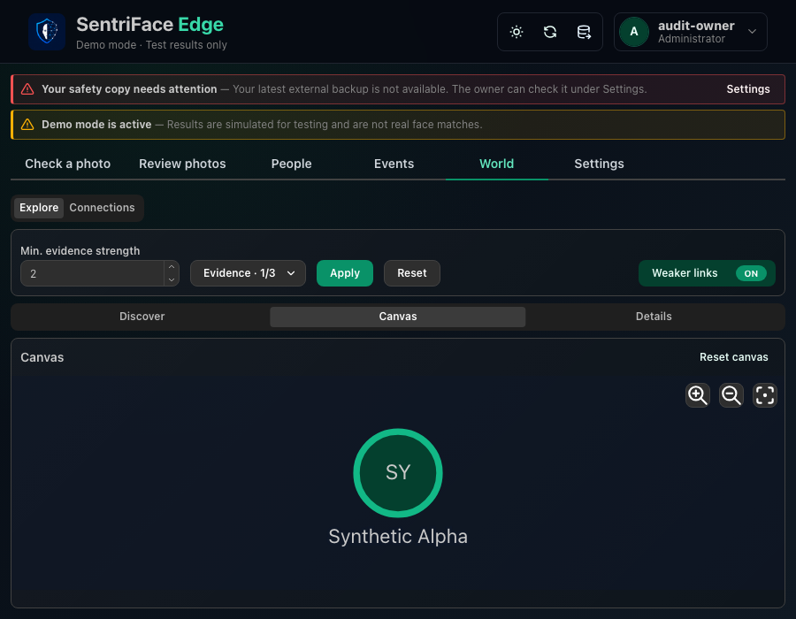](../screenshots/UX-11/UX-11_J26_Step-18_900x700-dark-Explore-Canvas.png)

Capture: UX-11 · Administrator · dark · 900×700 CSS viewport · DPR 1 · `2026-11-10T14:08:32.564697+00:00` · synthetic.

Scroll: x=0, y=0.

## Step 19 — 900x700 dark Explore Details

[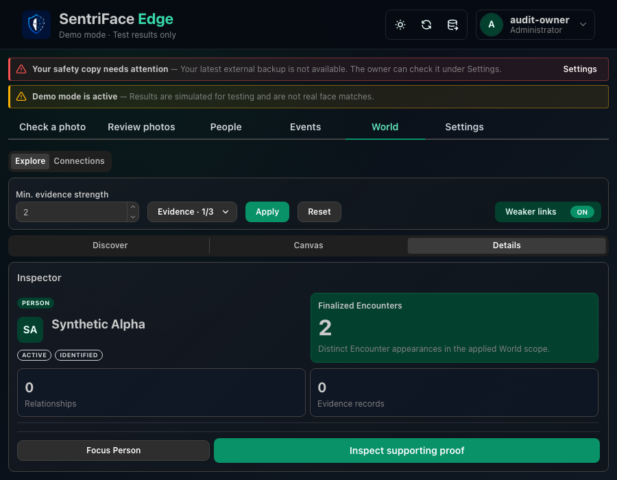](../screenshots/UX-11/UX-11_J26_Step-19_900x700-dark-Explore-Details.png)

Capture: UX-11 · Administrator · dark · 900×700 CSS viewport · DPR 1 · `2026-11-10T14:08:32.949474+00:00` · synthetic.

Scroll: x=0, y=0.

## Step 20 — 900x700 dark Settings

[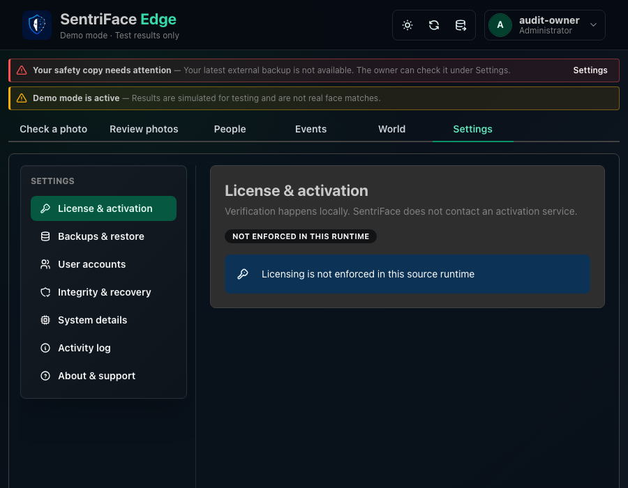](../screenshots/UX-13/UX-13_J26_Step-20_900x700-dark-Settings.png)

Capture: UX-13 · Administrator · dark · 900×700 CSS viewport · DPR 1 · `2026-11-10T14:08:33.874767+00:00` · synthetic.

Scroll: x=0, y=0.

## Step 21 — 1440x900 dark Check a photo

[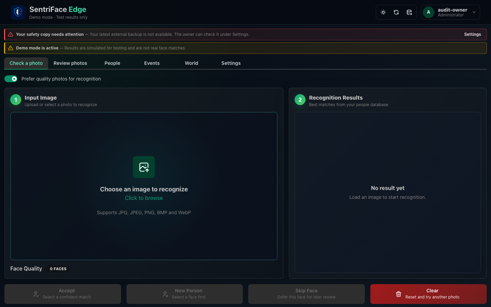](../screenshots/UX-02/UX-02_J26_Step-21_1440x900-dark-Check-a-photo.png)

Capture: UX-02 · Administrator · dark · 1440×900 CSS viewport · DPR 1 · `2026-11-10T14:08:34.619957+00:00` · synthetic.

Scroll: x=0, y=0.

## Step 22 — 1440x900 dark Review photos

[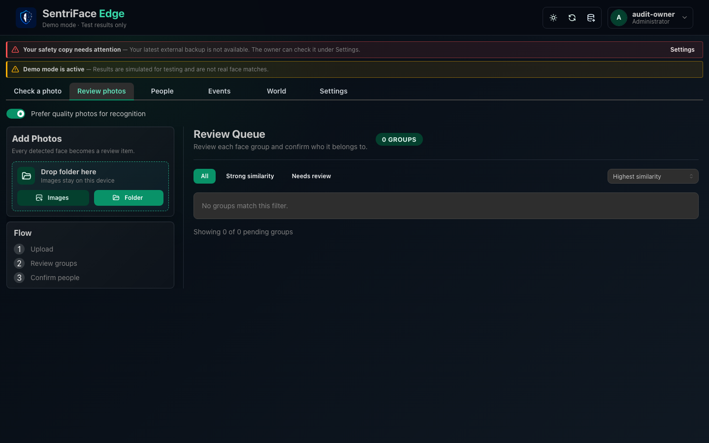](../screenshots/UX-03/UX-03_J26_Step-22_1440x900-dark-Review-photos.png)

Capture: UX-03 · Administrator · dark · 1440×900 CSS viewport · DPR 1 · `2026-11-10T14:08:35.385715+00:00` · synthetic.

Scroll: x=0, y=0.

## Step 23 — 1440x900 dark People

[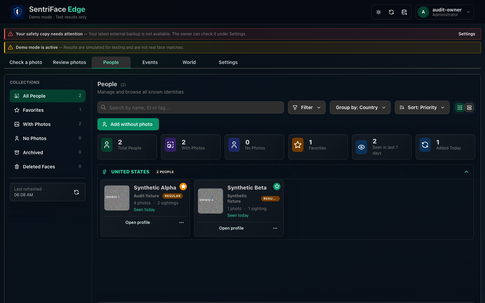](../screenshots/UX-05/UX-05_J26_Step-23_1440x900-dark-People.png)

Capture: UX-05 · Administrator · dark · 1440×900 CSS viewport · DPR 1 · `2026-11-10T14:08:36.126089+00:00` · synthetic.

Scroll: x=0, y=0.

## Step 24 — 1440x900 dark Events

[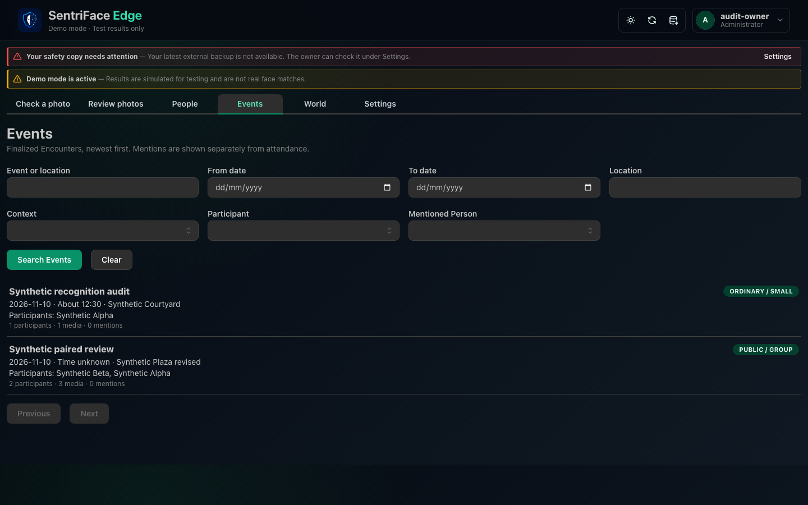](../screenshots/UX-09/UX-09_J26_Step-24_1440x900-dark-Events.png)

Capture: UX-09 · Administrator · dark · 1440×900 CSS viewport · DPR 1 · `2026-11-10T14:08:36.903166+00:00` · synthetic.

Scroll: x=0, y=0.

## Step 25 — 1440x900 dark World

[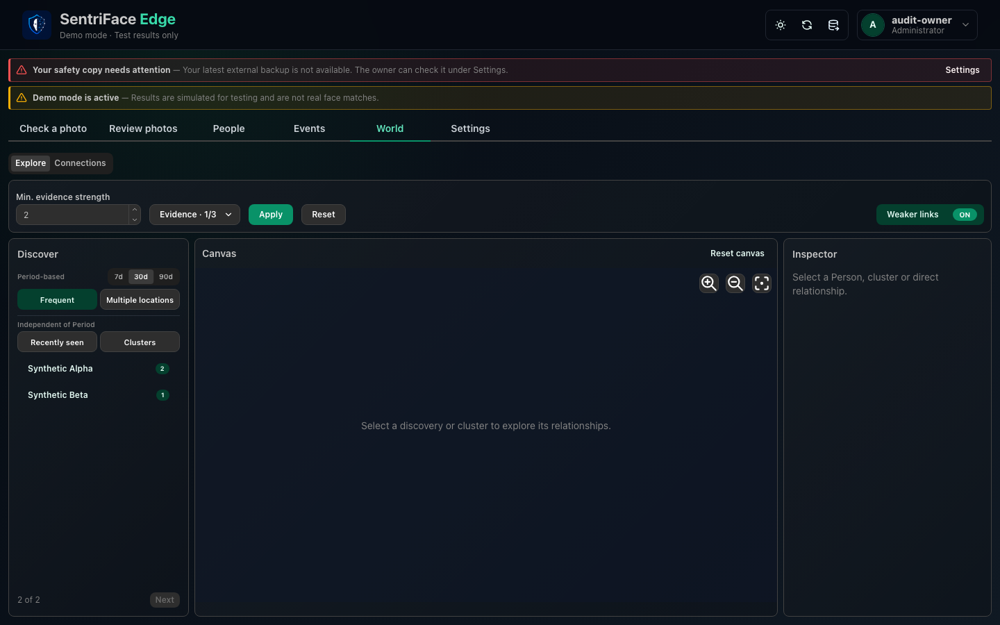](../screenshots/UX-11/UX-11_J26_Step-25_1440x900-dark-World.png)

Capture: UX-11 · Administrator · dark · 1440×900 CSS viewport · DPR 1 · `2026-11-10T14:08:37.684652+00:00` · synthetic.

Scroll: x=0, y=0.

## Step 26 — 1440x900 dark Settings

[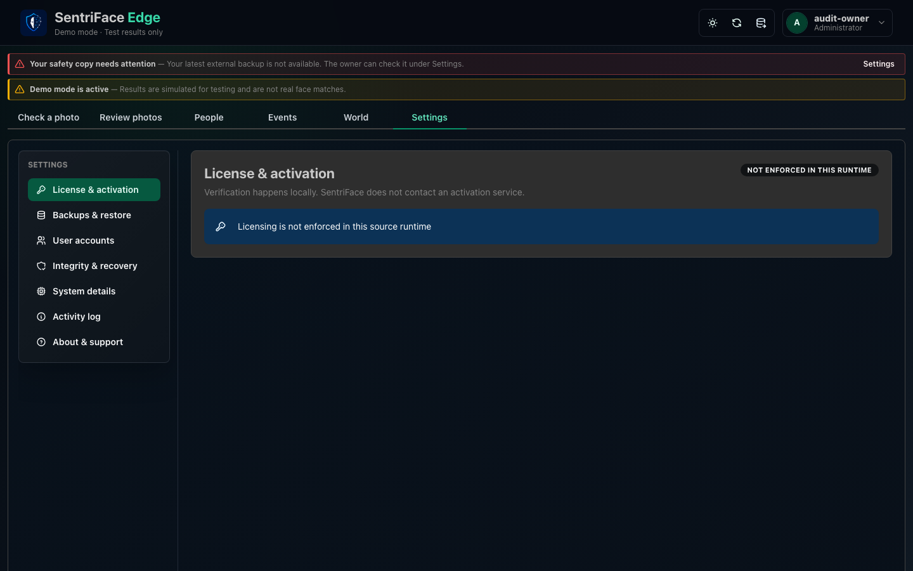](../screenshots/UX-13/UX-13_J26_Step-26_1440x900-dark-Settings.png)

Capture: UX-13 · Administrator · dark · 1440×900 CSS viewport · DPR 1 · `2026-11-10T14:08:38.644884+00:00` · synthetic.

Scroll: x=0, y=0.

## Outcome, authority, return and limits

Samples1366×768 Day,1280×800 Night,900×700 Night,1440×900 Night; earlier1440×900 Day. Compact Explore Canvas/Details also captured. These are full CSS viewport screenshots, not native OS windows. Some frames retain scroll position. Every overlay/dense/role combination is not implied equivalent.

Navigation/read controls do not create authoritative identity or occurrence state. Mutations above use existing product commands. Return paths and later-session results are only claimed where ordered evidence or explicit checks demonstrate them. Missing cancellation, failure, stale, role or restart branches remain visible in the source execution ledger.
