# J27 — Canonical merge and guarded revert refusal

**Update:** Earlier refusal-only observations below are historical. Continuation H subsequently prepared and executed one supported synthetic guarded revert; see its ordered evidence and limits.

[Audit index](../INDEX.md) · [Source oracle](../source-map.md) · [Independent review](../review.md)

**Scope result: PARTIAL.** Source tasks: SJ-023,SJ-034,SJ-055. Only the following observations are qualified; full source-contract branches remain in [the execution ledger](../source-branches.csv).

**Operator goal and entry:** Canonical merge and guarded revert refusal. Create source identity, choose active survivor, confirm merge; run integrity check; load committed merge history and ask eligibility.

**Starting state / role:** Administrator; a newly created disposable duplicate Person.

**Source:** `b457f0a723e845dd1a92a07a577072c85146c89a`. Captures were interrupted/resumed at this same product source. Synthetic means generated non-biometric patterns, not ONNX inference.

## Interaction sequence and authority

1. Create the disposable duplicate Person (step 1). Open Merge, select the active survivor and inspect the confirmation (step 2). Confirm through the real control.
2. The dialog closes to People (step 3). Step 4 subsequently shows the completion toast and committed merge history. The integrity check passed; this is distinct from an exhaustive historical-row proof.
3. Ask the existing history control for revert eligibility (step 5). The guard **P11-D** refuses because the survivor's profile/note state changed. This is a successful refusal branch, not a successful revert.
4. Return through Settings/People navigation. The source identity was merged into the survivor using current semantics. Prepared/successful revert, stale/overlapping merges and restart validation are not claimed.

## Step 01 — Disposable merge source created

[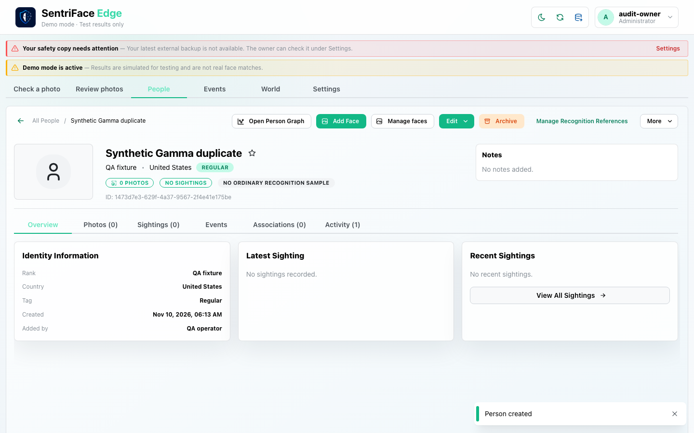](../screenshots/UX-07/UX-07_J27_Step-01_Disposable-merge-source-created.png)

Capture: UX-07 · Administrator · light · 1440×900 CSS viewport · DPR 1 · `2026-11-10T14:13:26.064806+00:00` · synthetic.

Scroll: x=0, y=0.

## Step 02 — Merge target chosen

[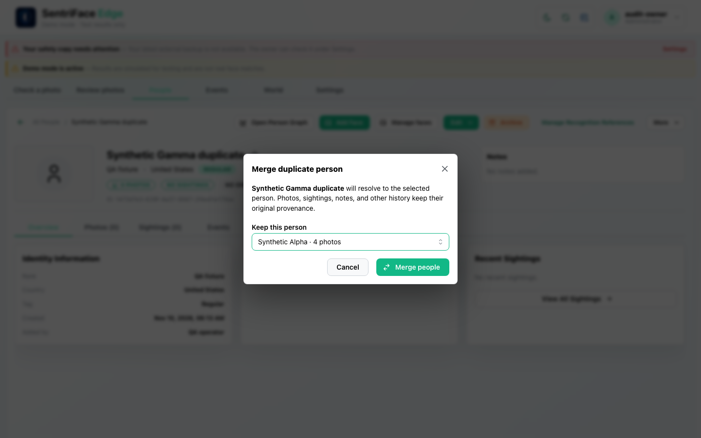](../screenshots/UX-08/UX-08_J27_Step-02_Merge-target-chosen.png)

Capture: UX-08 · Administrator · light · 1440×900 CSS viewport · DPR 1 · `2026-11-10T14:18:03.246264+00:00` · synthetic.

Scroll: x=0, y=0.

## Step 03 — People collection after merge

[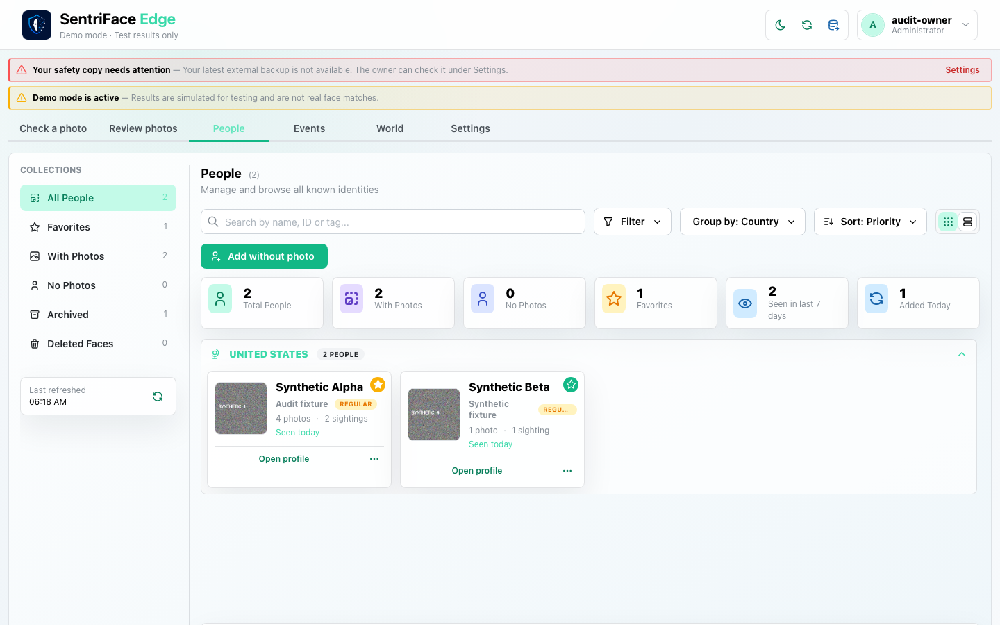](../screenshots/UX-08/UX-08_J27_Step-03_Merge-completed.png)

Capture: UX-08 · Administrator · light · 1440×900 CSS viewport · DPR 1 · `2026-11-10T14:18:10.185051+00:00` · synthetic.

Merge confirmation closed; committed history and completion toast independently observed at step4.

Scroll: x=0, y=0.

## Step 04 — Merge revert history

[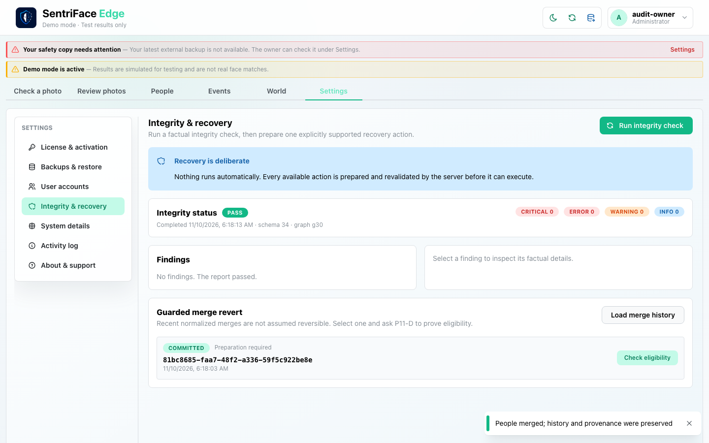](../screenshots/UX-13/UX-13_J27_Step-04_Merge-revert-history.png)

Capture: UX-13 · Administrator · light · 1440×900 CSS viewport · DPR 1 · `2026-11-10T14:18:14.705284+00:00` · synthetic.

Scroll: x=0, y=0.

## Step 05 — Revert eligibility result

[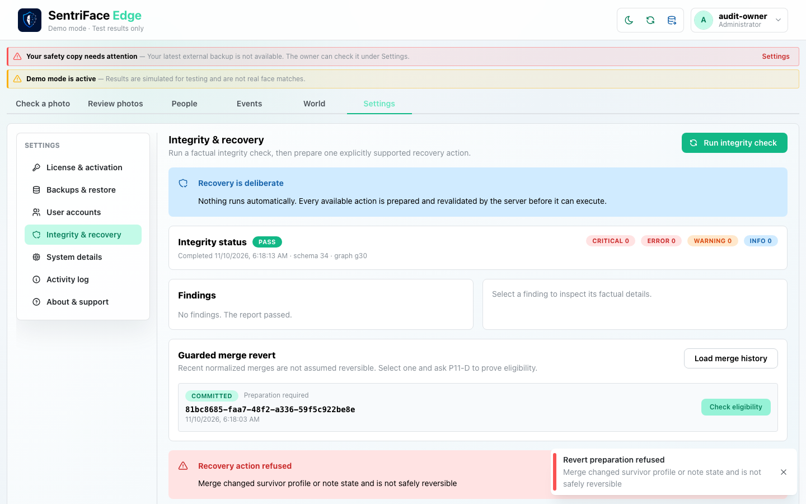](../screenshots/UX-13/UX-13_J27_Step-05_Revert-eligibility-result.png)

Capture: UX-13 · Administrator · light · 1440×900 CSS viewport · DPR 1 · `2026-11-10T14:18:15.963485+00:00` · synthetic.

Scroll: x=0, y=0.

## Outcome, authority, return and limits

Merge completion feedback and committed history are visible at step4. Step3 is the resulting collection before feedback. P11-D refuses revert because survivor profile/note state changed. No successful prepared/reverted operation is claimed; raw historical invariants beyond these UI/backend responses are not exhaustively revalidated.

Navigation/read controls do not create authoritative identity or occurrence state. Mutations above use existing product commands. Return paths and later-session results are only claimed where ordered evidence or explicit checks demonstrate them. Missing cancellation, failure, stale, role or restart branches remain visible in the source execution ledger.

## macOS completion pass 2 — continuation D

Source product `b457f0a723e845dd1a92a07a577072c85146c89a`; disposable authority; full browser-content viewport 1440×900 CSS pixels, DPR 1, Day. Role and capture time are recorded per step.

Create two fresh synthetic no-photo identities with different names, merge source into survivor, and check the newly committed operation. The server refuses revert with the same survivor profile/note conflict message. Try creating two identical synthetic placeholders: after the second submission only one card is observed; the precise server response was not captured. Create a differently named placeholder and edit it to the existing name: the server refuses with a raw UNIQUE constraint error, and Cancel preserves the profile. Identical-name attempts were not bypassed. Successful prepared revert remains unverified; source guard identifies conflicts as outside its safe subset.

### Step 06 — Pass2 Revert source form

[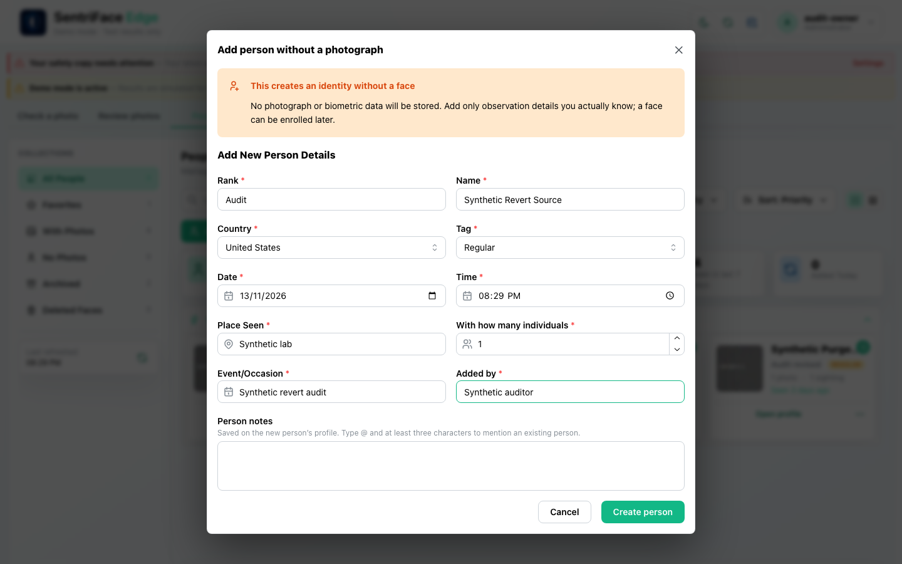](../screenshots/UX-07/UX-07_J27_Step-06_Pass2-Revert-source-form.png)

Captured `2026-11-14T04:29:23.650552+00:00` · Administrator · UX-07 · synthetic fixture · scroll {'x': 0, 'y': 0}.

### Step 07 — Pass2 Revert source created

Captured `2026-11-14T04:29:40.587723+00:00` · Administrator · UX-05 · synthetic fixture · scroll {'x': 0, 'y': 0}.

### Step 08 — Pass2 Revert survivor created

[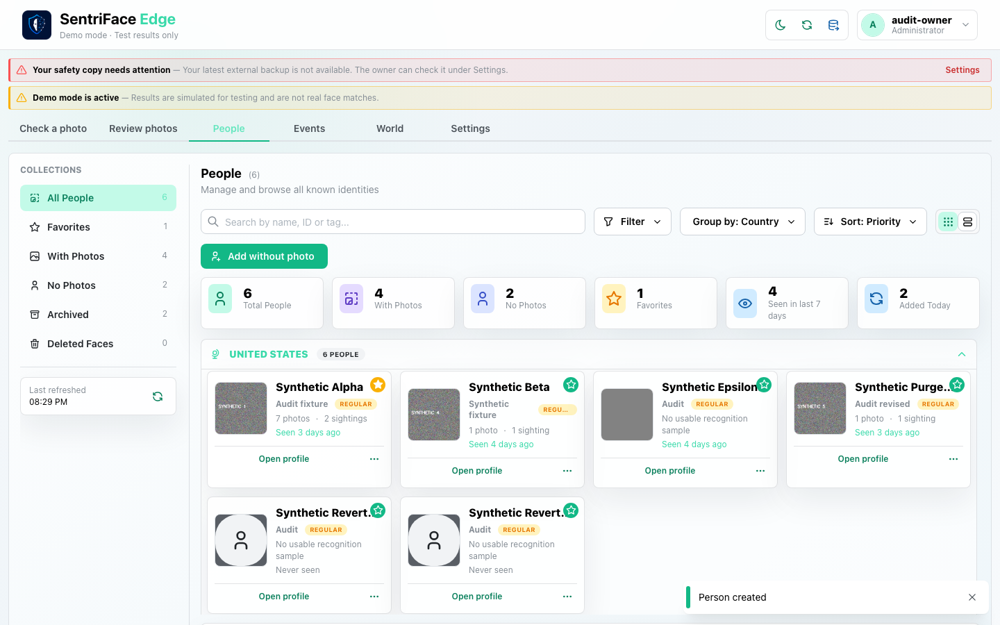](../screenshots/UX-05/UX-05_J27_Step-08_Pass2-Revert-survivor-created.png)

Captured `2026-11-14T04:29:42.960146+00:00` · Administrator · UX-05 · synthetic fixture · scroll {'x': 0, 'y': 0}.

### Step 09 — Pass2 Revert merge confirmation

Captured `2026-11-14T04:30:14.051568+00:00` · Administrator · UX-08 · synthetic fixture · scroll {'x': 0, 'y': 0}.

### Step 10 — Pass2 Revert merge completed

[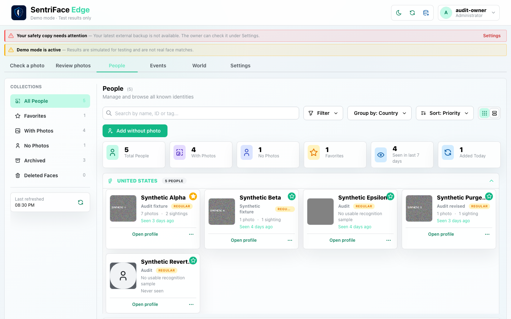](../screenshots/UX-05/UX-05_J27_Step-10_Pass2-Revert-merge-completed.png)

Captured `2026-11-14T04:30:30.971818+00:00` · Administrator · UX-05 · synthetic fixture · scroll {'x': 0, 'y': 0}.

### Step 11 — Pass2 Fresh merge history

[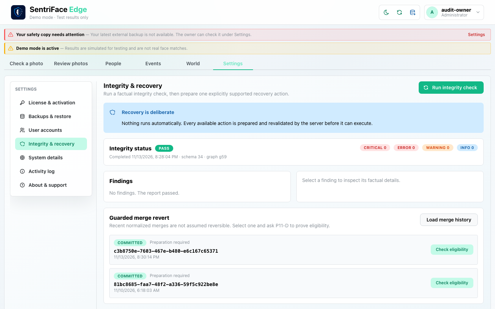](../screenshots/UX-13/UX-13_J27_Step-11_Pass2-Fresh-merge-history.png)

Captured `2026-11-14T04:30:44.749967+00:00` · Administrator · UX-13 · synthetic fixture · scroll {'x': 0, 'y': 0}.

### Step 12 — Fresh merge eligibility response (refusal below viewport)

[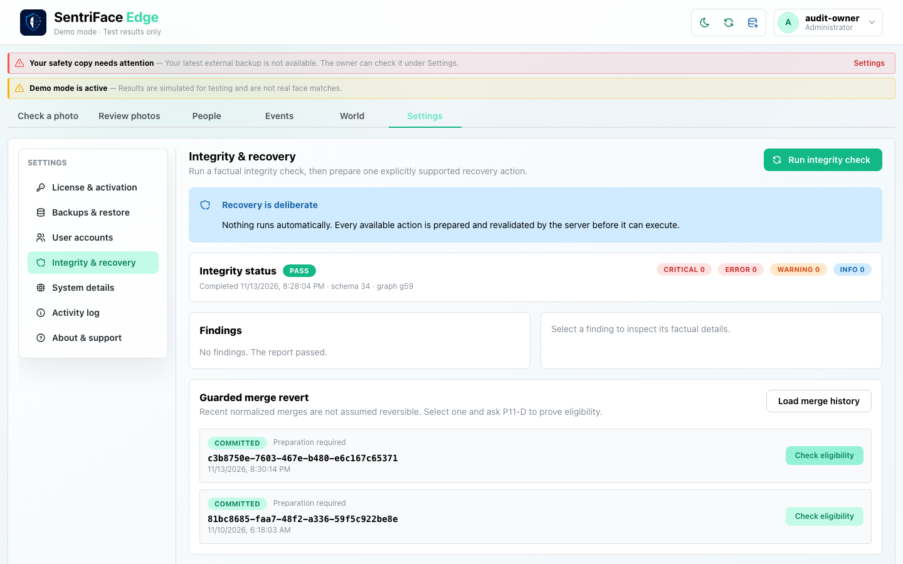](../screenshots/UX-13/UX-13_J27_Step-12_Pass2-Fresh-merge-revert-refused.png)

Captured `2026-11-14T04:30:59.392226+00:00` · Administrator · UX-13 · synthetic fixture · scroll {'x': 0, 'y': 0}.

### Step 13 — Pass2 Identical revert person one form

[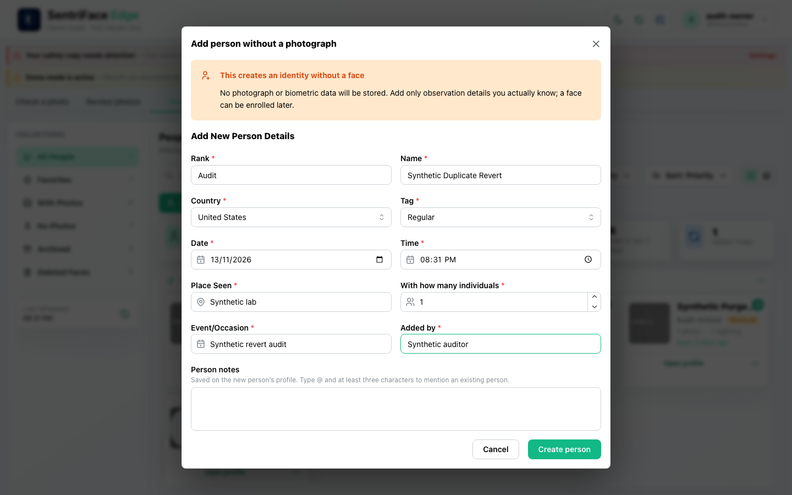](../screenshots/UX-07/UX-07_J27_Step-13_Pass2-Identical-revert-person-one-form.png)

Captured `2026-11-14T04:31:50.226667+00:00` · Administrator · UX-07 · synthetic fixture · scroll {'x': 0, 'y': 0}.

### Step 14 — Pass2 Identical revert person two form

Captured `2026-11-14T04:32:05.465900+00:00` · Administrator · UX-07 · synthetic fixture · scroll {'x': 0, 'y': 0}.

### Step 15 — Pass2 Identical person submission no second card

[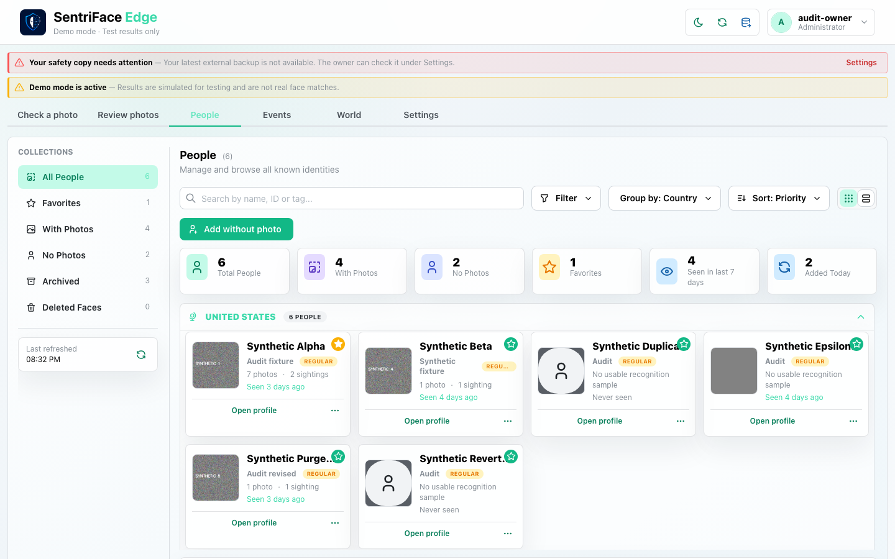](../screenshots/UX-05/UX-05_J27_Step-15_Pass2-Identical-person-submission-no-second-card.png)

Captured `2026-11-14T04:32:24.067305+00:00` · Administrator · UX-05 · synthetic fixture · scroll {'x': 0, 'y': 0}.

### Step 16 — Pass2 Edit candidate to matching name

[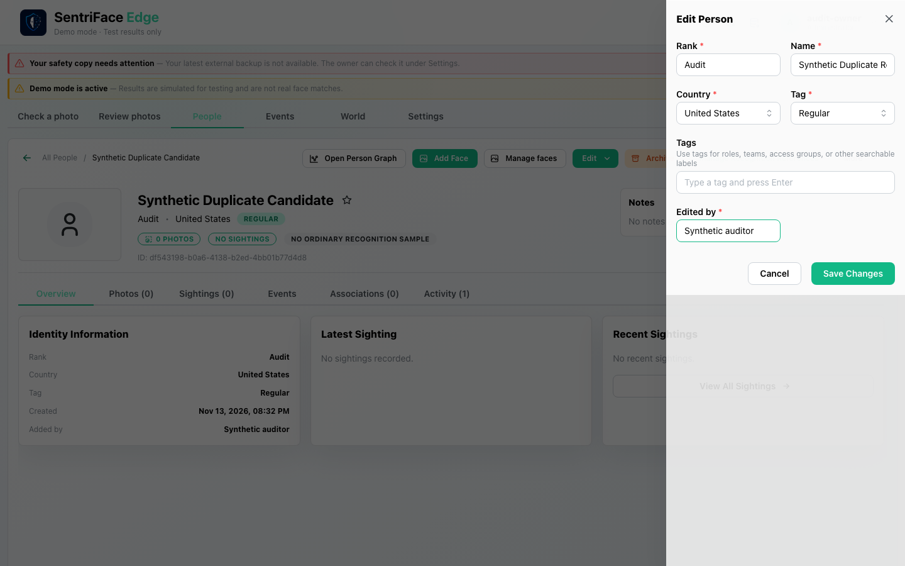](../screenshots/UX-07/UX-07_J27_Step-16_Pass2-Edit-candidate-to-matching-name.png)

Captured `2026-11-14T04:32:40.396388+00:00` · Administrator · UX-07 · synthetic fixture · scroll {'x': 0, 'y': 0}.

### Step 17 — Pass2 Duplicate name editor remains after refusal

[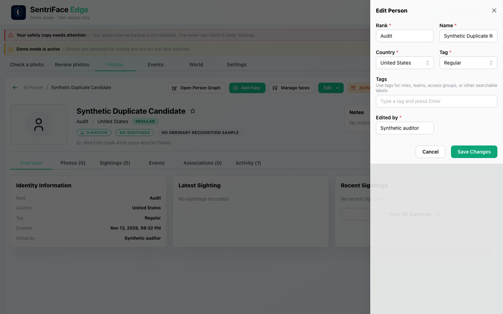](../screenshots/UX-07/UX-07_J27_Step-17_Pass2-Duplicate-name-edit-refused.png)

Captured `2026-11-14T04:32:52.473112+00:00` · Administrator · UX-07 · synthetic fixture · scroll {'x': 0, 'y': 0}.

### Step 18 — Pass2 Duplicate name edit cancelled

[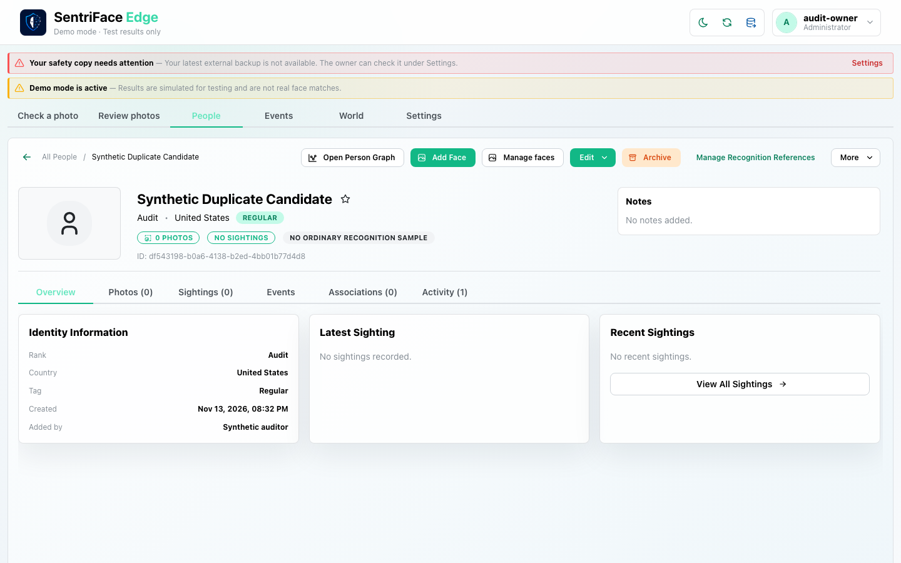](../screenshots/UX-06/UX-06_J27_Step-18_Pass2-Duplicate-name-edit-cancelled.png)

Captured `2026-11-14T04:32:53.410790+00:00` · Administrator · UX-06 · synthetic fixture · scroll {'x': 0, 'y': 0}.

### Step 19 — Pass2 Duplicate name error toast

[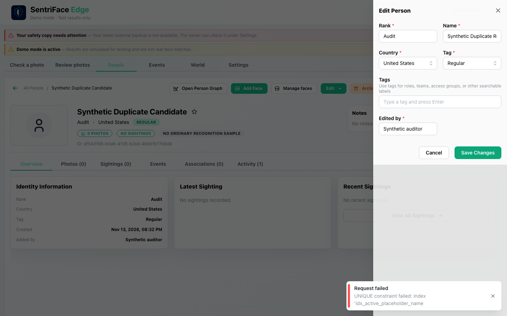](../screenshots/UX-07/UX-07_J27_Step-19_Pass2-Duplicate-name-error-toast.png)

Captured `2026-11-14T04:33:11.721401+00:00` · Administrator · UX-07 · synthetic fixture · scroll {'x': 0, 'y': 0}.

### Step 20 — Fresh merge refusal visible after retry

In a new authenticated browser session, load the same committed history and check the latest operation again. The refusal is visible in the window; this is a repeated actual server response, not a fabricated error.

[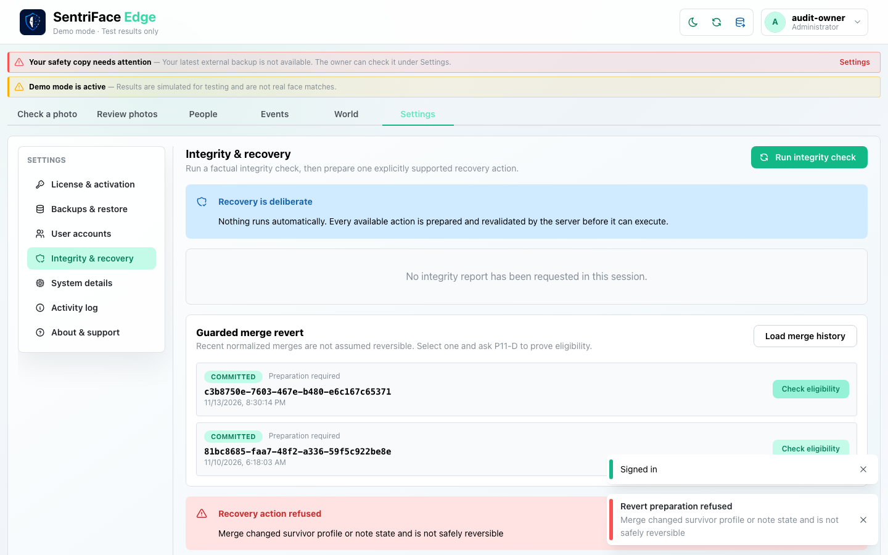](../screenshots/UX-13/UX-13_J27_Step-20_Pass2-Fresh-merge-refusal-visible.png)

Captured `2026-11-14T04:38:52.612475+00:00` · Administrator · UX-13 · synthetic fixture · scroll {'x': 0, 'y': 0}.

## macOS completion pass 2 — continuation F

Synthetic source mode, disposable authority, Administrator and Day at 1440×900 CSS viewport unless the capture register records otherwise. Source `b457f0a723e845dd1a92a07a577072c85146c89a`; browser-content originals, not native window chrome.

Attempt to merge the new one-Reference synthetic Person into another with four active References. The server refuses because the combined total exceeds four. Cancel; the source profile and survivor remain visible.

### Step 21 — Pass2 Reference cap merge attempt

[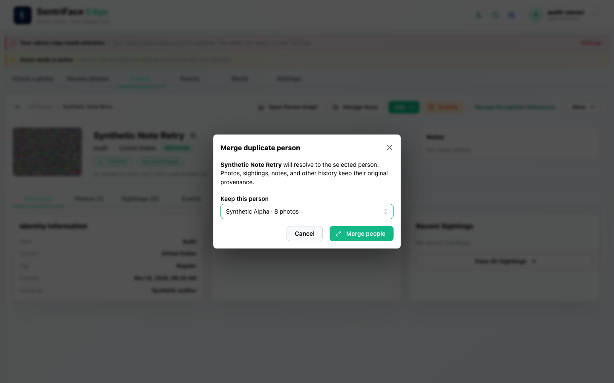](../screenshots/UX-08/UX-08_J27_Step-21_Pass2-Reference-cap-merge-attempt.png)

Captured 2026-11-14T16:28:01.541723+00:00 · Administrator · synthetic · scroll {'x': 0, 'y': 0}.

### Step 22 — Pass2 Reference cap merge refusal

[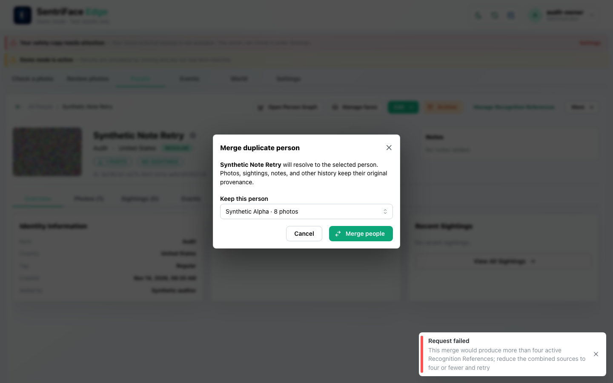](../screenshots/UX-08/UX-08_J27_Step-22_Pass2-Reference-cap-merge-refusal.png)

Captured 2026-11-14T16:28:16.707496+00:00 · Administrator · synthetic · scroll {'x': 0, 'y': 0}.

### Step 23 — Pass2 Reference cap source preserved

[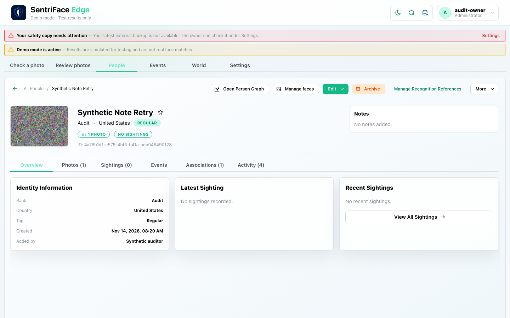](../screenshots/UX-06/UX-06_J27_Step-23_Pass2-Reference-cap-source-preserved.png)

Captured 2026-11-14T16:28:34.047685+00:00 · Administrator · synthetic · scroll {'x': 0, 'y': 0}.

### Step 24 — Pass2 Reference cap survivor preserved

[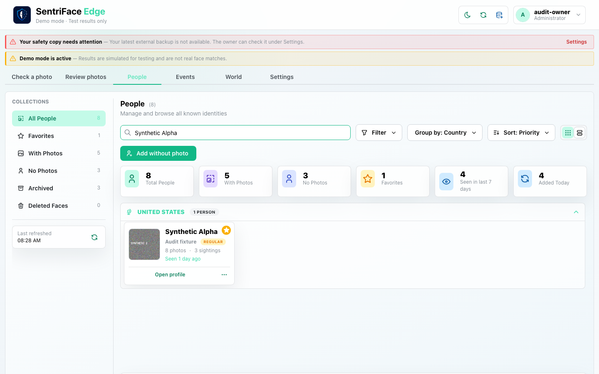](../screenshots/UX-05/UX-05_J27_Step-24_Pass2-Reference-cap-survivor-preserved.png)

Captured 2026-11-14T16:28:35.468735+00:00 · Administrator · synthetic · scroll {'x': 0, 'y': 0}.

## macOS completion pass 2 — continuation H

Synthetic source mode, dedicated disposable authority, Administrator, Day, 1440×900 CSS browser viewport. No production data or security guards were modified.

Create a no-photo synthetic Person and add a generated Reference. Create a same-named no-photo Person with the default observation time one minute later, merge it, and ask guarded revert eligibility: the server refuses because survivor profile or note state changed. In a separate same-name merge with another Reference, the application’s actual merge-preview response identifies a difference in the initial observation time. Raw response includes private paths and is not published.

Create a further same-named no-photo Person through the real UI with the same initial observation fields and time as the target, then merge into the target. The actual preview returns zero conflict fields; the merge history reports COMMITTED. Check eligibility: the server prepares a guarded plan. Enter an incorrect confirmation and observe execution disabled; Cancel returns to Settings. Prepare again, give a synthetic reason and type CONFIRM. Execute; the application reports recovery committed and a post-operation integrity PASS with zero findings. Refresh history: the operation is REVERTED; a repeat eligibility check refuses “Operation has already been reverted.” A fresh People view shows the restored source and survivor as two active synthetic profiles.

This qualifies only the tested safe subset, not arbitrary merges or dependent operations. Steps 30, 33, 35 and 38 capture submission/loading rather than completion; step 28 has the relevant cards below the viewport. Step 46 caught the People list before its asynchronous refresh and showed one card; step 48 is the independently observed two-card state after reopening. Legacy filenames are retained, with capture-register state corrected.

### Step 25 — Pass2 Safe revert first person before create

[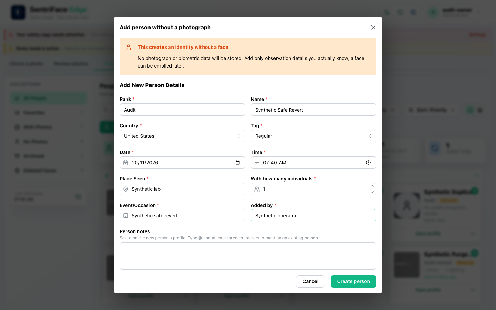](../screenshots/UX-05/UX-05_J27_Step-25_Pass2-Safe-revert-first-person-before-create.png)

Captured 2026-11-20T15:40:46.295550+00:00 · Administrator · synthetic · scroll {'x': 0, 'y': 0}.

### Step 26 — Pass2 Safe revert first person enrolled reference

[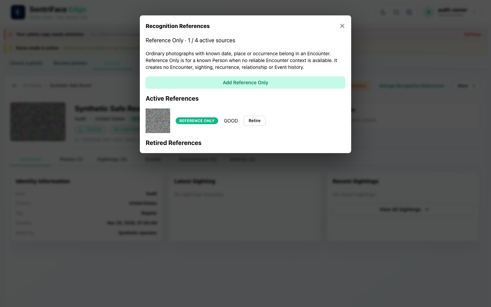](../screenshots/UX-07/UX-07_J27_Step-26_Pass2-Safe-revert-first-person-enrolled-reference.png)

Captured 2026-11-20T15:41:32.908195+00:00 · Administrator · synthetic · scroll {'x': 0, 'y': 0}.

### Step 27 — Pass2 Safe revert second same name before create

Captured 2026-11-20T15:41:40.139433+00:00 · Administrator · synthetic · scroll {'x': 0, 'y': 0}.

### Step 28 — Pass2 Safe revert people collection before merge profiles below viewport

[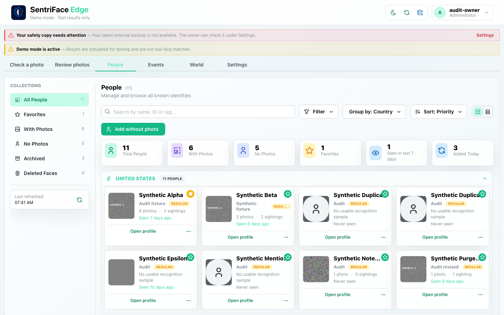](../screenshots/UX-05/UX-05_J27_Step-28_Pass2-Safe-revert-two-same-name-profiles.png)

Captured 2026-11-20T15:42:16.323670+00:00 · Administrator · synthetic · scroll {'x': 0, 'y': 0}.

### Step 29 — Pass2 Safe revert same profile merge confirm

Captured 2026-11-20T15:43:53.486486+00:00 · Administrator · synthetic · scroll {'x': 0, 'y': 0}.

### Step 30 — Pass2 Safe revert first merge submission loading

[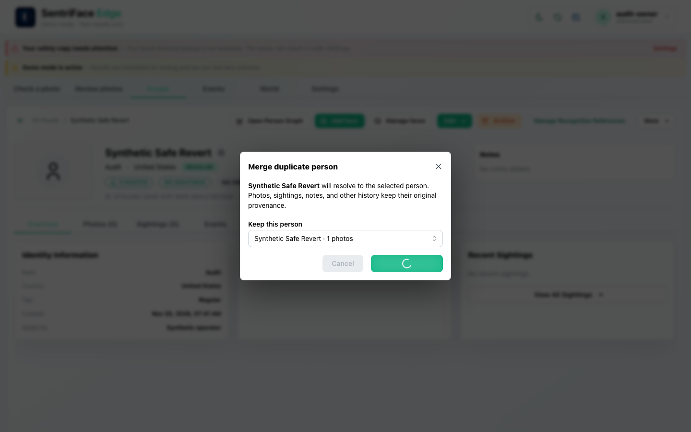](../screenshots/UX-05/UX-05_J27_Step-30_Pass2-Safe-revert-merge-result.png)

Captured 2026-11-20T15:43:58.327743+00:00 · Administrator · synthetic · scroll {'x': 0, 'y': 0}.

### Step 31 — Pass2 Safe revert history committed

[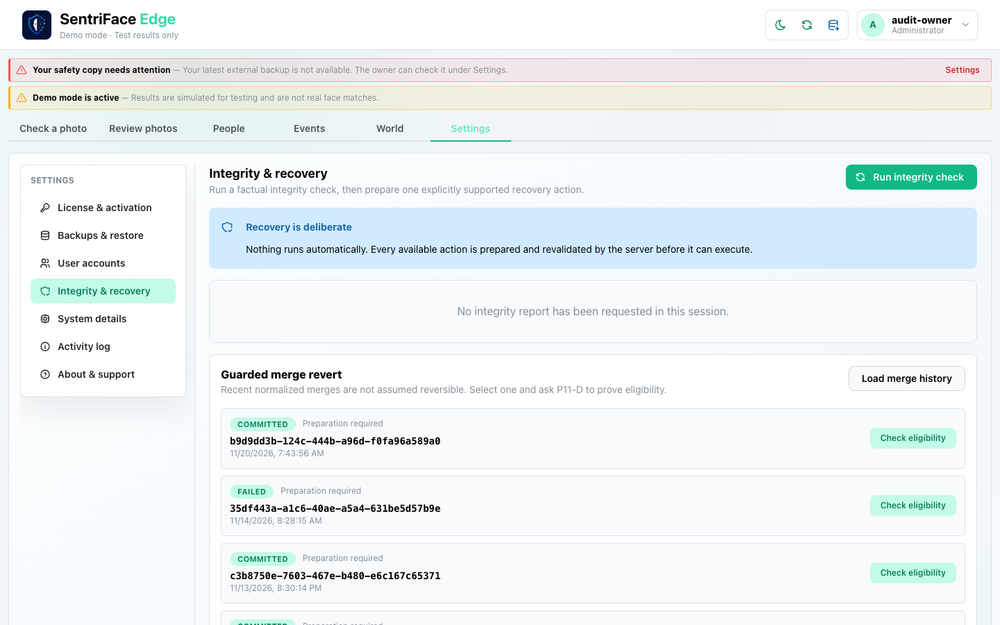](../screenshots/UX-13/UX-13_J27_Step-31_Pass2-Safe-revert-history-committed.png)

Captured 2026-11-20T15:45:07.954115+00:00 · Administrator · synthetic · scroll {'x': 0, 'y': 0}.

### Step 32 — Pass2 Safe revert eligibility result

[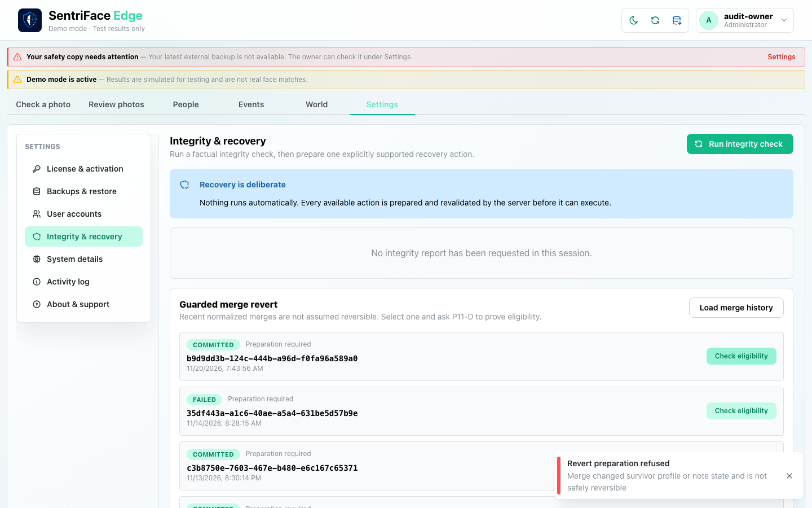](../screenshots/UX-13/UX-13_J27_Step-32_Pass2-Safe-revert-eligibility-result.png)

Captured 2026-11-20T15:45:13.566380+00:00 · Administrator · synthetic · scroll {'x': 0, 'y': 0}.

### Step 33 — Pass2 Safe revert second reference confirmation loading

[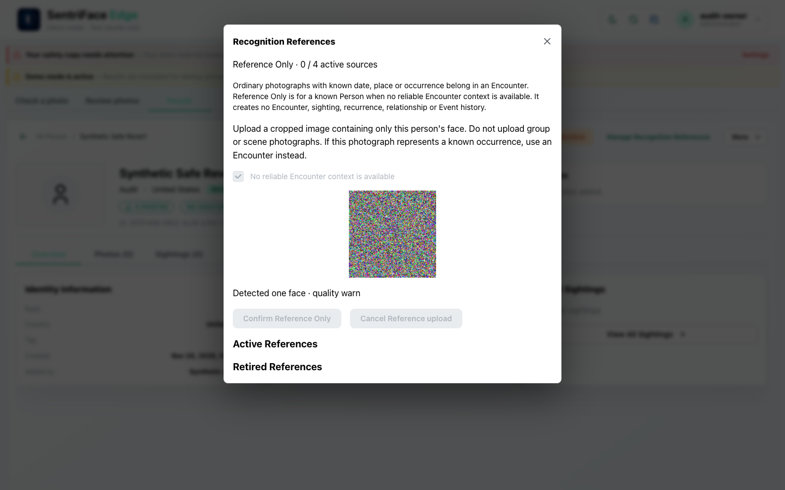](../screenshots/UX-07/UX-07_J27_Step-33_Pass2-Safe-revert-second-person-enrolled.png)

Captured 2026-11-20T15:46:30.512497+00:00 · Administrator · synthetic · scroll {'x': 0, 'y': 0}.

### Step 34 — Pass2 Safe revert two enrolled before merge

[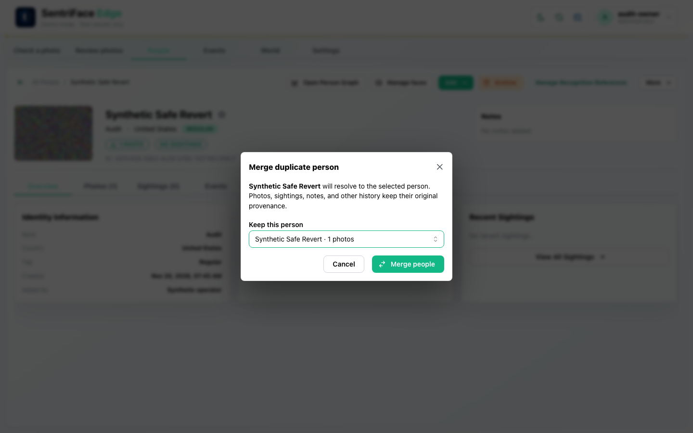](../screenshots/UX-08/UX-08_J27_Step-34_Pass2-Safe-revert-two-enrolled-before-merge.png)

Captured 2026-11-20T15:47:24.751021+00:00 · Administrator · synthetic · scroll {'x': 0, 'y': 80}.

### Step 35 — Pass2 Safe revert two enrolled merge submission loading

Captured 2026-11-20T15:47:31.099283+00:00 · Administrator · synthetic · scroll {'x': 0, 'y': 80}.

### Step 36 — Pass2 Safe revert matched observation before create

[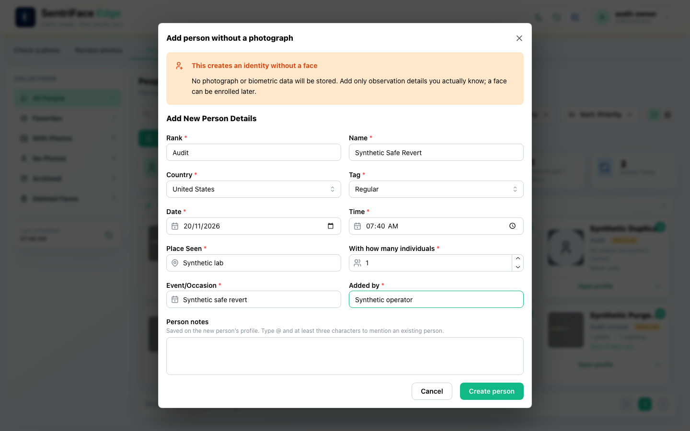](../screenshots/UX-05/UX-05_J27_Step-36_Pass2-Safe-revert-matched-observation-before-create.png)

Captured 2026-11-20T15:48:19.628122+00:00 · Administrator · synthetic · scroll {'x': 0, 'y': 80}.

### Step 37 — Pass2 Safe revert matched observation merge confirm

[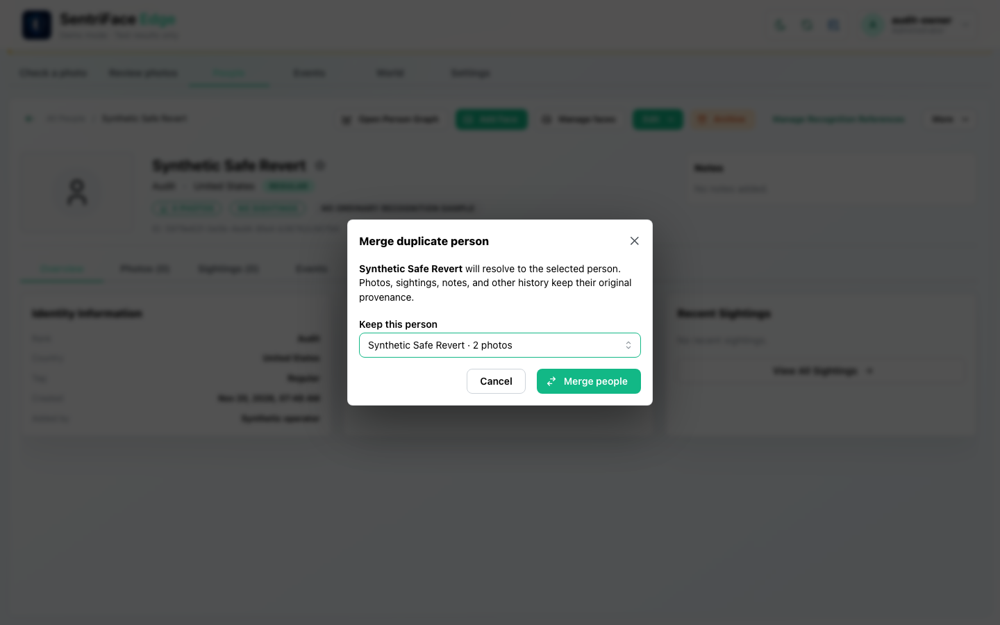](../screenshots/UX-08/UX-08_J27_Step-37_Pass2-Safe-revert-matched-observation-merge-confirm.png)

Captured 2026-11-20T15:49:12.478717+00:00 · Administrator · synthetic · scroll {'x': 0, 'y': 80}.

### Step 38 — Pass2 Safe revert matched merge submission loading

[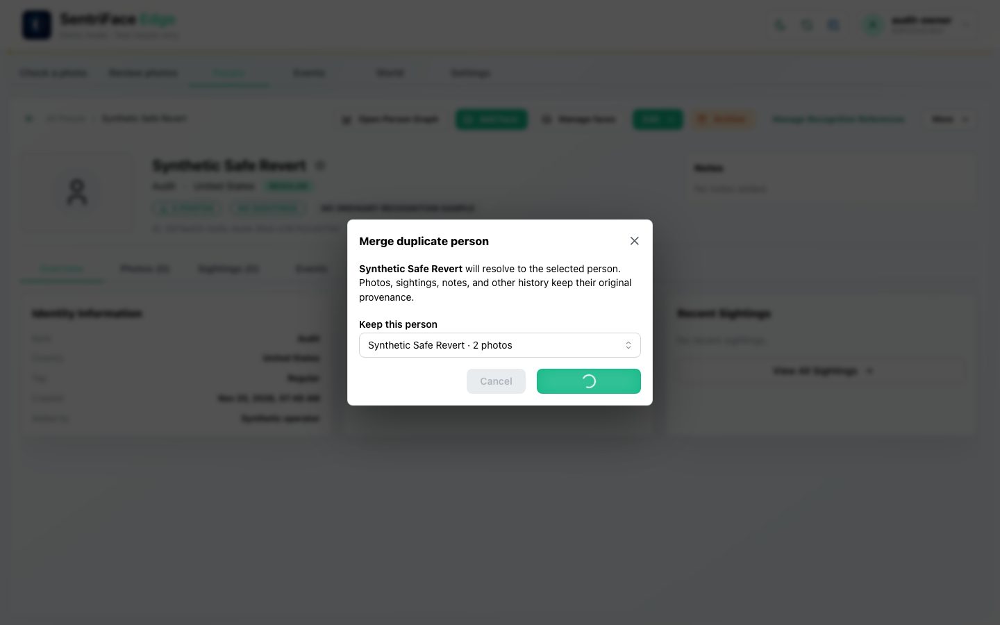](../screenshots/UX-05/UX-05_J27_Step-38_Pass2-Safe-revert-matched-observation-merge-result.png)

Captured 2026-11-20T15:49:20.140884+00:00 · Administrator · synthetic · scroll {'x': 0, 'y': 80}.

### Step 39 — Pass2 Safe revert matched merge history

[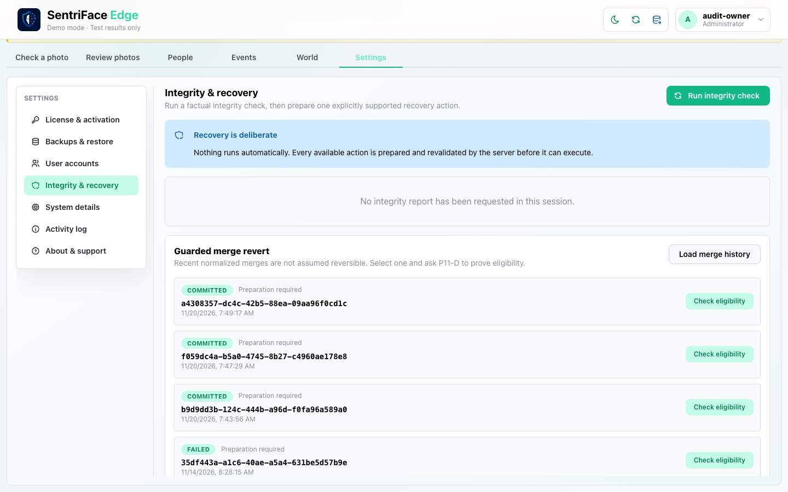](../screenshots/UX-13/UX-13_J27_Step-39_Pass2-Safe-revert-matched-merge-history.png)

Captured 2026-11-20T15:49:35.138425+00:00 · Administrator · synthetic · scroll {'x': 0, 'y': 80}.

### Step 40 — Pass2 Safe revert matched eligibility

[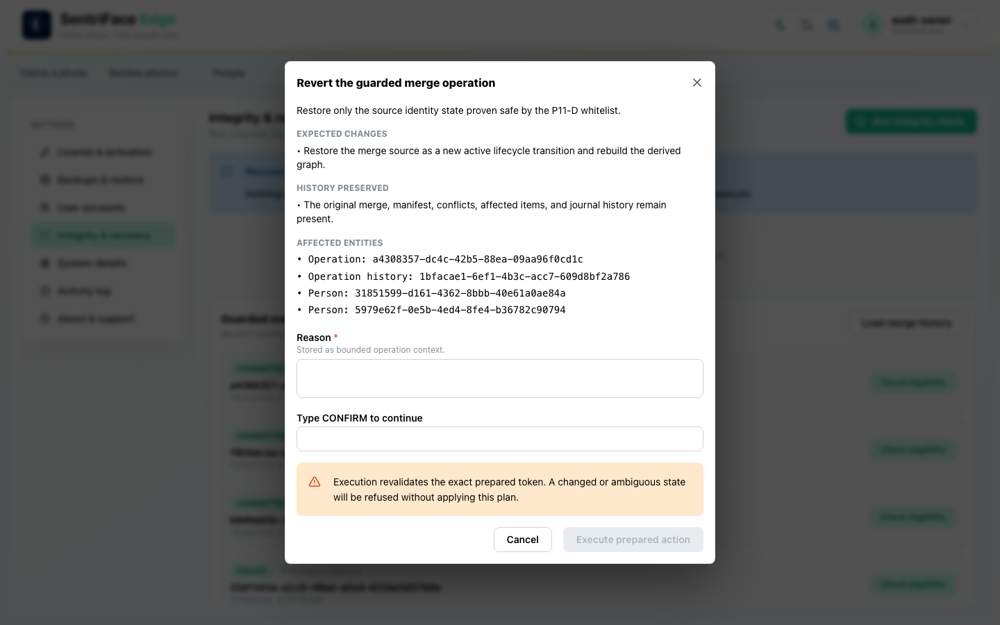](../screenshots/UX-13/UX-13_J27_Step-40_Pass2-Safe-revert-matched-eligibility.png)

Captured 2026-11-20T15:49:39.385314+00:00 · Administrator · synthetic · scroll {'x': 0, 'y': 80}.

### Step 41 — Pass2 Safe revert invalid confirmation

[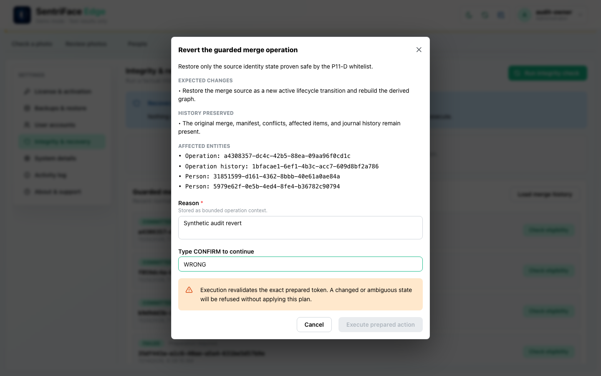](../screenshots/UX-13/UX-13_J27_Step-41_Pass2-Safe-revert-invalid-confirmation.png)

Captured 2026-11-20T15:49:55.961133+00:00 · Administrator · synthetic · scroll {'x': 0, 'y': 80}.

### Step 42 — Pass2 Safe revert plan canceled

Captured 2026-11-20T15:49:58.448293+00:00 · Administrator · synthetic · scroll {'x': 0, 'y': 80}.

### Step 43 — Pass2 Safe revert ready to execute

[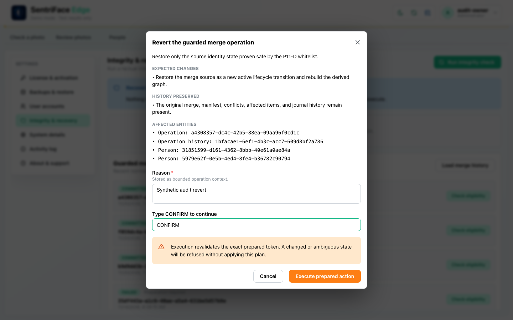](../screenshots/UX-13/UX-13_J27_Step-43_Pass2-Safe-revert-ready-to-execute.png)

Captured 2026-11-20T15:50:06.825603+00:00 · Administrator · synthetic · scroll {'x': 0, 'y': 80}.

### Step 44 — Pass2 Safe revert execution result

[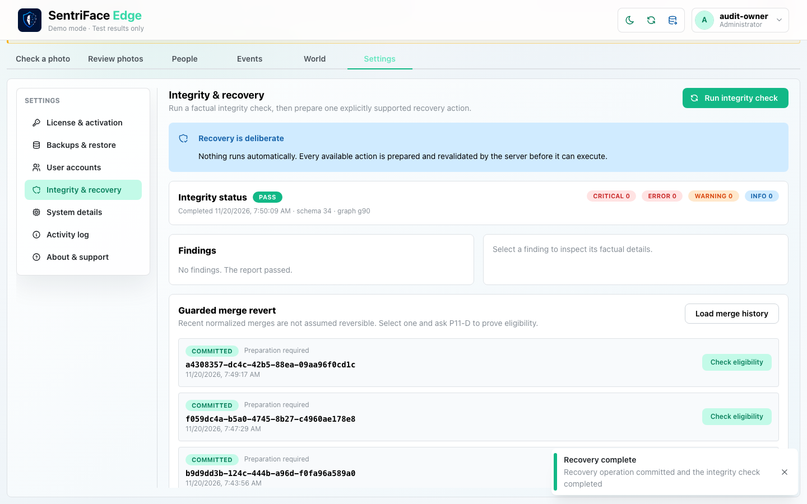](../screenshots/UX-13/UX-13_J27_Step-44_Pass2-Safe-revert-execution-result.png)

Captured 2026-11-20T15:50:13.307151+00:00 · Administrator · synthetic · scroll {'x': 0, 'y': 80}.

### Step 45 — Pass2 Safe revert refreshed history

[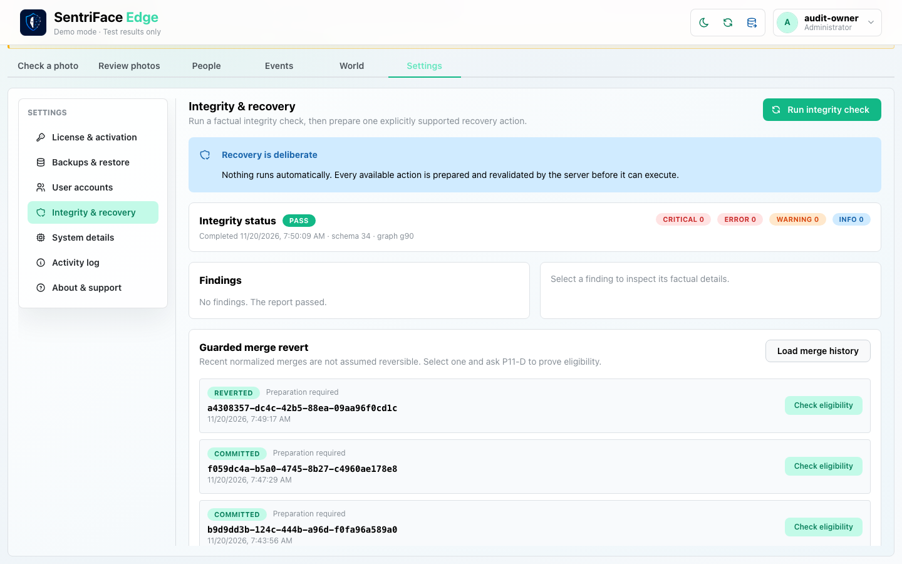](../screenshots/UX-13/UX-13_J27_Step-45_Pass2-Safe-revert-refreshed-history.png)

Captured 2026-11-20T15:50:35.754760+00:00 · Administrator · synthetic · scroll {'x': 0, 'y': 80}.

### Step 46 — Pass2 Safe revert people search before asynchronous update

[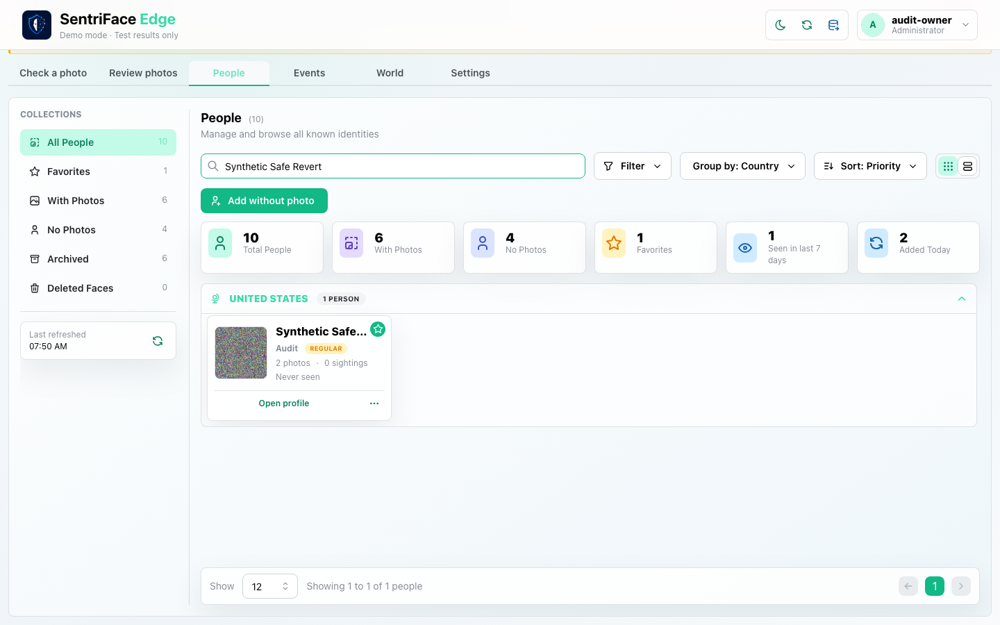](../screenshots/UX-05/UX-05_J27_Step-46_Pass2-Safe-revert-both-profiles-restored.png)

Captured 2026-11-20T15:50:40.943737+00:00 · Administrator · synthetic · scroll {'x': 0, 'y': 80}.

### Step 47 — Pass2 Safe revert repeat refusal

[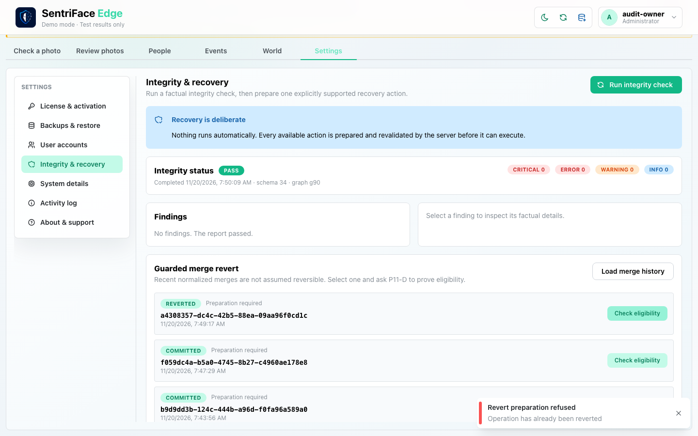](../screenshots/UX-13/UX-13_J27_Step-47_Pass2-Safe-revert-repeat-refusal.png)

Captured 2026-11-20T15:51:07.754912+00:00 · Administrator · synthetic · scroll {'x': 0, 'y': 80}.

### Step 48 — Pass2 Safe revert both profiles after refresh

[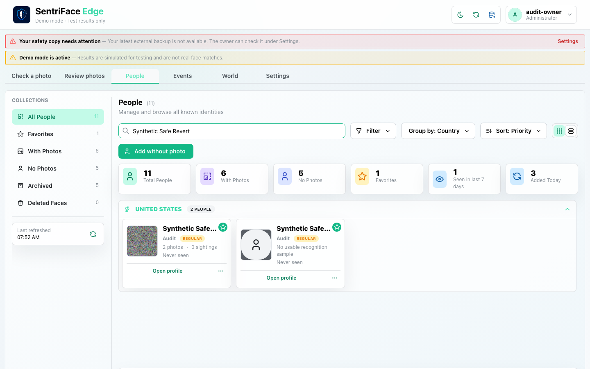](../screenshots/UX-05/UX-05_J27_Step-48_Pass2-Safe-revert-both-profiles-after-refresh.png)

Captured 2026-11-20T15:52:58.567283+00:00 · Administrator · synthetic · scroll {'x': 0, 'y': 0}.
