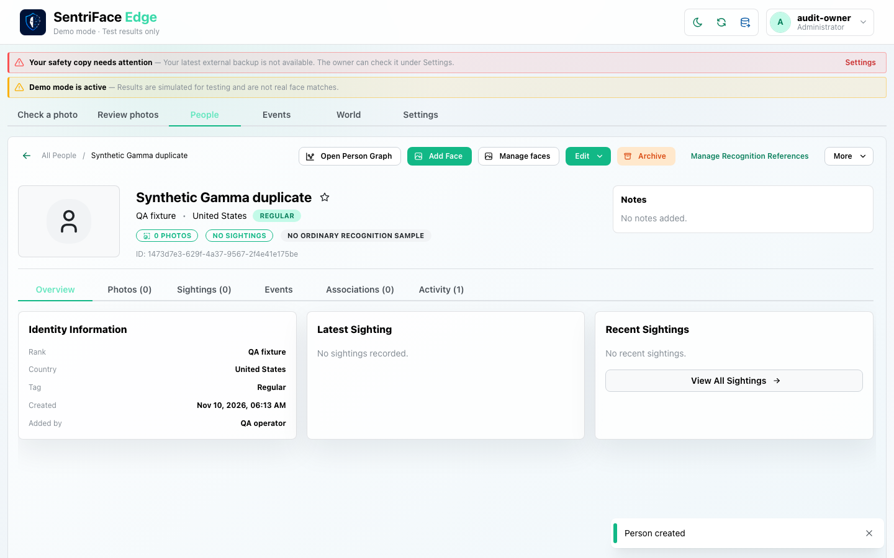
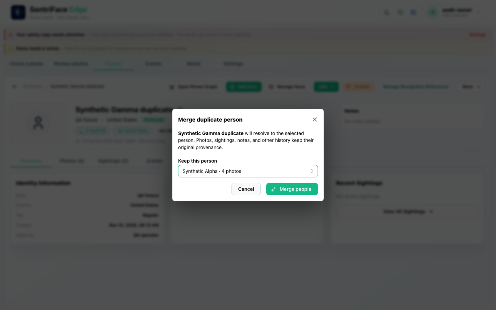
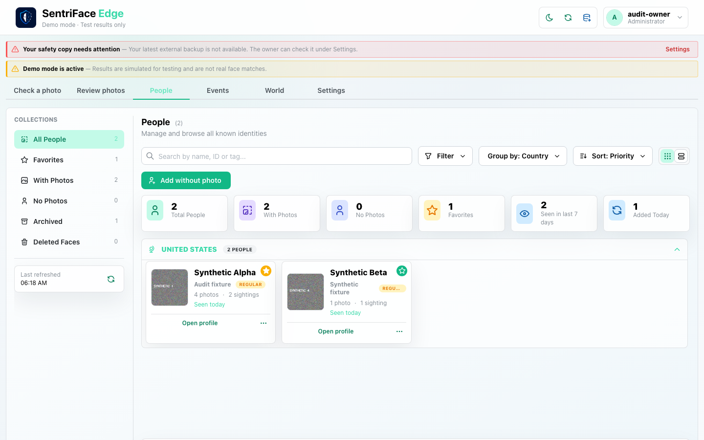
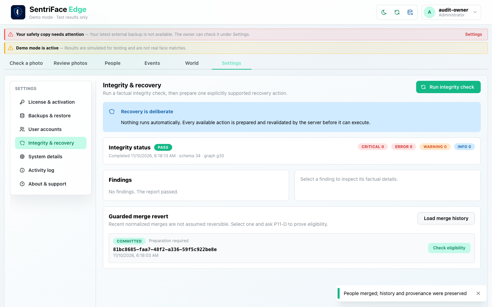
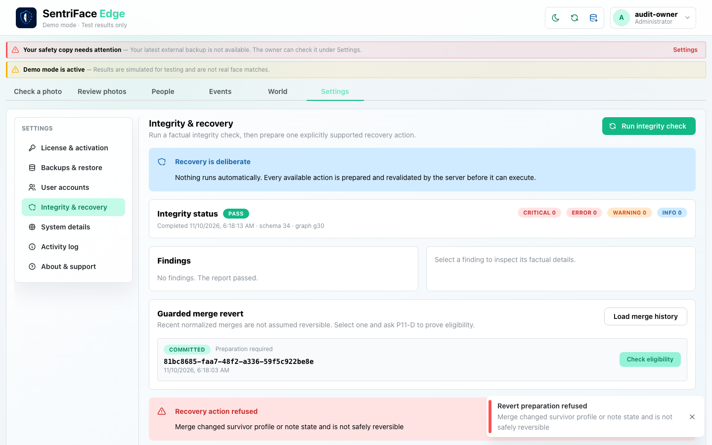

# J27 — Canonical merge and guarded revert refusal

[Audit index](../INDEX.md) · [Source oracle](../source-map.md) · [Independent review](../review.md)

**Scope result: PARTIAL.** Source tasks: SJ-023,SJ-034,SJ-055. Only the following observations are qualified; full source-contract branches remain in [the execution ledger](../source-branches.csv).

**Operator goal and entry:** Canonical merge and guarded revert refusal. Create source identity, choose active survivor, confirm merge; run integrity check; load committed merge history and ask eligibility.

**Starting state / role:** Administrator; a newly created disposable duplicate Person.

**Source:** `b457f0a723e845dd1a92a07a577072c85146c89a`. Captures were interrupted/resumed at this same product source. Synthetic means generated non-biometric patterns, not ONNX inference.

## Interaction sequence and authority

1. Create the disposable duplicate Person (step 1). Open Merge, select the active survivor and inspect the confirmation (step 2). Confirm through the real control.
2. The dialog closes to People (step 3). Step 4 subsequently shows the completion toast and committed merge history. The integrity check passed; this is distinct from an exhaustive historical-row proof.
3. Ask the existing history control for revert eligibility (step 5). The guard **P11-D** refuses because the survivor's profile/note state changed. This is a successful refusal branch, not a successful revert.
4. Return through Settings/People navigation. The source identity was merged into the survivor using current semantics. Prepared/successful revert, stale/overlapping merges and restart validation are not claimed.

## Step 01 — Disposable merge source created

Capture: UX-07 · Administrator · light · 1440×900 CSS viewport · DPR 1 · `2026-11-10T14:13:26.064806+00:00` · synthetic.

Scroll: x=0, y=0.

## Step 02 — Merge target chosen

Capture: UX-08 · Administrator · light · 1440×900 CSS viewport · DPR 1 · `2026-11-10T14:18:03.246264+00:00` · synthetic.

Scroll: x=0, y=0.

## Step 03 — People collection after merge

Capture: UX-08 · Administrator · light · 1440×900 CSS viewport · DPR 1 · `2026-11-10T14:18:10.185051+00:00` · synthetic.

Merge confirmation closed; committed history and completion toast independently observed at step4.

Scroll: x=0, y=0.

## Step 04 — Merge revert history

Capture: UX-13 · Administrator · light · 1440×900 CSS viewport · DPR 1 · `2026-11-10T14:18:14.705284+00:00` · synthetic.

Scroll: x=0, y=0.

## Step 05 — Revert eligibility result

Capture: UX-13 · Administrator · light · 1440×900 CSS viewport · DPR 1 · `2026-11-10T14:18:15.963485+00:00` · synthetic.

Scroll: x=0, y=0.

## Outcome, authority, return and limits

Merge completion feedback and committed history are visible at step4. Step3 is the resulting collection before feedback. P11-D refuses revert because survivor profile/note state changed. No successful prepared/reverted operation is claimed; raw historical invariants beyond these UI/backend responses are not exhaustively revalidated.

Navigation/read controls do not create authoritative identity or occurrence state. Mutations above use existing product commands. Return paths and later-session results are only claimed where ordered evidence or explicit checks demonstrate them. Missing cancellation, failure, stale, role or restart branches remain visible in the source execution ledger.
