# J27 — Canonical merge and guarded revert refusal

[Audit index](../INDEX.md) · [Source oracle](../source-map.md) · [Independent review](../review.md)

**Scope result: PARTIAL.** Source tasks: SJ-023,SJ-034,SJ-055. Only the following observations are qualified; full source-contract branches remain in [the execution ledger](../source-branches.csv).

**Operator goal and entry:** Canonical merge and guarded revert refusal. Create source identity, choose active survivor, confirm merge; run integrity check; load committed merge history and ask eligibility.

**Starting state / role:** Administrator; a newly created disposable duplicate Person.

**Source:** `b457f0a723e845dd1a92a07a577072c85146c89a`. Captures were interrupted/resumed at this same product source. Synthetic means generated non-biometric patterns, not ONNX inference.

## Interaction sequence and authority

1. Create the disposable duplicate Person (step 1). Open Merge, select the active survivor and inspect the confirmation (step 2). Confirm through the real control.
2. The dialog closes to People (step 3). Step 4 subsequently shows the completion toast and committed merge history. The integrity check passed; this is distinct from an exhaustive historical-row proof.
3. Ask the existing history control for revert eligibility (step 5). The guard **P11-D** refuses because the survivor's profile/note state changed. This is a successful refusal branch, not a successful revert.
4. Return through Settings/People navigation. The source identity was merged into the survivor using current semantics. Prepared/successful revert, stale/overlapping merges and restart validation are not claimed.

## Step 01 — Disposable merge source created

Capture: UX-07 · Administrator · light · 1440×900 CSS viewport · DPR 1 · `2026-11-10T14:13:26.064806+00:00` · synthetic.

Scroll: x=0, y=0.

## Step 02 — Merge target chosen

Capture: UX-08 · Administrator · light · 1440×900 CSS viewport · DPR 1 · `2026-11-10T14:18:03.246264+00:00` · synthetic.

Scroll: x=0, y=0.

## Step 03 — People collection after merge

Capture: UX-08 · Administrator · light · 1440×900 CSS viewport · DPR 1 · `2026-11-10T14:18:10.185051+00:00` · synthetic.

Merge confirmation closed; committed history and completion toast independently observed at step4.

Scroll: x=0, y=0.

## Step 04 — Merge revert history

Capture: UX-13 · Administrator · light · 1440×900 CSS viewport · DPR 1 · `2026-11-10T14:18:14.705284+00:00` · synthetic.

Scroll: x=0, y=0.

## Step 05 — Revert eligibility result

Capture: UX-13 · Administrator · light · 1440×900 CSS viewport · DPR 1 · `2026-11-10T14:18:15.963485+00:00` · synthetic.

Scroll: x=0, y=0.

## Outcome, authority, return and limits

Merge completion feedback and committed history are visible at step4. Step3 is the resulting collection before feedback. P11-D refuses revert because survivor profile/note state changed. No successful prepared/reverted operation is claimed; raw historical invariants beyond these UI/backend responses are not exhaustively revalidated.

Navigation/read controls do not create authoritative identity or occurrence state. Mutations above use existing product commands. Return paths and later-session results are only claimed where ordered evidence or explicit checks demonstrate them. Missing cancellation, failure, stale, role or restart branches remain visible in the source execution ledger.

## macOS completion pass 2 — continuation D

Source product `b457f0a723e845dd1a92a07a577072c85146c89a`; disposable authority; full browser-content viewport 1440×900 CSS pixels, DPR 1, Day. Role and capture time are recorded per step.

Create two fresh synthetic no-photo identities with different names, merge source into survivor, and check the newly committed operation. The server refuses revert with the same survivor profile/note conflict message. Try creating two identical synthetic placeholders: after the second submission only one card is observed; the precise server response was not captured. Create a differently named placeholder and edit it to the existing name: the server refuses with a raw UNIQUE constraint error, and Cancel preserves the profile. Identical-name attempts were not bypassed. Successful prepared revert remains unverified; source guard identifies conflicts as outside its safe subset.

### Step 06 — Pass2 Revert source form

[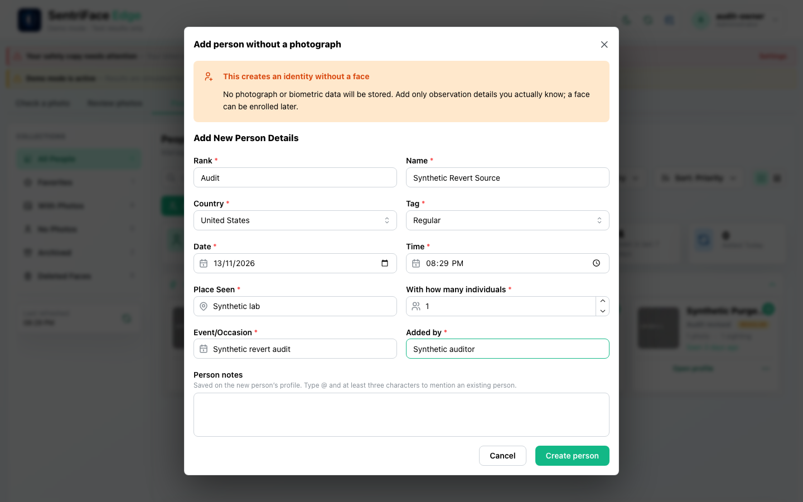](../screenshots/UX-07/UX-07_J27_Step-06_Pass2-Revert-source-form.png)

Captured `2026-11-14T04:29:23.650552+00:00` · Administrator · UX-07 · synthetic fixture · scroll {'x': 0, 'y': 0}.

### Step 07 — Pass2 Revert source created

Captured `2026-11-14T04:29:40.587723+00:00` · Administrator · UX-05 · synthetic fixture · scroll {'x': 0, 'y': 0}.

### Step 08 — Pass2 Revert survivor created

[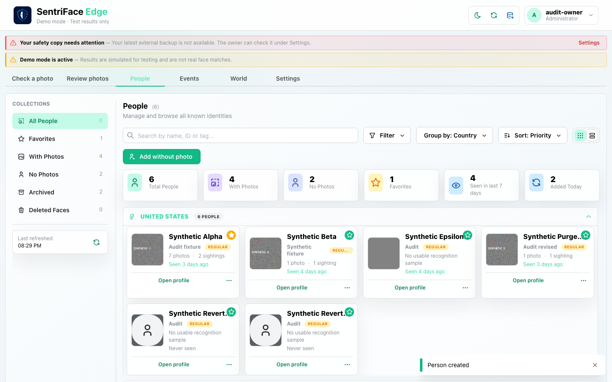](../screenshots/UX-05/UX-05_J27_Step-08_Pass2-Revert-survivor-created.png)

Captured `2026-11-14T04:29:42.960146+00:00` · Administrator · UX-05 · synthetic fixture · scroll {'x': 0, 'y': 0}.

### Step 09 — Pass2 Revert merge confirmation

[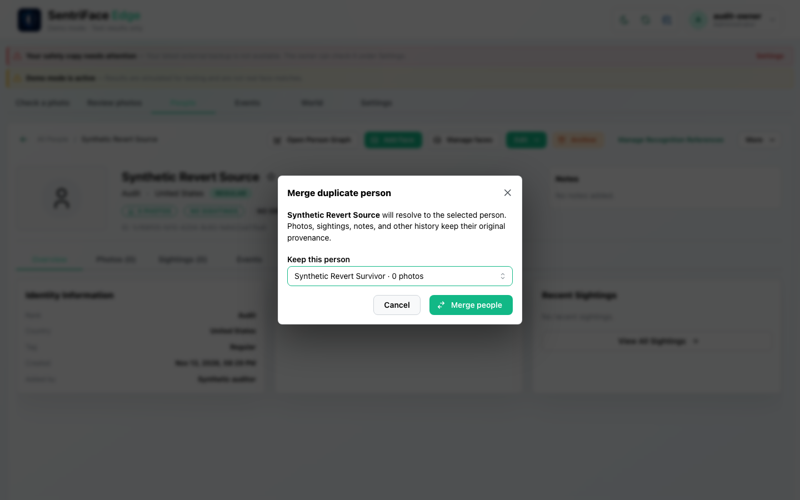](../screenshots/UX-08/UX-08_J27_Step-09_Pass2-Revert-merge-confirmation.png)

Captured `2026-11-14T04:30:14.051568+00:00` · Administrator · UX-08 · synthetic fixture · scroll {'x': 0, 'y': 0}.

### Step 10 — Pass2 Revert merge completed

[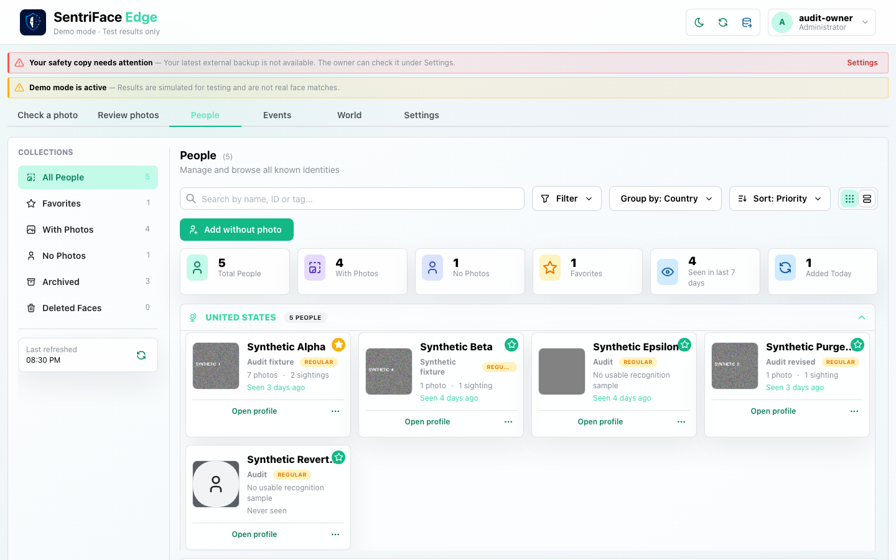](../screenshots/UX-05/UX-05_J27_Step-10_Pass2-Revert-merge-completed.png)

Captured `2026-11-14T04:30:30.971818+00:00` · Administrator · UX-05 · synthetic fixture · scroll {'x': 0, 'y': 0}.

### Step 11 — Pass2 Fresh merge history

[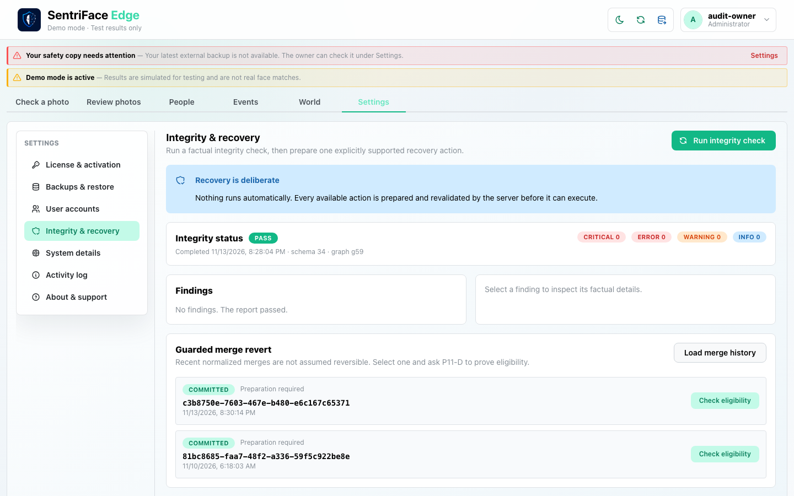](../screenshots/UX-13/UX-13_J27_Step-11_Pass2-Fresh-merge-history.png)

Captured `2026-11-14T04:30:44.749967+00:00` · Administrator · UX-13 · synthetic fixture · scroll {'x': 0, 'y': 0}.

### Step 12 — Fresh merge eligibility response (refusal below viewport)

[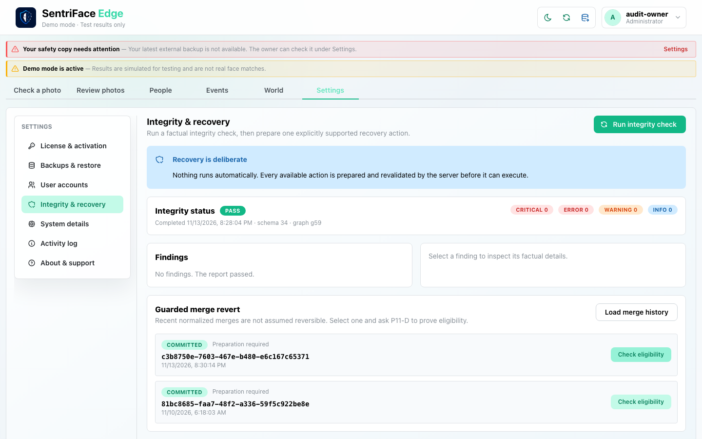](../screenshots/UX-13/UX-13_J27_Step-12_Pass2-Fresh-merge-revert-refused.png)

Captured `2026-11-14T04:30:59.392226+00:00` · Administrator · UX-13 · synthetic fixture · scroll {'x': 0, 'y': 0}.

### Step 13 — Pass2 Identical revert person one form

[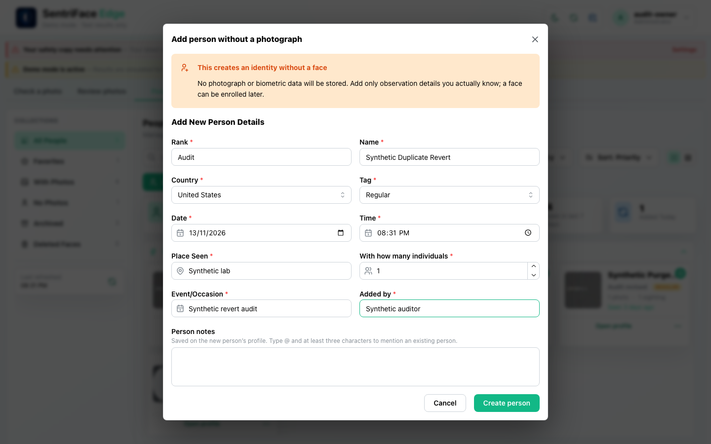](../screenshots/UX-07/UX-07_J27_Step-13_Pass2-Identical-revert-person-one-form.png)

Captured `2026-11-14T04:31:50.226667+00:00` · Administrator · UX-07 · synthetic fixture · scroll {'x': 0, 'y': 0}.

### Step 14 — Pass2 Identical revert person two form

Captured `2026-11-14T04:32:05.465900+00:00` · Administrator · UX-07 · synthetic fixture · scroll {'x': 0, 'y': 0}.

### Step 15 — Pass2 Identical person submission no second card

[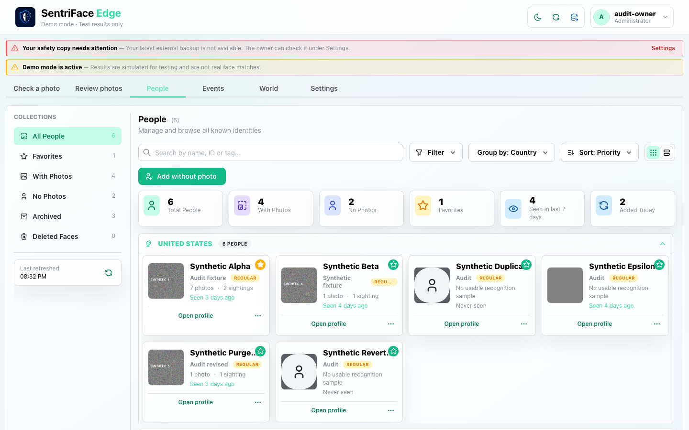](../screenshots/UX-05/UX-05_J27_Step-15_Pass2-Identical-person-submission-no-second-card.png)

Captured `2026-11-14T04:32:24.067305+00:00` · Administrator · UX-05 · synthetic fixture · scroll {'x': 0, 'y': 0}.

### Step 16 — Pass2 Edit candidate to matching name

[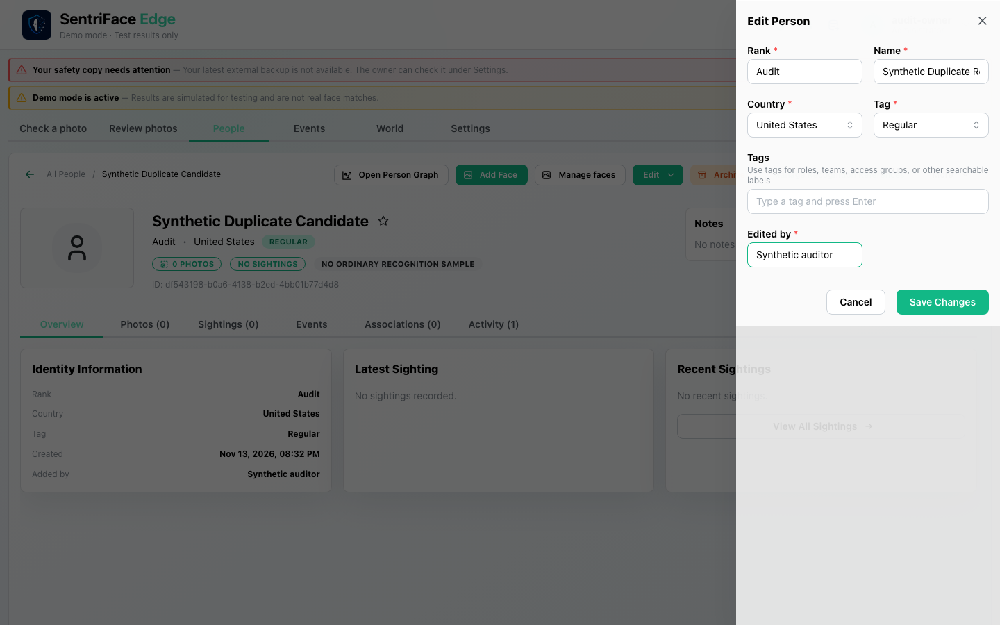](../screenshots/UX-07/UX-07_J27_Step-16_Pass2-Edit-candidate-to-matching-name.png)

Captured `2026-11-14T04:32:40.396388+00:00` · Administrator · UX-07 · synthetic fixture · scroll {'x': 0, 'y': 0}.

### Step 17 — Pass2 Duplicate name editor remains after refusal

[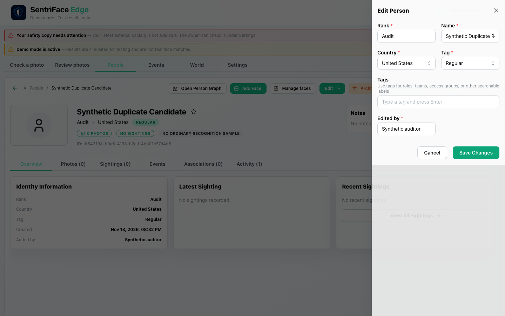](../screenshots/UX-07/UX-07_J27_Step-17_Pass2-Duplicate-name-edit-refused.png)

Captured `2026-11-14T04:32:52.473112+00:00` · Administrator · UX-07 · synthetic fixture · scroll {'x': 0, 'y': 0}.

### Step 18 — Pass2 Duplicate name edit cancelled

[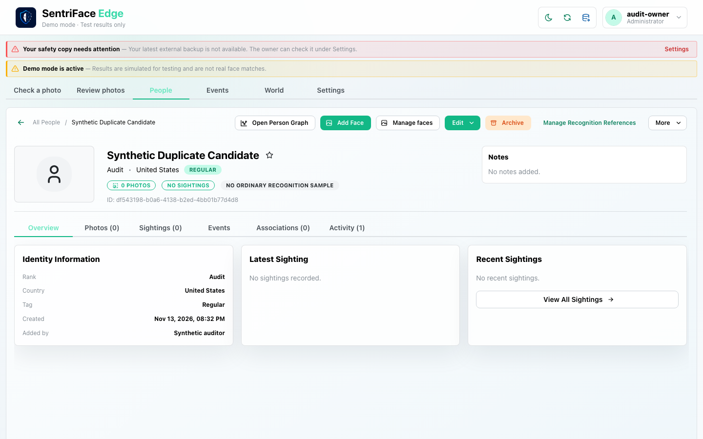](../screenshots/UX-06/UX-06_J27_Step-18_Pass2-Duplicate-name-edit-cancelled.png)

Captured `2026-11-14T04:32:53.410790+00:00` · Administrator · UX-06 · synthetic fixture · scroll {'x': 0, 'y': 0}.

### Step 19 — Pass2 Duplicate name error toast

[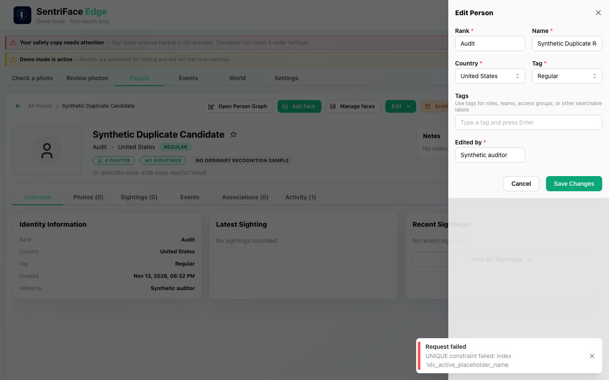](../screenshots/UX-07/UX-07_J27_Step-19_Pass2-Duplicate-name-error-toast.png)

Captured `2026-11-14T04:33:11.721401+00:00` · Administrator · UX-07 · synthetic fixture · scroll {'x': 0, 'y': 0}.

### Step 20 — Fresh merge refusal visible after retry

In a new authenticated browser session, load the same committed history and check the latest operation again. The refusal is visible in the window; this is a repeated actual server response, not a fabricated error.

[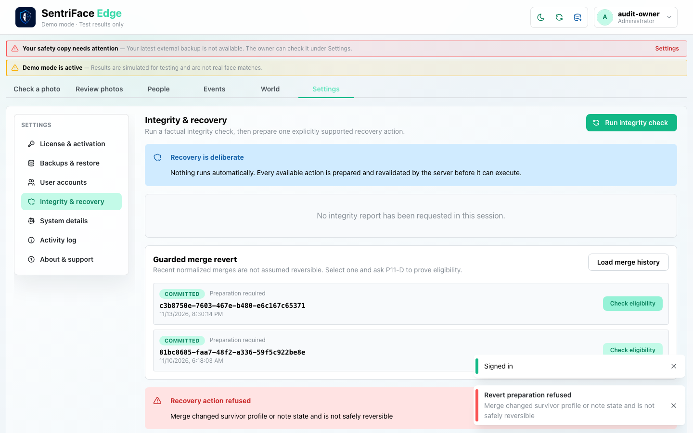](../screenshots/UX-13/UX-13_J27_Step-20_Pass2-Fresh-merge-refusal-visible.png)

Captured `2026-11-14T04:38:52.612475+00:00` · Administrator · UX-13 · synthetic fixture · scroll {'x': 0, 'y': 0}.
