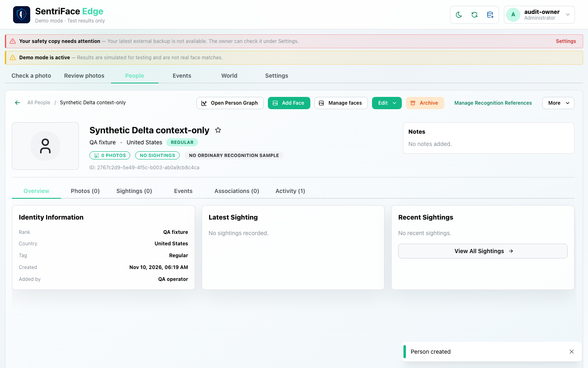
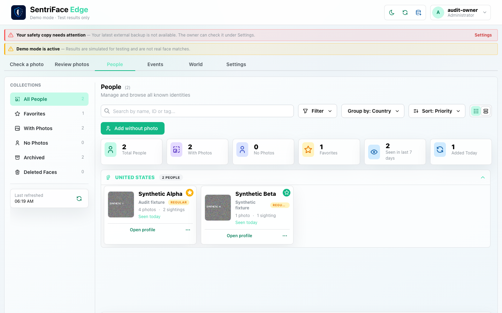

# J28 — Tombstone a disposable Person

[Audit index](../INDEX.md) · [Source oracle](../source-map.md) · [Independent review](../review.md)

**Scope result: PARTIAL.** Source tasks: SJ-023,SJ-033. Only the following observations are qualified; full source-contract branches remain in [the execution ledger](../source-branches.csv).

**Operator goal and entry:** Tombstone a disposable Person. Open profile deletion, type DELETE, confirm through actual control, return to collection.

**Starting state / role:** Administrator; newly created context-only synthetic identity.

**Source:** `b457f0a723e845dd1a92a07a577072c85146c89a`. Captures were interrupted/resumed at this same product source. Synthetic means generated non-biometric patterns, not ONNX inference.

## Interaction sequence and authority

1. Create a disposable context-only Person with no genuine photographs (step 1). Open the existing profile deletion confirmation, type the required **DELETE** phrase and confirm.
2. Return to the People collection (step 2). This immediate frame precedes the feedback; the actual **Profile deleted** toast and safety-backup statement remain visible in [J29 step 1](J29.md#step-01--note-mention-suggestions).
3. This executes current tombstoning semantics on disposable authority only. The application states a safety backup retains a recovery copy; this is not evidence of erased history or an independently restored copy.
4. Navigation back to People succeeds. Deletion cancellation is covered in the earlier lifecycle journey; a restore of this tombstone, restart persistence and every historical consumer are not qualified here.

## Step 01 — Context only person

Capture: UX-07 · Administrator · light · 1440×900 CSS viewport · DPR 1 · `2026-11-10T14:19:25.187821+00:00` · synthetic.

Scroll: x=0, y=0.

## Step 02 — People collection after tombstone

Capture: UX-08 · Administrator · light · 1440×900 CSS viewport · DPR 1 · `2026-11-10T14:19:28.279736+00:00` · synthetic.

Deleted feedback and verified safety-copy statement appear in J29step1.

Scroll: x=0, y=0.

## Outcome, authority, return and limits

Step2 is collection before toast. J29step1 carries actual Profile deleted feedback and the product statement that a safety backup retains a recovery copy. This was disposable authority only. Historical retention copy is not an independent every-row proof, and deletion is not labelled erasure of history.

Navigation/read controls do not create authoritative identity or occurrence state. Mutations above use existing product commands. Return paths and later-session results are only claimed where ordered evidence or explicit checks demonstrate them. Missing cancellation, failure, stale, role or restart branches remain visible in the source execution ledger.
