# J29 — Selected Person Note and independent evidence

[Audit index](../INDEX.md) · [Source oracle](../source-map.md) · [Independent review](../review.md)

**Scope result: PARTIAL.** Source tasks: SJ-029,SJ-027. Only the following observations are qualified; full source-contract branches remain in [the execution ledger](../source-branches.csv).

**Operator goal and entry:** Selected Person Note and independent evidence. Edit Notes, type a three-character-plus Person query, choose the existing Person, save, inspect Associations.

**Starting state / role:** Administrator; existing synthetic Alpha/Beta.

**Source:** `b457f0a723e845dd1a92a07a577072c85146c89a`. Captures were interrupted/resumed at this same product source. Synthetic means generated non-biometric patterns, not ONNX inference.

## Interaction sequence and authority

1. In the existing Person profile, open Notes and type a Person search of at least three characters (step 1). The lingering deletion toast belongs to J28, not this Note action.
2. Choose the actual existing counterpart from the suggestions (step 2), then Save (step 3). The saved structured mention badge and **Notes saved** feedback distinguish selection from plain typed text.
3. Open Associations (step 4). Separate MENTION-LINKED and CO-OBSERVED evidence groups support the same counterpart. The tab count is 2 while **Associated people** is 1; these count different things.
4. Return using the existing profile tabs/Back. This saved a Note and selected reference; it did not create a new Person or replace co-observed evidence. Literal-only Note comparison, placeholder creation, stale Note conflicts and restart are unverified.

## Step 01 — Note mention suggestions

[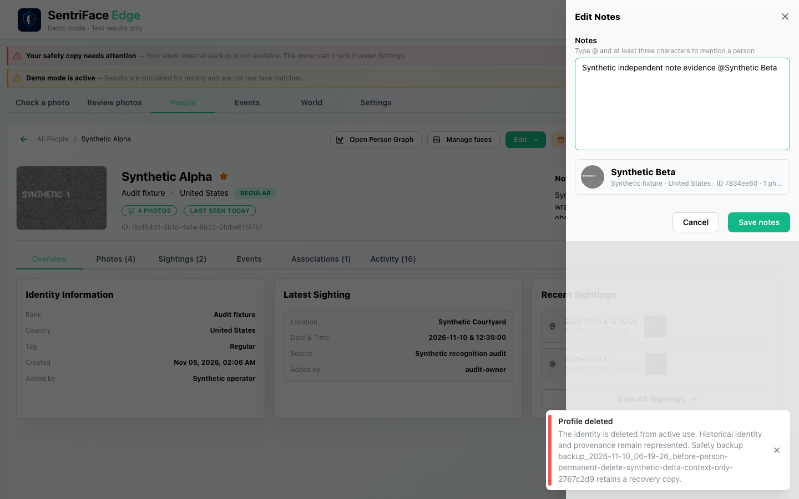](../screenshots/UX-07/UX-07_J29_Step-01_Note-mention-suggestions.png)

Capture: UX-07 · Administrator · light · 1440×900 CSS viewport · DPR 1 · `2026-11-10T14:19:30.649899+00:00` · synthetic.

Scroll: x=0, y=0.

## Step 02 — Selected mention

[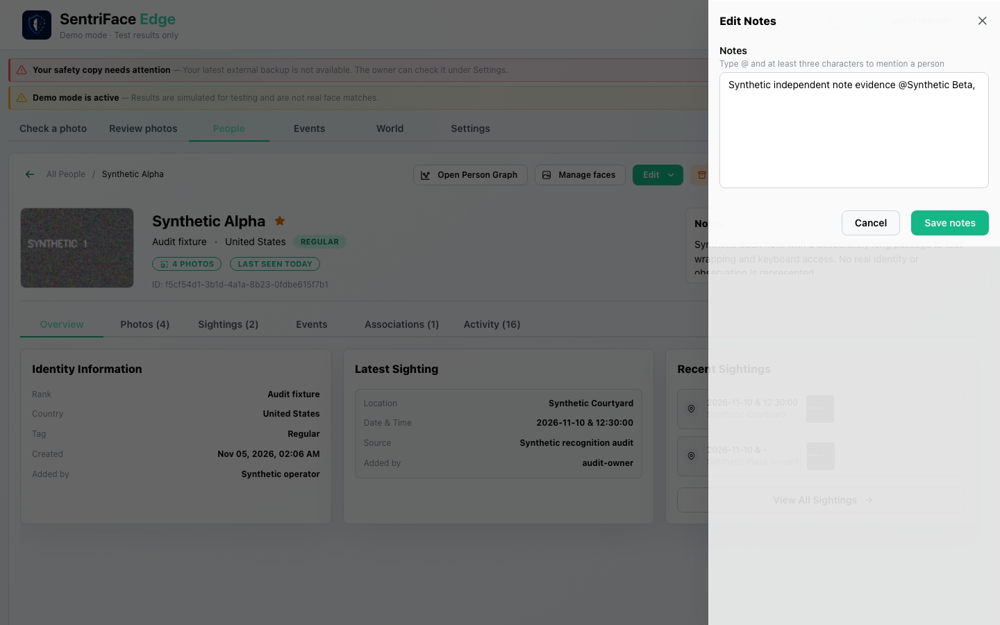](../screenshots/UX-07/UX-07_J29_Step-02_Selected-mention.png)

Capture: UX-07 · Administrator · light · 1440×900 CSS viewport · DPR 1 · `2026-11-10T14:20:42.379020+00:00` · synthetic.

Scroll: x=0, y=0.

## Step 03 — Mention note saved

[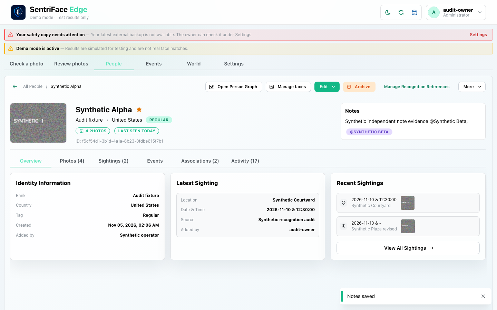](../screenshots/UX-07/UX-07_J29_Step-03_Mention-note-saved.png)

Capture: UX-07 · Administrator · light · 1440×900 CSS viewport · DPR 1 · `2026-11-10T14:20:45.735638+00:00` · synthetic.

Scroll: x=0, y=0.

## Step 04 — Note and coobserved independent

[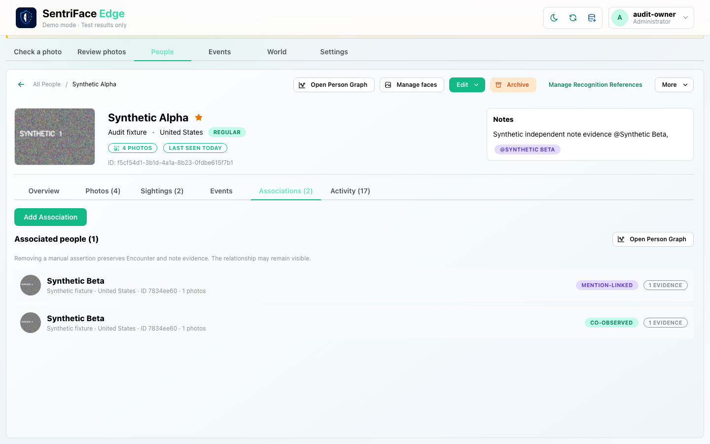](../screenshots/UX-06/UX-06_J29_Step-04_Note-and-coobserved-independent.png)

Capture: UX-06 · Administrator · light · 1440×900 CSS viewport · DPR 1 · `2026-11-10T14:23:01.371488+00:00` · synthetic.

Scroll: x=0, y=80.

## Outcome, authority, return and limits

Structured mention badge and Notes saved are visible. Separate mention-linked and co-observed rows remain. Associations tab says2 while Associated people says1: distinguish evidence groups from unique counterparts. No literal-only mutation/evidence comparison or mention-created placeholder is claimed.

Navigation/read controls do not create authoritative identity or occurrence state. Mutations above use existing product commands. Return paths and later-session results are only claimed where ordered evidence or explicit checks demonstrate them. Missing cancellation, failure, stale, role or restart branches remain visible in the source execution ledger.

## macOS completion pass 2 — continuation C

Source product `b457f0a723e845dd1a92a07a577072c85146c89a`; disposable authority; 1440×900 browser-content viewport, DPR 1, Day, Administrator.

Save a long synthetic note and observe profile layout. Replace it with a selected explicit Alpha mention and save; the note and mention badge are displayed. Reopen the editor, clear all text and save: Overview says “No notes added”, but Associations still shows Alpha as “Mention-linked 1 evidence”. Reload and reopen the profile: the association persists. The editor exposed no selected-mention removal control in this scenario. This is a correction/visibility failure for the observed path; do not infer underlying historical-retention semantics or fabricate a successful removal.

### Step 05 — Pass2 Long note in drawer

[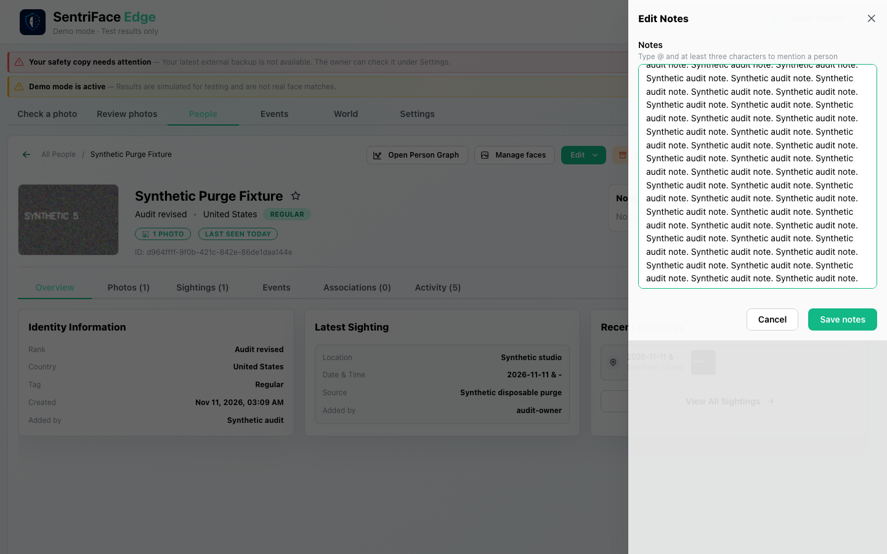](../screenshots/UX-07/UX-07_J29_Step-05_Pass2-Long-note-in-drawer.png)

Captured `2026-11-11T13:32:43.098264+00:00` · Administrator · UX-07 · synthetic fixture · scroll {'x': 0, 'y': 0}.

### Step 06 — Pass2 Long note on profile

[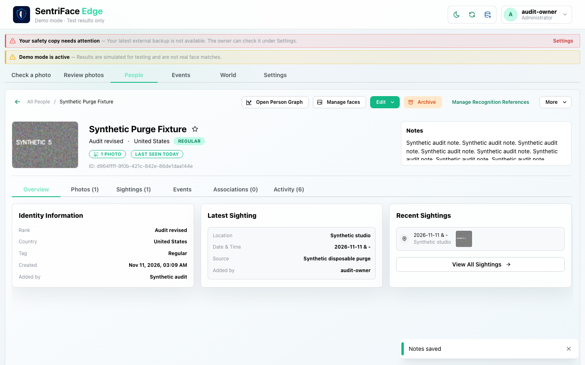](../screenshots/UX-06/UX-06_J29_Step-06_Pass2-Long-note-on-profile.png)

Captured `2026-11-11T13:32:44.742530+00:00` · Administrator · UX-06 · synthetic fixture · scroll {'x': 0, 'y': 0}.

### Step 07 — Pass2 Selected alpha note

[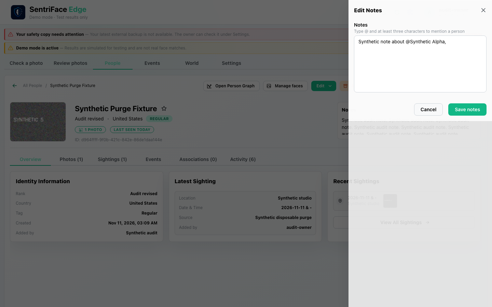](../screenshots/UX-07/UX-07_J29_Step-07_Pass2-Selected-alpha-note.png)

Captured `2026-11-11T13:33:20.233915+00:00` · Administrator · UX-07 · synthetic fixture · scroll {'x': 0, 'y': 0}.

### Step 08 — Pass2 Selected alpha note saved

[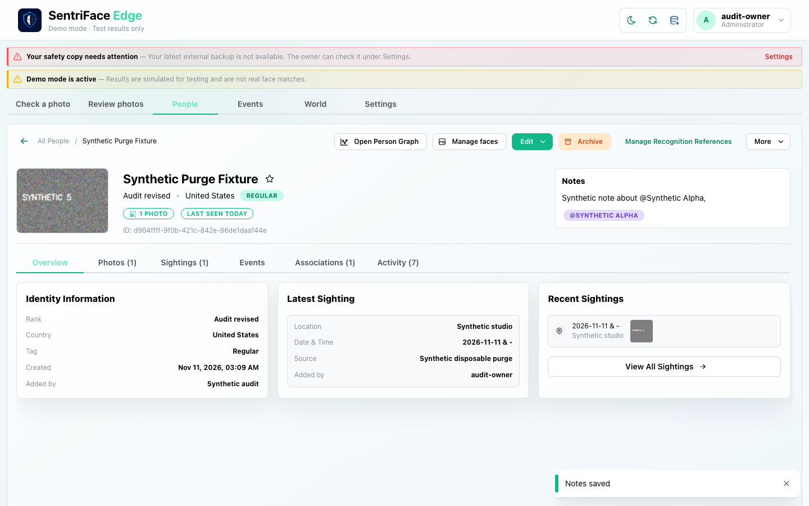](../screenshots/UX-06/UX-06_J29_Step-08_Pass2-Selected-alpha-note-saved.png)

Captured `2026-11-11T13:33:21.791954+00:00` · Administrator · UX-06 · synthetic fixture · scroll {'x': 0, 'y': 0}.

### Step 09 — Pass2 Clear note text before save

[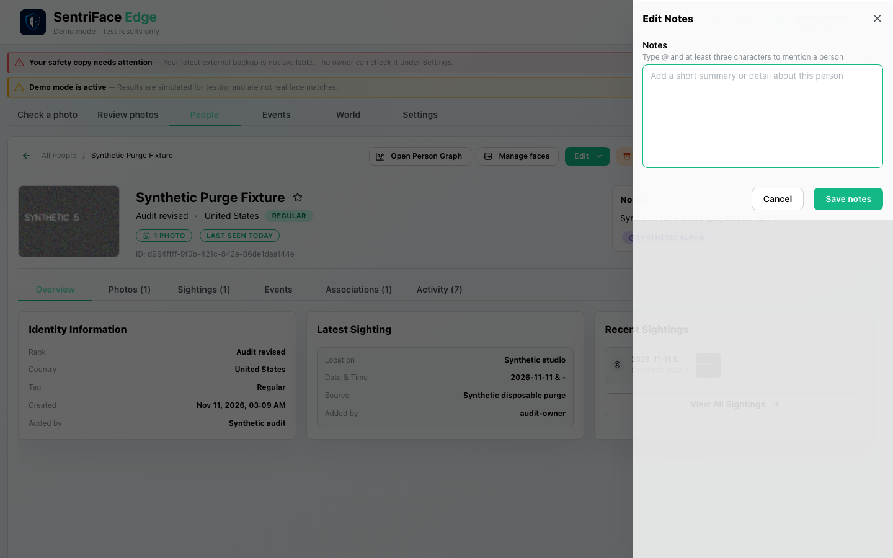](../screenshots/UX-07/UX-07_J29_Step-09_Pass2-Clear-note-text-before-save.png)

Captured `2026-11-11T13:33:34.021544+00:00` · Administrator · UX-07 · synthetic fixture · scroll {'x': 0, 'y': 0}.

### Step 10 — Pass2 Empty note retains mention

[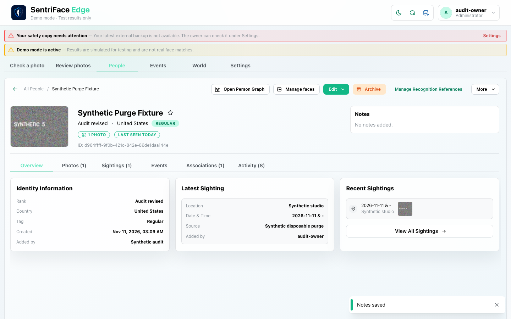](../screenshots/UX-06/UX-06_J29_Step-10_Pass2-Empty-note-retains-mention.png)

Captured `2026-11-11T13:33:35.693145+00:00` · Administrator · UX-06 · synthetic fixture · scroll {'x': 0, 'y': 0}.

### Step 11 — Pass2 Empty note still mention linked

Captured `2026-11-11T13:33:51.007096+00:00` · Administrator · UX-06 · synthetic fixture · scroll {'x': 0, 'y': 80}.

### Step 12 — Pass2 Mention link persists after reload

[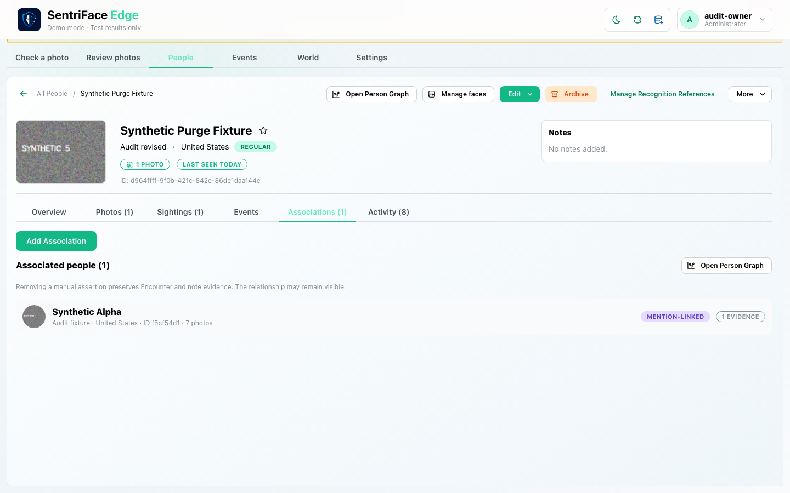](../screenshots/UX-06/UX-06_J29_Step-12_Pass2-Mention-link-persists-after-reload.png)

Captured `2026-11-11T13:34:08.403524+00:00` · Administrator · UX-06 · synthetic fixture · scroll {'x': 0, 'y': 80}.
