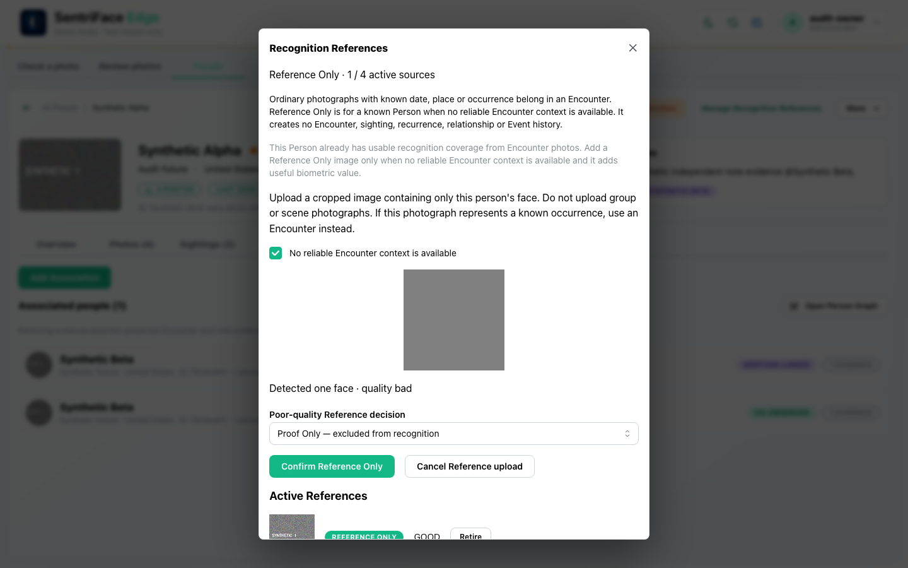
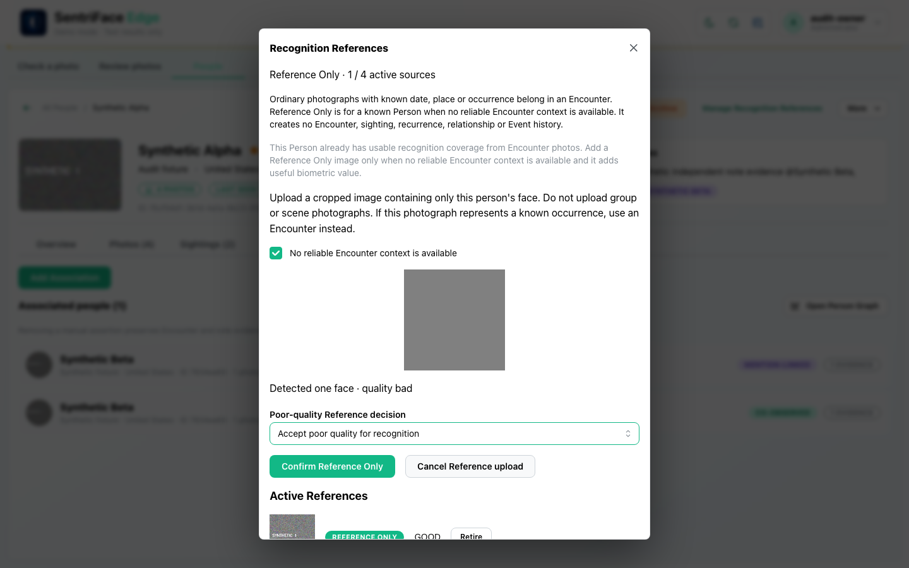
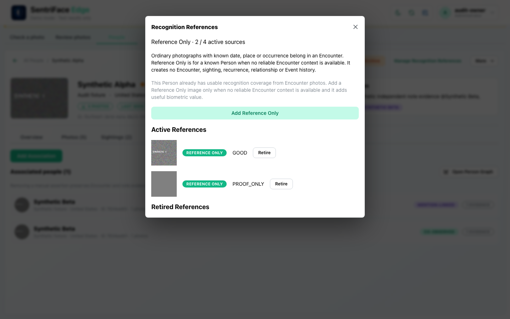
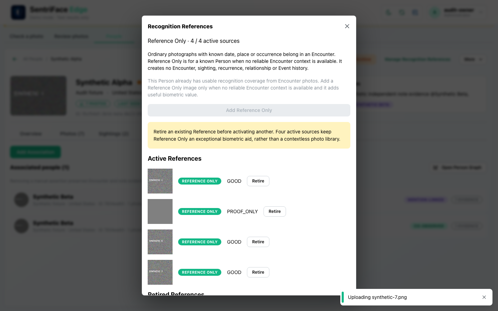

# J30 — Poor-quality Reference and four-source cap

[Audit index](../INDEX.md) · [Source oracle](../source-map.md) · [Independent review](../review.md)

**Scope result: PARTIAL.** Source tasks: SJ-030,SJ-031. Only the following observations are qualified; full source-contract branches remain in [the execution ledger](../source-branches.csv).

**Operator goal and entry:** Poor-quality Reference and four-source cap. Upload a generated24×24 low-quality pattern through Reference controls. Select poor-accepted, switch to proof-only and confirm. Add two independent generated patterns.

**Starting state / role:** Administrator with add; existing active Person with Encounter coverage.

**Source:** `b457f0a723e845dd1a92a07a577072c85146c89a`. Captures were interrupted/resumed at this same product source. Synthetic means generated non-biometric patterns, not ONNX inference.

## Interaction sequence and authority

1. Through Add Reference Only on the active Person, upload the generated 24×24 poor-quality pattern (step 1). Select **Accept poor quality for recognition** to expose that choice (step 2), but do not commit it.
2. Switch to proof-only and confirm through the existing product control. The saved active source is marked **PROOF_ONLY** (step 3); this does not grant recognition eligibility or create a Sighting.
3. Add two independent generated patterns through the same Reference controls. The profile reaches **4 / 4** active sources, disables Add Reference Only and explains retirement before adding another (step 4). The uploading toast is captured timing, not independent completion feedback.
4. Return to profile browsing. No shared-sample conflict, zero/multiple-face real detection or poor-accepted committed state is claimed; the synthetic detector uses the whole pattern as one face.

## Step 01 — Poor reference decision

Capture: UX-07 · Administrator · light · 1440×900 CSS viewport · DPR 1 · `2026-11-10T14:23:11.074670+00:00` · synthetic.

Scroll: x=0, y=80.

## Step 02 — Poor accepted option selected not committed

Capture: UX-07 · Administrator · light · 1440×900 CSS viewport · DPR 1 · `2026-11-10T14:23:58.761029+00:00` · synthetic.

Scroll: x=0, y=80.

## Step 03 — Proof only active

Capture: UX-07 · Administrator · light · 1440×900 CSS viewport · DPR 1 · `2026-11-10T14:24:04.109611+00:00` · synthetic.

Scroll: x=0, y=80.

## Step 04 — Reference cap four

Capture: UX-07 · Administrator · light · 1440×900 CSS viewport · DPR 1 · `2026-11-10T14:24:16.497778+00:00` · synthetic.

Scroll: x=0, y=80.

## Outcome, authority, return and limits

Poor-accepted is selected but not committed. PROOF_ONLY is actually active at step3; step4 shows4/4 and disabled Add Reference Only. Uploading toast can linger. Whole-image synthetic detection is not real face detection. No zero/multiple-face or shared-sample conflict is claimed.

Navigation/read controls do not create authoritative identity or occurrence state. Mutations above use existing product commands. Return paths and later-session results are only claimed where ordered evidence or explicit checks demonstrate them. Missing cancellation, failure, stale, role or restart branches remain visible in the source execution ledger.
