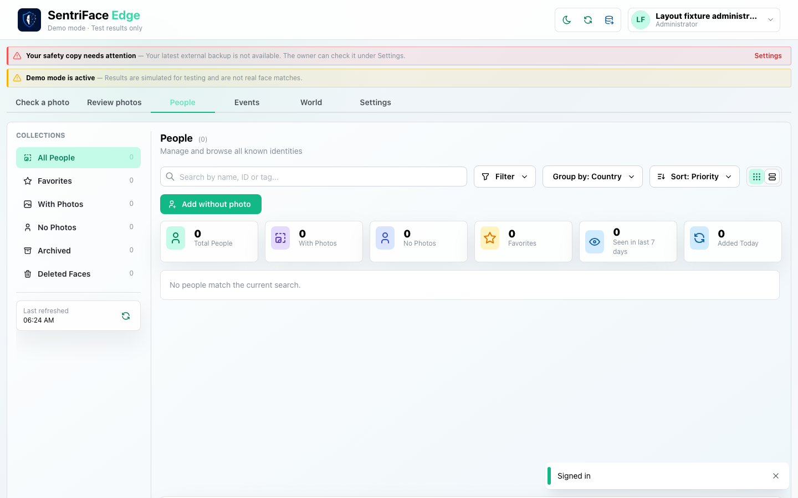
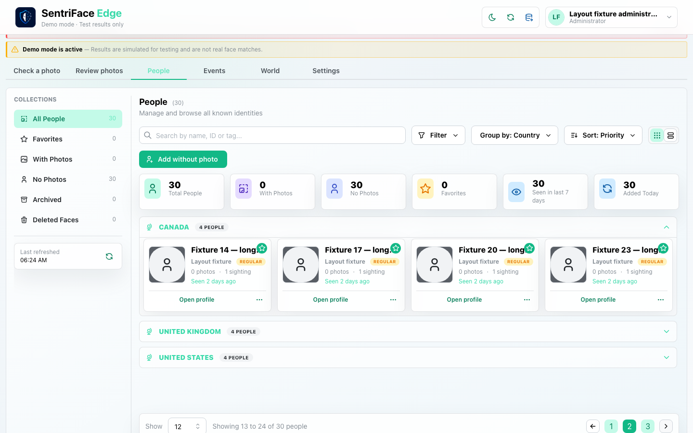
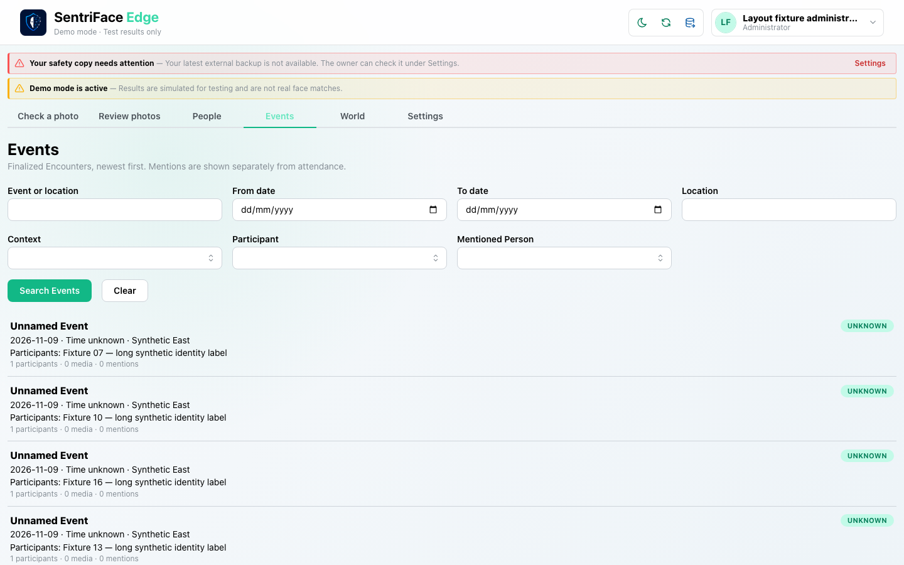
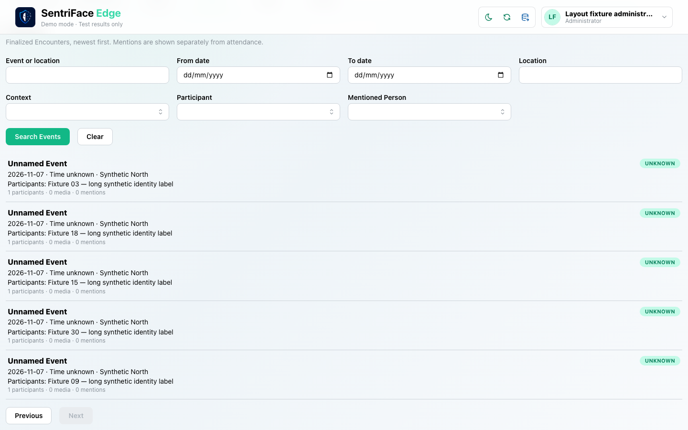
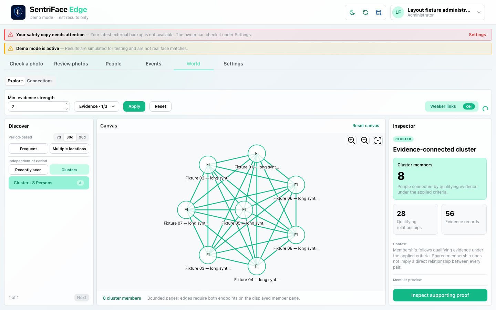
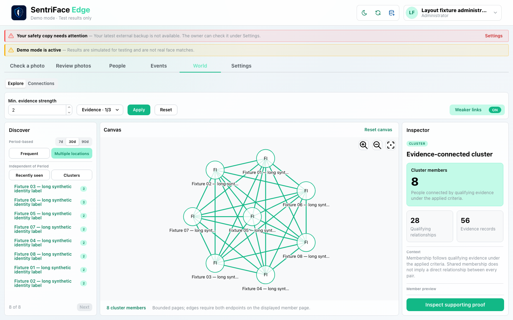
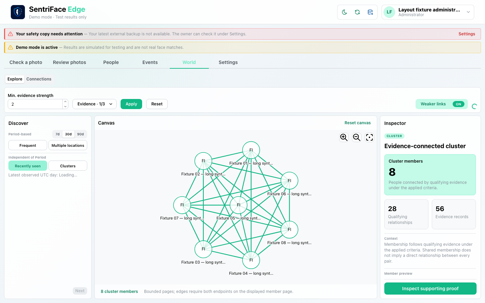

# J31 — Long lists, pagination and dense graph fixture

[Audit index](../INDEX.md) · [Source oracle](../source-map.md) · [Independent review](../review.md)

**Scope result: PARTIAL.** Source tasks: SJ-022,SJ-037,SJ-043,SJ-044. Only the following observations are qualified; full source-contract branches remain in [the execution ledger](../source-branches.csv).

**Operator goal and entry:** Long lists, pagination and dense graph fixture. Sign in, browse People, use Next page; browse Events and Next; select authoritative cluster, Multiple locations and Recently seen.

**Starting state / role:** Administrator; fresh encrypted domain fixture created while stopped.

**Source:** `b457f0a723e845dd1a92a07a577072c85146c89a`. Captures were interrupted/resumed at this same product source. Synthetic means generated non-biometric patterns, not ONNX inference.

## Interaction sequence and authority

1. Start the fresh stopped-authority fixture created through existing QA/store methods: 30 People, 30 finalized media-free Encounters, zero photographs. Sign in and open People. The initial frame still says zero while its read is pending (step 1); it is not the loaded result.
2. Use Next page after the People read completes (step 2). Open Events and use Next page there (steps 3–4). These qualify actual loaded list pagination, not performance at large corpus scale.
3. In World, select a dense fixture cluster (step 5): eight members, 28 relationships and 56 evidence. Select Multiple locations (step 6), then Recently seen (step 7).
4. Step 7 shows **Loading** for the latest observed UTC day and retains the previous cluster. No completed Recently seen result is asserted. Ordinary navigation returns to the collections. This is fixture-backed read/display evidence; it does not demonstrate UI creation or inference for these records.

## Step 01 — People initial read pending zero count

Capture: UX-05 · Administrator · light · 1440×900 CSS viewport · DPR 1 · `2026-11-10T14:24:25.144187+00:00` · fixture-backed media-free.

Zero-count initial read frame, not the loaded30-Person outcome. Step2 shows loaded pagination.

Scroll: x=0, y=0.

## Step 02 — People page two

Capture: UX-05 · Administrator · light · 1440×900 CSS viewport · DPR 1 · `2026-11-10T14:24:27.983555+00:00` · fixture-backed media-free.

Scroll: x=0, y=38.

## Step 03 — Thirty event collection

Capture: UX-09 · Administrator · light · 1440×900 CSS viewport · DPR 1 · `2026-11-10T14:24:29.441941+00:00` · fixture-backed media-free.

Scroll: x=0, y=0.

## Step 04 — Events next page

Capture: UX-09 · Administrator · light · 1440×900 CSS viewport · DPR 1 · `2026-11-10T14:24:30.634316+00:00` · fixture-backed media-free.

Scroll: x=0, y=177.

## Step 05 — Dense cluster selected

Capture: UX-11 · Administrator · light · 1440×900 CSS viewport · DPR 1 · `2026-11-10T14:24:32.662520+00:00` · fixture-backed media-free.

Scroll: x=0, y=0.

## Step 06 — Multiple location discovery

Capture: UX-11 · Administrator · light · 1440×900 CSS viewport · DPR 1 · `2026-11-10T14:25:28.071148+00:00` · fixture-backed media-free.

Scroll: x=0, y=0.

## Step 07 — Recently seen loading retaining selection

Capture: UX-11 · Administrator · light · 1440×900 CSS viewport · DPR 1 · `2026-11-10T14:25:38.325055+00:00` · fixture-backed media-free.

Latest observed UTC day says Loading; prior cluster retained. Not a completed discovery result.

Scroll: x=0, y=0.

## Outcome, authority, return and limits

Fixture requested/created30 People,30 media-free finalized Encounters,0 photographs using existing QA/store methods. This is display/read evidence, not UI creation/inference/performance acceptance. Step1 is initial zero-count read, step2 loaded page2. Step5 shows8 members,28 relationships,56 evidence. Step7 is Recently seen loading with previous cluster retained; no completed recent result asserted.

Navigation/read controls do not create authoritative identity or occurrence state. Mutations above use existing product commands. Return paths and later-session results are only claimed where ordered evidence or explicit checks demonstrate them. Missing cancellation, failure, stale, role or restart branches remain visible in the source execution ledger.
