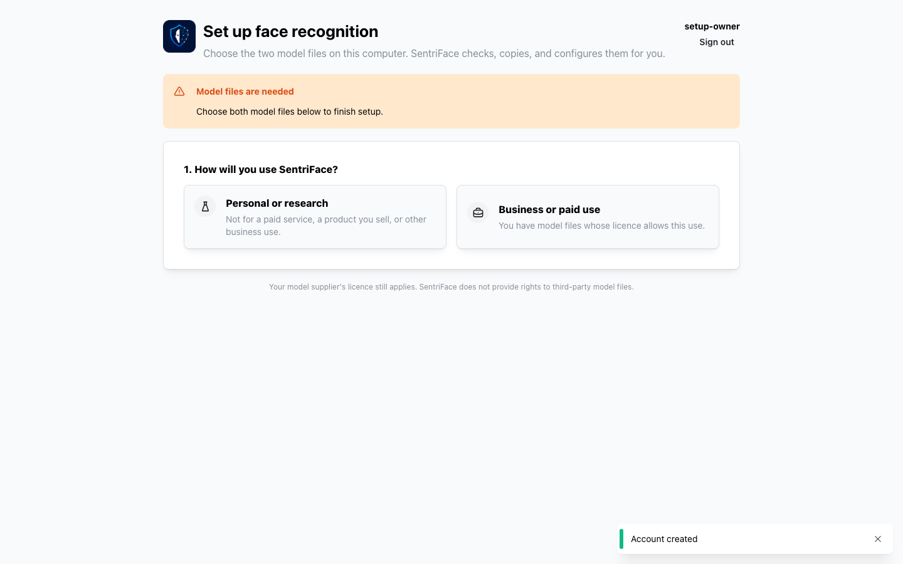
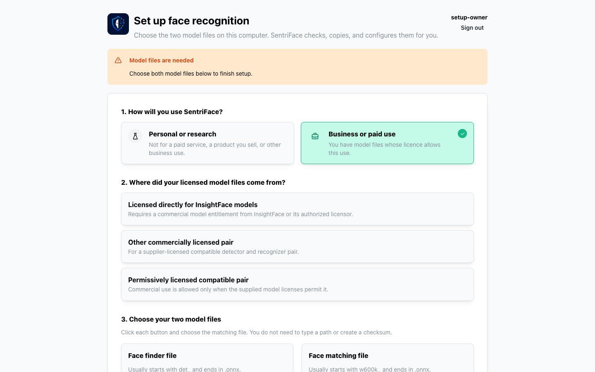
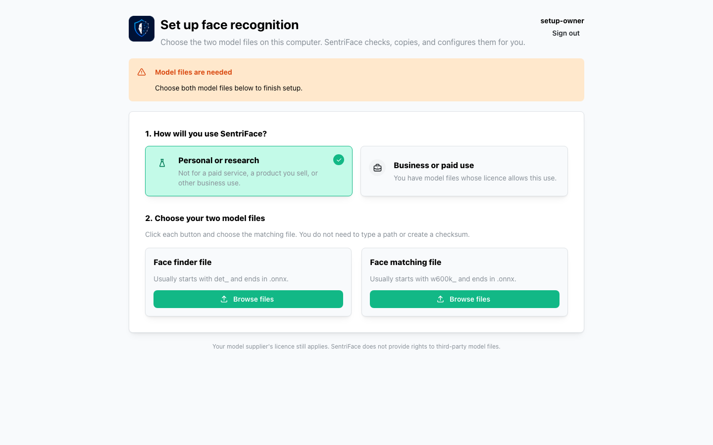
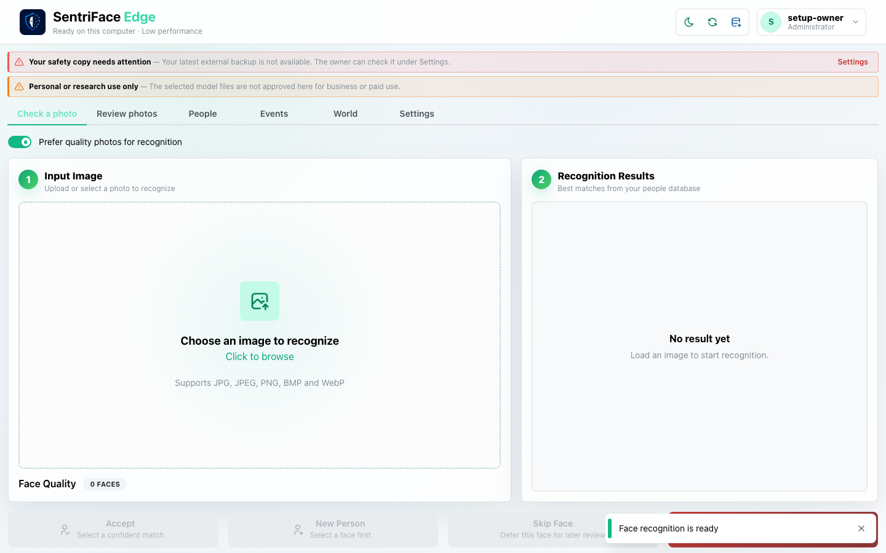
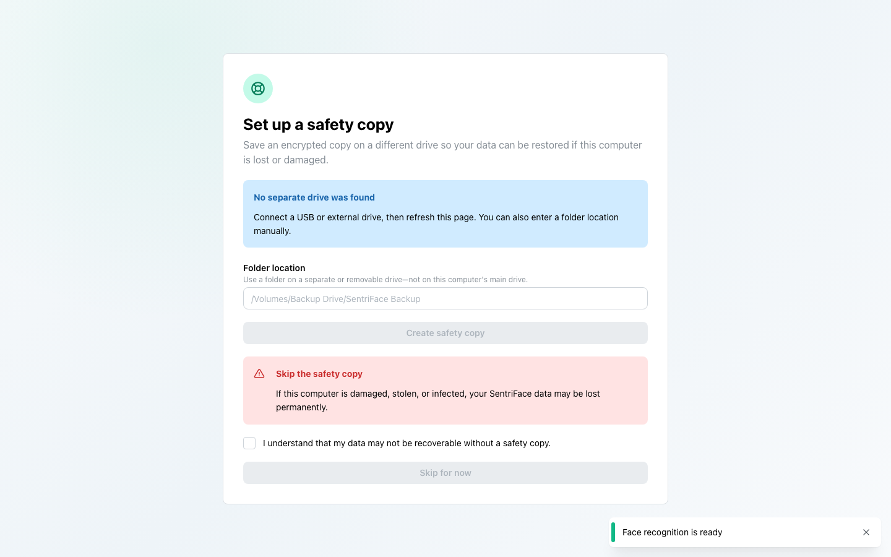

# J32 — Model-needed gate, local source and activation

[Audit index](../INDEX.md) · [Source oracle](../source-map.md) · [Independent review](../review.md)

**Scope result: PARTIAL.** Source tasks: SJ-003. Only the following observations are qualified; full source-contract branches remain in [the execution ledger](../source-branches.csv).

**Operator goal and entry:** Model-needed gate, local source and activation. Create disposable owner, inspect model-needed gate, select business choices then personal/research, prepare existing local files, inspect/cancel the plan, then activate and acknowledge recovery readiness.

**Starting state / role:** Fresh source ONNX authority; initial Administrator.

**Source:** `b457f0a723e845dd1a92a07a577072c85146c89a`. Captures were interrupted/resumed at this same product source. Synthetic means generated non-biometric patterns, not ONNX inference.

## Interaction sequence and authority

1. Fresh disposable owner reaches Models needed. Inspect business choices, then personal/research file controls (steps 1–3).
2. Select existing authorized local files. Detector becomes ready first (step 4); after processing, both local files become ready (step 5). Private model-bearing captures are withheld.
3. Review the prepared bundle (step 6), Cancel (step 7), then reopen the plan and activate through **Activate verified bundle**. The recovery gate appears (step 8).
4. Acknowledge the readiness risk and enter the empty ONNX-ready shell (step 9). This changes only the disposable authority's admitted runtime setup; no recognition operation runs in this journey.

## Step 01 — Models needed

Capture: UX-00 · Administrator · light · 1440×900 CSS viewport · DPR 1 · `2026-11-10T14:25:52.843244+00:00` · source ONNX model setup; no inference.

Scroll: x=0, y=0.

## Step 02 — Business model options

Capture: UX-00 · Administrator · light · 1440×900 CSS viewport · DPR 1 · `2026-11-10T14:27:27.574600+00:00` · source ONNX model setup; no inference.

Scroll: x=0, y=0.

## Step 03 — Research model file controls

Capture: UX-00 · Administrator · light · 1440×900 CSS viewport · DPR 1 · `2026-11-10T14:27:28.148821+00:00` · source ONNX model setup; no inference.

Scroll: x=0, y=0.

## Step 04 — Detector ready matcher not yet ready private

Private original retained outside Git; no public screenshot.

Capture: UX-00 · Administrator · light · 1440×900 CSS viewport · DPR 1 · `2026-11-10T14:28:11.800541+00:00` · source ONNX model setup; no inference.

At this early step only the detector is visibly ready. The complete pair and activation occur later; no inference is invoked in this journey.

Scroll: x=0, y=0.

## Step 05 — Both local files ready private

Private original retained outside Git; no public screenshot.

Capture: UX-00 · Administrator · light · 1440×900 CSS viewport · DPR 1 · `2026-11-11T04:33:57.889681+00:00` · source ONNX model setup.

Scroll: x=0, y=0.

## Step 06 — Activation plan private

Private original retained outside Git; no public screenshot.

Capture: UX-00 · Administrator · light · 1440×900 CSS viewport · DPR 1 · `2026-11-11T04:36:39.035546+00:00` · source ONNX model setup; no inference.

Scroll: x=0, y=312.

## Step 07 — Activation cancel retains candidate private

Private original retained outside Git; no public screenshot.

Capture: UX-00 · Administrator · light · 1440×900 CSS viewport · DPR 1 · `2026-11-11T04:36:39.905061+00:00` · source ONNX model setup; no inference.

Scroll: x=0, y=312.

## Step 08 — Models ready recovery next

Capture: UX-00 · Administrator · light · 1440×900 CSS viewport · DPR 1 · `2026-11-11T04:36:43.666945+00:00` · source ONNX model setup; no inference.

Scroll: x=0, y=0.

## Step 09 — ONNX source ready empty shell

Capture: UX-00 · Administrator · light · 1440×900 CSS viewport · DPR 1 · `2026-11-11T04:36:44.445589+00:00` · source ONNX model setup; no inference.

Scroll: x=0, y=0.

## Outcome, authority, return and limits

Operational model setup completed through actual UI. Both local files are ready at step 5; the activation plan opens at step 6; Cancel retains the prepared candidate at step 7. Review prepared bundle → Activate verified bundle succeeds and returns to the recovery-readiness gate at step 8. Acknowledge risk enters the empty application shell with ONNX ready at step 9. These frames establish UI activation, not inference. Business selection does not grant license rights. Model-bearing steps 4–7 remain private; public gate/shell images disclose no private declarations. Genuine admitted inference is separately [J41](J41.md). Existing authorized files/configuration remain unchanged; no downloads occurred. Invalid/corrupt pair, denied/failed activation, rollback and restart of this particular setup authority remain unverified.

Navigation/read controls do not create authoritative identity or occurrence state. Mutations above use existing product commands. Return paths and later-session results are only claimed where ordered evidence or explicit checks demonstrate them. Missing cancellation, failure, stale, role or restart branches remain visible in the source execution ledger.

## macOS completion pass 2 — continuation B

Source product `b457f0a723e845dd1a92a07a577072c85146c89a`; full browser-content screenshots, 1440×900 CSS pixels, DPR 1, Day; dedicated disposable authority. See capture register for exact role, capture time and inference qualification.

Fresh disposable source setup: unsupported synthetic file names were refused; supported names with invalid synthetic bytes produced a genuine parser error exposing a private local path. A plan using already-authorized local model files was allowed to expire naturally; activation was refused, re-preparation succeeded and activation reached the recovery gate. Step 10 is REJECTED as evidence of the non-owner model gate: attempted Viewer fixture creation through the authenticated application API returned HTTP 428 models_required. No bypass or model download was used.

### Step 10 — Pass2 Model viewer fixture not created

Original retained privately: path, credential, or rejected attribution; not published.

Captured `2026-11-11T11:04:00.023277+00:00` · Administrator · UX-00 · scroll {'x': 0, 'y': 0}. Exact fixture and inference mode are described above and in the capture register.

### Step 11 — Pass2 Invalid model upload response

Original retained privately: path, credential, or rejected attribution; not published.

Captured `2026-11-11T11:04:47.475607+00:00` · Administrator · UX-00 · scroll {'x': 0, 'y': 0}. Exact fixture and inference mode are described above and in the capture register.

### Step 12 — Pass2 Invalid model pair uploaded

Original retained privately: path, credential, or rejected attribution; not published.

Captured `2026-11-11T11:05:02.164038+00:00` · Administrator · UX-00 · scroll {'x': 0, 'y': 0}. Exact fixture and inference mode are described above and in the capture register.

### Step 13 — Pass2 Invalid supported names pair

Original retained privately: path, credential, or rejected attribution; not published.

Captured `2026-11-11T11:05:23.108021+00:00` · Administrator · UX-00 · scroll {'x': 0, 'y': 0}. Exact fixture and inference mode are described above and in the capture register.

### Step 14 — Pass2 Invalid model prepare response

Original retained privately: path, credential, or rejected attribution; not published.

Captured `2026-11-11T11:05:38.114856+00:00` · Administrator · UX-00 · scroll {'x': 0, 'y': 376}. Exact fixture and inference mode are described above and in the capture register.

### Step 15 — Pass2 Model upload retry authorized pair

Original retained privately: path, credential, or rejected attribution; not published.

Captured `2026-11-11T11:06:27.820254+00:00` · Administrator · UX-00 · scroll {'x': 0, 'y': 376}. Exact fixture and inference mode are described above and in the capture register.

### Step 16 — Pass2 Model retry plan

Original retained privately: path, credential, or rejected attribution; not published.

Captured `2026-11-11T11:06:43.026297+00:00` · Administrator · UX-00 · scroll {'x': 0, 'y': 376}. Exact fixture and inference mode are described above and in the capture register.

### Step 17 — Pass2 Expired model plan refused

Original retained privately: path, credential, or rejected attribution; not published.

Captured `2026-11-11T11:17:09.006774+00:00` · Administrator · UX-00 · scroll {'x': 0, 'y': 376}. Exact fixture and inference mode are described above and in the capture register.

### Step 18 — Pass2 Expired plan reopened

Original retained privately: path, credential, or rejected attribution; not published.

Captured `2026-11-11T11:17:25.275173+00:00` · Administrator · UX-00 · scroll {'x': 0, 'y': 376}. Exact fixture and inference mode are described above and in the capture register.

### Step 19 — Pass2 Expired plan reprepared and activated

Captured `2026-11-11T11:17:41.474283+00:00` · Administrator · UX-00 · scroll {'x': 0, 'y': 0}. Exact fixture and inference mode are described above and in the capture register.

### Step 20 — Pass2 ONNX recovery ack response

Original retained privately: path, credential, or rejected attribution; not published.

Captured `2026-11-11T13:07:41.822889+00:00` · Administrator · UX-00 · scroll {'x': 0, 'y': 0}. Exact fixture and inference mode are described above and in the capture register.
