# J33 — Group-discard refusal and whole-session discard

[Audit index](../INDEX.md) · [Source oracle](../source-map.md) · [Independent review](../review.md)

**Scope result: PARTIAL.** Source task SJ-015. Group-discard confirmation and refusal, followed by successful session discard, were executed. Pass one did not establish successful group discard after valid Event details; the pass-two continuation below demonstrates it.

**Goal / entry / role:** Administrator wants to remove pending synthetic queue work without changing already confirmed People. Start Review Photos with two generated images queued as two groups in a single unresolved Encounter; Event details have not been completed. Source `b457f0a723e845dd1a92a07a577072c85146c89a`; synthetic whole-image detector, no genuine recognition.

## Ordered interactions and authority

1. Select Discard on one group. **Discard this entire group?** says it removes its one pending face and does not affect confirmed people (step 1).
2. Confirm **Discard group**. The dialog closes, but the request is refused: **Request failed Complete Event details before deciding identities**. Both groups and both pending faces remain (step 2). The legacy filename `Group-discarded` is incorrect as a description; this record deliberately preserves the original bytes/name while qualifying the actual outcome.
3. Select the session-level **Discard session**. **Discard this queue session?** explains removal of all pending faces/temporary photos while retaining already confirmed People (step 3).
4. Confirm the session-level discard. The session selector disappears, the queue shows **0 groups**, **Showing 0 of 0 pending groups**, and **Queue session and its pending photos were discarded** (step 4). Return is the ordinary empty Review Photos workspace.

## Step 01 — Group-discard confirmation

[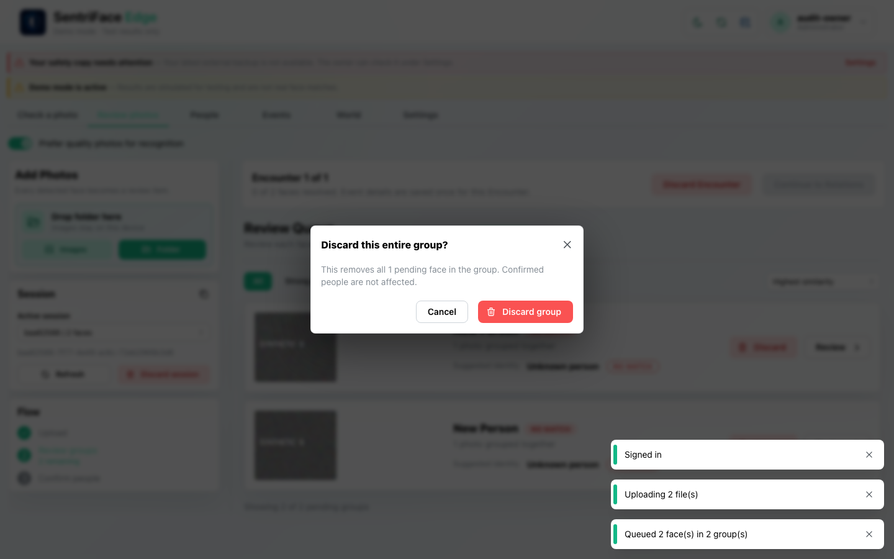](../screenshots/UX-03/UX-03_J33_Step-01_Discard-group-confirmation.png)

Capture: UX-03 · Administrator · Day · 1440×900 CSS viewport · DPR 1 · `2026-11-11T04:37:40.822949+00:00` · synthetic disposable authority. Scroll x=0, y=0.

## Step 02 — Group discard refused; both groups retained

[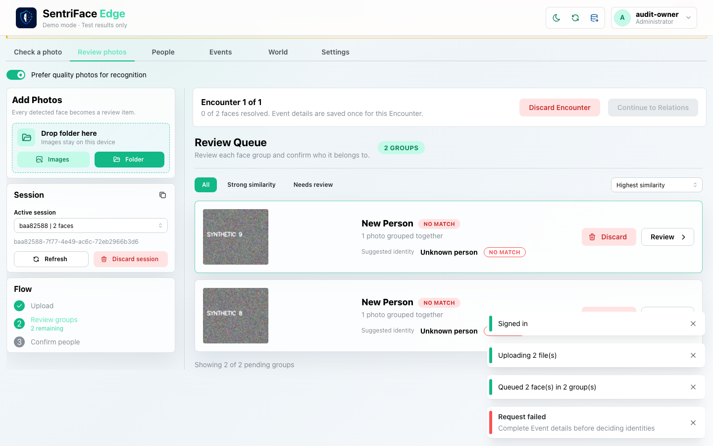](../screenshots/UX-03/UX-03_J33_Step-02_Group-discarded.png)

Capture: UX-03 · Administrator · Day · 1440×900 CSS viewport · DPR 1 · `2026-11-11T04:37:42.148910+00:00` · synthetic disposable authority. Scroll x=0, y=80.

## Step 03 — Whole-session discard confirmation

[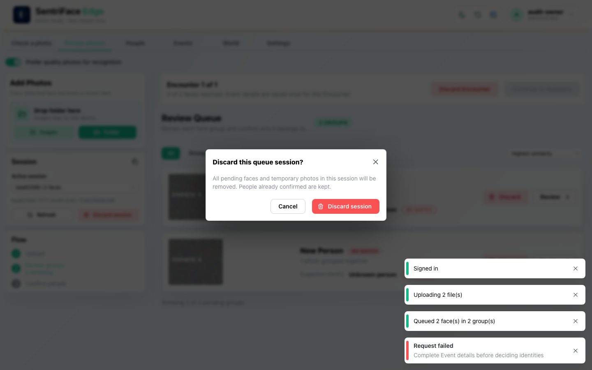](../screenshots/UX-03/UX-03_J33_Step-03_Discard-session-confirmation.png)

Capture: UX-03 · Administrator · Day · 1440×900 CSS viewport · DPR 1 · `2026-11-11T04:37:42.837963+00:00` · synthetic disposable authority. Scroll x=0, y=80.

## Step 04 — Whole-session discard succeeds; empty queue

[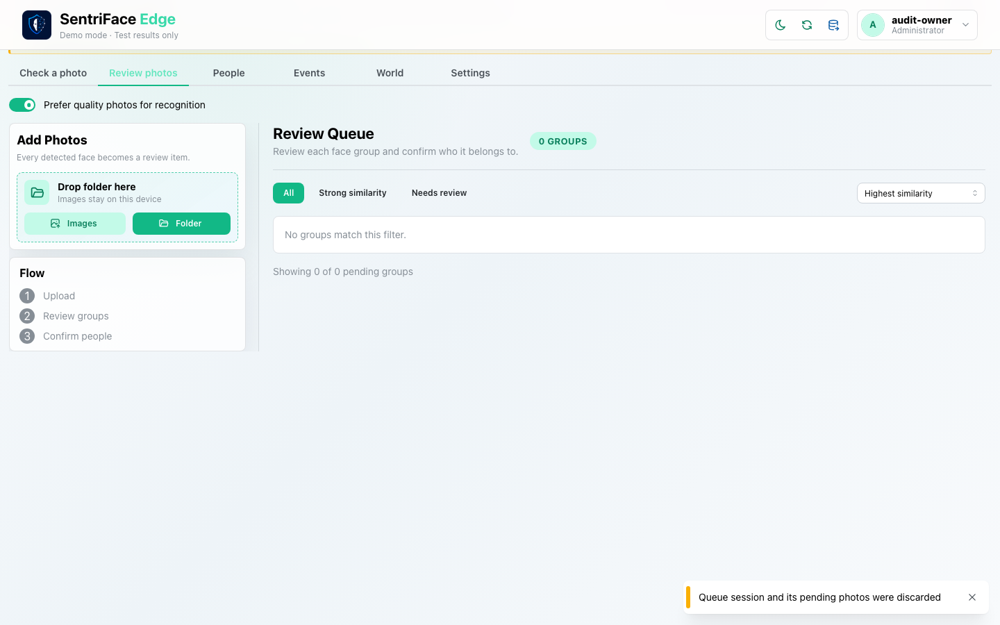](../screenshots/UX-03/UX-03_J33_Step-04_Session-discarded.png)

Capture: UX-03 · Administrator · Day · 1440×900 CSS viewport · DPR 1 · `2026-11-11T04:42:27.742193+00:00` · synthetic disposable authority. Scroll x=0, y=80.

## Outcome and limits

The group operation is a real guarded failure, not success. The later whole-session discard succeeds through the actual product control. No previously confirmed Person is asserted deleted, and no finalization or new historical occurrence is claimed. The UI promise about confirmed-Person retention is not a new independent every-row comparison in this journey. At the end of pass one, cancellation and successful single-group discard had not been qualified; see the pass-two continuation below. Alternate Encounter discard, permission denial and restart remain separate ledger branches. The dependency of group removal on Event metadata merits review; no product behavior was changed to bypass it.

## macOS completion pass 2 — ordered continuation

**Status: PARTIAL overall.** Source remains `b457f0a723e845dd1a92a07a577072c85146c89a`; pass-one checkpoint `27a0532123389421b5cfdc5d0331eb1793e74c78` remains unchanged in history. Synthetic source mode and a dedicated disposable authority; 1440×900 CSS viewport, DPR 1, Day, Administrator unless the capture register says unauthenticated.

Start an empty Review Queue, upload two synthetic patterns, confirm one Encounter and attempt to discard one of two groups before Event details. The real server refuses with “Complete Event details before deciding identities” and both groups remain. Open Review, complete synthetic Event details, and discard one group: the queue drops from two to one. Open session-discard confirmation, Cancel and verify the remaining group, then confirm session discard and verify an empty queue. The pre-metadata FAIL persists as a sequence/affordance failure; successful guarded operation after metadata does not erase it. Confirmed-Person preservation was not independently compared here.

### Step 05 — Pass2 Initial empty queue

[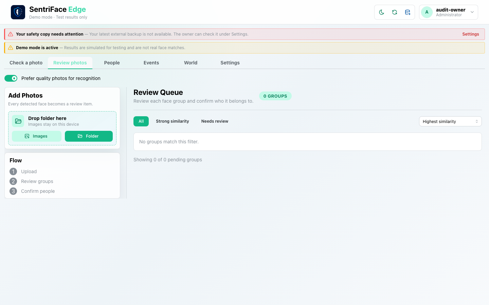](../screenshots/UX-03/UX-03_J33_Step-05_Pass2-Initial-empty-queue.png)

Capture `2026-11-11T06:24:38.621067+00:00` · Administrator · UX-03 · synthetic · scroll {'x': 0, 'y': 0}. Full browser viewport, not native window chrome.

### Step 06 — Pass2 Grouping before confirm

[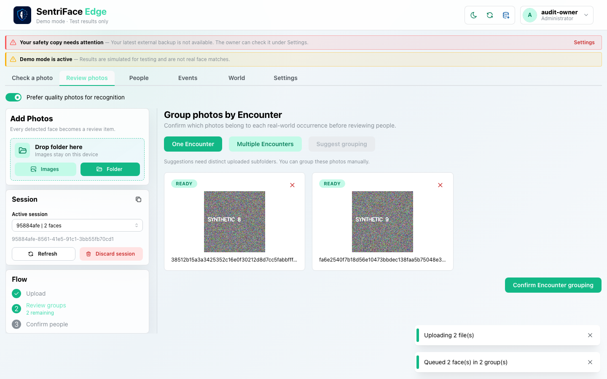](../screenshots/UX-03/UX-03_J33_Step-06_Pass2-Grouping-before-confirm.png)

Capture `2026-11-11T06:24:40.119011+00:00` · Administrator · UX-03 · synthetic · scroll {'x': 0, 'y': 0}. Full browser viewport, not native window chrome.

### Step 07 — Pass2 Pending groups before discard

[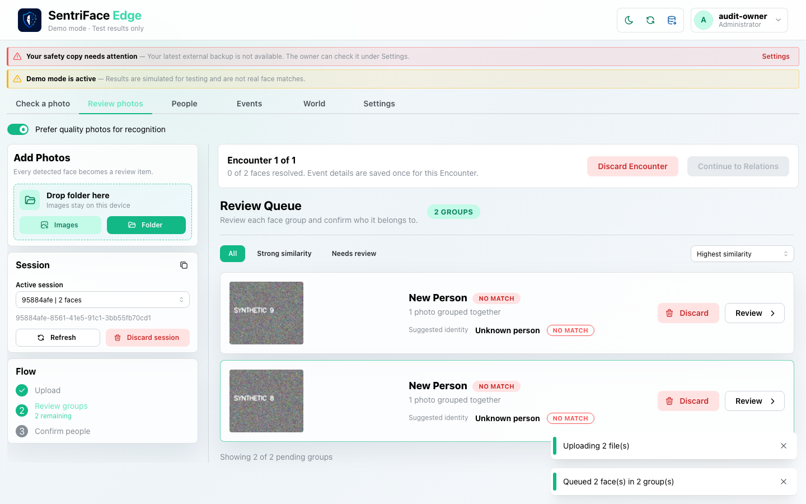](../screenshots/UX-03/UX-03_J33_Step-07_Pass2-Pending-groups-before-discard.png)

Capture `2026-11-11T06:24:41.075069+00:00` · Administrator · UX-03 · synthetic · scroll {'x': 0, 'y': 0}. Full browser viewport, not native window chrome.

### Step 08 — Pass2 Discard group confirmation

[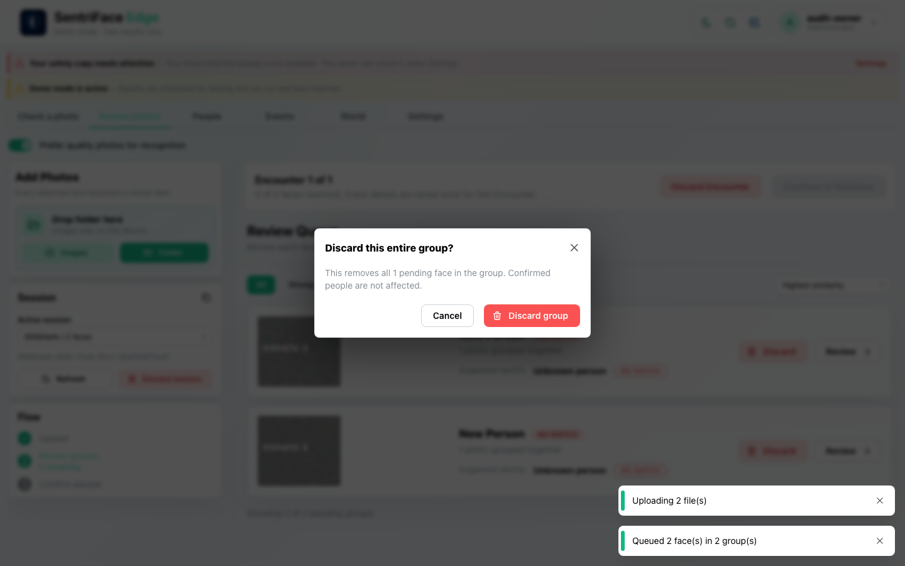](../screenshots/UX-03/UX-03_J33_Step-08_Pass2-Discard-group-confirmation.png)

Capture `2026-11-11T06:24:41.743979+00:00` · Administrator · UX-03 · synthetic · scroll {'x': 0, 'y': 0}. Full browser viewport, not native window chrome.

### Step 09 — Pass2 Discard response

[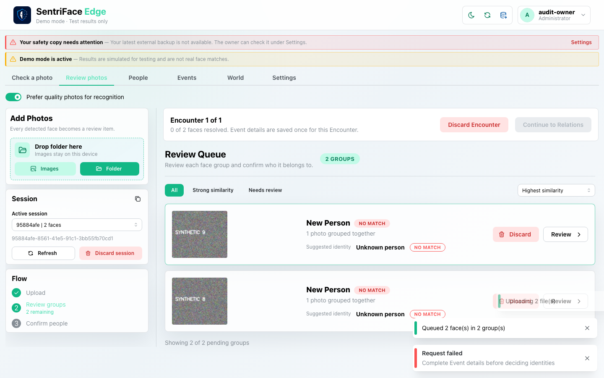](../screenshots/UX-03/UX-03_J33_Step-09_Pass2-Discard-response.png)

Capture `2026-11-11T06:24:43.440239+00:00` · Administrator · UX-03 · synthetic · scroll {'x': 0, 'y': 0}. Full browser viewport, not native window chrome.

### Step 10 — Pass2 Recovery Event details

[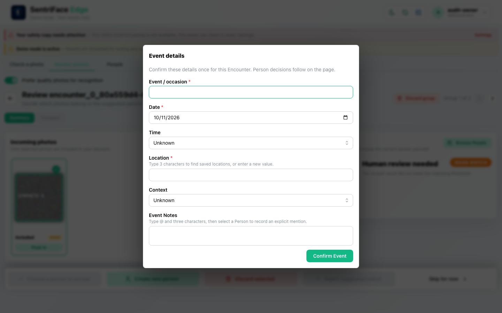](../screenshots/UX-04/UX-04_J33_Step-10_Pass2-Recovery-Event-details.png)

Capture `2026-11-11T06:24:55.066199+00:00` · Administrator · UX-04 · synthetic · scroll {'x': 0, 'y': 0}. Full browser viewport, not native window chrome.

### Step 11 — Pass2 Event details confirmed

[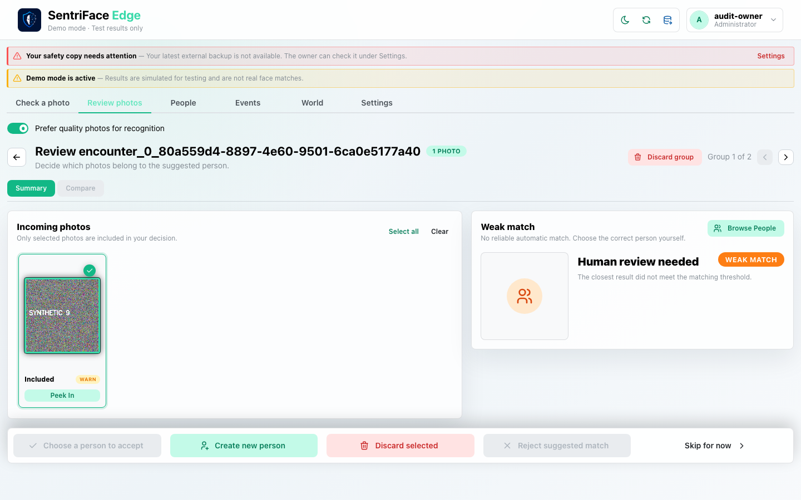](../screenshots/UX-04/UX-04_J33_Step-11_Pass2-Event-details-confirmed.png)

Capture `2026-11-11T06:25:11.147468+00:00` · Administrator · UX-04 · synthetic · scroll {'x': 0, 'y': 0}. Full browser viewport, not native window chrome.

### Step 12 — Pass2 Discard after metadata confirmation

[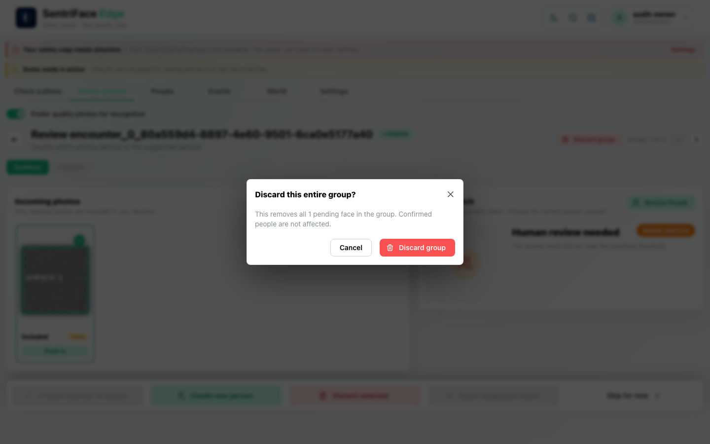](../screenshots/UX-04/UX-04_J33_Step-12_Pass2-Discard-after-metadata-confirmation.png)

Capture `2026-11-11T06:25:27.264589+00:00` · Administrator · UX-04 · synthetic · scroll {'x': 0, 'y': 0}. Full browser viewport, not native window chrome.

### Step 13 — Pass2 Discard after metadata result

Capture `2026-11-11T06:25:35.132212+00:00` · Administrator · UX-03 · synthetic · scroll {'x': 0, 'y': 0}. Full browser viewport, not native window chrome.

### Step 14 — Pass2 Session discard cancel confirmation

[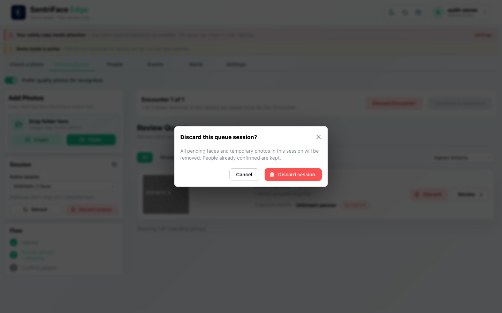](../screenshots/UX-03/UX-03_J33_Step-14_Pass2-Session-discard-cancel-confirmation.png)

Capture `2026-11-11T06:25:50.938912+00:00` · Administrator · UX-03 · synthetic · scroll {'x': 0, 'y': 0}. Full browser viewport, not native window chrome.

### Step 15 — Pass2 Session retained after cancel

[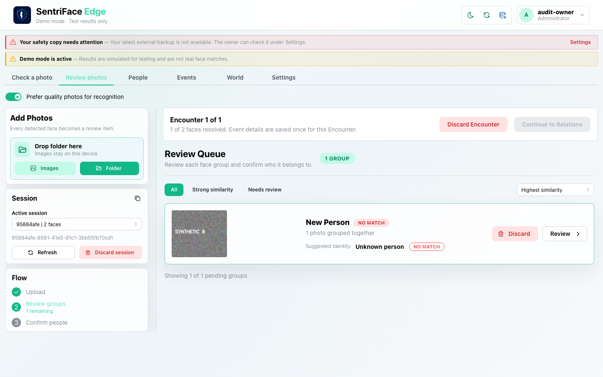](../screenshots/UX-03/UX-03_J33_Step-15_Pass2-Session-retained-after-cancel.png)

Capture `2026-11-11T06:25:51.630661+00:00` · Administrator · UX-03 · synthetic · scroll {'x': 0, 'y': 0}. Full browser viewport, not native window chrome.

### Step 16 — Pass2 Session discarded after recovery

[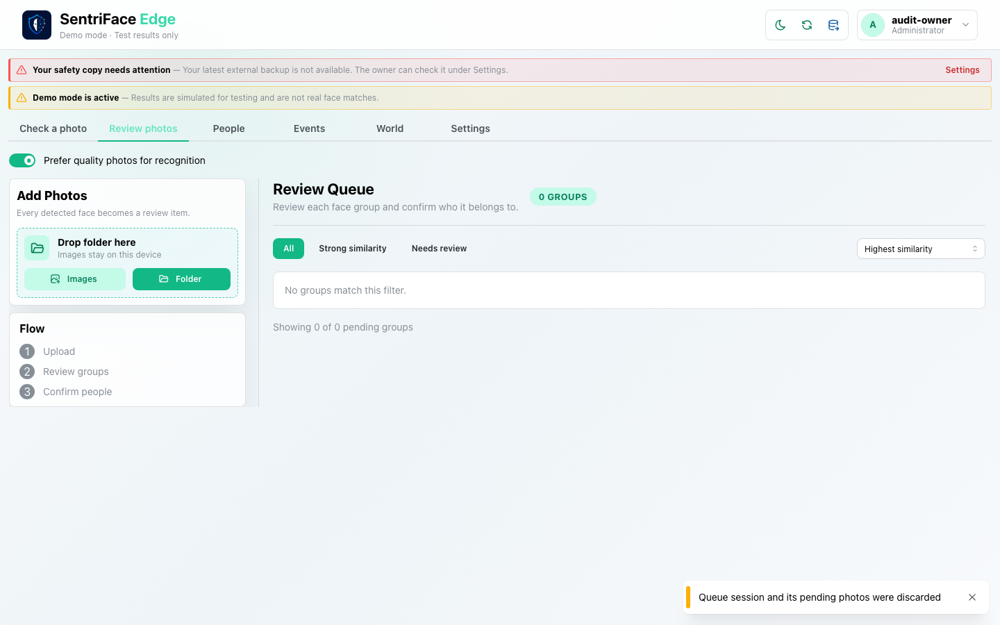](../screenshots/UX-03/UX-03_J33_Step-16_Pass2-Session-discarded-after-recovery.png)

Capture `2026-11-11T06:25:53.665784+00:00` · Administrator · UX-03 · synthetic · scroll {'x': 0, 'y': 0}. Full browser viewport, not native window chrome.
