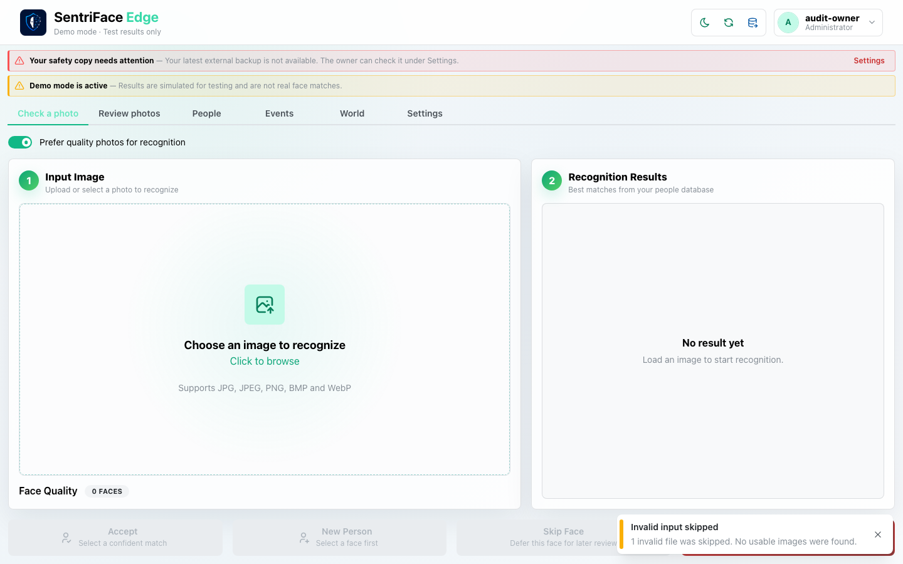
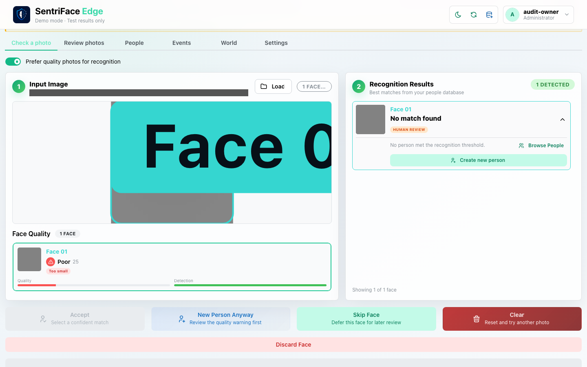
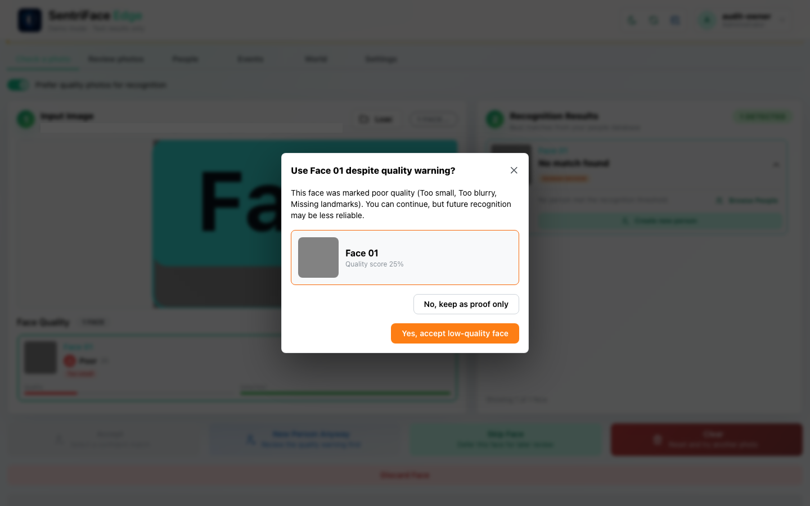
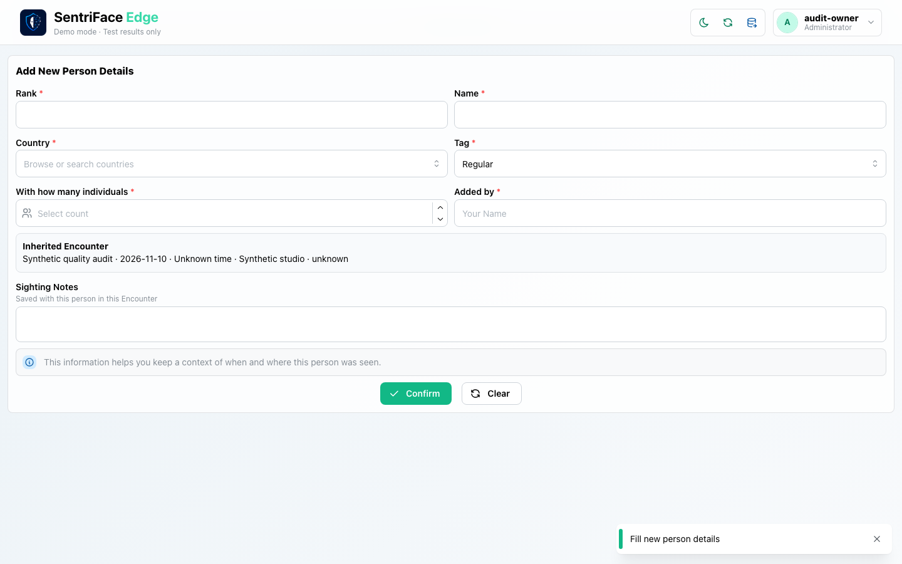
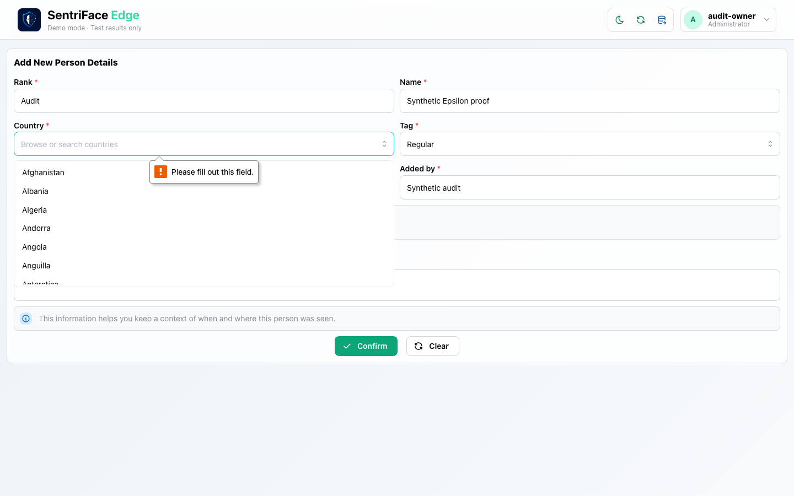
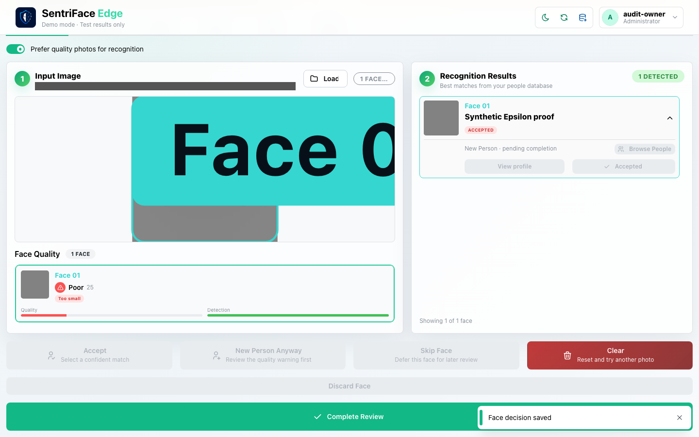
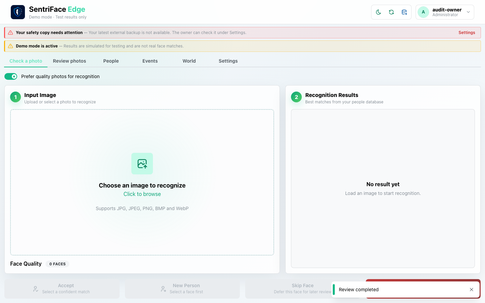
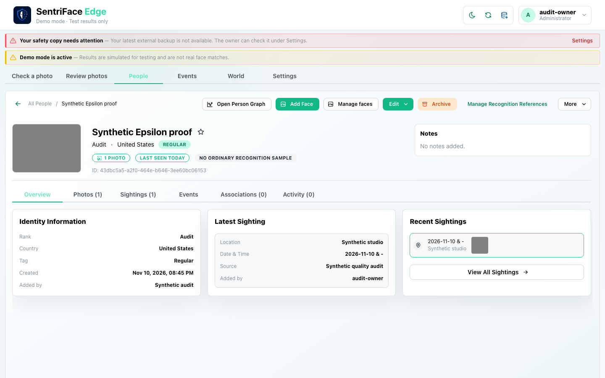

# J34 — Invalid photo, quality warning and proof-only completion

[Audit index](../INDEX.md) · [Source oracle](../source-map.md) · [Independent review](../review.md)

**Scope result: PARTIAL.** Source task SJ-010 and the corresponding recognition follow-up/finalization branches. Invalid-image refusal, poor-quality warning, proof-only choice, valid Person decision, completion and profile return are executed. This does not qualify the full set of recognition error/quality paths.

**Goal / entry / role:** Administrator checks invalid input, then wants to retain an explicitly poor-quality synthetic observation as proof while avoiding an ordinary recognition sample. Start the empty Check a Photo view on the disposable synthetic authority. Source `b457f0a723e845dd1a92a07a577072c85146c89a`; the whole-image synthetic detector is not genuine ONNX detection.

## Ordered interactions and authority

1. Choose the deliberately invalid fixture through the actual photo input. **Invalid input skipped — 1 invalid file was skipped. No usable images were found.** appears; identity actions remain disabled (step 1).
2. Choose the generated 24×24 poor-quality pattern. Its selected face is marked Poor and no Person meets the recognition threshold (step 2). Enter the synthetic Event context through the normal workflow.
3. Invoke **New Person Anyway**. **Use Face 01 despite quality warning?** explains Too small, Too blurry and Missing landmarks, with a 25% score (step 3). Escape dismisses the warning; reopen it and choose **No, keep as proof only**. The new-Person follow-up opens (step 4). Selecting a quality option alone is not a saved Person or finalized Encounter.
4. Fill the Person form. The first country-selection attempt leaves the options open and form visible (step 5); it is not a committed decision despite its legacy filename. Choose a valid country and confirm. **Face decision saved**, **Accepted** and **New Person · pending completion** then appear; Complete Review becomes enabled (step 6).
5. Select **Complete Review**. The photo workspace resets and displays **Review completed** (step 7). Navigate through People to the newly finalized synthetic Person profile (step 8): **1 Photo**, **Sightings (1)** and **No ordinary recognition sample** distinguish retained observation context from a usable recognition sample.

## Step 01 — Invalid input rejected; empty workspace retained

Capture: UX-02 · Administrator · Day · 1440×900 CSS viewport · DPR 1 · `2026-11-11T04:42:50.276308+00:00` · synthetic disposable authority. Scroll x=0, y=4.

## Step 02 — Poor-quality face selected

**SANITIZED derivative; unmodified original private.** This is a separate browser screenshot masking local-path text, not an untouched original. Capture timing may differ from the original timestamp below; masks can also occlude foreground overlays. See [capture register](../capture-register.json) `CAP-0266` for both hashes and classification.

Capture: UX-02 · Administrator · Day · 1440×900 CSS viewport · DPR 1 · `2026-11-11T04:43:39.985121+00:00` · synthetic disposable authority. Scroll x=0, y=80.

## Step 03 — Quality warning open

**SANITIZED derivative; unmodified original private.** This is a separate browser screenshot masking local-path text, not an untouched original. Capture timing may differ from the original timestamp below; masks can also occlude foreground overlays. See [capture register](../capture-register.json) `CAP-0267` for both hashes and classification.

Capture: UX-02 · Administrator · Day · 1440×900 CSS viewport · DPR 1 · `2026-11-11T04:44:04.630267+00:00` · synthetic disposable authority. Scroll x=0, y=80.

## Step 04 — Proof-only choice opens new-Person follow-up

**SANITIZED derivative; unmodified original private.** This is a separate browser screenshot masking local-path text, not an untouched original. Capture timing may differ from the original timestamp below; masks can also occlude foreground overlays. See [capture register](../capture-register.json) `CAP-0268` for both hashes and classification.

Capture: UX-02 · Administrator · Day · 1440×900 CSS viewport · DPR 1 · `2026-11-11T04:44:06.518370+00:00` · synthetic disposable authority. Scroll x=0, y=946.

## Step 05 — Country options still open; decision not saved

**SANITIZED derivative; unmodified original private.** This is a separate browser screenshot masking local-path text, not an untouched original. Capture timing may differ from the original timestamp below; masks can also occlude foreground overlays. See [capture register](../capture-register.json) `CAP-0269` for both hashes and classification.

Capture: UX-02 · Administrator · Day · 1440×900 CSS viewport · DPR 1 · `2026-11-11T04:44:57.882954+00:00` · synthetic disposable authority. Scroll x=0, y=946.

## Step 06 — Valid Person decision saved; finalization pending

**SANITIZED derivative; unmodified original private.** This is a separate browser screenshot masking local-path text, not an untouched original. Capture timing may differ from the original timestamp below; masks can also occlude foreground overlays. See [capture register](../capture-register.json) `CAP-0270` for both hashes and classification.

Capture: UX-02 · Administrator · Day · 1440×900 CSS viewport · DPR 1 · `2026-11-11T04:45:12.506200+00:00` · synthetic disposable authority. Scroll x=0, y=130.

## Step 07 — Review completed; workspace reset

Capture: UX-02 · Administrator · Day · 1440×900 CSS viewport · DPR 1 · `2026-11-11T04:45:28.589704+00:00` · synthetic disposable authority. Scroll x=0, y=4.

## Step 08 — Finalized profile retains proof and no ordinary recognition sample

Capture: UX-06 · Administrator · Day · 1440×900 CSS viewport · DPR 1 · `2026-11-11T04:45:51.401013+00:00` · synthetic disposable authority. Scroll x=0, y=4.

## Outcome, return and limits

The invalid input was safely refused; the subsequent valid synthetic input recovers through ordinary controls. The actual saved proof-only Person decision was finalized, and the People profile independently shows one photographic source/one Sighting with no ordinary recognition sample. This is a retained observation, not Reference Only enrollment, and a poor-quality selection is not silently promoted to recognition eligibility. No real face quality or ONNX accuracy conclusion follows from the generated pattern.

The warning Escape return is exercised; its low-quality acceptance alternative is displayed but not committed in this journey. Clear, Skip/Defer, Discard Face, no-face/multiple-face genuine input, inference failure/retry, permission denial, restart and repeated-input deduplication remain separately qualified or unrun in the source ledger. Step 5 records audit form-entry recovery, not an asserted product validation defect. The final profile is the observed cross-feature return; refresh/restart of this specific newly created Person was not exercised.

## macOS completion pass 2 — continuation B

Source product `b457f0a723e845dd1a92a07a577072c85146c89a`; full browser-content screenshots, 1440×900 CSS pixels, DPR 1, Day; dedicated disposable authority. See capture register for exact role, capture time and inference qualification.

A strong synthetic suggestion was displayed, but choosing a new synthetic Person completed without a duplicate warning for this path. Separately, the real ONNX detector processed a generated flat image and reported zero detected faces; its path-bearing original is private. No general claim about all duplicate checks or photographic accuracy is made.

### Step 09 — Pass2 Strong match before new person

Original retained privately: path, credential, or rejected attribution; not published.

Captured `2026-11-11T11:08:30.579263+00:00` · Administrator · UX-02 · scroll {'x': 0, 'y': 0}. Exact fixture and inference mode are described above and in the capture register.

### Step 10 — Pass2 New person despite strong match

Original retained privately: path, credential, or rejected attribution; not published.

Captured `2026-11-11T11:08:31.945334+00:00` · Administrator · UX-02 · scroll {'x': 0, 'y': 946}. Exact fixture and inference mode are described above and in the capture register.

### Step 11 — Pass2 New person accepted after strong match no duplicate warning

Original retained privately: path, credential, or rejected attribution; not published.

Captured `2026-11-11T11:09:25.786305+00:00` · Administrator · UX-02 · scroll {'x': 0, 'y': 130}. Exact fixture and inference mode are described above and in the capture register.

### Step 12 — Pass2 Strong match new person completed

Captured `2026-11-11T11:09:41.077351+00:00` · Administrator · UX-02 · scroll {'x': 0, 'y': 4}. Exact fixture and inference mode are described above and in the capture register.

### Step 13 — Pass2 Real ONNX flat input result

Original retained privately: path, credential, or rejected attribution; not published.

Captured `2026-11-11T13:07:57.485490+00:00` · Administrator · UX-02 · scroll {'x': 0, 'y': 0}. Exact fixture and inference mode are described above and in the capture register.
