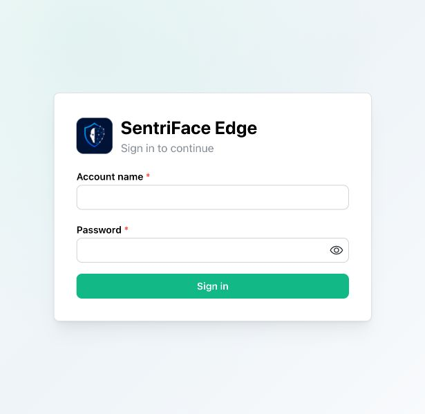
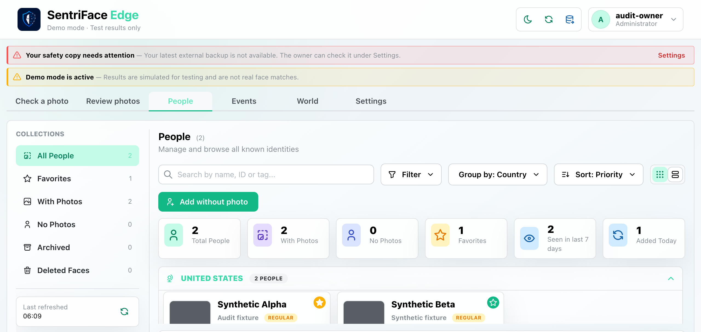
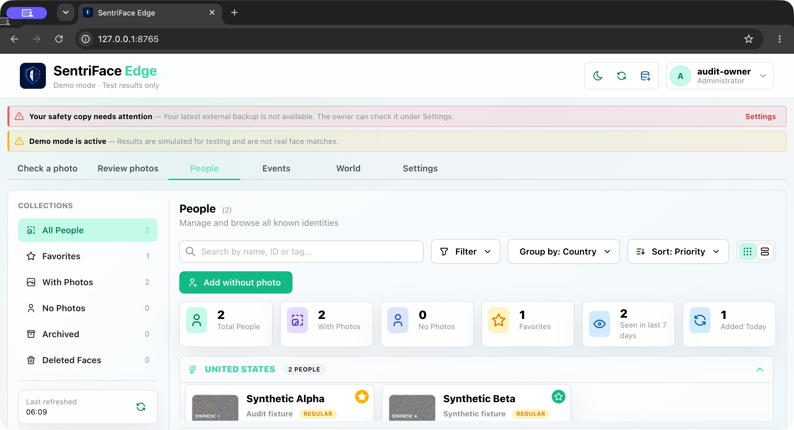
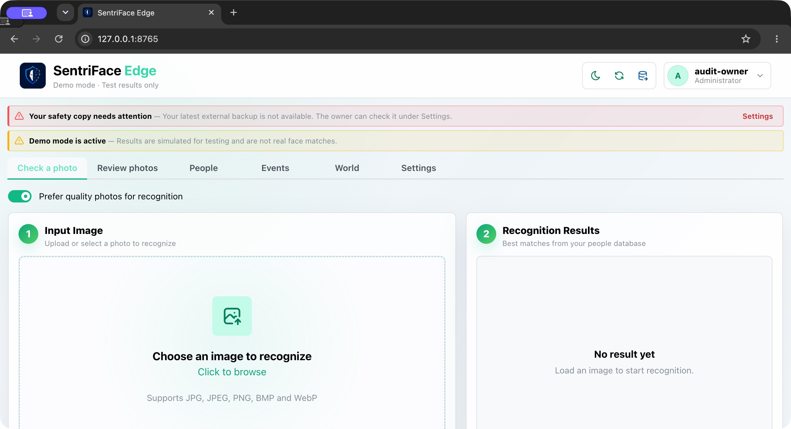
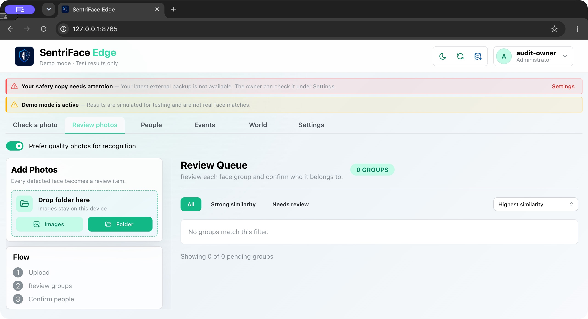
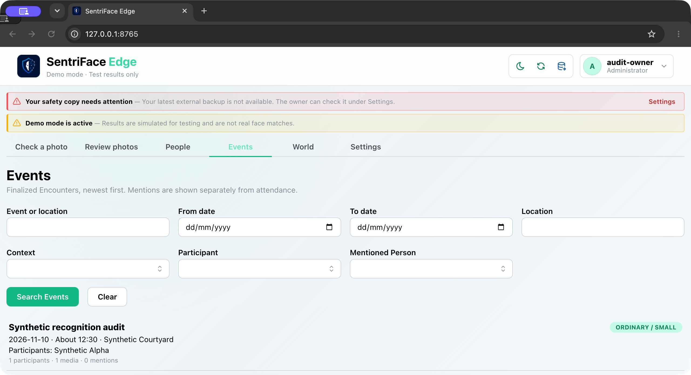
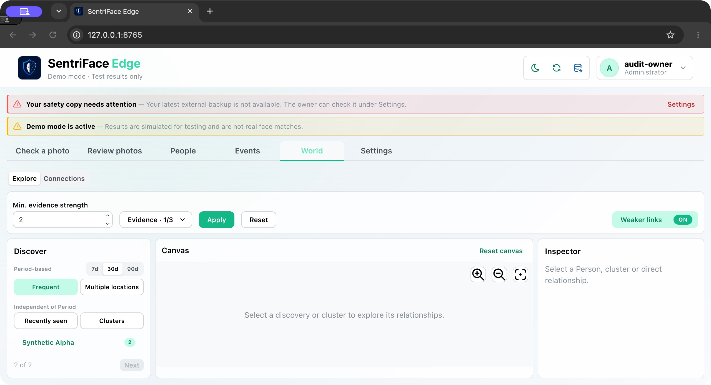
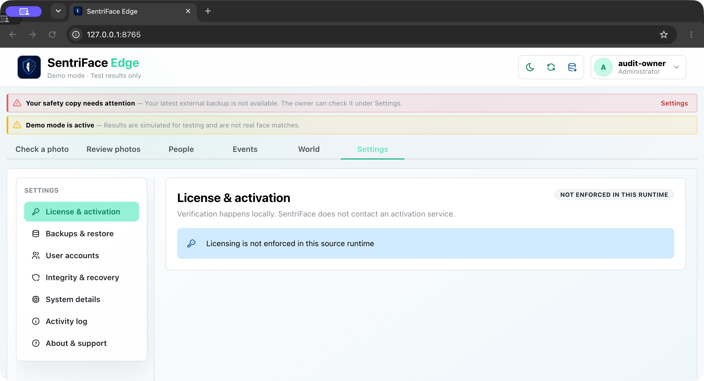

# J40 — Native macOS window and scaling baseline

[Audit index](../INDEX.md) · [Independent review](../review.md)

**Scope result: PARTIAL.** This qualifies the observed native surfaces and geometry only. It does not turn every CSS viewport capture into a full native-window capture.

The VM display reports1280×802 CSS points. Headed Google Chrome for Testing was requested1440×900 and clamped to an outer1280×695 window with1280×608 content, DPR2. Full-window originals are2560×1390 raster pixels; content-only original2560×1216. The narrow in-app browser sign-in is615×599; its DPR was not measured. All contain synthetic records or empty authentication fields.

## Interaction sequence and authority

Open the ordinary source sign-in in the in-app browser (step 1). Use a headed browser for the same disposable synthetic source authority; measure its actual outer/content geometry rather than inferring native size from a viewport request (step 2). Select People, Check a Photo, Review Photos, Events, World and Settings using the existing top-level navigation and capture each entire macOS browser window (steps 3–8). These are six different top-level surfaces, not six different scales. No record mutation or photographic input occurs. Return via ordinary navigation; overlays and alternate native sizes are not qualified by this sequence.

## Step 01 — Native in-app browser sign-in

native in-app browser content · Unauthenticated · light · source `b457f0a723e845dd1a92a07a577072c85146c89a` · `2026-11-10T08:39:25.725818+00:00`.

## Step 02 — Headed-native-People

synthetic · Administrator · light · source `b457f0a723e845dd1a92a07a577072c85146c89a` · `2026-11-10T14:09:37.838772+00:00`.

## Step 03 — Native full-window People

native macOS full window · Administrator · light · source `b457f0a723e845dd1a92a07a577072c85146c89a` · `2026-11-10T14:10:08.203702+00:00`.

## Step 04 — Native full-window Recognition

native macOS full window · Administrator · light · source `b457f0a723e845dd1a92a07a577072c85146c89a` · `2026-11-10T14:11:05.530155+00:00`.

## Step 05 — Native full-window Review

native macOS full window · Administrator · light · source `b457f0a723e845dd1a92a07a577072c85146c89a` · `2026-11-10T14:11:25.230338+00:00`.

## Step 06 — Native full-window Events

native macOS full window · Administrator · light · source `b457f0a723e845dd1a92a07a577072c85146c89a` · `2026-11-10T14:11:50.651417+00:00`.

## Step 07 — Native full-window World

native macOS full window · Administrator · light · source `b457f0a723e845dd1a92a07a577072c85146c89a` · `2026-11-10T14:12:12.524996+00:00`.

## Step 08 — Native full-window Settings

native macOS full window · Administrator · light · source `b457f0a723e845dd1a92a07a577072c85146c89a` · `2026-11-10T14:12:25.134060+00:00`.

Six source top-level views are represented with browser chrome at actual VM scaling. All dialogs, interaction branches, large native windows, other VM display settings and Windows remain unqualified. CSS-size/theme comparisons are [J26](J26.md).
