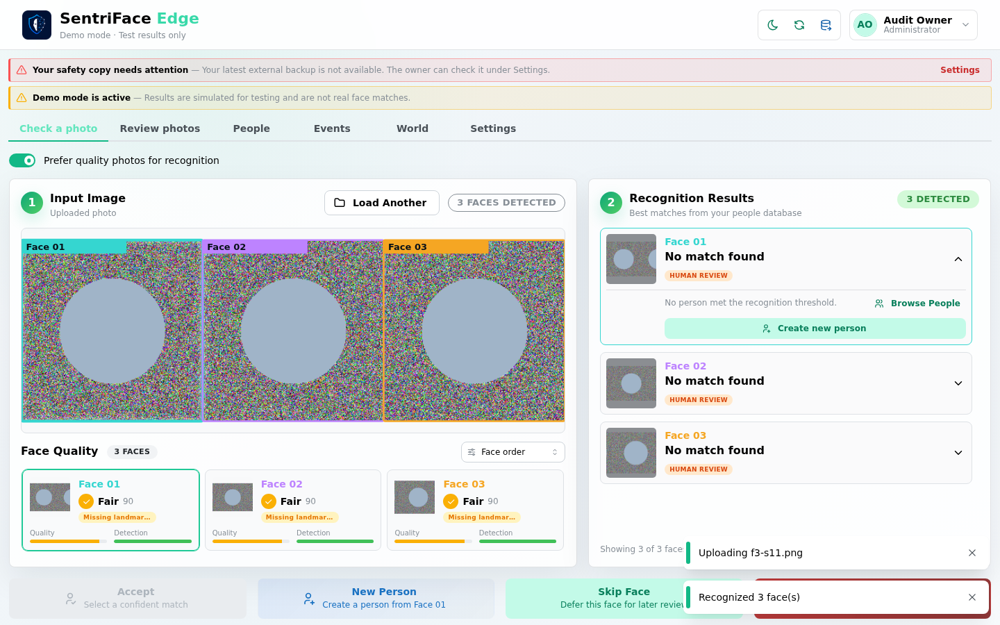
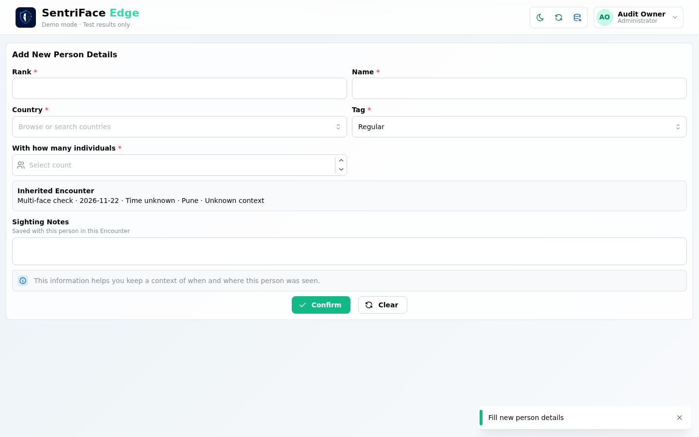
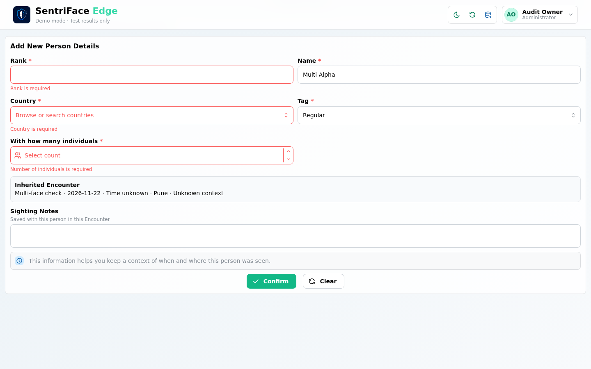
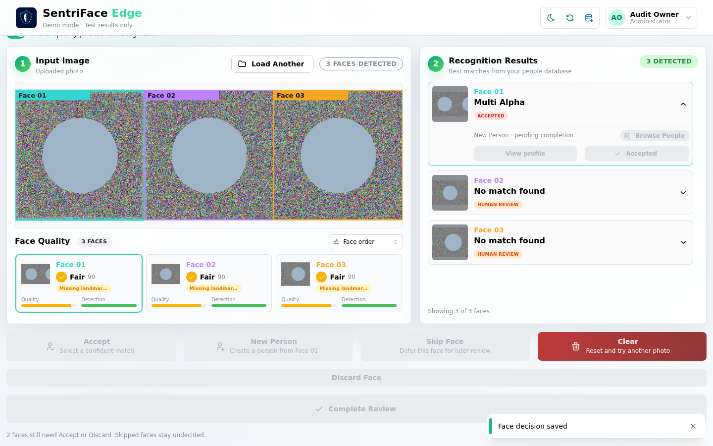
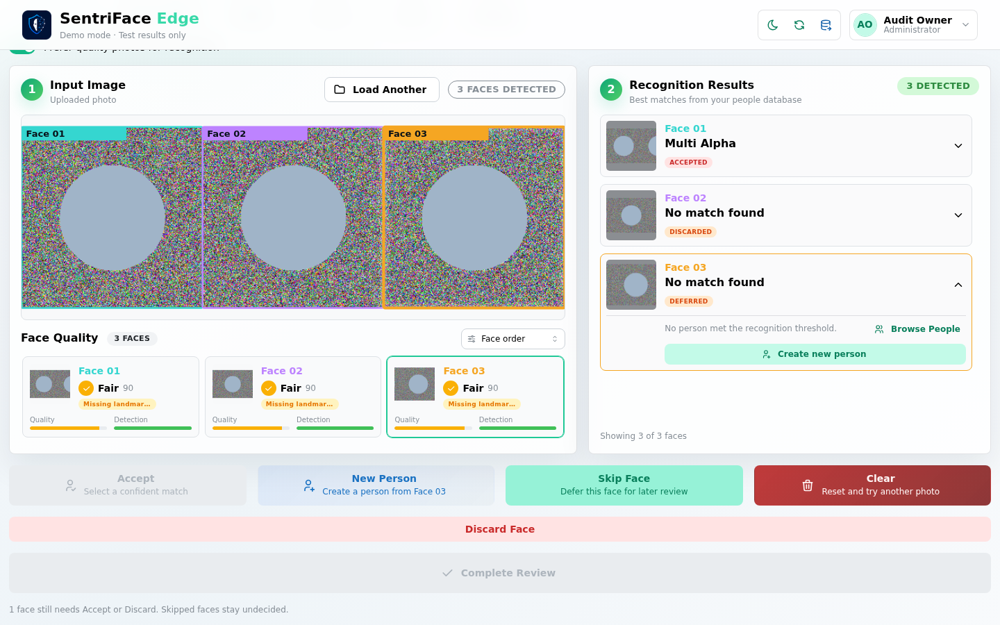
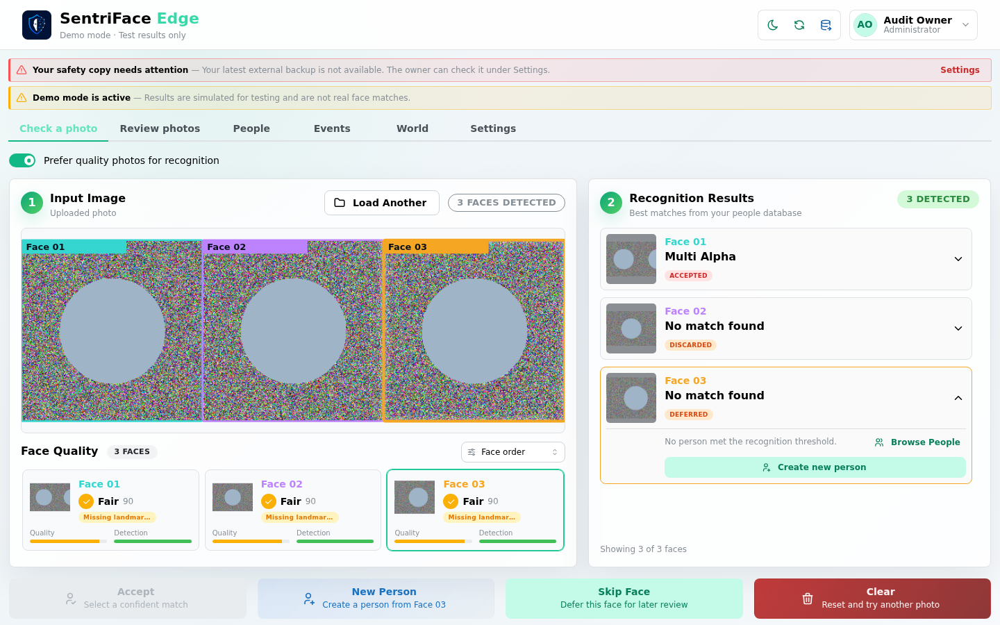
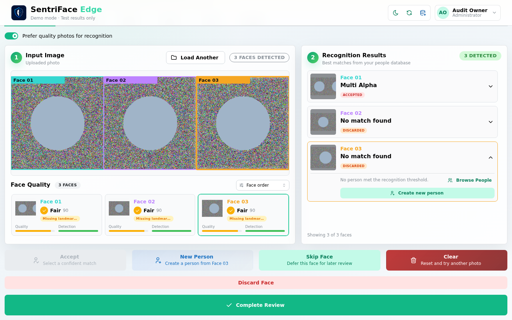

# J42 — Multi-face photo: decide every face, refresh mid-review, complete atomically

[Audit index](../INDEX.md) · [Findings](../findings.md) · [Independent review](../review.md)

**Pass 3 result: PASS for the persistence invariant; PARTIAL for the flow family.** Source `677bb61e8e9d659db95123871bb2e011cf663a79` (`v2-hardening-followups`), Linux headless Chromium, 1440×900, light theme, disposable synthetic source authority. Synthetic means generated non-biometric patterns, not ONNX inference.

**Starting state / role:** Administrator; fresh synthetic authority; generated three-face image (audit seam).

## Interaction sequence and outcomes

1. Upload a generated three-face image in Check a photo, enter Event details (Multi-face check, Pune) and confirm (step 1).
2. Face 01 → Create new person; Confirm with empty fields shows required errors; complete the form (steps 2–4). `/api/persons` stays empty.
3. Discard Face 02, Skip Face 03; Complete Review stays disabled while a face is undecided (step 5).
4. Reload the browser mid-review: decisions survive (step 6).
5. Decide Face 03; Complete Review → “Review completed”; exactly one Person and one finalized Encounter with operation id appear (steps 7–8).

**Limits and findings:** No graph-affecting record exists before explicit completion (invariant PASS). Toasts overlap decision controls (F04). Three terms for one state: Skip Face / DEFERRED / “skipped faces stay undecided”. Genuine ONNX multi-face remains BLOCKED (no licensed models on this VM).

## Step 01 — Three face photo loaded

Capture: CAP-0728 · UX-02 · Administrator · light · 1440×900 CSS · DPR 1 · `2026-11-22T18:11:19.744826+00:00` · synthetic.

## Step 02 — New person form face 01

Capture: CAP-0729 · UX-02 · Administrator · light · 1440×900 CSS · DPR 1 · `2026-11-22T18:11:34.749944+00:00` · synthetic.

## Step 03 — Confirm new person attempt

Capture: CAP-0730 · UX-02 · Administrator · light · 1440×900 CSS · DPR 1 · `2026-11-22T18:12:08.370595+00:00` · synthetic.

## Step 04 — Face 01 drafted new person

Capture: CAP-0731 · UX-02 · Administrator · light · 1440×900 CSS · DPR 1 · `2026-11-22T18:12:29.669136+00:00` · synthetic.

## Step 05 — Face 02 discarded face 03 skipped

Capture: CAP-0732 · UX-02 · Administrator · light · 1440×900 CSS · DPR 1 · `2026-11-22T18:12:47.839800+00:00` · synthetic.

## Step 06 — After browser refresh mid review

Capture: CAP-0733 · UX-02 · Administrator · light · 1440×900 CSS · DPR 1 · `2026-11-22T18:13:05.107159+00:00` · synthetic.

## Step 07 — All faces decided ready

Capture: CAP-0734 · UX-02 · Administrator · light · 1440×900 CSS · DPR 1 · `2026-11-22T18:13:21.796168+00:00` · synthetic.

## Step 08 — Review completed

Capture: CAP-0735 · UX-02 · Administrator · light · 1440×900 CSS · DPR 1 · `2026-11-22T18:13:24.297906+00:00` · synthetic.
