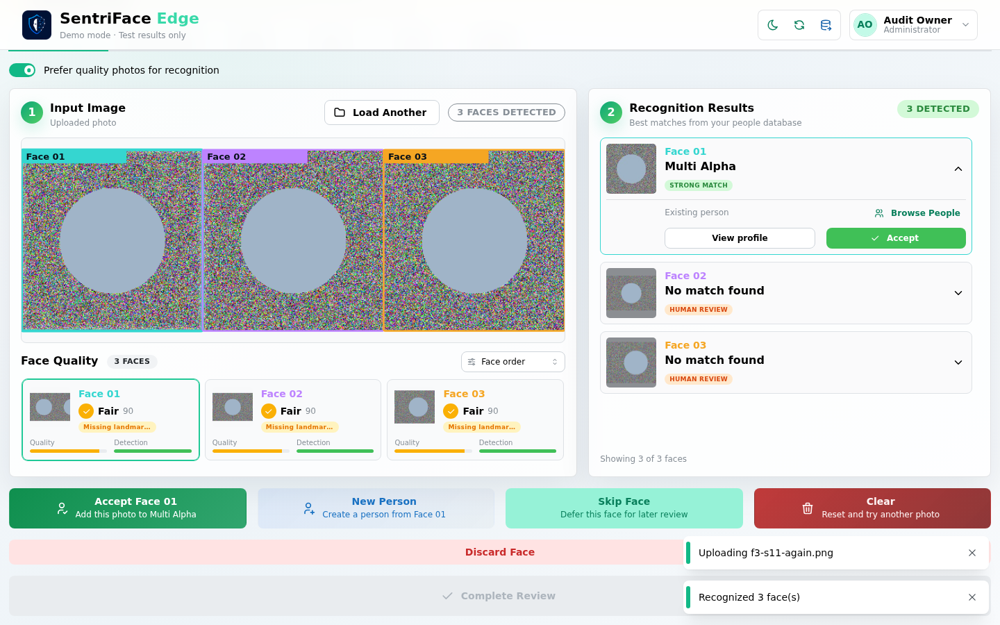
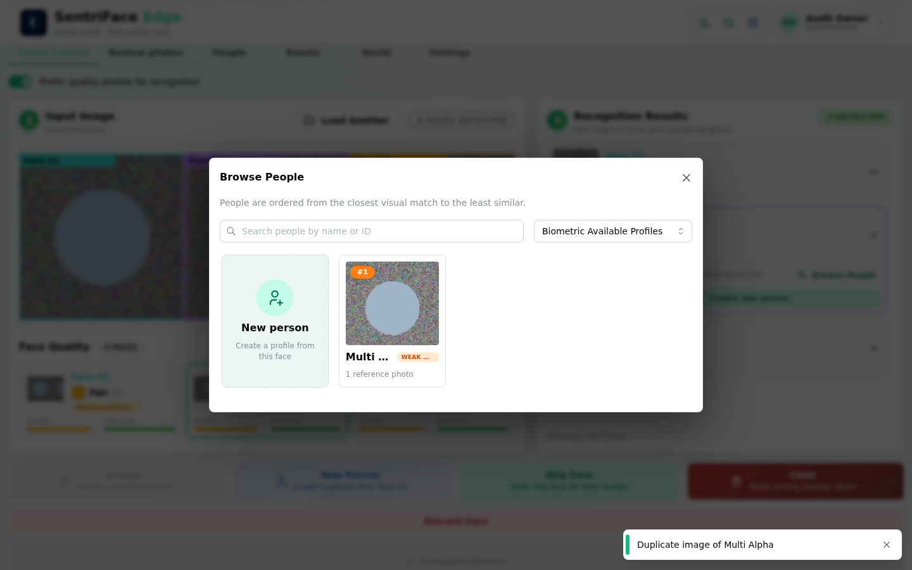
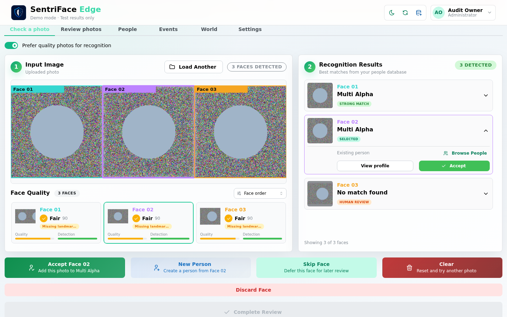
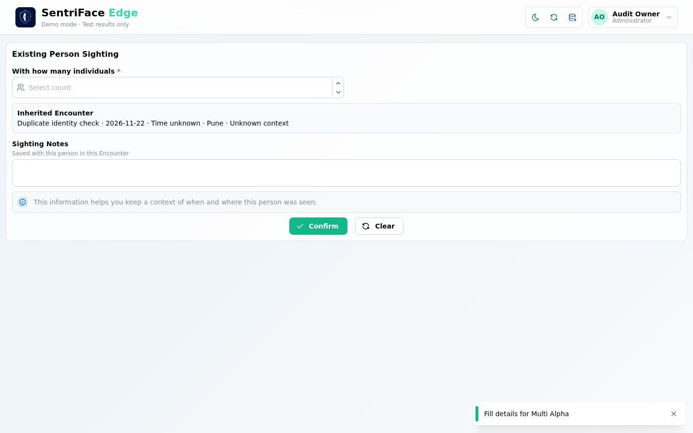
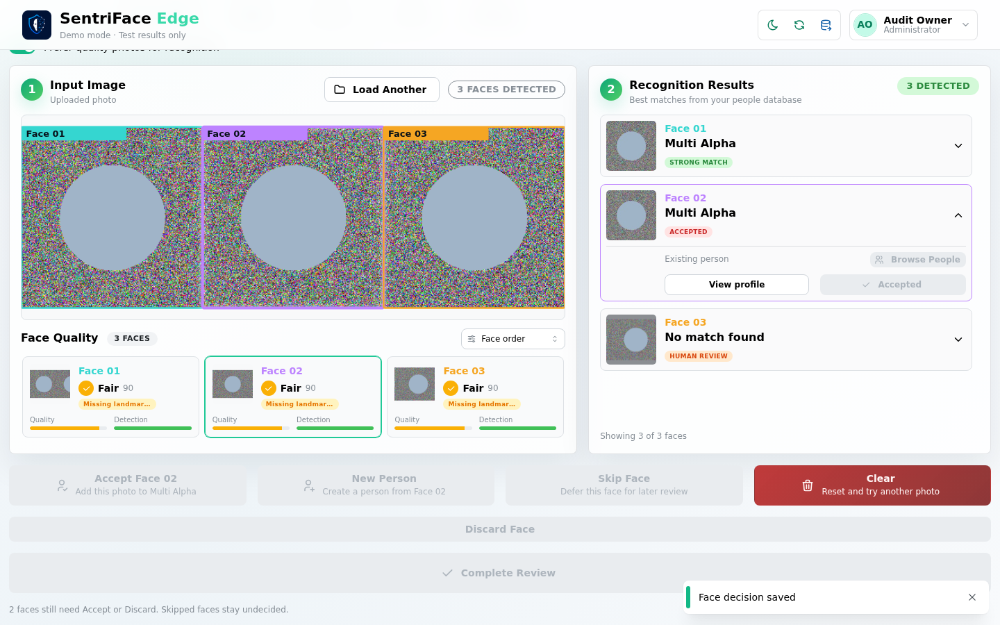
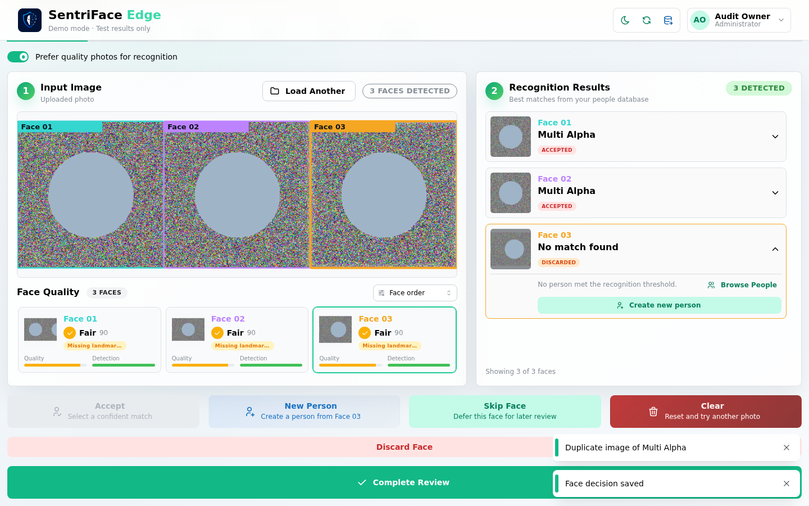

# J43 — Repeated photo and the same Person on two faces

[Audit index](../INDEX.md) · [Findings](../findings.md) · [Independent review](../review.md)

**Pass 3 result: PASS (participant deduplication).** Source `677bb61e8e9d659db95123871bb2e011cf663a79` (`v2-hardening-followups`), Linux headless Chromium, 1440×900, light theme, disposable synthetic source authority. Synthetic means generated non-biometric patterns, not ONNX inference.

**Starting state / role:** Administrator; J42 Person exists.

## Interaction sequence and outcomes

1. Upload the same image: Face 01 shows a strong proposal for Multi Alpha (step 1).
2. Browse People for Face 02 and pick Multi Alpha (steps 2–3); accepting Face 01 opens a duplicate-image follow-up form that is silently replaced when another face is selected (step 4).
3. Confirm Multi Alpha on both faces, discard Face 03, complete (steps 5–7).

**Limits and findings:** Encounter `participant_ids` contains the canonical Person once (invariant PASS). No warning that one Person is assigned to two faces in one photo; the ACCEPTED badge uses a red-family tint shared with destructive states.

## Step 01 — Repeat photo proposals

Capture: CAP-0736 · UX-02 · Administrator · light · 1440×900 CSS · DPR 1 · `2026-11-22T18:13:39.018326+00:00` · synthetic.

## Step 02 — Browse people for face 02

Capture: CAP-0737 · UX-02 · Administrator · light · 1440×900 CSS · DPR 1 · `2026-11-22T18:14:05.305385+00:00` · synthetic.

## Step 03 — Face 02 selected same person

Capture: CAP-0738 · UX-02 · Administrator · light · 1440×900 CSS · DPR 1 · `2026-11-22T18:14:19.507110+00:00` · synthetic.

## Step 04 — Same person accepted twice attempt

Capture: CAP-0739 · UX-02 · Administrator · light · 1440×900 CSS · DPR 1 · `2026-11-22T18:14:35.030808+00:00` · synthetic.

## Step 05 — Face 02 confirmed same person

Capture: CAP-0740 · UX-02 · Administrator · light · 1440×900 CSS · DPR 1 · `2026-11-22T18:14:59.197791+00:00` · synthetic.

## Step 06 — Same person on two faces ready

Capture: CAP-0741 · UX-02 · Administrator · light · 1440×900 CSS · DPR 1 · `2026-11-22T18:15:54.804787+00:00` · synthetic.

## Step 07 — Same person two faces completed

Capture: CAP-0742 · UX-02 · Administrator · light · 1440×900 CSS · DPR 1 · `2026-11-22T18:15:57.319123+00:00` · synthetic.
