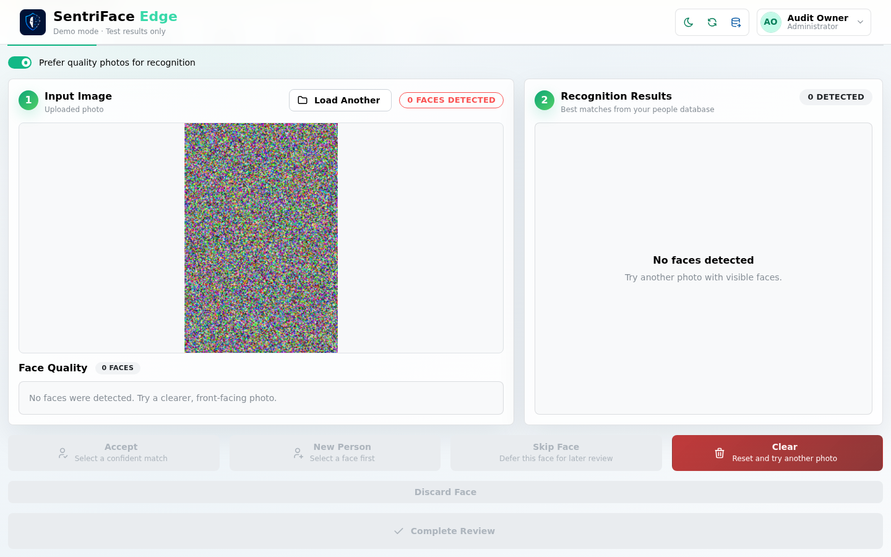
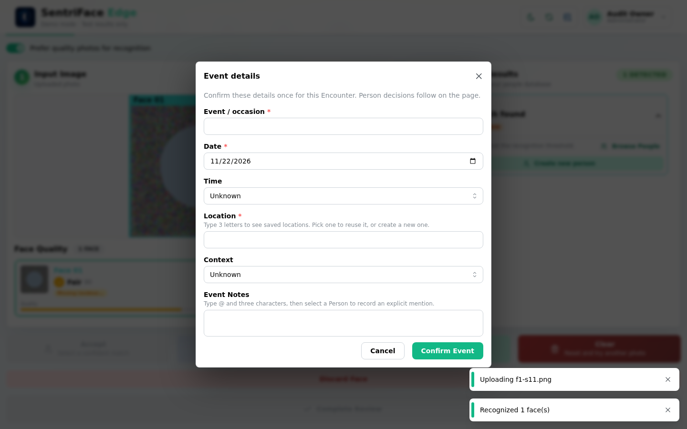
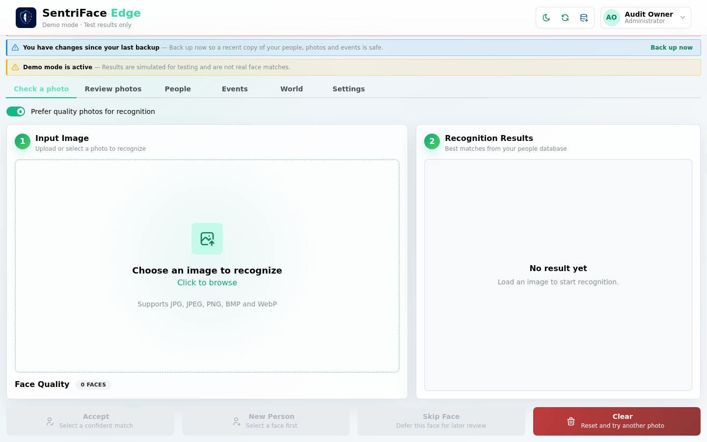
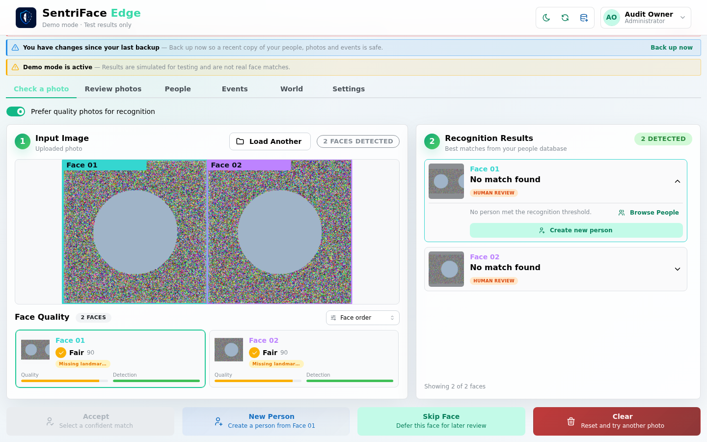
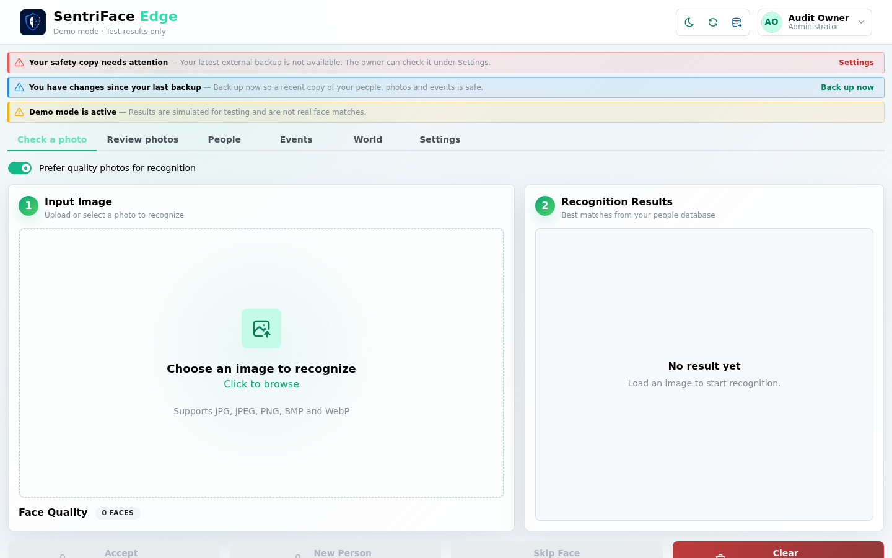

# J44 — Zero, one and two faces; cancel and Clear

[Audit index](../INDEX.md) · [Findings](../findings.md) · [Independent review](../review.md)

**Pass 3 result: PASS with findings.** Source `677bb61e8e9d659db95123871bb2e011cf663a79` (`v2-hardening-followups`), Linux headless Chromium, 1440×900, light theme, disposable synthetic source authority. Synthetic means generated non-biometric patterns, not ONNX inference.

**Starting state / role:** Administrator.

## Interaction sequence and outcomes

1. Zero-face image: “0 FACES DETECTED … Try a clearer, front-facing photo”, no Event dialog (step 1).
2. One-face image opens Event details; Cancel resets to the empty page and persists nothing (steps 2–3).
3. Two-face image: Escape inside Location keeps the dialog; confirm shows two faces (step 4).
4. Discard Face 01 then Clear: immediate reset, no confirmation, decisions lost; reload shows the empty page (steps 5–6).

**Limits and findings:** Nothing persisted on cancel/clear (PASS). F38: Clear drops decisions without confirmation; disabled Clear looks enabled. F40 banner shown to the owner.

## Step 01 — Zero face upload

Capture: CAP-0743 · UX-02 · Administrator · light · 1440×900 CSS · DPR 1 · `2026-11-22T18:16:40.052678+00:00` · synthetic.

## Step 02 — One face upload event details

Capture: CAP-0744 · UX-02 · Administrator · light · 1440×900 CSS · DPR 1 · `2026-11-22T18:17:02.366180+00:00` · synthetic.

## Step 03 — One face event details cancelled

Capture: CAP-0745 · UX-02 · Administrator · light · 1440×900 CSS · DPR 1 · `2026-11-22T18:17:17.183029+00:00` · synthetic.

## Step 04 — Two face proposals

Capture: CAP-0746 · UX-02 · Administrator · light · 1440×900 CSS · DPR 1 · `2026-11-22T18:17:56.774637+00:00` · synthetic.

## Step 05 — Clear mid review

Capture: CAP-0747 · UX-02 · Administrator · light · 1440×900 CSS · DPR 1 · `2026-11-22T18:18:15.405406+00:00` · synthetic.

## Step 06 — After clear reload

Capture: CAP-0748 · UX-02 · Administrator · light · 1440×900 CSS · DPR 1 · `2026-11-22T18:18:33.955619+00:00` · synthetic.
