# J45 — Portable backup: create, invalid imports, restore, export, re-import

[Audit index](../INDEX.md) · [Findings](../findings.md) · [Independent review](../review.md)

**Pass 3 result: PASS for safety outcomes; PARTIAL for interruption/failure injection.** Source `677bb61e8e9d659db95123871bb2e011cf663a79` (`v2-hardening-followups`), Linux headless Chromium, 1440×900, light theme, disposable synthetic source authority. Synthetic means generated non-biometric patterns, not ONNX inference.

**Starting state / role:** Administrator.

## Interaction sequence and outcomes

1. Settings → Backups & restore; Create backup → verified, complete, 1.4 MB, 5 files (steps 1–4).
2. Import plain corrupt file → “Invalid backup skipped”; import corrupt `.enc` with passphrase → two toasts (steps 5–7, F09).
3. After adding a Person and Encounter, open Restore: “Restore portable backup?” names “the selected backup”; Cancel changes nothing (step 8).
4. Restore Safely → app reloads to Check a photo; the post-backup Person is gone; an automatic pre-restore backup exists (steps 9–11).
5. Export with mismatched passphrases is blocked (step 13, private); export succeeds; wrong passphrase import gives two toasts and closes the dialog; correct passphrase imports and verifies (steps 12–15).
6. Importing the same file again creates a second identical row (step 16).

**Limits and findings:** Data replacement and safety backup behave correctly. F37/F11: origin labels, raw ids, duplicate import, reminder after restore. Not run: interrupted restore, disk-full or power-loss injection, restore across schema versions.

## Step 01 — Settings landing

[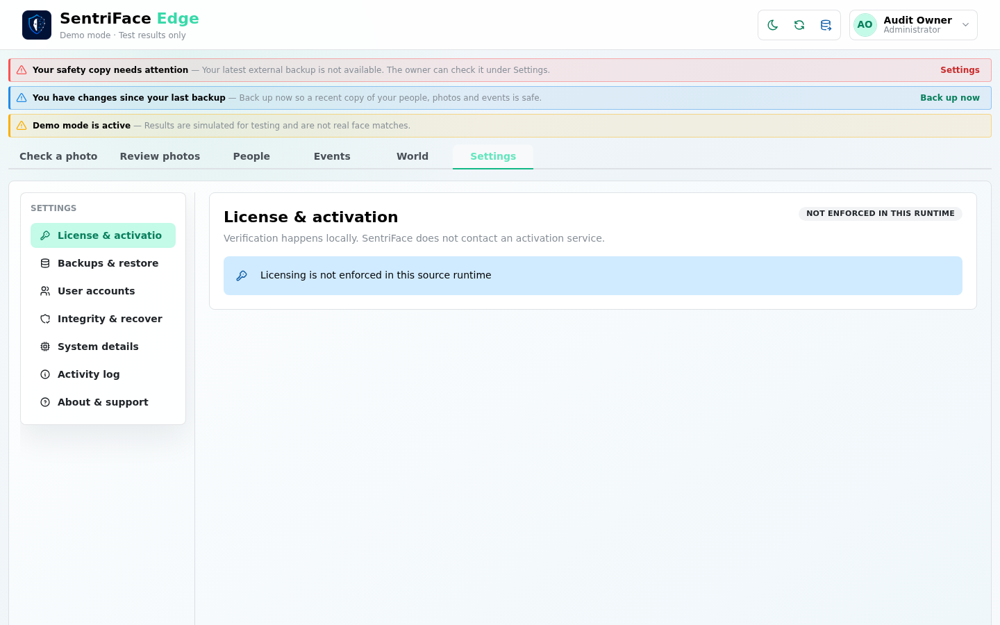](../screenshots/UX-13/UX-13_J45_Step-01_Settings-landing.png)

Capture: CAP-0749 · UX-13 · Administrator · light · 1440×900 CSS · DPR 1 · `2026-11-22T18:19:06.484941+00:00` · synthetic.

## Step 02 — Backups before create

[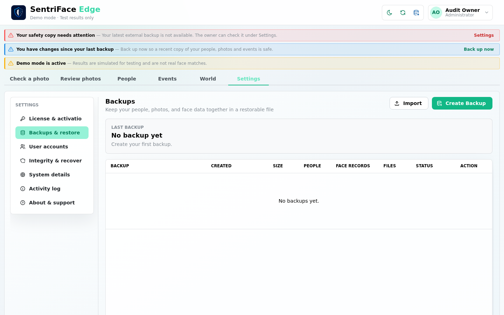](../screenshots/UX-13/UX-13_J45_Step-02_Backups-before-create.png)

Capture: CAP-0750 · UX-13 · Administrator · light · 1440×900 CSS · DPR 1 · `2026-11-22T18:19:25.716032+00:00` · synthetic.

## Step 03 — Backup creating

Capture: CAP-0751 · UX-13 · Administrator · light · 1440×900 CSS · DPR 1 · `2026-11-22T18:19:26.680124+00:00` · synthetic.

## Step 04 — Backup created

[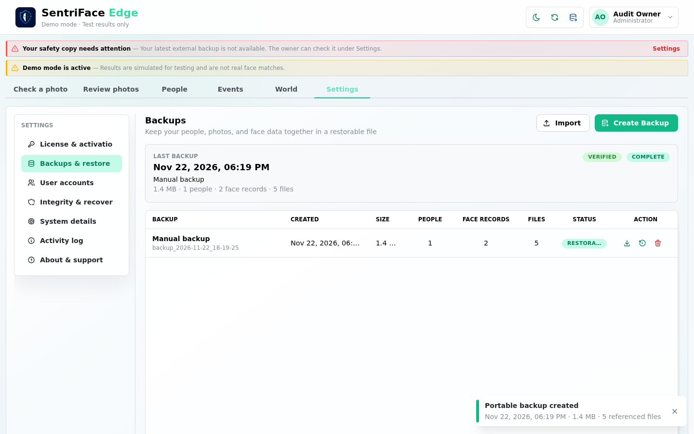](../screenshots/UX-13/UX-13_J45_Step-04_Backup-created.png)

Capture: CAP-0752 · UX-13 · Administrator · light · 1440×900 CSS · DPR 1 · `2026-11-22T18:19:33.107850+00:00` · synthetic.

## Step 05 — Import corrupt plain

[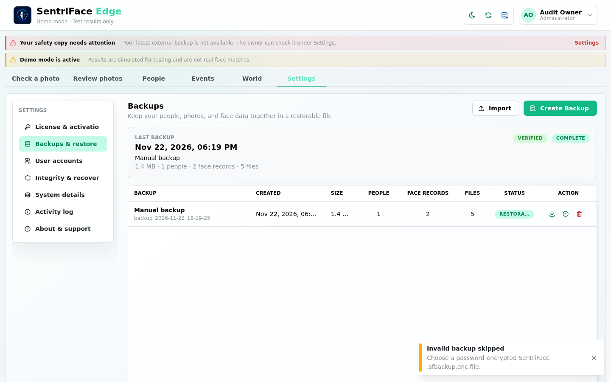](../screenshots/UX-13/UX-13_J45_Step-05_Import-corrupt-plain.png)

Capture: CAP-0753 · UX-13 · Administrator · light · 1440×900 CSS · DPR 1 · `2026-11-22T18:19:46.524965+00:00` · synthetic.

## Step 06 — Import encrypted passphrase dialog

[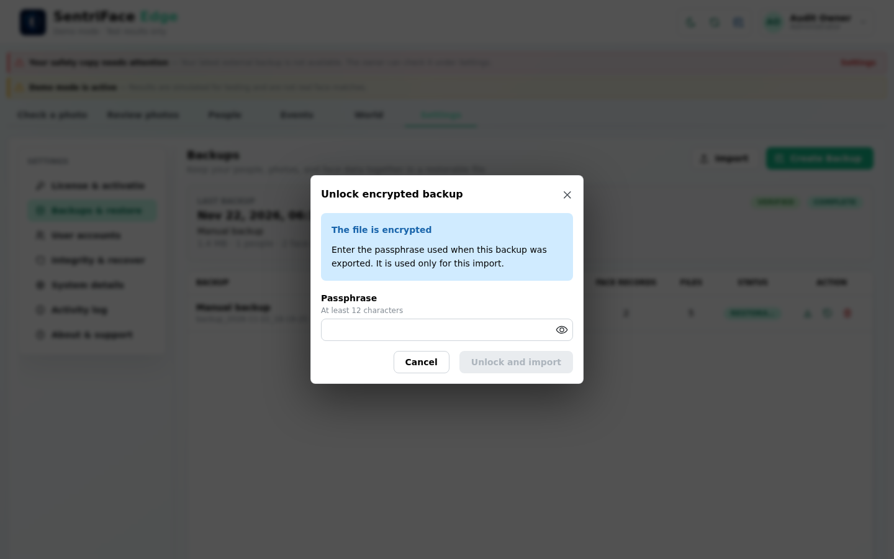](../screenshots/UX-13/UX-13_J45_Step-06_Import-encrypted-passphrase-dialog.png)

Capture: CAP-0754 · UX-13 · Administrator · light · 1440×900 CSS · DPR 1 · `2026-11-22T18:20:07.987603+00:00` · synthetic.

## Step 07 — Import corrupt encrypted result

[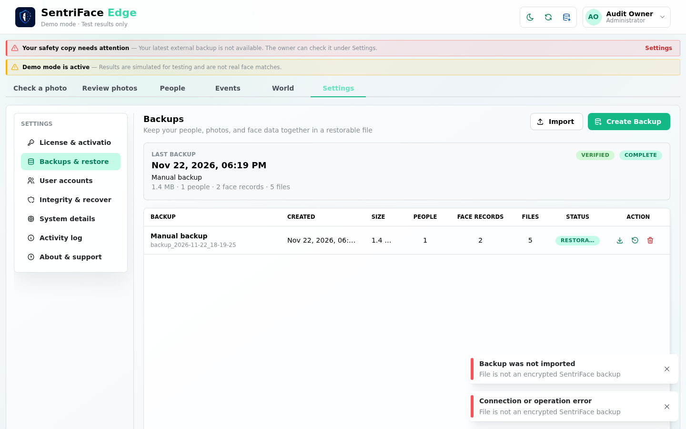](../screenshots/UX-13/UX-13_J45_Step-07_Import-corrupt-encrypted-result.png)

Capture: CAP-0755 · UX-13 · Administrator · light · 1440×900 CSS · DPR 1 · `2026-11-22T18:20:27.123111+00:00` · synthetic.

## Step 08 — Restore confirmation

[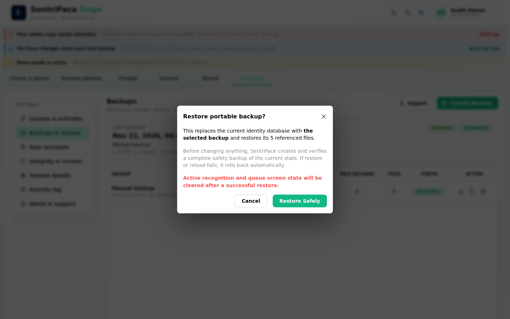](../screenshots/UX-13/UX-13_J45_Step-08_Restore-confirmation.png)

Capture: CAP-0756 · UX-13 · Administrator · light · 1440×900 CSS · DPR 1 · `2026-11-22T18:22:01.211606+00:00` · synthetic.

## Step 09 — Restore in progress

[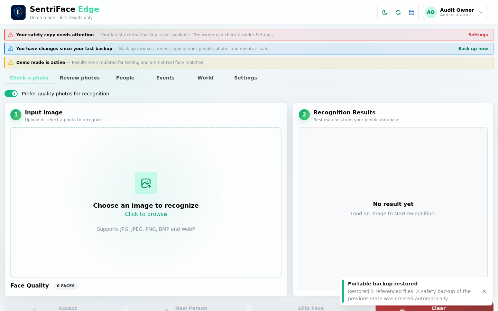](../screenshots/UX-13/UX-13_J45_Step-09_Restore-in-progress.png)

Capture: CAP-0757 · UX-13 · Administrator · light · 1440×900 CSS · DPR 1 · `2026-11-22T18:22:21.739964+00:00` · synthetic.

## Step 10 — Restore completed

[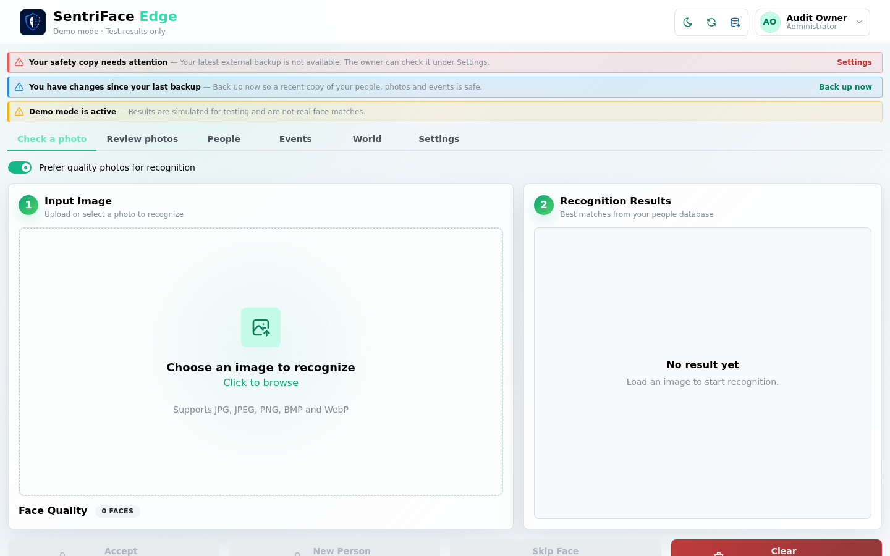](../screenshots/UX-13/UX-13_J45_Step-10_Restore-completed.png)

Capture: CAP-0758 · UX-13 · Administrator · light · 1440×900 CSS · DPR 1 · `2026-11-22T18:22:34.312077+00:00` · synthetic.

## Step 11 — Backups after restore

[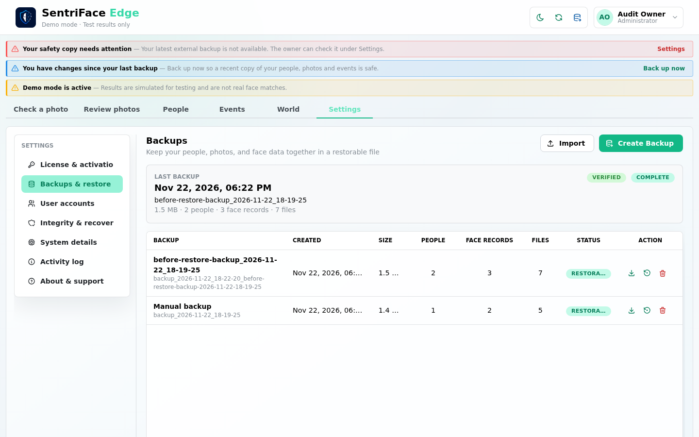](../screenshots/UX-13/UX-13_J45_Step-11_Backups-after-restore.png)

Capture: CAP-0759 · UX-13 · Administrator · light · 1440×900 CSS · DPR 1 · `2026-11-22T18:23:21.855385+00:00` · synthetic.

## Step 12 — Export passphrase dialog

[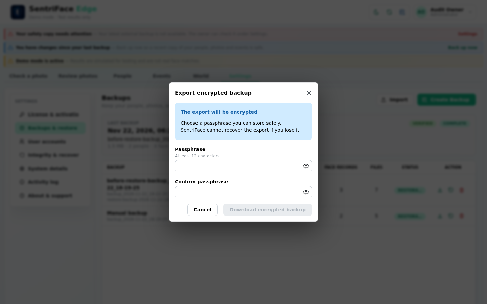](../screenshots/UX-13/UX-13_J45_Step-12_Export-passphrase-dialog.png)

Capture: CAP-0760 · UX-13 · Administrator · light · 1440×900 CSS · DPR 1 · `2026-11-22T18:23:23.148677+00:00` · synthetic.

## Step 13 — Export passphrase mismatch

*Private original only.* Withheld: credential-bearing form with a filled password/passphrase field.

Capture: CAP-0761 · UX-13 · Administrator · light · 1440×900 CSS · DPR 1 · `2026-11-22T18:23:40.477941+00:00` · synthetic.

## Step 14 — Import valid wrong passphrase

[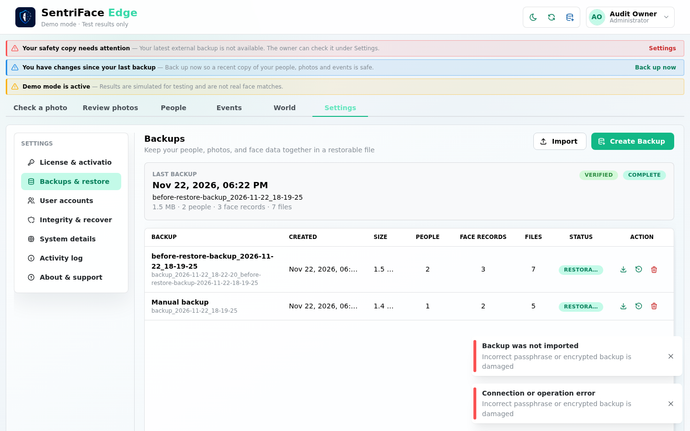](../screenshots/UX-13/UX-13_J45_Step-14_Import-valid-wrong-passphrase.png)

Capture: CAP-0762 · UX-13 · Administrator · light · 1440×900 CSS · DPR 1 · `2026-11-22T18:24:05.528648+00:00` · synthetic.

## Step 15 — Import valid right passphrase

[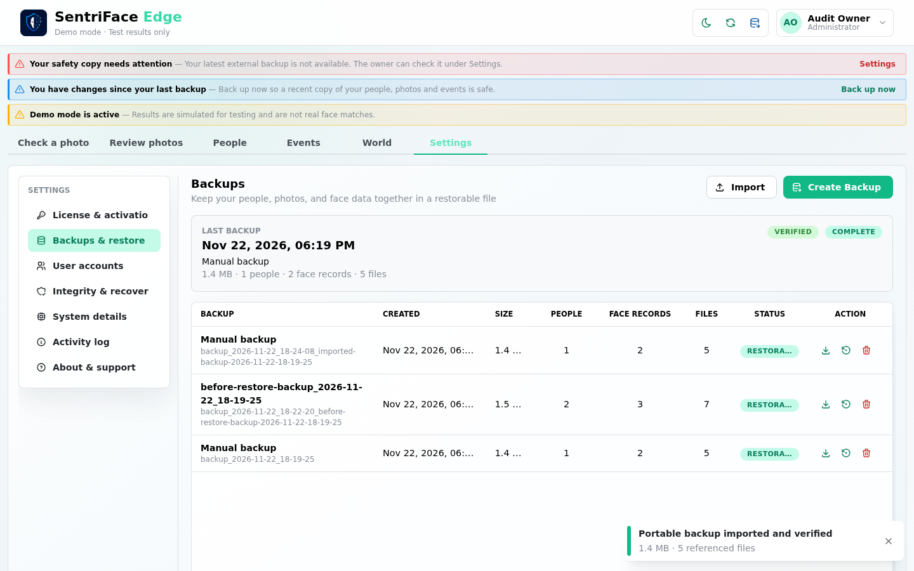](../screenshots/UX-13/UX-13_J45_Step-15_Import-valid-right-passphrase.png)

Capture: CAP-0763 · UX-13 · Administrator · light · 1440×900 CSS · DPR 1 · `2026-11-22T18:24:14.672796+00:00` · synthetic.

## Step 16 — Import same file again

[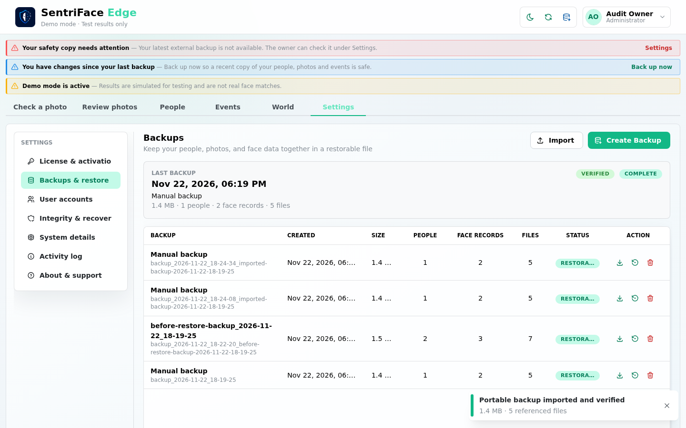](../screenshots/UX-13/UX-13_J45_Step-16_Import-same-file-again.png)

Capture: CAP-0764 · UX-13 · Administrator · light · 1440×900 CSS · DPR 1 · `2026-11-22T18:24:41.076840+00:00` · synthetic.
