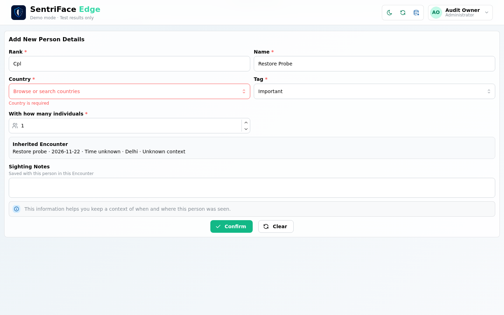

# J46 — New-person form validation in Check a photo

[Audit index](../INDEX.md) · [Findings](../findings.md) · [Independent review](../review.md)

**Pass 3 result: PASS with finding.** Source `677bb61e8e9d659db95123871bb2e011cf663a79` (`v2-hardening-followups`), Linux headless Chromium, 1440×900, light theme, disposable synthetic source authority. Synthetic means generated non-biometric patterns, not ONNX inference.

**Starting state / role:** Administrator.

## Interaction sequence and outcomes

1. Type “India” in the searchable Country field, press Escape, Confirm → “Country is required” (step 1).

**Limits and findings:** Escape silently clears typed text in the searchable select; Rank precedes Name; face context scrolls away.

## Step 01 — New person confirm blocked

Capture: CAP-0765 · UX-02 · Administrator · light · 1440×900 CSS · DPR 1 · `2026-11-22T18:21:19.282221+00:00` · synthetic.
