# J47 — Five roles: account creation, navigation and permissions

[Audit index](../INDEX.md) · [Findings](../findings.md) · [Independent review](../review.md)

**Pass 3 result: PASS for frontend/backend agreement; PARTIAL for exhaustive denial matrix.** Source `677bb61e8e9d659db95123871bb2e011cf663a79` (`v2-hardening-followups`), Linux headless Chromium, 1440×900, light theme, disposable synthetic source authority. Synthetic means generated non-biometric patterns, not ONNX inference.

**Starting state / role:** Administrator creates Viewer, Operator, Custodian, Technician through the UI; each signs in separately.

## Interaction sequence and outcomes

1. Settings → User accounts → Add account; role picker shows bare names; four accounts created (steps 1–4; step 3 private).
2. Viewer: tabs Check a photo, People, Events, World; header Favorite enabled then refused; More-menu Favorite disabled; Add Reference Only disabled (steps 5–12).
3. Operator: adds Review photos; Archive/Merge/Delete disabled; Event detail has only Attach Media (steps 13–16).
4. Custodian: adds Settings and Encounter corrections (step 17).
5. Technician: no Review photos; Settings shows License, Backups, System details, Activity log, About; Back up now succeeds; Import/Restore/Delete disabled without reason; Activity log shows raw ids and `permanent: false` (steps 18–23).

**Limits and findings:** Visible capabilities match `ROLE_CAPABILITIES`; refused calls hold at the API (F06 revalidated). F33 explanations; F39 temporary password not enforced.

## Step 01 — User accounts

[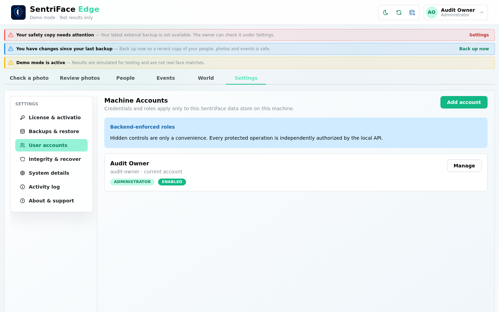](../screenshots/UX-13/UX-13_J47_Step-01_User-accounts.png)

Capture: CAP-0766 · UX-13 · Administrator · light · 1440×900 CSS · DPR 1 · `2026-11-22T18:25:01.805838+00:00` · synthetic.

## Step 02 — Role options

[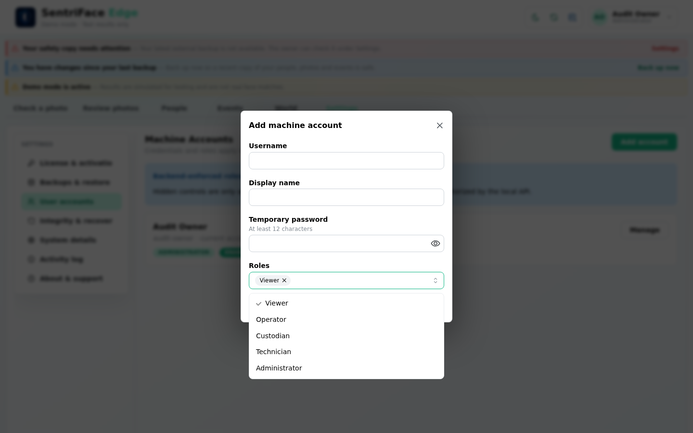](../screenshots/UX-13/UX-13_J47_Step-02_Role-options.png)

Capture: CAP-0767 · UX-13 · Administrator · light · 1440×900 CSS · DPR 1 · `2026-11-22T18:25:03.369839+00:00` · synthetic.

## Step 03 — Accounts created

*Private original only.* Withheld: credential-bearing form with a filled password/passphrase field.

Capture: CAP-0768 · UX-13 · Administrator · light · 1440×900 CSS · DPR 1 · `2026-11-22T18:25:25.795846+00:00` · synthetic.

## Step 04 — Accounts created

[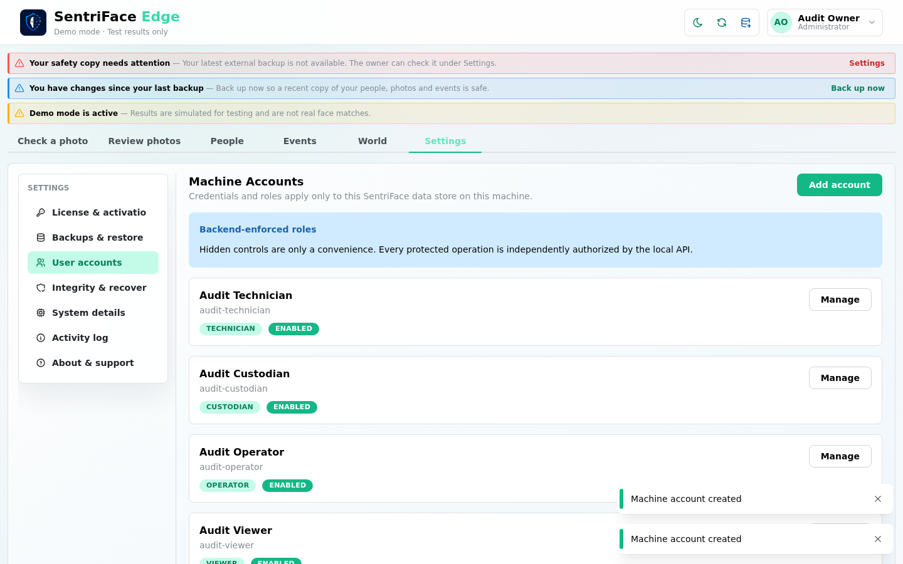](../screenshots/UX-13/UX-13_J47_Step-04_Accounts-created.png)

Capture: CAP-0769 · UX-13 · Administrator · light · 1440×900 CSS · DPR 1 · `2026-11-22T18:26:10.785863+00:00` · synthetic.

## Step 05 — Signed out

[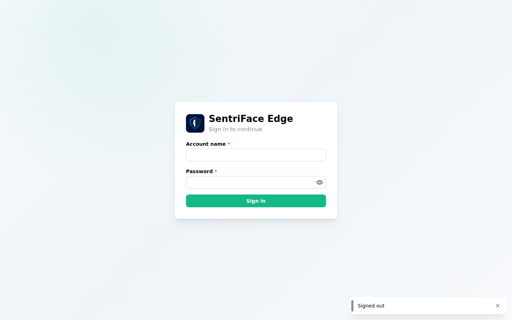](../screenshots/UX-01/UX-01_J47_Step-05_Signed-out.png)

Capture: CAP-0770 · UX-01 · Signed out · light · 1440×900 CSS · DPR 1 · `2026-11-22T18:26:32.144354+00:00` · synthetic.

## Step 06 — Viewer first sign in

[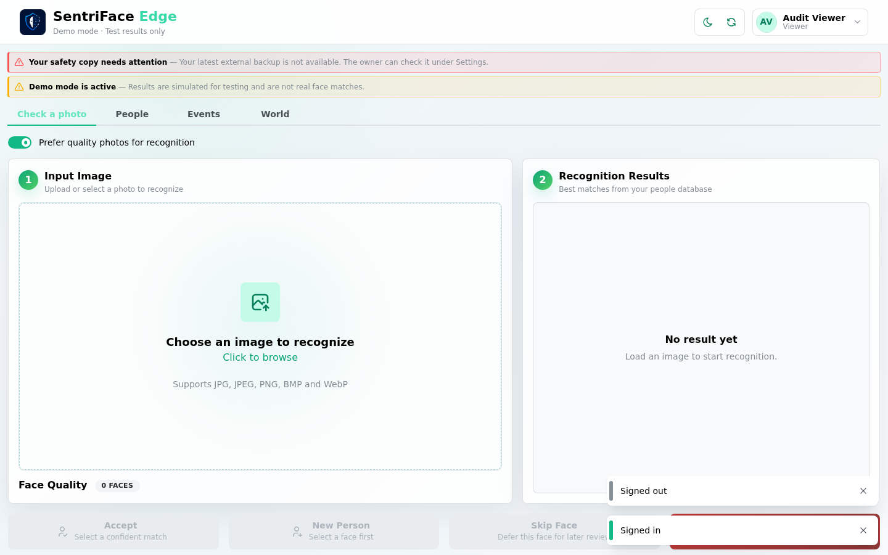](../screenshots/UX-01/UX-01_J47_Step-06_Viewer-first-sign-in.png)

Capture: CAP-0771 · UX-01 · Viewer · light · 1440×900 CSS · DPR 1 · `2026-11-22T18:26:34.925711+00:00` · synthetic.

## Step 07 — Viewer account menu

[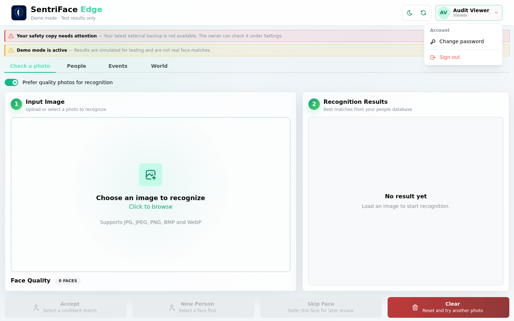](../screenshots/UX-01/UX-01_J47_Step-07_Viewer-account-menu.png)

Capture: CAP-0772 · UX-01 · Viewer · light · 1440×900 CSS · DPR 1 · `2026-11-22T18:27:13.994209+00:00` · synthetic.

## Step 08 — Viewer people

[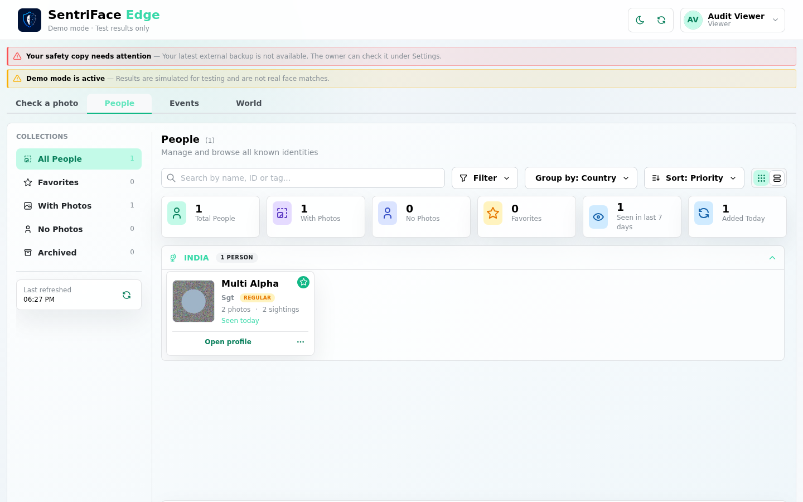](../screenshots/UX-05/UX-05_J47_Step-08_Viewer-people.png)

Capture: CAP-0773 · UX-05 · Viewer · light · 1440×900 CSS · DPR 1 · `2026-11-22T18:27:16.009290+00:00` · synthetic.

## Step 09 — Viewer profile

[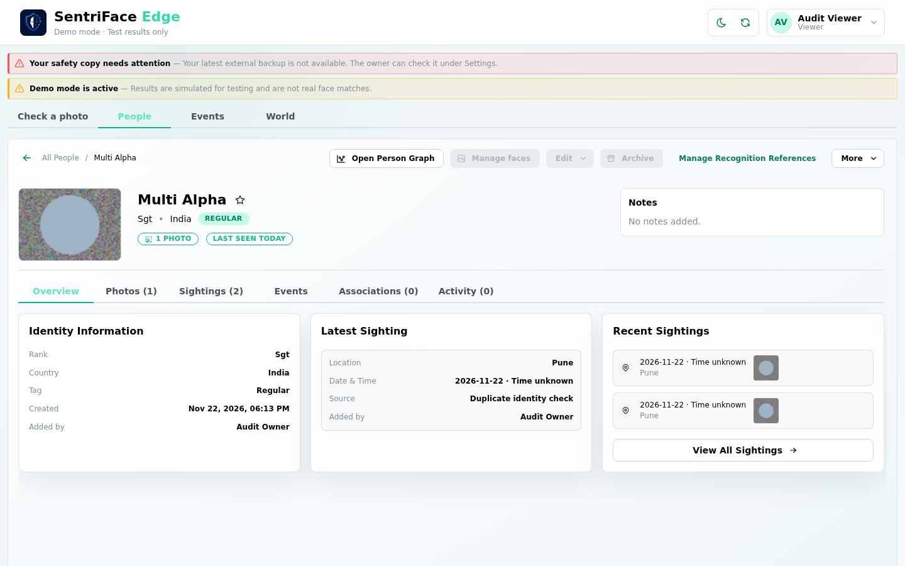](../screenshots/UX-06/UX-06_J47_Step-09_Viewer-profile.png)

Capture: CAP-0774 · UX-06 · Viewer · light · 1440×900 CSS · DPR 1 · `2026-11-22T18:27:33.031692+00:00` · synthetic.

## Step 10 — Viewer add favorite attempt

[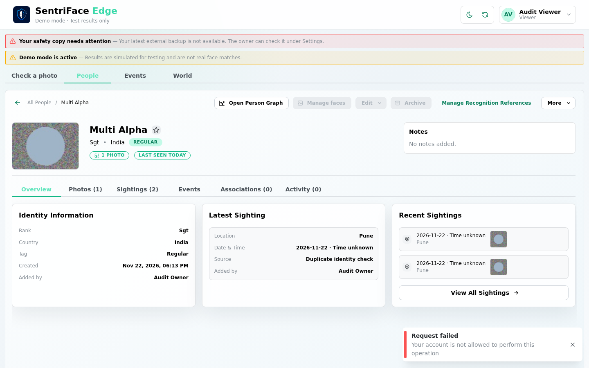](../screenshots/UX-06/UX-06_J47_Step-10_Viewer-add-favorite-attempt.png)

Capture: CAP-0775 · UX-06 · Viewer · light · 1440×900 CSS · DPR 1 · `2026-11-22T18:27:51.464118+00:00` · synthetic.

## Step 11 — Viewer more menu

[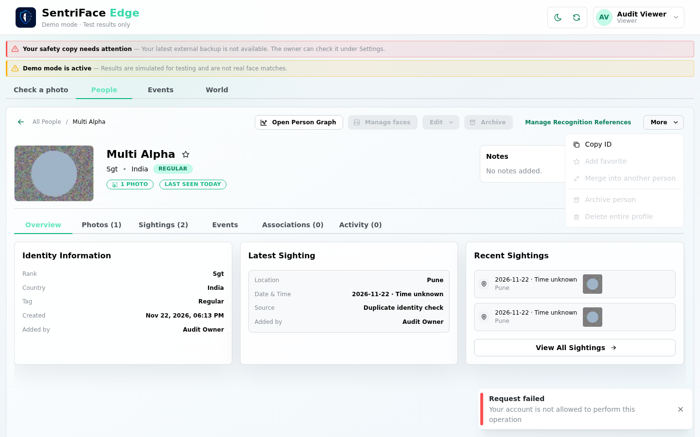](../screenshots/UX-06/UX-06_J47_Step-11_Viewer-more-menu.png)

Capture: CAP-0776 · UX-06 · Viewer · light · 1440×900 CSS · DPR 1 · `2026-11-22T18:27:52.556511+00:00` · synthetic.

## Step 12 — Viewer manage references

[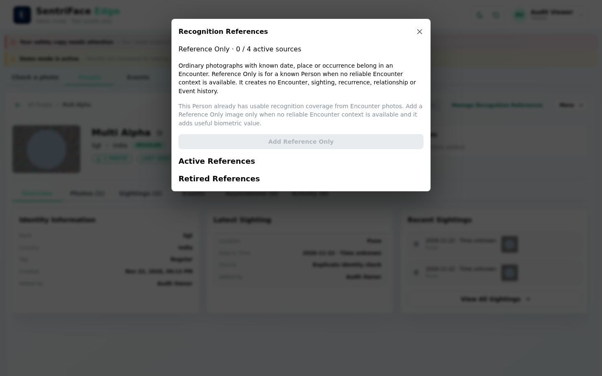](../screenshots/UX-06/UX-06_J47_Step-12_Viewer-manage-references.png)

Capture: CAP-0777 · UX-06 · Viewer · light · 1440×900 CSS · DPR 1 · `2026-11-22T18:27:54.672440+00:00` · synthetic.

## Step 13 — Operator landing

[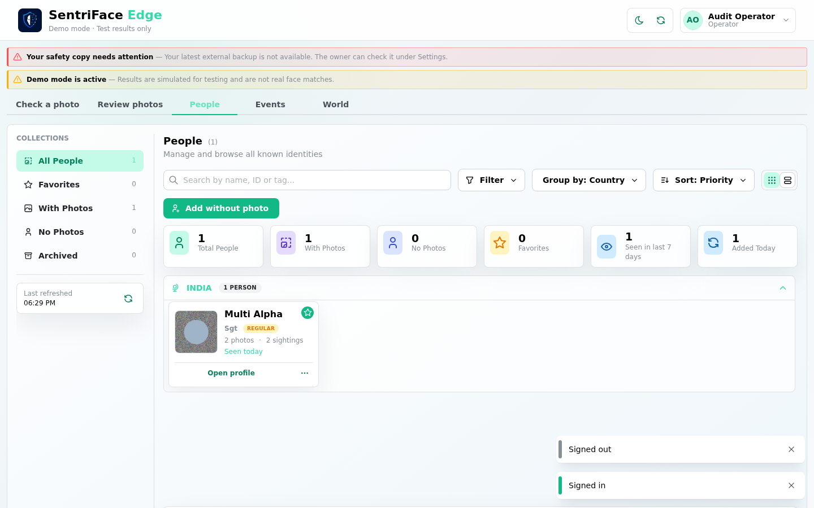](../screenshots/UX-01/UX-01_J47_Step-13_Operator-landing.png)

Capture: CAP-0778 · UX-01 · Operator · light · 1440×900 CSS · DPR 1 · `2026-11-22T18:29:05.970652+00:00` · synthetic.

## Step 14 — Operator profile

[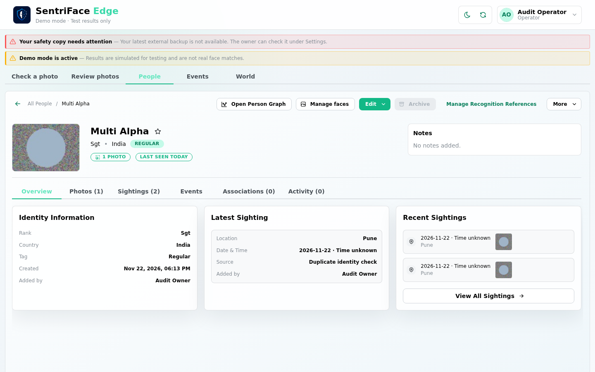](../screenshots/UX-06/UX-06_J47_Step-14_Operator-profile.png)

Capture: CAP-0779 · UX-06 · Operator · light · 1440×900 CSS · DPR 1 · `2026-11-22T18:29:27.023285+00:00` · synthetic.

## Step 15 — Operator events

[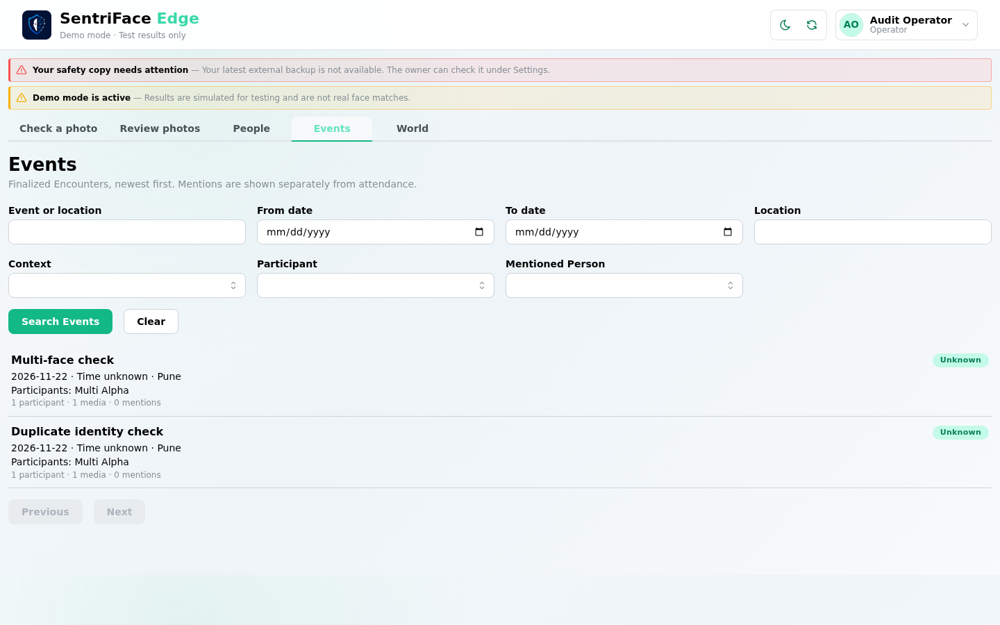](../screenshots/UX-09/UX-09_J47_Step-15_Operator-events.png)

Capture: CAP-0780 · UX-09 · Operator · light · 1440×900 CSS · DPR 1 · `2026-11-22T18:29:44.554992+00:00` · synthetic.

## Step 16 — Operator event detail

[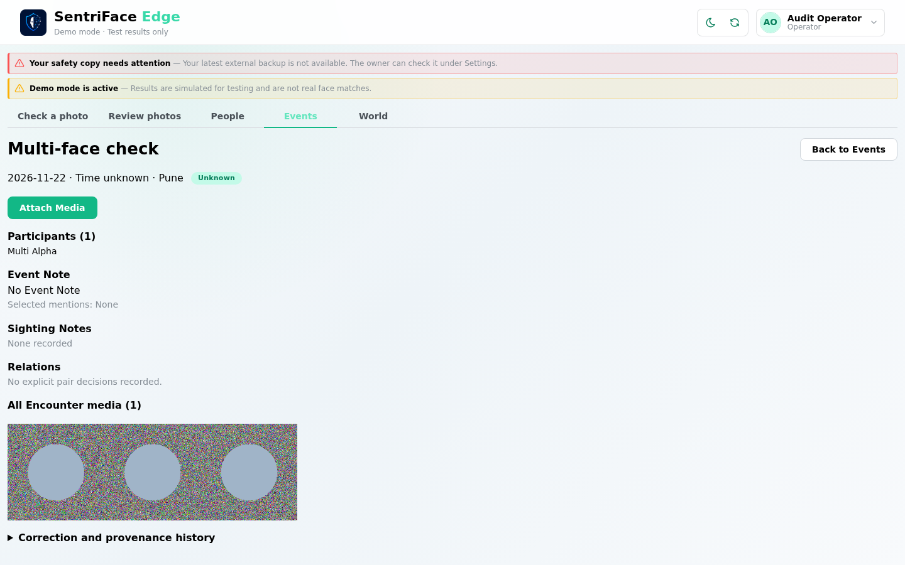](../screenshots/UX-09/UX-09_J47_Step-16_Operator-event-detail.png)

Capture: CAP-0781 · UX-09 · Operator · light · 1440×900 CSS · DPR 1 · `2026-11-22T18:30:00.896302+00:00` · synthetic.

## Step 17 — Custodian landing

[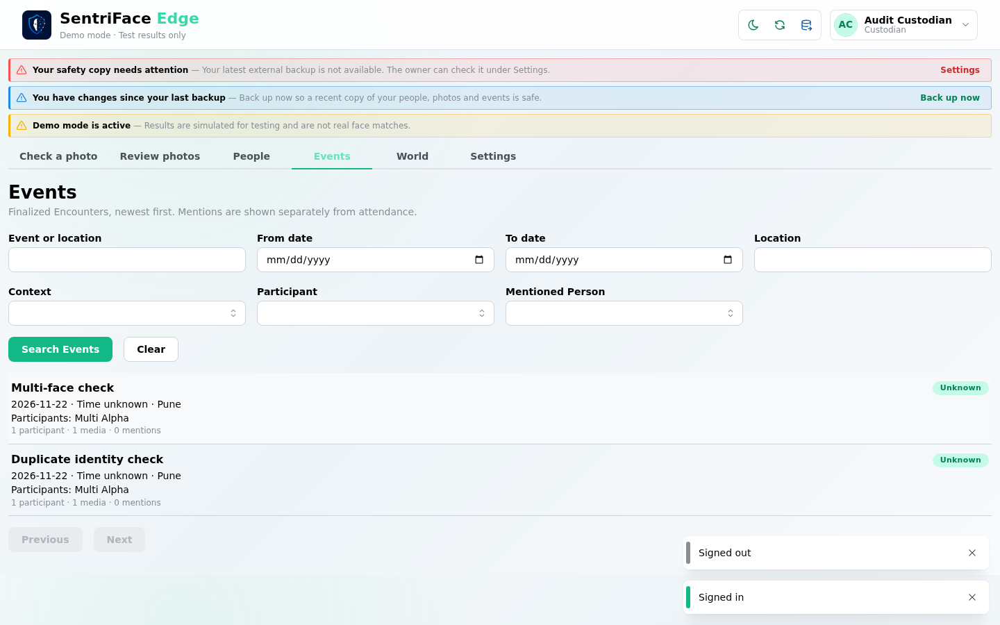](../screenshots/UX-01/UX-01_J47_Step-17_Custodian-landing.png)

Capture: CAP-0782 · UX-01 · Custodian · light · 1440×900 CSS · DPR 1 · `2026-11-22T18:30:22.053589+00:00` · synthetic.

## Step 18 — Technician home

[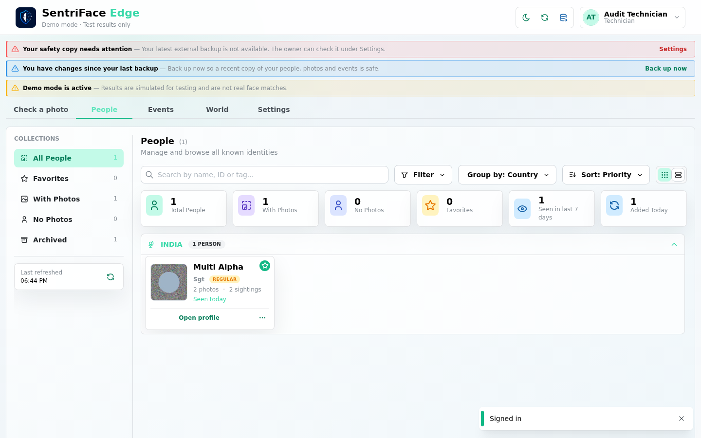](../screenshots/UX-01/UX-01_J47_Step-18_Technician-home.png)

Capture: CAP-0783 · UX-01 · Technician · light · 1440×900 CSS · DPR 1 · `2026-11-22T18:44:24.223523+00:00` · synthetic.

## Step 19 — Technician settings

[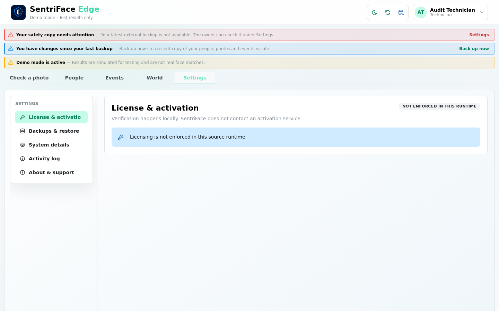](../screenshots/UX-13/UX-13_J47_Step-19_Technician-settings.png)

Capture: CAP-0784 · UX-13 · Technician · light · 1440×900 CSS · DPR 1 · `2026-11-22T18:44:41.608256+00:00` · synthetic.

## Step 20 — Technician back up now

[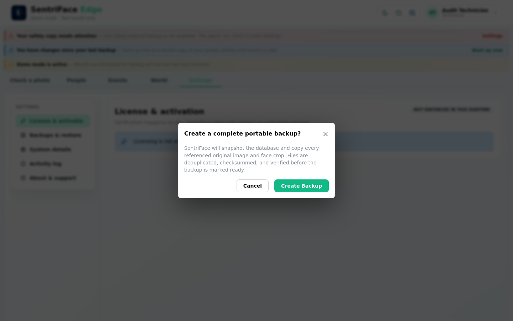](../screenshots/UX-13/UX-13_J47_Step-20_Technician-back-up-now.png)

Capture: CAP-0785 · UX-13 · Technician · light · 1440×900 CSS · DPR 1 · `2026-11-22T18:45:03.191446+00:00` · synthetic.

## Step 21 — Technician backups

[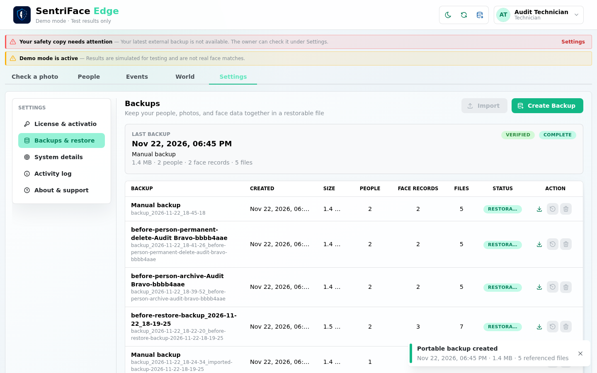](../screenshots/UX-13/UX-13_J47_Step-21_Technician-backups.png)

Capture: CAP-0786 · UX-13 · Technician · light · 1440×900 CSS · DPR 1 · `2026-11-22T18:45:25.390074+00:00` · synthetic.

## Step 22 — Technician activity log

[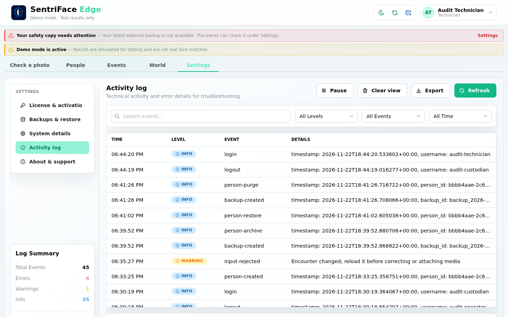](../screenshots/UX-13/UX-13_J47_Step-22_Technician-activity-log.png)

Capture: CAP-0787 · UX-13 · Technician · light · 1440×900 CSS · DPR 1 · `2026-11-22T18:45:27.409190+00:00` · synthetic.

## Step 23 — Technician restore disabled hover

[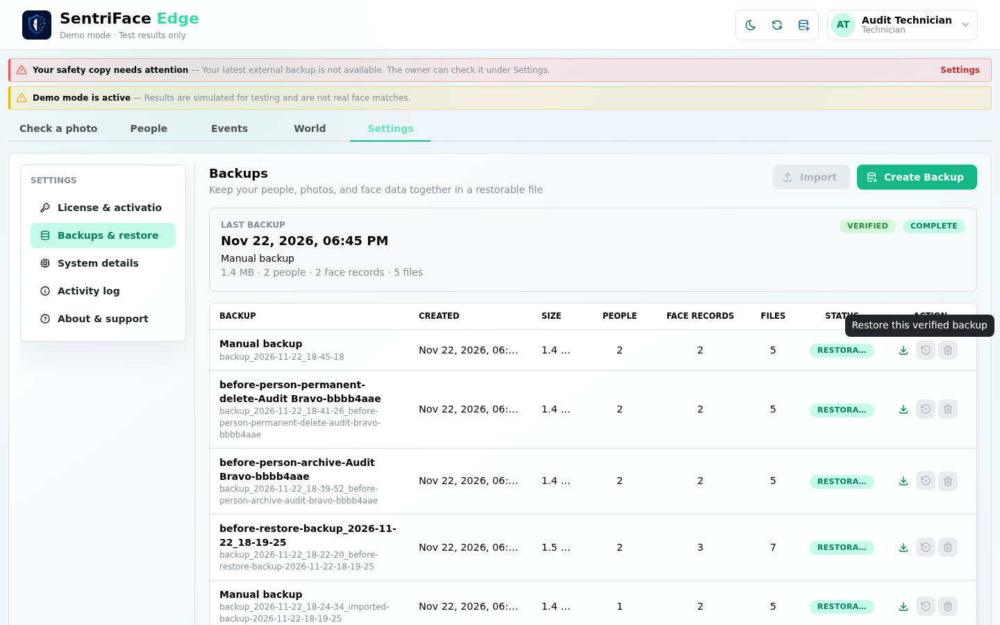](../screenshots/UX-13/UX-13_J47_Step-23_Technician-restore-disabled-hover.png)

Capture: CAP-0788 · UX-13 · Technician · light · 1440×900 CSS · DPR 1 · `2026-11-22T18:45:49.479272+00:00` · synthetic.
