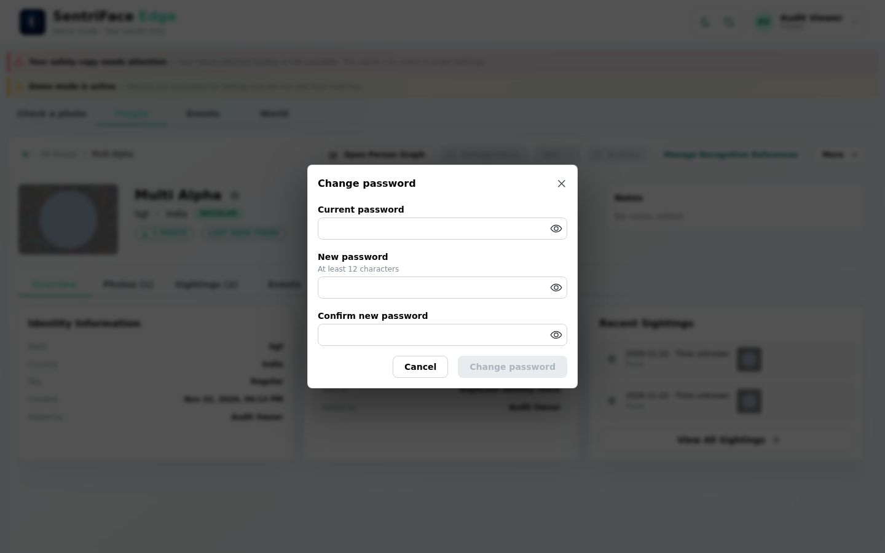
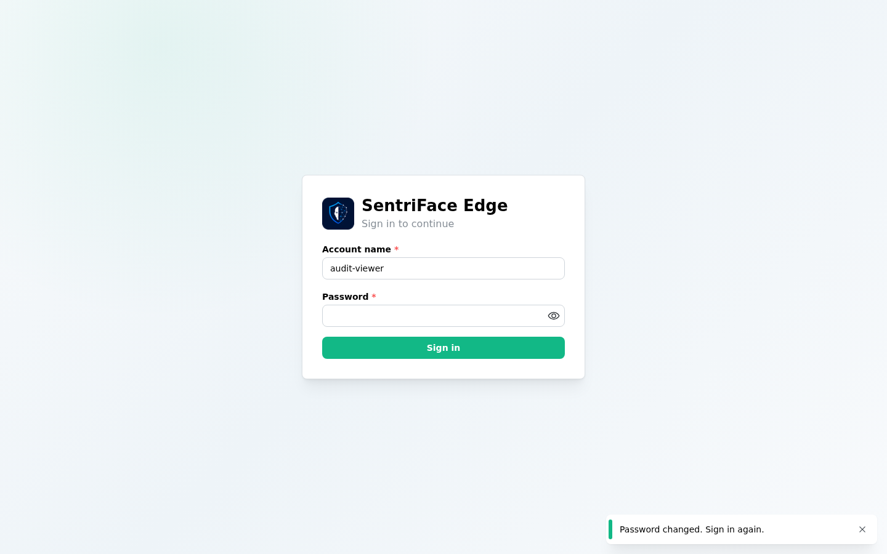
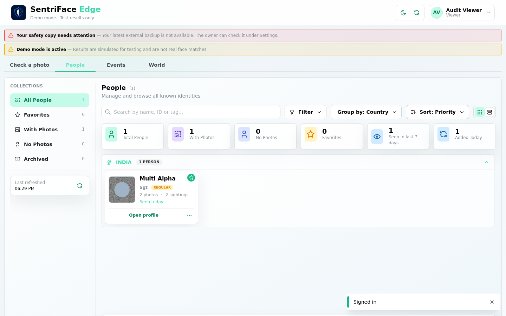

# J48 — Change password lifecycle (Viewer)

[Audit index](../INDEX.md) · [Findings](../findings.md) · [Independent review](../review.md)

**Pass 3 result: PASS.** Source `677bb61e8e9d659db95123871bb2e011cf663a79` (`v2-hardening-followups`), Linux headless Chromium, 1440×900, light theme, disposable synthetic source authority. Synthetic means generated non-biometric patterns, not ONNX inference.

**Starting state / role:** Viewer.

## Interaction sequence and outcomes

1. Open Change password (step 1). Short password disables Save with only static help; mismatch shows “Passwords do not match”; wrong current password keeps the modal open with toast “Request failed / Current password is incorrect” (steps 2–4, private).
2. Cancel and reopen: all three values retained (step 5, private).
3. Valid change → signed out, “Password changed. Sign in again.” (step 6).
4. Old password rejected inline; new password accepted (steps 7–8; step 7 private).

**Limits and findings:** Server rejects wrong current password and revokes sessions (PASS). Error shown as a generic toast instead of on the field; Cancel retains secrets (F39).

## Step 01 — Change password open

Capture: CAP-0789 · UX-01 · Viewer · light · 1440×900 CSS · DPR 1 · `2026-11-22T18:28:15.974332+00:00` · synthetic.

## Step 02 — New password too short

*Private original only.* Withheld: credential-bearing form with a filled password/passphrase field.

Capture: CAP-0790 · UX-01 · Viewer · light · 1440×900 CSS · DPR 1 · `2026-11-22T18:28:16.725802+00:00` · synthetic.

## Step 03 — Confirmation mismatch

*Private original only.* Withheld: credential-bearing form with a filled password/passphrase field.

Capture: CAP-0791 · UX-01 · Viewer · light · 1440×900 CSS · DPR 1 · `2026-11-22T18:28:17.412808+00:00` · synthetic.

## Step 04 — Wrong current password

*Private original only.* Withheld: credential-bearing form with a filled password/passphrase field.

Capture: CAP-0792 · UX-01 · Viewer · light · 1440×900 CSS · DPR 1 · `2026-11-22T18:28:19.810107+00:00` · synthetic.

## Step 05 — Reopen after cancel

*Private original only.* Withheld: credential-bearing form with a filled password/passphrase field.

Capture: CAP-0793 · UX-01 · Viewer · light · 1440×900 CSS · DPR 1 · `2026-11-22T18:28:38.874765+00:00` · synthetic.

## Step 06 — Password changed

Capture: CAP-0794 · UX-01 · Viewer · light · 1440×900 CSS · DPR 1 · `2026-11-22T18:28:41.455428+00:00` · synthetic.

## Step 07 — Old password rejected

*Private original only.* Withheld: credential-bearing form with a filled password/passphrase field.

Capture: CAP-0795 · UX-01 · Viewer · light · 1440×900 CSS · DPR 1 · `2026-11-22T18:28:59.936599+00:00` · synthetic.

## Step 08 — New password accepted

Capture: CAP-0796 · UX-01 · Viewer · light · 1440×900 CSS · DPR 1 · `2026-11-22T18:29:02.467137+00:00` · synthetic.
