# J49 — Encounter corrections, placeholder Person and stale revision

[Audit index](../INDEX.md) · [Findings](../findings.md) · [Independent review](../review.md)

**Pass 3 result: PASS for authority; findings on feedback.** Source `677bb61e8e9d659db95123871bb2e011cf663a79` (`v2-hardening-followups`), Linux headless Chromium, 1440×900, light theme, disposable synthetic source authority. Synthetic means generated non-biometric patterns, not ONNX inference.

**Starting state / role:** Custodian; second browser tab for the conflict.

## Interaction sequence and outcomes

1. Event detail shows Correct Encounter, Correct Participants, Correct Relations (step 1).
2. Correct Encounter: Cancel discards; no-change Save closes silently but adds “Encounter interpretation reviewed”; a real rename updates heading and history with no toast (steps 2–4).
3. Browser reload on detail returns to the list (step 5).
4. Add without photo requires sighting fields; placeholder “Audit Bravo” created (steps 7–8, F35).
5. Correct Participants: add Audit Bravo; Save waits for an explicit INCLUDE/EXCLUDE relation; saved without feedback (steps 6, 10–12).
6. Tab B renames; tab A stale edit is refused inline plus toast; after Cancel and header Refresh the detail stays stale while the list shows the new name (steps 13–16).
7. People grouping collapses the new group; Person Graph shows the new relationship (steps 17–19).

**Limits and findings:** Expected-revision refusal and history are correct. F36, F08 extended. Remove/reassign participant and Correct Relations full lifecycle NOT RUN; Split/Merge belongs to #4.

## Step 01 — Custodian event detail

Capture: CAP-0797 · UX-09 · Custodian · light · 1440×900 CSS · DPR 1 · `2026-11-22T18:30:25.328116+00:00` · synthetic.

## Step 02 — Correct encounter open

[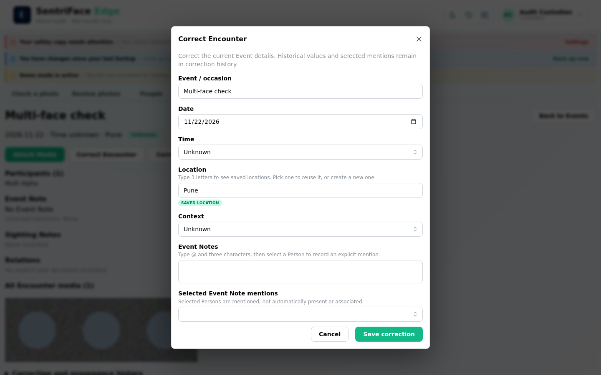](../screenshots/UX-10/UX-10_J49_Step-02_Correct-encounter-open.png)

Capture: CAP-0798 · UX-10 · Custodian · light · 1440×900 CSS · DPR 1 · `2026-11-22T18:30:44.196802+00:00` · synthetic.

## Step 03 — No change save

[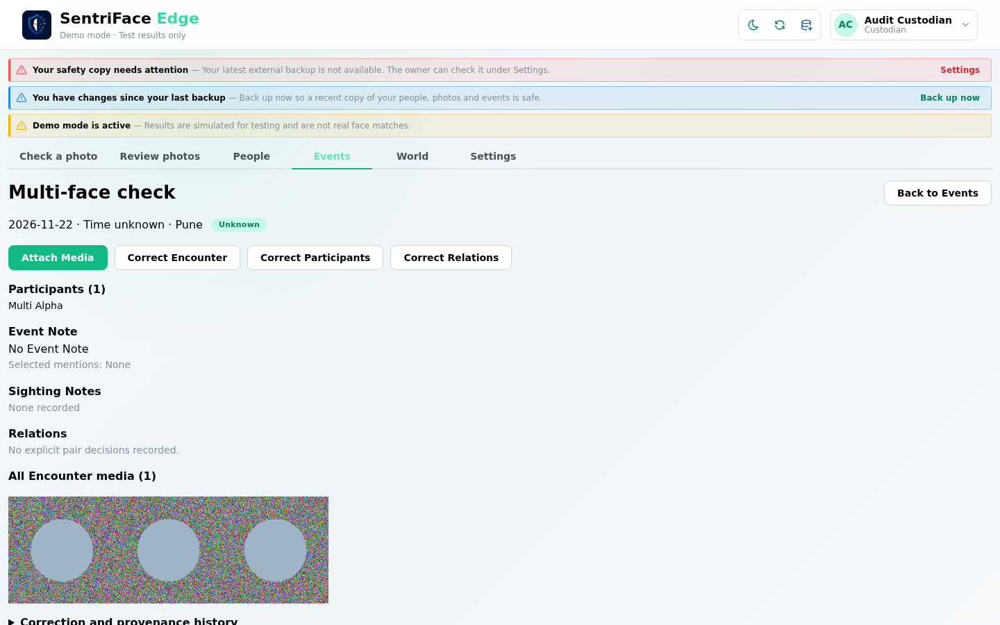](../screenshots/UX-10/UX-10_J49_Step-03_No-change-save.png)

Capture: CAP-0799 · UX-10 · Custodian · light · 1440×900 CSS · DPR 1 · `2026-11-22T18:31:06.128655+00:00` · synthetic.

## Step 04 — Correction saved history

[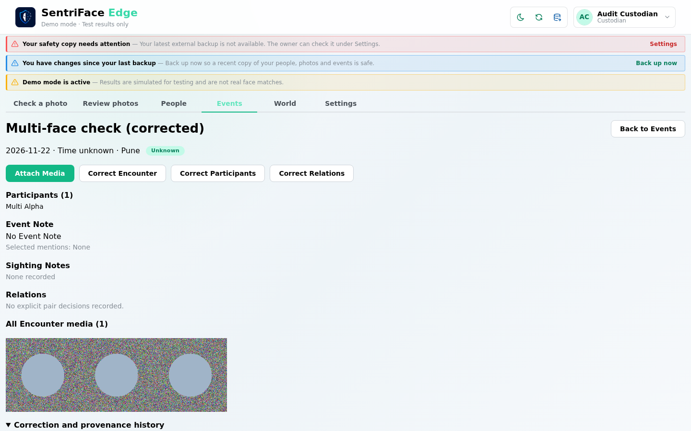](../screenshots/UX-10/UX-10_J49_Step-04_Correction-saved-history.png)

Capture: CAP-0800 · UX-10 · Custodian · light · 1440×900 CSS · DPR 1 · `2026-11-22T18:31:31.289377+00:00` · synthetic.

## Step 05 — After reload

[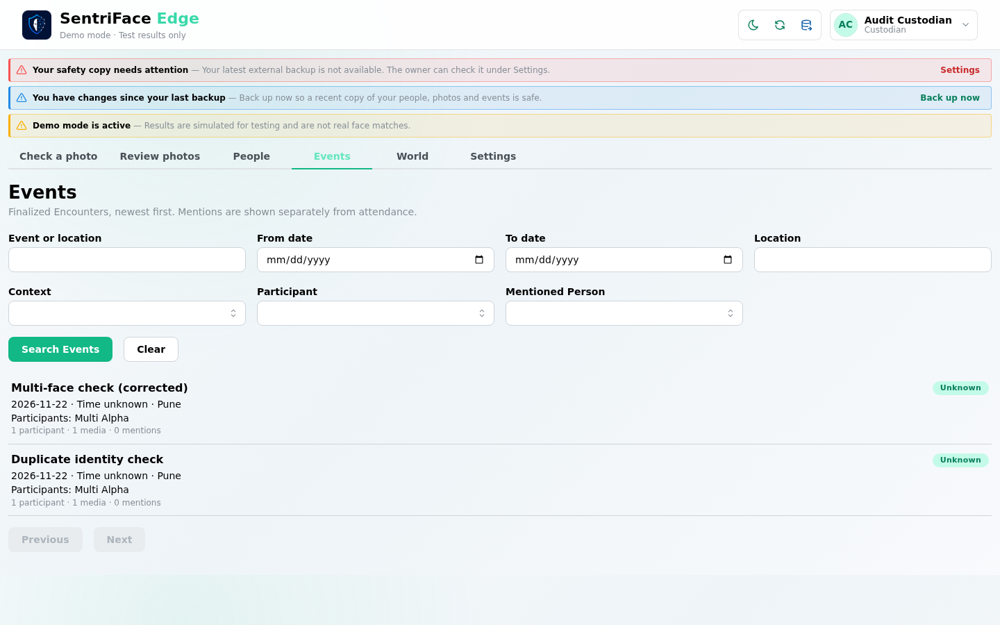](../screenshots/UX-10/UX-10_J49_Step-05_After-reload.png)

Capture: CAP-0801 · UX-10 · Custodian · light · 1440×900 CSS · DPR 1 · `2026-11-22T18:31:34.341699+00:00` · synthetic.

## Step 06 — Correct participants open

[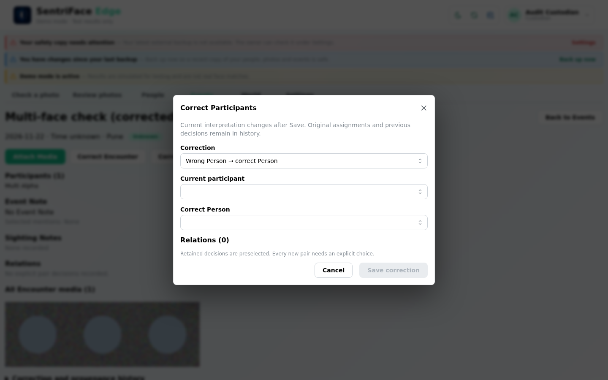](../screenshots/UX-10/UX-10_J49_Step-06_Correct-participants-open.png)

Capture: CAP-0802 · UX-10 · Custodian · light · 1440×900 CSS · DPR 1 · `2026-11-22T18:32:04.598962+00:00` · synthetic.

## Step 07 — Add without photo form

[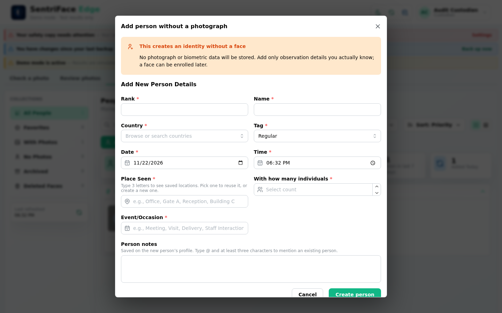](../screenshots/UX-05/UX-05_J49_Step-07_Add-without-photo-form.png)

Capture: CAP-0803 · UX-05 · Custodian · light · 1440×900 CSS · DPR 1 · `2026-11-22T18:33:01.771713+00:00` · synthetic.

## Step 08 — Placeholder created

[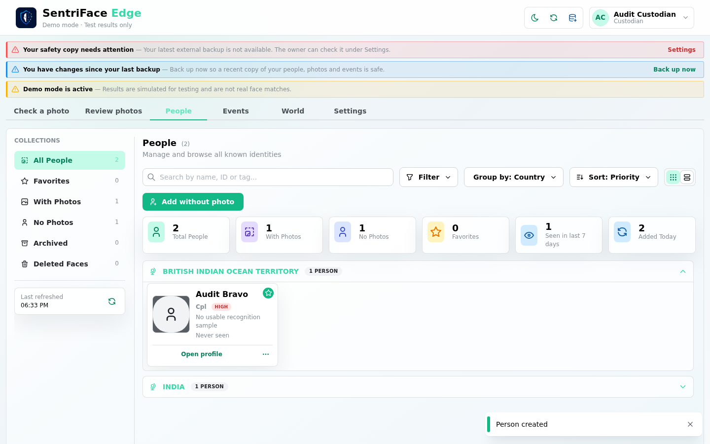](../screenshots/UX-05/UX-05_J49_Step-08_Placeholder-created.png)

Capture: CAP-0804 · UX-05 · Custodian · light · 1440×900 CSS · DPR 1 · `2026-11-22T18:33:27.863456+00:00` · synthetic.

## Step 09 — Events after placeholder

[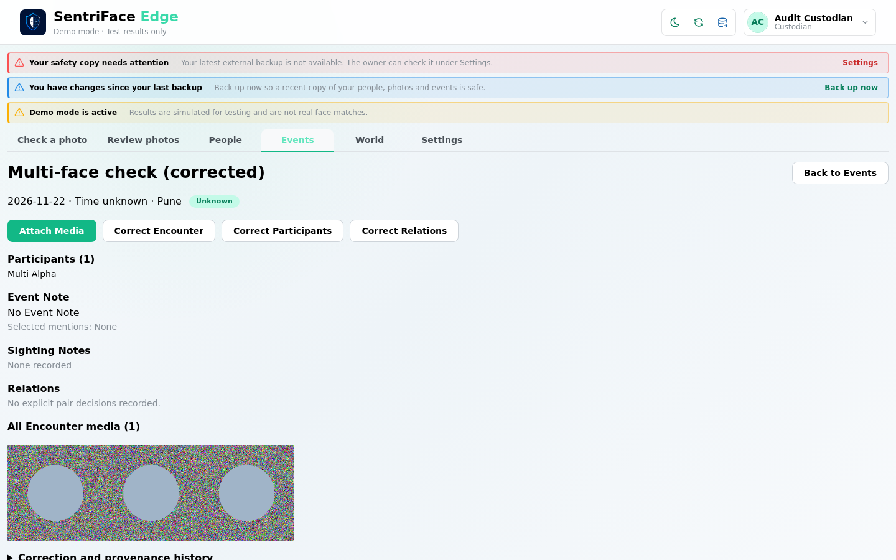](../screenshots/UX-09/UX-09_J49_Step-09_Events-after-placeholder.png)

Capture: CAP-0805 · UX-09 · Custodian · light · 1440×900 CSS · DPR 1 · `2026-11-22T18:34:04.963904+00:00` · synthetic.

## Step 10 — Add participant relation pending

[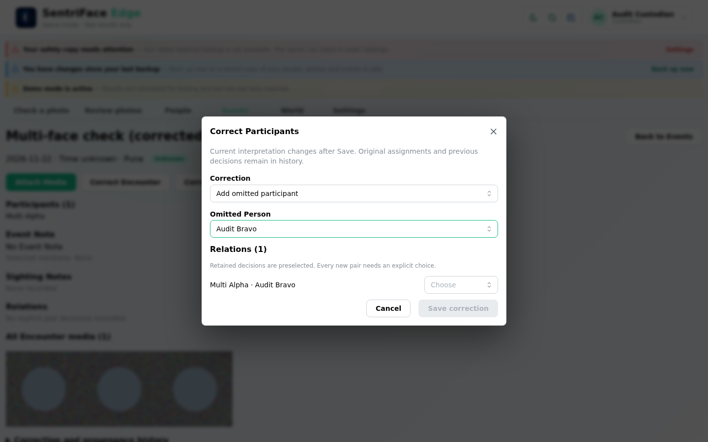](../screenshots/UX-10/UX-10_J49_Step-10_Add-participant-relation-pending.png)

Capture: CAP-0806 · UX-10 · Custodian · light · 1440×900 CSS · DPR 1 · `2026-11-22T18:34:26.139431+00:00` · synthetic.

## Step 11 — Add participant ready

[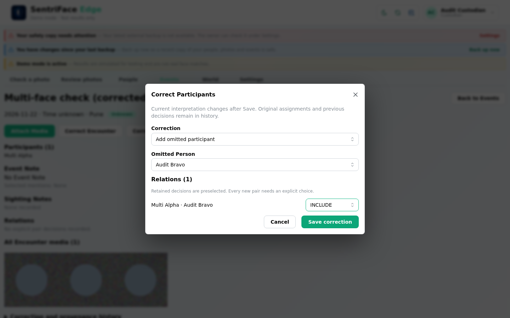](../screenshots/UX-10/UX-10_J49_Step-11_Add-participant-ready.png)

Capture: CAP-0807 · UX-10 · Custodian · light · 1440×900 CSS · DPR 1 · `2026-11-22T18:34:27.312515+00:00` · synthetic.

## Step 12 — Add participant saved

[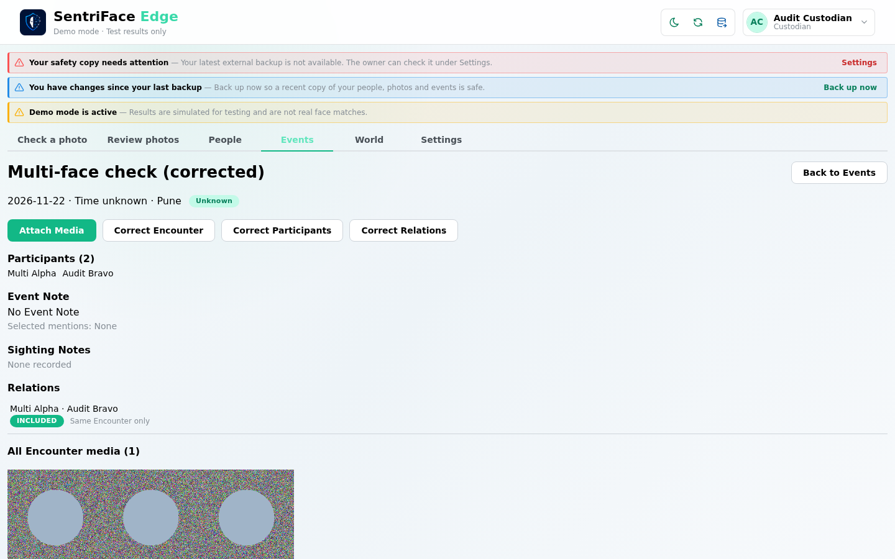](../screenshots/UX-10/UX-10_J49_Step-12_Add-participant-saved.png)

Capture: CAP-0808 · UX-10 · Custodian · light · 1440×900 CSS · DPR 1 · `2026-11-22T18:34:29.881847+00:00` · synthetic.

## Step 13 — Stale revision conflict

[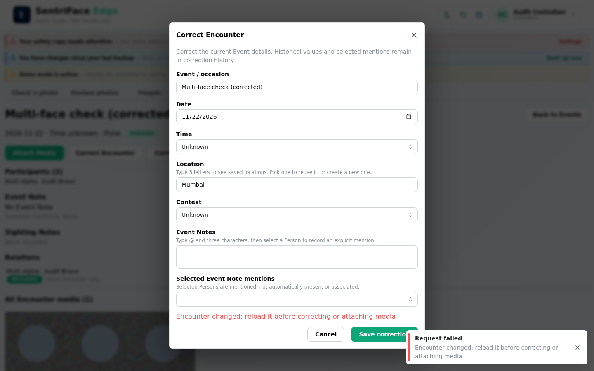](../screenshots/UX-10/UX-10_J49_Step-13_Stale-revision-conflict.png)

Capture: CAP-0809 · UX-10 · Custodian · light · 1440×900 CSS · DPR 1 · `2026-11-22T18:35:29.663971+00:00` · synthetic.

## Step 14 — Stale after cancel

[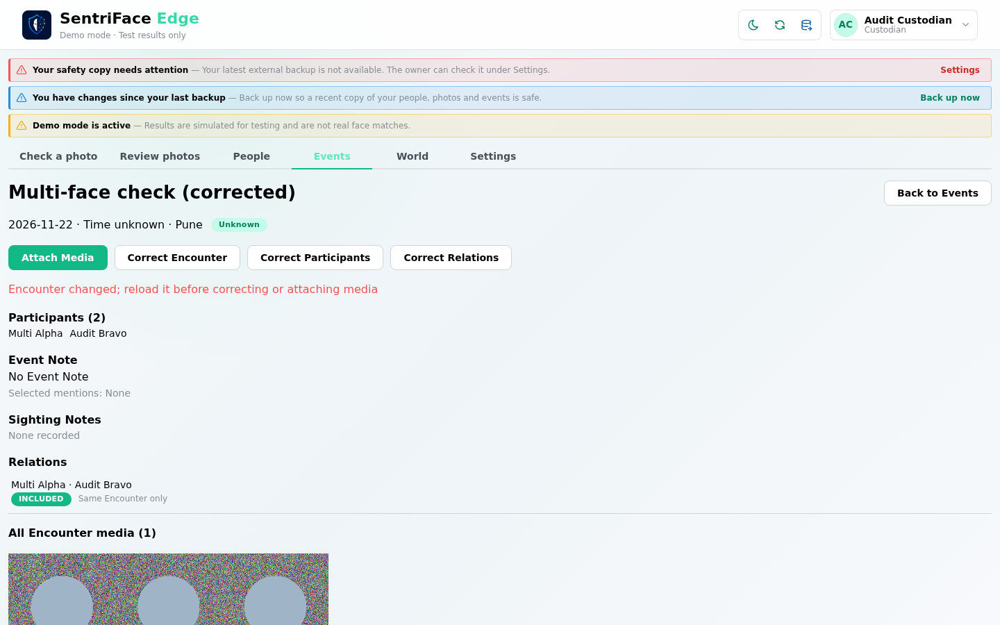](../screenshots/UX-10/UX-10_J49_Step-14_Stale-after-cancel.png)

Capture: CAP-0810 · UX-10 · Custodian · light · 1440×900 CSS · DPR 1 · `2026-11-22T18:35:49.830574+00:00` · synthetic.

## Step 15 — After header refresh

[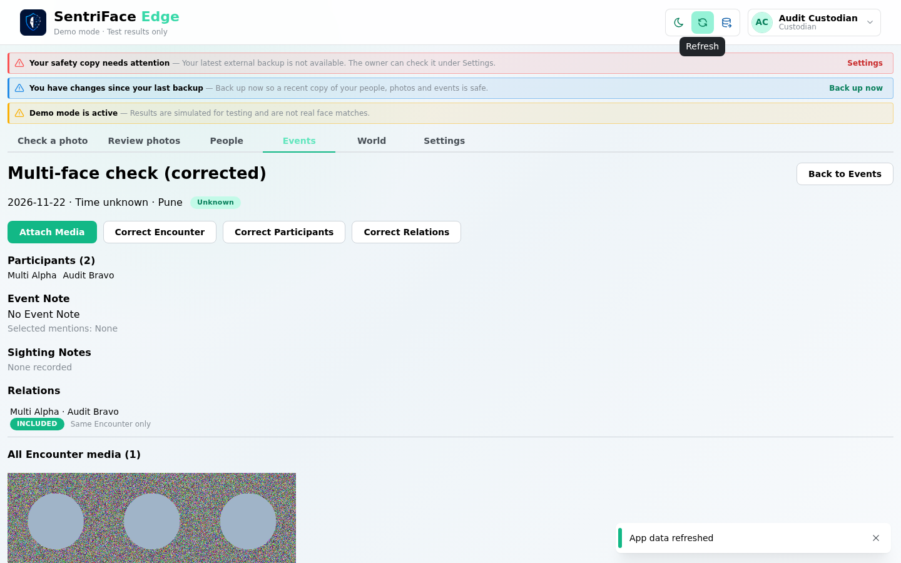](../screenshots/UX-10/UX-10_J49_Step-15_After-header-refresh.png)

Capture: CAP-0811 · UX-10 · Custodian · light · 1440×900 CSS · DPR 1 · `2026-11-22T18:36:11.474307+00:00` · synthetic.

## Step 16 — Events list after stale

[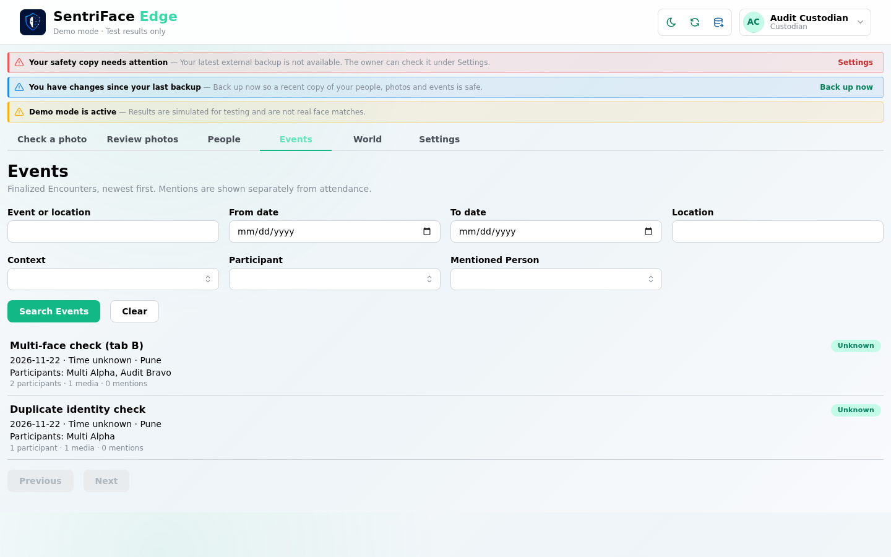](../screenshots/UX-09/UX-09_J49_Step-16_Events-list-after-stale.png)

Capture: CAP-0812 · UX-09 · Custodian · light · 1440×900 CSS · DPR 1 · `2026-11-22T18:36:38.078921+00:00` · synthetic.

## Step 17 — People two groups

[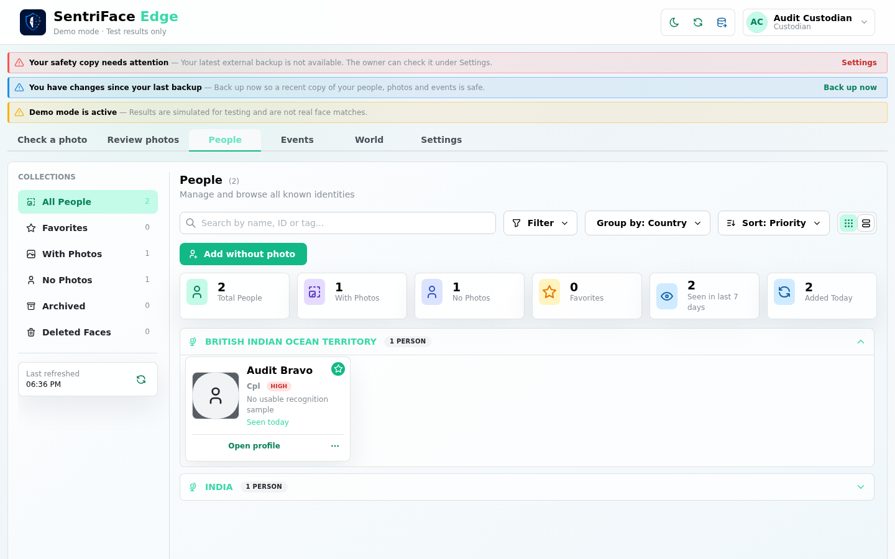](../screenshots/UX-05/UX-05_J49_Step-17_People-two-groups.png)

Capture: CAP-0813 · UX-05 · Custodian · light · 1440×900 CSS · DPR 1 · `2026-11-22T18:37:21.071140+00:00` · synthetic.

## Step 18 — People search multi

[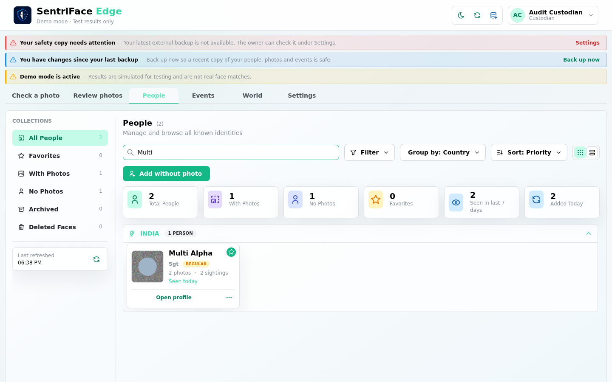](../screenshots/UX-05/UX-05_J49_Step-18_People-search-multi.png)

Capture: CAP-0814 · UX-05 · Custodian · light · 1440×900 CSS · DPR 1 · `2026-11-22T18:38:03.771579+00:00` · synthetic.

## Step 19 — Graph after add participant

[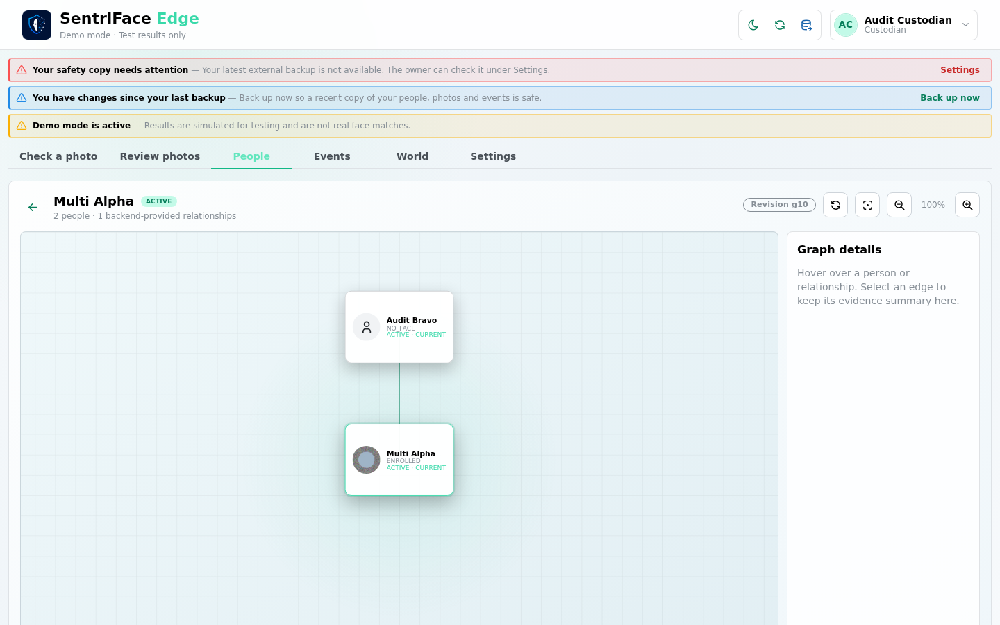](../screenshots/UX-06/UX-06_J49_Step-19_Graph-after-add-participant.png)

Capture: CAP-0815 · UX-06 · Custodian · light · 1440×900 CSS · DPR 1 · `2026-11-22T18:38:08.463588+00:00` · synthetic.
